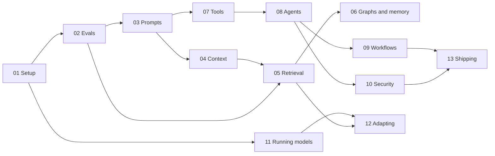

# The AI Engineering Stack: Overview and Appendices

*October 20, 2026. The front matter and appendices for the 13-part series (claude/engineering-stack-plan.md, Phase 5). This file adds no new research: every figure below is carried from the part, ledger or reference named beside it, with the tag it has there, so its source, date and scope can be checked in one step. Tags are the series' own: [V] verified against a source, [T] tested, [R] a reader test, [U] unverified, [I] invented for teaching (Part 01, "How to read this series"). Still open: the separate-session review of the whole series (claude/edition-protocol-v3.md, Sessions B and C) hasn't been run; Appendix L says what it should cover.*

**What this is.** The series turns an AI-written overview of AI engineering (ai-reports/gemini-ai-engineering-stack.md) into a checked, teachable reference. Each part explains a few topics in plain words, checks every claim, gives the free tools to use and a lab that runs on an ordinary computer with no account or API key. This overview is the map: what each part covers, which order to read them in, how the series fits with the project's two prompting references, and, in the appendices, the series' figures, tools, decision guides, corrections, open questions and skill ideas gathered in one place.

## Contents

1. The parts
2. Reading routes
3. How the series connects to the taxonomy and the guide
4. Appendix A: Glossary
5. Appendix B: Key figures with scope
6. Appendix C: Tool and download index
7. Appendix D: Decision guides
8. Appendix E: The learning path
9. Appendix F: Errata for the Gemini paper
10. Appendix G: The freshness ledger
11. Appendix H: What's still unverified
12. Appendix I: Skill opportunities
13. Appendix J: Corrections applied to project documents on October 20, 2026
14. Appendix K: Acceptance tests for this edition
15. Appendix L: The separate-session review

## 1. The parts

The plan sorts the series' 30 topics into seven **layers**, in the order a request meets them (Delivery, Control, Integration, Context, Model, Runtime, Compute), and five **concerns** that run through every layer (Evaluate, Secure, Govern, Observe, Economize) (claude/engineering-stack-plan.md, Section 5). Every part has the same twelve sections: plain words, definitions, how it works, "Gemini said, evidence says", examples, tools, setup, a lab, teaching material, limits, a skill opportunity and sources, followed by reader tests, the checks run on it, a cheat sheet and the lab listings.

| Part | Title | Topics | Layer or concern | File | Review record |
|---|---|---|---|---|---|
| 01 | Setup and Safe Practice | No topic of its own: Python, venv, pip with hashes, Git, Node.js, keys | Foundation | claude/engineering-stack-part-01-setup.md | claude/engineering-stack-part-01-review.md |
| 02 | Evals, Test Data and Judges | T01: evals, intervals, paired tests, model judges | Evaluate | claude/engineering-stack-part-02-evals.md | claude/engineering-stack-part-02-review.md |
| 03 | Prompts as Software Interfaces | Schemas and structured output, tool calls, prompt optimization | Integration, Control | claude/engineering-stack-part-03-prompts-as-interfaces.md | claude/engineering-stack-part-03-review.md |
| 04 | Context | T05 context budget and placement, T06 prompt caching | Context, Runtime | claude/engineering-stack-part-04-context.md | claude/engineering-stack-part-04-review.md |
| 05 | Retrieval | Keyword, dense and hybrid search, reranking, chunking, metrics, stores | Context | claude/engineering-stack-part-05-retrieval.md | claude/engineering-stack-part-05-review.md |
| 06 | Graphs and Memory | Knowledge graphs, GraphRAG, agent memory | Context | claude/engineering-stack-part-06-graphs-and-memory.md | claude/engineering-stack-part-06-review.md |
| 07 | Tools and Protocols | Tool calling, MCP, A2A, Agent Skills | Integration | claude/engineering-stack-part-07-tools-and-protocols.md | claude/engineering-stack-part-07-review.md |
| 08 | Agents | The agent loop, sandboxes, computer use, agent benchmarks | Control | claude/engineering-stack-part-08-agents.md | claude/engineering-stack-part-08-review.md |
| 09 | Workflows and Several Agents | Durable workflows, retries, approvals, multi-agent systems | Control | claude/engineering-stack-part-09-workflows-and-multi-agent.md | claude/engineering-stack-part-09-review.md |
| 10 | Security, Privacy and Licences | Prompt injection, guardrails, redaction, regulation, licences | Secure, Govern | claude/engineering-stack-part-10-security.md | claude/engineering-stack-part-10-review.md |
| 11 | Running Models | T23 serving engines, T24 local models and quantization, T25 hardware | Runtime, Compute | claude/engineering-stack-part-11-running-models.md | claude/engineering-stack-part-11-review.md |
| 12 | Adapting Models | T26 choosing a model, T27 fine-tuning | Model | claude/engineering-stack-part-12-adapting-models.md | claude/engineering-stack-part-12-review.md |
| 13 | Shipping and Operating | T28 APIs and streaming, T29 observability, T30 cost and latency | Delivery, Observe, Economize | claude/engineering-stack-part-13-shipping.md | claude/engineering-stack-part-13-review.md |

**The supporting files.**

| File | What it holds |
|---|---|
| claude/engineering-stack-plan.md | Scope, the layers and concerns, the learning map, the rules every part follows |
| claude/engineering-stack-claim-ledger.md | The claim-by-claim audit of the Gemini report; verdict totals in Section 8; Phase 5 corrections in Section 12 |
| claude/engineering-stack-freshness-ledger.md | Versions, prices and dates as read, with the date and the part that relies on each |
| claude/engineering-stack-glossary.md | Every defined term, plain words first (313 terms) |
| claude/engineering-stack-progress.md | Status, decisions and the full list of unverified items |
| claude/engineering-stack-windows-run-2026-10-12.md, -2026-10-19.md, -2026-10-20.md | What ran on a Windows 11 PC, by script, and what it printed |
| claude/engineering-stack-prompt.md | The prompt that defines the series' phases |

**How each part was checked.** A lead session wrote the part and ran its lab on Python 3.13, 3.12 and 3.11. Then separate agents, on a different model and without seeing the part, re-checked its claims against the cited sources (the blind source check), and a fresh agent followed its steps literally as a beginner. The lead reproduced each finding before fixing it; the findings and fixes are in each part's review record. Every lab has a mutation check that breaks the code on purpose and expects the tests to fail, so a test that can't fail is caught (each part's Section 8). The labs ran on a Windows 11 PC by script on October 12, 19 and 20, 2026 (the Windows-run records). No hosted model was called anywhere, by the owner's rule of no paid keys.

## 2. Reading routes

**Learn from scratch** (about a working week, one part a day or two). Read 01 to 13 in order, run each lab, and do the exercises in each part's Section 9. The plan's prerequisite table (Appendix E) says what each part needs, so a part can be skipped if you know its prerequisites.

**Build something this week.** Parts 01, 02, 03, 05, 08 and 13: set up, write an eval before changing anything, make the model's output a checked schema, retrieve the right passages, wrap it in a capped agent loop, then stream it to people and trace it. Read Part 10's decision rules (its cheat sheet) before anything touches private data or takes actions (plan, Section 6).

**Local first** (for privacy, or no budget for APIs). Parts 01, 11, 02, 03, 05 and 10: set up, learn what fits on your computer and how fast it can go, evaluate, structure output, retrieve, and secure it. Part 11's fit check and Part 10's licence buckets decide which model you can use (plan, Section 6).

**Look up a tool.** Appendix C lists every tool the series names, with its licence, the version read, where to get it officially and what it needs. Then go to the part named in its row, Section 6, for the picks and when not to use it, and to the freshness ledger for newer versions.

**Look up a term.** claude/engineering-stack-glossary.md (Appendix A).

**Check a claim from the Gemini report.** Find its row in claude/engineering-stack-claim-ledger.md, then the part named in the row's "settled in" note; each part's Section 4 gives the evidence (Appendix F).

**Decide something.** Appendix D: prompt, retrieve or fine-tune; one agent or several; local or cloud.

## 3. How the series connects to the taxonomy and the guide

The project has two prompting references: *The Taxonomy of Prompt Engineering*, Third Edition (claude/taxonomy-of-prompt-engineering-3e.md, the taxonomy), which says what each technique is and what the evidence shows, and the *Prompt Construction Guide*, Second Edition (claude/prompt-construction-guide-2e.md, the guide), which says how to write a prompt step by step. The series covers what surrounds the prompt: the evals that judge it, the context it sits in, the retrieval that fills that context, the tools and agents that act on its output, the security around it, and the models, servers and hardware that run it. The parts link to the references instead of repeating them.

**Division of labour.**

| Question | Go to |
|---|---|
| Which prompting technique, and what is the evidence for it? | The taxonomy |
| How do I write or fix this prompt? | The guide; claude/task-type-index.md for a quick pick |
| Did my change make things better? | Part 02 |
| How do I get reliable structured output? | Part 03, then guide §18 |
| What goes in the context, in what order, and what does it cost? | Part 04; taxonomy §7.4, §8 and §11.6 for the prompting side |
| Which passages should the model see? | Part 05; taxonomy §11.1 for retrieval-augmented generation |
| Should this be an agent, and how do I stop it doing damage? | Parts 08 to 10 |
| Will it run on my computer, and which model? | Parts 11 and 12 |
| How do I put it in front of people and pay for it? | Part 13 |

**Where they meet.** These are the places where a part checked a claim in a reference. The resulting corrections were applied on October 20, 2026 (Appendix J); each reference now carries a dated post-edition note listing them (taxonomy §27.6; the guide's "Post-edition note" at its end).

| Reference and section | What the series found | Part |
|---|---|---|
| Taxonomy §4.1, induction heads | The wording now follows Yin and Steinhardt (ICML 2025) | Claim ledger §9, flag 1 |
| Taxonomy §4.1 and §7.4, position effects | The U-shaped curve is documented for 2023 models; for later models length degradation is the robust finding and position matters less, depending on the task | Part 04 §3.4 |
| Taxonomy §10.5 and guide §18, constrained decoding | Strict structured output can still fail: vendors document a refusal, a `max_tokens` cut-off and, at Anthropic, enum capitalization | Part 03 §10 |
| Taxonomy §11.1, GraphRAG | Microsoft's GraphRAG is "largely in maintenance mode" | Part 06 |
| Taxonomy §11.6, prompt caching | Newer read rates (0.05x and 0.025x on some Anthropic models; 0.05x on GPT-6.1 Sol) and OpenAI's 1.25x write charge from GPT-5.6 on | Part 04 §3.5 |
| Taxonomy §11.6, MCP | The protocol's move to the Agentic AI Foundation and its 2026-07-28 revision | Part 07 |
| Taxonomy §17.1, OWASP | The 2026 edition of the OWASP Top 10 for LLM applications | Part 10 |
| Taxonomy §17.3, spotlighting | Adaptive attacks beat it on most targets tested (Appendix B, row 17) | Part 10 |
| Prompt generator checklist and New Skills Appendix §1, low temperature | Claude's 5.x-era models reject any non-default temperature, so "low temperature" now reads "where the model accepts it" | Part 03 |
| New Skills Appendix idea 3 | Reshaped from injection-hardening to agent-permission-review | Part 10 §11 |

**What the parts did not find.** Parts 11 and 13 searched the references for speculative decoding, quantization, observability, tracing and streaming and found nothing to correct (their Sections 10).

**One rule they share.** The guide says to start with the simplest prompt and add structure only when a test shows it's needed (project instructions); Part 02 supplies that test, and every part's decision rules apply the same idea to its own layer: measure first, add machinery second.

## Appendix A: Glossary

claude/engineering-stack-glossary.md holds every term the parts define, 313 in all, each with its plain-words meaning first, the technical term, and the part that defines it. Each part's Section 2 has the same terms in context. Three terms used throughout this overview:

| Plain words | Term | Where defined |
|---|---|---|
| A repeatable test of an AI system | Eval | Part 02 §1 |
| A test that breaks code on purpose to prove the checks can fail | Mutation check | Part 02; each part's Section 8 |
| A step run by the reader because the test machine couldn't | Reader test, [R] | Part 01, "How to read this series" |

## Appendix B: Key figures with scope

Each figure as the cited part gives it, with what it was measured on. A figure from a vendor about its own product is the vendor's claim; the "Kind" column says which. "pp" means percentage points.

| # | Figure | Scope | Kind | Where |
|---|---|---|---|---|
| 1 | Accuracy 75.8% with the answer document first, 53.8% at the 10th position: a 22.0-point drop | Liu et al., "Lost in the Middle"; GPT-3.5-Turbo, 20 documents; 2023 models | Preprint [V][T] | Part 04 §3.4 |
| 2 | 11 of 13 models fell below half their short-context score at 32,000 tokens; GPT-4o from 99.3% to 69.7% | NoLiMa (ICML 2025), needles sharing few words with the question | Peer-reviewed [V] | Part 04 §3.4 |
| 3 | A 5-minute prompt cache pays after one read; a 1-hour cache after two | Anthropic's list prices, write 1.25x or 2x, read 0.1x; read October 13, 2026 | Arithmetic [T] on vendor prices [V] | Part 04 §3.6 |
| 4 | Caching cut cost 79 to 81% on GPT-5.2 and 28 to 41% on Gemini 2.5 Pro | Lumer et al., a deep-research agent with a 10,000-token system prompt, 40 sessions per condition; January 2026 models and prices | Preprint [V] | Part 04 §3.6 |
| 5 | Over 272,000 input tokens, the whole request is billed at 2x input and 1.5x output | OpenAI's GPT-6 models; read October 13 and 20, 2026 | Vendor price [V] | Part 04 §3.2; Part 13 |
| 6 | Dense retrieval (DPR) beat BM25 by 9 to 19 pp of top-20 accuracy | The question-answering sets DPR was trained for | Peer-reviewed [V] | Part 05 |
| 7 | Late interaction (ColBERTv2) led single-vector models by 0.9 to 9.3 points of MRR@10 | MS MARCO dev, ColBERTv2's Table 4 | Peer-reviewed [V] | Part 05 §4 |
| 8 | GPT-4 answered 56% correctly from retrieved chunks, 89% when given the right evidence | MultiHop-RAG, 2,556 news questions | [V] | Part 05 |
| 9 | Commercial legal research tools built on retrieval hallucinated about 17% (Lexis+ AI) to about 33% (Westlaw AI-Assisted Research) of the time | 202 legal research questions, 2024 | [V] | Part 05 |
| 10 | Average prompt per question about 900 tokens for vector RAG, about 39,000 for GraphRAG local search, about 331,000 for global search | One ICLR study, novels | [V][T] | Part 06 |
| 11 | A prompt search that scored 1.0 on 5 validation tickets fell to 0.417 on new tickets | The lab's toy optimizer and invented tickets | [T][I] | Part 03 §9 |
| 12 | Sending `temperature: 0` returns a 400 error | Claude's 5.x-era models; checked October 12, 2026 | Vendor docs [V] | Part 03 §9 |
| 13 | Reasoning errors were 47% of ReAct's failures, search-result errors 23% | HotpotQA, PaLM-540B, 200 sampled runs labelled by people | Peer-reviewed [V] | Part 08 |
| 14 | A multi-agent research system beat a single agent by 90.2%, using about 15 times the tokens of a chat (about 4 times for one agent) | Anthropic's own internal research evaluation; Claude Opus 4 leading Sonnet 4 subagents; June 2025 | Vendor report [V] | Part 09 |
| 15 | Users approve 93% of permission prompts | Claude Code; Anthropic's post doesn't say what data the figure comes from | Vendor report [V] | Part 09 |
| 16 | GPT-4 kept its verdict in 65.0% of swapped answer pairs, 77.5% with few-shot examples | Zheng et al. 2023, MT-bench | [V] | Part 02 |
| 17 | Adaptive attacks beat spotlighting 99% of the time on three of four target models, and 47% on GPT-5 Mini | Nasr et al., AgentDojo targets | Preprint [V] | Part 10; taxonomy §17.3 |
| 18 | Llama Guard 4: recall 69%, false-positive rate 11% | Meta's English in-house set, output filtering | Vendor card [V] | Part 10 |
| 19 | Prompt Guard 2 (86M): recall 97.5% at a 1% false-positive rate; 88.7% for the 22M model | Meta's private English jailbreak set | Vendor card [V] | Part 10 |
| 20 | Q4_K_M: 4.8944 bits per weight, 4.91 GB, +2.79% perplexity | Llama 3 8B, Wikitext-2, llama.cpp's own scoreboard, no importance matrix | [V][T] | Part 11 §3.3 |
| 21 | Speculative decoding: 3.55 times; but 1.4 to 1.8 times slower at high load in another test | NVIDIA: Llama 3.3 70B with a Llama 3.2 1B draft, one H200, batch size 1. vLLM team: Llama 3 70B, four H100s, 2024 | Vendor and engine-team measurements [V] | Part 11 §3.5 |
| 22 | Only 20.4% to 38.2% of KV memory held real token data before paging; paging gave 2 to 4 times the throughput | The vLLM paper (SOSP 2023), against the authors' own Orca reimplementations and FasterTransformer | Peer-reviewed [V] | Part 11 §3.4 |
| 23 | 3,958 TFLOPS at FP8 is with sparsity; dense is 1,979; bandwidth 3.35 TB/s | NVIDIA H100 SXM datasheet | Vendor spec [V][T] | Part 11 §3.9 |
| 24 | Two separate figures. A decode ceiling of 8.5 tokens per second for Llama 3 8B at Q4_K_M, worked out, not measured. And a measurement of a different, smaller model, qwen3:1.7b: 8.4 and 8.0 tokens per second, below its own ceilings of 30.6 and 15.7. The measurement doesn't test the 8.5 ceiling | Ceiling: a Core i5-9500T at 41.6 GB/s divided by the file size. Measured: the owner's test PC, October 19, 2026 | [T] | Part 11 §3.9 and reader tests |
| 25 | Retrieval beat fine-tuning on new facts by 19 to 37 pp | Ovadia et al., EMNLP 2024, questions about events after training | Peer-reviewed [V][T] | Part 12 |
| 26 | LoRA trains often under 1% of the weights | LoRA paper's method | Peer-reviewed [V] | Part 12 |
| 27 | Accuracy drops of up to 8% on newly written problems for some models | GSM1k against GSM8k (NeurIPS 2024, Datasets and Benchmarks Track) | Peer-reviewed [V] | Part 12 |
| 28 | Batch APIs cost 50% less and answer within 24 hours | Anthropic, OpenAI and Google; read October 20, 2026 | Vendor prices [V] | Part 13 |
| 29 | The mean of 94 one-second and six nine-second answers is 1.48 seconds, which describes none of them | Worked arithmetic | [T] | Part 13 §1 |
| 30 | Of 137 checkable claims in the Gemini report, 50 hold (36.5%), 55 are overstated (40.1%) and 32 are wrong (23.4%) | The claim ledger's verdicts after Phase 5 | Project audit [T] | Claim ledger §8 |

## Appendix C: Tool and download index

Every tool the parts recommend or compare, in one table. Versions are as read on the date of the part named, so check the freshness ledger or the tool's own page first. On October 26, 2026 the ledger's 40 PyPI packages were re-checked: a version marked "(Oct 26)" is the new one, with the rest of its row as the part read it, and the ledger's other packages in this table had not changed (`docs/records/freshness-recheck-2026-10-26.md`). "Where to get it" names only official sources: the project's own site, its official GitHub releases, or its official PyPI or npm package (Part 01, Section 3). "Needs" says what the tool asks of you beyond itself: an account, a key, a GPU, or telemetry you should turn off. Each part's Section 6 has the full row, with its sources.

**Setup and evals (Parts 01, 02)**

| Tool | Part | Licence | Version read | Where to get it | Needs |
|---|---|---|---|---|---|
| Python 3.13 | 01 | Python's licence | 3.13.16 | python.org (on Windows, the Python install manager) | Nothing |
| venv, pip | 01 | Python's licence | pip 26.2.1 | Comes with Python | Nothing |
| Git | 01 | GPL version 2.0 | Git for Windows 2.56.0(2) | git-scm.com | Nothing |
| Node.js LTS | 01 | MIT-style notice | 24.21.0 | nodejs.org | Nothing |
| Visual Studio Code | 01 | Microsoft product licence; source MIT | Not checked | code.visualstudio.com | Nothing |
| WinGet | 01 | Open source | Store-updated | Comes with Windows | Nothing |
| Docker Desktop | 01, 08 | Paid subscription for larger enterprises | See Part 08 | docs.docker.com | 8 GB of memory, virtualization on |
| pytest | 02 | MIT | 9.1.1 | PyPI `pytest` | Nothing |
| promptfoo | 02 | MIT | 0.124.1 | npm `promptfoo` | Telemetry on: `PROMPTFOO_DISABLE_TELEMETRY=1` |
| Inspect AI | 02 | MIT | 0.3.278 | PyPI `inspect-ai` | A model, or `mockllm/model` for tests |
| DeepEval | 02 | Apache-2.0 | 4.3.1 (Oct 26) | PyPI `deepeval` | Telemetry on: `DEEPEVAL_TELEMETRY_OPT_OUT=1`; judged metrics default to OpenAI |
| Ragas | 02, 05 | Apache-2.0 | 0.4.3 | PyPI `ragas` | A model for most metrics; telemetry on by default |
| lm-evaluation-harness | 02 | MIT | 0.4.13 | PyPI `lm-eval` | Depends on the model tested |

**Prompts and context (Parts 03, 04)**

| Tool | Part | Licence | Version read | Where to get it | Needs |
|---|---|---|---|---|---|
| Pydantic | 03 | MIT | 2.14.1 | PyPI `pydantic` | Nothing |
| jsonschema | 03 | MIT | 4.26.0 | PyPI `jsonschema` | Nothing |
| anthropic SDK | 03, 04 | Apache-2.0 (MIT up to 1.14.0) | 2.3.0 (Oct 26) | PyPI `anthropic` | An API key (paid use) |
| openai SDK | 03, 04 | Apache-2.0 | 3.37.0 (Oct 26) | PyPI `openai` | An API key (paid use) |
| DSPy | 03 | MIT | 3.4.1 (Oct 26) | PyPI `dspy` | A model: hosted (key) or local |
| Outlines | 03 | Apache-2.0 | 1.3.3 | PyPI `outlines` | A local model |
| tiktoken | 04 | MIT | 0.14.0 | PyPI `tiktoken` | Downloads its encoding file once |

**Retrieval, graphs and memory (Parts 05, 06)**

| Tool | Part | Licence | Version read | Where to get it | Needs |
|---|---|---|---|---|---|
| bm25s | 05 | MIT | 0.3.13 | PyPI `bm25s` | NumPy |
| rank-bm25 | 05 | Apache-2.0 | 0.2.2 (no release since February 2022) | PyPI `rank-bm25` | Nothing |
| sentence-transformers | 05 | Apache-2.0 | 6.2.0 (Oct 26) | PyPI `sentence-transformers` | PyTorch; downloads models from Hugging Face |
| faiss-cpu | 05 | MIT | 1.15.1 | PyPI `faiss-cpu` | Nothing |
| rerankers | 05 | Apache-2.0 | 0.10.0 | PyPI `rerankers` | A key only for hosted rerankers |
| FlashRank | 05 | Apache-2.0 | 0.2.10 (low activity) | PyPI `flashrank` | Nothing |
| ir-measures | 05 | Apache-2.0 | 0.4.3 | PyPI `ir-measures` | Nothing |
| ranx | 05 | MIT | 0.3.21 | PyPI `ranx` | Nothing |
| Chroma | 05 | Apache-2.0 | 1.5.9 | PyPI `chromadb` | Hybrid search in Chroma Cloud only |
| Qdrant | 05 | Apache-2.0 | v1.19.2 | GitHub releases, qdrant/qdrant | Telemetry on: `QDRANT__TELEMETRY_DISABLED=true` |
| Elasticsearch | 05 | AGPLv3, SSPL or Elastic License 2.0 | v9.5.5 | elastic.co | Its RRF retriever may need a paid tier [U] |
| OpenSearch | 05 | Apache-2.0 | 3.9.0 | GitHub, opensearch-project/OpenSearch | A server |
| Weaviate | 05 | BSD-3-Clause, except proprietary `wl/` code | v1.40.1 | GitHub releases, weaviate/weaviate | A server |
| Milvus | 05 | Apache-2.0 | v3.0.3 | GitHub releases, milvus-io/milvus | A server |
| pgvector | 05 | PostgreSQL licence | v0.8.7 | GitHub, pgvector/pgvector | PostgreSQL |
| Pinecone | 05 | Proprietary service | SDK 10.2.0 (Oct 26) | pinecone.io | An account; free Starter plan up to 2 GB |
| networkx | 06 | BSD-3-Clause | 3.7 (3.6.1 for Python 3.11) | PyPI `networkx` | Nothing |
| Microsoft GraphRAG | 06 | MIT | 3.3.0, maintenance mode | PyPI `graphrag` | A model API; defaults to OpenAI |
| Neo4j | 06 | Community GPLv3; Enterprise commercial | 2026.09.0 | neo4j.com | A Java server, or a free Aura account |
| neo4j-graphrag | 06 | Apache-2.0 | 1.22.0 | PyPI `neo4j-graphrag` | Neo4j and a model |
| Kuzu | 06 | MIT | 0.11.3, archived October 10, 2025 | PyPI `kuzu` | Don't start new work on it |
| FalkorDB | 06 | Server SSPL v1; client MIT | client 1.8.0 | PyPI `falkordb` | A server |
| Apache AGE | 06 | Apache-2.0 | Not recorded | GitHub, apache/age | PostgreSQL |
| Memgraph | 06 | BSL 1.1 (not open source; Apache-2.0 in 2030) | Not recorded | GitHub, memgraph/memgraph | A server |

**Tools, agents and workflows (Parts 07, 08, 09)**

| Tool | Part | Licence | Version read | Where to get it | Needs |
|---|---|---|---|---|---|
| `mcp` (Python SDK) | 07 | MIT | 2.3.0 | PyPI `mcp` | Nothing |
| `fastmcp` | 07 | Apache-2.0 | 4.1.0 | PyPI `fastmcp` | Nothing |
| `@modelcontextprotocol/server`, `/client` | 07 | Apache-2.0 | 2.3.1 | npm | Node 20 or later |
| `@modelcontextprotocol/sdk` (version 1) | 07 | MIT | 1.32.1, fixes only | npm | Node 18 or later |
| MCP Inspector | 07 | Moving from MIT to Apache-2.0 | 2.11.0 | npm `@modelcontextprotocol/inspector` | Node 22.19.0 or later |
| `a2a-sdk` | 07 | Apache-2.0 | 1.2.2 | PyPI `a2a-sdk` | Nothing |
| `skills-ref` | 07 | Apache-2.0 | In the agentskills repository | GitHub, agentskills | Nothing |
| OpenAI Agents SDK | 08, 09 | MIT | 0.24.0 (Part 09; still the newest on Oct 26); Part 08's lab pins 0.23.1 | PyPI `openai-agents` | An OpenAI key for real models |
| Claude Agent SDK | 08, 09 | MIT | 0.2.167 | PyPI `claude-agent-sdk` | An Anthropic key |
| Docker Engine | 08 | Apache-2.0 | 29.9.1 | docs.docker.com | Linux |
| gVisor (`runsc`) | 08 | Apache-2.0 | release-20261005.0 | GitHub releases, google/gvisor | Linux |
| Firecracker | 08 | Apache-2.0 | v1.17.0 | GitHub releases, firecracker-microvm/firecracker | Linux with KVM |
| E2B | 08 | SDK MIT | e2b 2.56.0 | PyPI `e2b` | An API key; free plan with a one-time credit |
| Playwright | 08 | Apache-2.0 | 1.64.0 | PyPI `playwright` | Nothing |
| LangGraph | 09 | MIT | 1.2.17 (Oct 26) | PyPI `langgraph` | Nothing; LangSmith tracing is separate |
| `langgraph-checkpoint-sqlite` | 09 | MIT | 3.1.2 | PyPI | "For development" |
| Temporal | 09 | MIT | SDK 1.34.0 | PyPI `temporalio` | A Temporal server, or Temporal Cloud (paid) |
| DBOS | 09 | MIT | 3.2.0 | PyPI `dbos` | Postgres |
| Restate, Inngest | 09 | Business Source License 1.1; SSPL (Inngest server) | See their sites | Their own sites | Self-hosted or their clouds |
| Prefect, Airflow | 09 | Apache-2.0 | 3.8.8; 3.3.2 | PyPI `prefect`, `apache-airflow` | Nothing |
| Celery | 09 | BSD-3-Clause | 5.6.3 | PyPI `celery` | A broker such as Redis or RabbitMQ |
| Microsoft Agent Framework | 09 | MIT | 1.23.0 (Oct 26) | PyPI `agent-framework` | A model provider's key |
| CrewAI | 09 | MIT | 1.15.30 (Oct 26) | PyPI `crewai` | A model key; telemetry on by default |

**Security, privacy and licences (Part 10)**

| Tool | Licence | Version read | Where to get it | Needs |
|---|---|---|---|---|
| Presidio | MIT | 2.2.365 (Oct 26, `presidio-analyzer`) | PyPI `presidio-analyzer`, `presidio-anonymizer` | spaCy's `en_core_web_lg` (382 MB) for names |
| NeMo Guardrails | Apache-2.0 | 0.24.1 | PyPI `nemoguardrails` | Telemetry on: `NEMO_GUARDRAILS_NO_USAGE_STATS=1` |
| garak | Apache-2.0 | 0.17.1 (Oct 26) | PyPI `garak` | PyTorch; a key only for hosted targets |
| Guardrails AI | Apache-2.0 | 0.11.0 | PyPI `guardrails-ai` | A hub token for remote inference |
| LlamaFirewall | MIT | 1.0.3, no release since May 29, 2025 | PyPI `llamafirewall` | A Together AI key for its alignment check's default |
| Llama Prompt Guard 2 | Llama 4 Community License | 2025 | Hugging Face, Meta | A Hugging Face account and licence acceptance |
| Llama Guard 4 | Llama 4 Community License | 2025 | Hugging Face, Meta | The same, and a GPU |
| AgentDojo | MIT | 0.1.35 | PyPI `agentdojo` | Keys for the models you test |
| LLM Guard | MIT | 0.3.16, archived July 8, 2026 | PyPI `llm-guard` | Don't start new work on it |

**Running and adapting models (Parts 11, 12)**

| Tool | Part | Licence | Version read | Where to get it | Needs |
|---|---|---|---|---|---|
| Ollama | 03, 04, 11 | MIT | v0.40.5 | ollama.com/download | Calls ollama.com unless `OLLAMA_NO_CLOUD=1`; its apps check for updates hourly regardless |
| llama.cpp | 03, 11 | MIT | b11691 | GitHub releases, ggml-org/llama.cpp; `winget install llama.cpp` | Nothing |
| LM Studio | 11 | Proprietary; personal and internal business use | Terms of August 23, 2026 | Its own site | AVX2 on x64 Windows |
| vLLM | 04, 11 | Apache-2.0 | 0.32.0 (Oct 26) | PyPI `vllm` | Linux and a GPU; usage statistics on: `VLLM_NO_USAGE_STATS=1` |
| SGLang | 04, 11 | Apache-2.0 | 0.5.22 | PyPI `sglang` | Linux, CUDA 13 |
| TensorRT-LLM | 11 | Apache-2.0 | 1.2.1 | NVIDIA's package index (PyPI holds a stub) | NVIDIA GPUs on Linux |
| MLX-LM | 11, 12 | MIT | 0.32.2 | PyPI `mlx-lm` | Apple silicon |
| llm-compressor, GPTQModel | 11 | Apache-2.0 | 0.14.0; 7.6.0 | PyPI `llmcompressor`, `gptqmodel` | GPUs |
| PyTorch | 12 | Apache-2.0 and bundled licences | 2.14.1 | PyPI `torch` | 124 MB on Windows, 555 MB on Linux |
| transformers | 12 | Apache-2.0 | 5.20.2 | PyPI `transformers` | Gated models need a Hugging Face account |
| PEFT | 12 | Apache-2.0 | 0.21.2 | PyPI `peft` | Nothing |
| TRL | 12 | Apache-2.0 | 1.16.0 | PyPI `trl` | Telemetry on: `HF_HUB_DISABLE_TELEMETRY=1` |
| Unsloth | 12 | Apache-2.0 with AGPL-3.0 files | 2026.10.7 | PyPI `unsloth` | A GPU or Apple silicon; statistics on by default |
| Axolotl | 12 | Apache-2.0 | 0.21.0 | PyPI `axolotl` | An NVIDIA or AMD GPU; telemetry on by default |
| LLaMA-Factory | 12 | Apache-2.0 | 0.9.5 | GitHub, hiyouga/LLaMA-Factory | Its web UI reports usage |

**Shipping and operating (Part 13)**

| Tool | Licence | Version read | Where to get it | Needs |
|---|---|---|---|---|
| FastAPI | MIT | 0.162.0 (Oct 26) | PyPI `fastapi` | Nothing; it declares `starlette>=0.46.0` (Starlette 1.9.0 needs Python 3.11 or later) |
| uvicorn | BSD-3-Clause | 0.54.0 | PyPI `uvicorn` | Nothing |
| sse-starlette | BSD-3-Clause | 3.6.0 (Oct 26) | PyPI `sse-starlette` | Nothing |
| OpenTelemetry Python SDK | Apache-2.0 | 1.45.1 | PyPI (Part 13, Section 6) | Nothing |
| OpenTelemetry GenAI instrumentations | Apache-2.0 | openai-v2 2.4b0; genai-anthropic 1.2b0 | PyPI | Content capture off by default; keep it off |
| OpenTelemetry Collector | Apache-2.0 | Not read [U] | Not read [U] | A separate program |
| Langfuse | MIT core, commercial `ee/` | SDK 5.0.3 | PyPI `langfuse`; Docker for self-hosting | An account if hosted |
| Arize Phoenix | Elastic-2.0 | 20.26.1 (Oct 26) | PyPI `arize-phoenix` | Telemetry on by default (Part 02) |

**Every lab.** Each part's lab is a zip sent to the owner, not a project file (plan, Section 8). The core of every lab uses Python's standard library only, on Python 3.11 to 3.13. Optional extras pin exact versions; those of Parts 01 to 04 also pin file hashes (except Part 03's DSPy file), while the cross-checks of Parts 05 to 10 and 13 pin versions only [T: the labs' requirements files, October 26, 2026] (corrected October 26 from "optional cross-checks pin their packages with hashes"). Part 04's `placement_test.py` gained a separate timeout message, `--timeout` and `--no-think` on October 20, 2026; its new listing is in Part 04's appendix, and the replacement file was sent to the owner. Part 13's `stream_server.py` and `run_lab.py` were fixed on October 26, 2026, after the Windows run found check c20 failing (`docs/records/engineering-stack-windows-run-2026-10-26.md`).

## Appendix D: Decision guides

Each guide gathers the decision rules of the parts named, in the order to apply them. A step that rests on one study says so.

### D1. Prompt, retrieve or fine-tune?

1. **Build the eval first** (Part 02): a few dozen real cases, graded by code wherever there is one right answer, scored with an interval, and compared between versions with a paired test.
2. **Try prompting next**, and other models (Part 03; the guide). Make the output a schema and validate every reply. Change one thing at a time and re-run the eval.
3. **Missing or changing facts go in retrieval, not training.** In one peer-reviewed study, retrieval beat fine-tuning on facts the model hadn't seen by 19 to 37 pp (Appendix B, row 25; Part 12). Start with BM25, add dense search when questions use other words than the documents, and rerank (Part 05).
4. **If the whole corpus fits the window and is reused, send it and cache it** instead of retrieving (Part 05 rule 8; Part 04). Put it first, the question last, and nothing that changes above the cache breakpoint.
5. **Fine-tune for formats, labels and habits** that prompting can't hold steady (Part 12). Start with LoRA on all linear layers; check the data for format errors, duplicates and test leaks first.
6. **Check the base model's licence** before naming or sharing the result (Parts 10, 12), and check that the vendor still offers hosted fine-tuning: OpenAI closed it to new organizations on May 7, 2026 and to all new jobs from January 6, 2027; the Gemini API has had no tunable model since May 2025 (Part 12, read October 19, 2026).
7. **After any change, re-run the eval with a paired test and a safety test**; the base model's scores don't carry over (Part 12).

### D2. One agent or several?

1. **Use a workflow when the steps are known**; an agent only when they aren't (Part 08 rule 1).
2. **One agent with tools is the default** (project instructions, "Building a skill", rule 7). Cap its turns, tokens and money in code, handle every stop reason, and ask a person before anything that spends, sends or deletes (Part 08).
3. **Add agents only for wide, separable work, or for independent checking.** Anthropic's research system used about 15 times the tokens of a chat, against about 4 times for one agent, on its own evaluation (Appendix B, row 14). Before trusting a multi-agent gain, ask what was held equal (Part 09 rule 8).
4. **Give each agent only the context it needs**: pass a brief, get back a summary (Part 09).
5. **Assume every step can run twice** after a retry, a crash or a pause; make side effects idempotent (Part 09).
6. **Cap every loop**: iterations for a judge, steps for a graph, depth and count for subagents (Part 09).
7. **State the cost** of the extra agents before building them (project instructions).

### D3. Local or cloud?

1. **Check the fit**: weights plus the KV cache for your real context and batch, with memory to spare (Part 11). Llama 3 8B at Q4_K_M is 4.91 GB of weights (Appendix B, row 20).
2. **Check the speed limit**: for one user, bandwidth divided by bytes per token is a ceiling, never a prediction (Part 11). An office PC's ceiling for Llama 3 8B at Q4_K_M is 8.5 tokens per second (Appendix B, row 24).
3. **Look at the traffic**: light or bursty use with no GPU favours a hosted API, which bills per token, while your own GPU costs the same idle or busy (Parts 11, 13) [I].
4. **Look at the data**: local isn't offline. Ollama calls ollama.com unless told not to, and its apps check for updates hourly regardless; block the network if that's the requirement (Part 11). For health data in the US, a hosted vendor needs a business associate agreement before PHI reaches it (Part 10).
5. **Look at the licence**: "open weights" isn't a licence; Meta's newest open model, Muse Spark Open, has a custom, gated licence, while Muse Glimmer 30B is Apache-2.0 (Parts 10, 12).
6. **For many users on your own hardware**, use a maintained engine (vLLM or SGLang), turn off its telemetry, and measure time to first token and time per output token on your own traffic (Part 11).
7. **Hosted, price the whole request**: caching, batch discounts, long-context surcharges and data-residency rules, and size for peak load with Little's law (Part 13).

## Appendix E: The learning path

**Prerequisites** (plan, Section 6).

| Part | Needs | Why |
|---|---|---|
| 01 Setup | Nothing | Everything else uses it |
| 02 Evals | 01 | Later parts test their labs against an eval |
| 03 Prompts as interfaces | 01, 02 | Schemas and optimizers need a metric |
| 04 Context | 03 | Builds on how a prompt is assembled |
| 05 Retrieval | 02, 04 | Retrieval fills the context and needs its own evals |
| 06 Graphs and memory | 05 | Extends retrieval |
| 07 Tools and protocols | 03 | Builds on tool calling |
| 08 Agents | 03, 07 (02 for agent evals) | An agent is a loop over tools |
| 09 Workflows and several agents | 08 | Composes agents |
| 10 Security, privacy and licences | 08 (05 for injection through retrieved text) | Agents and retrieval create the attack surface; the basics can be read at any time |
| 11 Running models | 01 (04 for the KV cache) | Independent of 03 to 10 |
| 12 Adapting models | 02, 05, 11 | Fine-tuning is judged by evals, weighed against retrieval, and needs a runtime |
| 13 Shipping and operating | 02, 08 or 09, 10 | What gets shipped, tested and secured |

**How to work through a part.** Read Sections 1 and 2; run the lab (Section 8) before reading Section 3 closely, since the lab's output is what Section 3 explains; do Section 9's exercises and self-check; then read Section 10, which says where the evidence is weak. Each part's "You've got it when" line (Section 9) is the test of whether to move on. Each part also has a tutor prompt to paste into Claude, modelled on claude/github-tutor-prompt.md.

**Three paths per part.** Each topic has a hosted, a laptop and a cloud path where they differ (plan, Section 6); a hosted path may need a free account, which readers create for themselves.

## Appendix F: Errata for the Gemini paper

The Gemini report (ai-reports/gemini-ai-engineering-stack.md) is AI-written and is kept unchanged as the series' starting point. Its corrections live in two places:

- **claude/engineering-stack-claim-ledger.md**, one row per claim, each with a verdict, the evidence and the part that settled it. Section 8 gives the totals: of 137 checkable claims, 50 hold (36.5%), 55 are overstated (40.1%) and 32 are wrong (23.4%) (Appendix B, row 30). Section 12 lists the verdicts and notes changed on October 20, 2026.
- **Each part's Section 4**, "Gemini said, evidence says", which gives the evidence for every ledger row the part settles.

**A sample of the corrections, by kind.**

| Kind | Gemini said (ledger row) | Evidence | Part |
|---|---|---|---|
| Wrong number | "132 SMs on the GH100 die" (P4-04) | 144 on the full die, 132 enabled on SXM5, 114 on PCIe | 11 |
| Wrong scope | 8 x H100 draws "upwards of 5.6 kW" (P4-15) | 5.6 kW is the GPUs' ceiling; the whole DGX H100 is rated up to 10.2 kW | 11 |
| Rule from one test | A draft model "effectively doubles" speed (P10-11) | 3.55 times at batch size 1 in NVIDIA's test, slowdowns at high load in vLLM's | 11 |
| Category error | GGUF versus AWQ versus GPTQ (B4-10) | A file format against two methods | 11 |
| Too strong | Local use gives "zero cloud telemetry and total air-gapped security" (B4-02) | Ollama calls ollama.com unless cloud is off, and its apps check for updates hourly | 11 |
| Too strong | Llama Guard "deterministically blocks" violations (P12-04) | 69% recall and 11% false positives on Meta's own set | 10 |
| Too strong | Models "ignore" mid-prompt information (P2-02) | 2023 models were less accurate in the middle, not blind; for current models the effect is weaker and task-dependent | 04 |
| Mixed-up concepts | Context engineering "inherently" manipulates the KV cache (P2-04) | Three separate things: choosing context, provider caching, engine KV reuse | 04 |
| Unsupported advice | Put "aggressively summarized" documents in the middle (P2-13) | No source read recommends it; Liu et al. advise reranking relevant passages to the front | 04 |
| Overstated gain | Late interaction "vastly improves accuracy" (P5-09) | 0.9 to 9.3 points of MRR@10 on MS MARCO dev | 05 |

The ledger's Section 1, "Headline findings", summarizes the report's main problems for a reader in a hurry.

## Appendix G: The freshness ledger

claude/engineering-stack-freshness-ledger.md records every version, price, status and date the series relies on, each with the day it was read, its official source and the part that uses it. Its Sections 1 to 19 were added part by part, so a later section can supersede an earlier one; its Section 7 gives a standard-library script (`pypi_fresh.py`) that re-reads versions, dates, licences and Python ranges from PyPI, plus the commands for npm and GitHub tags.

**What goes stale fastest**, from the parts' own notes: prices (read October 13 to 20, 2026; Gemini 3.8 Flash and 3.6 Flash prices double on January 1, 2027) (Parts 04, 13); model names and their availability (OpenAI's fine-tuning closes to new jobs on January 6, 2027; fine-tuned GPT-4 models were removed on October 23, 2026, as scheduled) (Part 12); maintenance status (TGI, GraphRAG, Kuzu, LLM Guard, LangServe, HELM, the Open LLM Leaderboard) (Parts 06, 10, 11, 12, 13); and moving standards (the OpenTelemetry GenAI conventions are still at status Development; MCP's 2026-07-28 revision) (Parts 07, 13).

**Before relying on any figure in Appendix B or C,** check its row in the freshness ledger and re-read the source if the date is old.

## Appendix H: What's still unverified

The full list, item by item with what would settle each, is the "Unverified" section of claude/engineering-stack-progress.md, and each part's header and Section 10. The main gaps, grouped:

**Across the series.**

- **No hosted model was called** in any part, by the owner's rule of no paid keys. Live structured output, tool calls, reasoning settings, caching on a live API, streams, rate limits and usage APIs are described from vendor documentation and SDK source code [R] (Parts 03, 04, 13).
- **No AI model ran on the cloud test machine**, which has no GPU and couldn't reach Hugging Face or Ollama. Small local models ran on the owner's Windows PC by script on October 19 and 20, 2026 [T]; serving engines, GPUs, embedding models, rerankers and fine-tuning at scale are described from source code, documentation and published measurements (Parts 05, 10, 11, 12).
- **macOS steps have never been run**, and the PowerShell steps typed by hand on Windows haven't either; the labs ran on Windows by script [R] (every part, Section 7).
- **Reader tests not yet run**: Part 07 R4 (needs a host app such as Claude Code), Part 08 R4 (needs Docker), Part 04 R4 at full size (200 documents; needs a faster computer or a longer limit, which `--timeout` now allows), and Parts 01 and 02's R4 (need Node.js) (Windows-run record, October 20, 2026).
- **Network behaviour was read in source code, not captured**: telemetry and content defaults for Ollama, the tracing tools and others come from their code at the versions named [U] (Parts 02, 11, 13).
- **No independent benchmarks** were found for vector databases, graph databases, memory products, serving engines on the same hardware, or GPUs (MLPerf's results are submitted by vendors and reviewed by other submitters) [U] (Parts 05, 06, 11).
- **Much of the evidence on injection defences and multi-agent systems is preprints or vendor reports** (Parts 09, 10).

**By part.**

| Part | Main open items |
|---|---|
| 01 | Whether python.org will post installers for 3.13's security releases; no measured comparison of venv and pip against conda or uv [U] |
| 02 | Telemetry statements for pytest, Inspect AI, lm-evaluation-harness and OpenAI Evals; whether today's model judges show the biases measured in 2023 and 2024 [U] |
| 03 | OpenAI's structured-output limits (nesting depth, property counts); a peer-reviewed reproduction of MIPROv2 or GEPA's headline numbers [U] |
| 04 | An independent position-effect test of GPT-6, Claude 5.x and Gemini 3.x; the GPT-6 tokenizer; Gemini's explicit-cache creation charge [U] |
| 05 | An independent benchmark of vector databases; a peer-reviewed study of chunk size; Elasticsearch's licence tier for RRF [U] |
| 06 | Benchmarks of graph databases and memory products; a measurement of entity extraction by current models [U] |
| 07 | Which MCP revision each vendor's hosted client speaks; a peer-reviewed study of accuracy against the number of tools [U] |
| 08 | The official OSWorld-Verified leaderboard and METR's current figures couldn't be read; "OSWorld 2.1" isn't defined in any source found [U] |
| 09 | Temporal, CrewAI and Microsoft Agent Framework weren't run (LangGraph was) [R] |
| 10 | The GDPR's article texts weren't reachable; several legal dates were read once from regulators' pages [U] |
| 11 | An independent measurement of speculative decoding on current GPUs; which Rubin bandwidth is right; RTX Spark's specifications [U] |
| 12 | Rankings and leaderboards were read, not re-run; hosted fine-tuning was read from vendor pages only [U] |
| 13 | Which Gemini stream chunk carries the final usage; how CDNs buffer SSE; when the GenAI conventions reach a release [U] |
| This overview | The separate-session review (Appendix L) [U] |

## Appendix I: Skill opportunities

Every part's Section 11 proposes a skill its lab could power. None has been built. Each needs the owner's ten trigger and ten non-trigger requests first, then the project's skill rules: one job, a script that prints structured output, an eval pack whose tests are proven able to fail (project instructions, "Building a skill"; claude/agent-skills-reference-v1-2.md).

| Skill | From | What it would do | Its script and the start of its eval pack |
|---|---|---|---|
| setup-doctor | Part 01 | Explain each FAIL and WARN from the setup check, with the fix | `check_setup.py` |
| eval-report | Part 02 | Accuracy with its interval, per-label scores, the paired mid-p and judge agreement, explained in plain words, warning when a sample is too small | `evalkit.py` |
| schema-contract | Part 03 | Write the Pydantic model and JSON Schema, lint them against the vendor's strict rules, print validation and refusal handling | `schema_lint.py` |
| long-context-placer, extended | Part 04 (New Skills Appendix idea 4) | Plan the budget with a margin, place documents and instructions, and order the prompt for caching | `token_budget.py`, `cache_cost.py`; `cache_sim.py` and `placement_test.py` for its evals |
| retrieval-eval | Part 05 | Build BM25 and dense indexes over a folder, fuse them, report recall@k, MRR and nDCG@k per method | `retrieval.py`; `run_lab.py` and `mutation_check.py` |
| graph-qa-check | Part 06 | Build a graph from notes, report duplicate entities and broken paths, answer with note IDs | `graph.py` |
| memory-hygiene | Part 06 | Review an agent's memory folder for stale facts, unsafe paths and writes from untrusted sources | Part 06's memory designs |
| skill-lint | Part 07 | Check a skill folder against the open spec and the Claude product rules before upload | `skill_check.py`; checks 8 to 8c |
| mcp-server-review | Part 07 | Pin a server's tool list, flag descriptions and tools needing approval, report missing schemas; never connect | `guard.py` |
| docker-run-review | Part 08 | Report dangerous and missing options in a `docker run` command or compose file; never run a container | `sandbox_check.py`; checks 7 to 7d |
| agent-loop-audit | Part 08 | List which stop reasons an agent's code handles, its caps, its error reporting and its approvals | Part 08's Section 3.1 table |
| retry-safety-review | Part 09 | List a workflow's side effects and whether each runs again on retry or resume | The lab's engine; checks 2b, 3, 6 and 6d |
| agent-permission-review | Part 10 (replaces New Skills Appendix idea 3) | Mark which of the Rule of Two's legs each tool adds, flag unlimited tools and sessions combining all three; never call the tools | `Gate`, `url_problem`; checks 1c, 2, 2c and 4c |
| model-fit-check | Part 11 | Weight and KV-cache sizes at each quantization, fit at a context and batch, and the decode ceiling | `runmath.py`; checks c03 to c09 |
| finetune-readiness | Part 12 | Prompt, retrieve or fine-tune; data problems and test leaks; LoRA's size and memory; licence duties | `adaptmath.py`, `datacheck.py`; checks c02 to c16 |
| llm-cost-check | Part 13 | Cost per request and per month with caching, batch and long-context rules, and open streams by Little's law, from a dated price sheet | `shipmath.py`; checks c10 to c13 |

The New Skills Appendix's other two ideas, decoding-controller and faithfulness-auditor, are unchanged (claude/new-skills-appendix.md, Section 4).

**Where to start, if building one.** skill-lint helps every skill the project builds; agent-permission-review and eval-report cover the two checks the series leans on most (security in code, and evals before changes). This is a suggestion from the series' structure, not a measured ranking [I].

## Appendix J: Corrections applied to project documents on October 20, 2026

The parts flagged 21 changes to project documents and held them until the series was finished (plan, Section 8). The owner approved all 21 on October 20, 2026, and they were applied that day.

| # | Document | Change | Flagged by |
|---|---|---|---|
| A1 | Taxonomy §4.1 and Appendix A | Induction-heads wording follows Yin and Steinhardt (ICML 2025); new works-cited entry 140 | Claim ledger §9 |
| A2 | Taxonomy §17.1 | OWASP's 2026 edition; works-cited entry 141 | Part 10 |
| A3 | Taxonomy §4.1 | The position-effect analogy scoped: in 2023 models, and in some tasks since | Part 04 |
| A4 | Taxonomy §11.6 | Caching rates as of October 2026, including OpenAI's write charge | Parts 04, 13 |
| A5 | Taxonomy §10.5; guide §18 | The documented exceptions to constrained decoding | Part 03 |
| A6 | Taxonomy §11.1 | GraphRAG's maintenance mode | Part 06 |
| A7 | Taxonomy §11.6 | MCP's governance and its 2026-07-28 revision | Part 07 |
| A8 | Taxonomy §17.3 | Spotlighting under adaptive attack | Part 10 |
| B9 | Prompt generator checklist; New Skills Appendix §1 | "Low temperature" now reads "where the model accepts it" | Part 03 |
| B10 | New Skills Appendix idea 3 | Reshaped to agent-permission-review | Part 10 |
| B11 | File map | A known-problem note: the AI-written skills report treats `allowed-tools` as a security boundary; it is an experimental field (the report itself is unchanged, as an AI-written source) | Part 07 |
| C12 to C17 | Claim ledger | Notes and verdicts: P5-09, P7-01, P7-07, P7-11, P8-01, B1-03, P10-04, P10-09b, P10-10, P10-11, P4-09, P11-02 to P11-05, P12-02, B2-05, P12-03; totals recounted | Parts 05, 08 to 13 |
| D18 | Part 10, Section 4 | Row P10-09b names Muse Glimmer 30B and Muse Spark Open | Parts 11, 12 |
| D19 | Part 11, Section 3.6 | The GenAI conventions' own names for time to first chunk and token | Part 13 |
| D20 | Part 04's lab | `placement_test.py`: a separate timeout message, `--timeout` and `--no-think` | Windows run, October 20, 2026 |
| D21 | Sources citing Anthropic's old "long context tips" page | Checked: no project document cites the old page, so nothing changed | Part 04 |

Details are in claim ledger §12, taxonomy §27.6, the guide's post-edition note and claude/engineering-stack-progress.md.

## Appendix K: Acceptance tests for this edition

claude/edition-protocol-v3.md, Section 6, sets six acceptance tests for a final edition, and the series prompt adds five checks (claude/engineering-stack-prompt.md, Phase 5). They were run on October 20, 2026, on this overview and on the documents changed that day (Appendix J), by script where a script can decide [T].

| Test | Result | How it was run |
|---|---|---|
| 1. Every KEY statement is present | Pass | Appendix B is this file's KEY. A script looked for 71 strings from its 30 rows in the cited parts, ledger and taxonomy: all found. Row 30's three percentages appear in the ledger with the same numbers in other words; row 16 was confirmed in Part 02 by a project search |
| 2. Two independent summaries with zero DISTORTED items | Pass (October 22, 2026) | Fresh Haiku and Sonnet sessions; one distortion found in a first Sonnet summary was traced to Appendix B row 24's wording, fixed, and absent from the re-test (Appendix L; `review-2026-10-22/REVIEW_STATUS.md`) |
| 3. Every citation resolves and supports its sentence | Pass | All 41 project paths in this file are in the project's file list. Every "where to get it" entry in Appendix C was checked against the part's own sources; nine that the parts don't name were replaced before saving |
| 4. Every example prompt runs as written | Pass | This file has no example prompts. Part 04's changed lab: 13 of 13 checks and every mutation caught on Python 3.13.16, 3.12.3 and 3.11.17; the timeout, refusal and `--no-think` paths ran against stand-in servers, and the old misleading message was reproduced first |
| 5. Every number is identical wherever it appears | Pass | The 71 strings of test 1 match their sources character for character |
| 6. The Still Unverified list is complete | Pass | Appendix H has a row for every part, drawn from each part's header and Section 10, and points to the full list in the progress file |
| No untagged claims | Pass | Every Appendix B row has its source's tag and kind; the decision guides cite a part for each step, and the two judgements of this file's own are tagged [I] |
| No unscoped numbers | Pass | Every Appendix B row has a scope column; other numbers here are counts of project items (parts, terms, flags) |
| No unopened sources | Pass | This file cites only project documents, each opened in this session or by the part that cites the source |
| No em dashes | Pass | None in this file; none added to any document changed on October 20, 2026 (the dashes that remain are in original text) |
| No personal details | Pass | No names, email addresses or file paths of a person; "the owner" only |

## Appendix L: The separate-session review

The edition protocol asks for a review in sessions that didn't write the work (claude/edition-protocol-v3.md, Sections 5 and 6). **Status, October 22, 2026:** Session C passed (two summaries with zero distortions, after one fix to Appendix B row 24), the cross-part consistency pass ran, and Session B covered Parts 01 to 03; Parts 04 to 13 are next. Details: `review-2026-10-22/REVIEW_STATUS.md`. Recommended:

1. **Session B, one per part or per pair of parts:** a fresh model with only the part and its cited sources, checking the protocol's nine review criteria, especially "no claim stronger than its source supports" and "every number identical wherever it appears".
2. **Session C, the fidelity test:** two or more fresh sessions, each attaching only this overview and asked to summarize the series' main findings with their numbers; score each summary against Appendix B (CORRECT, DISTORTED, ABSENT). A DISTORTED item means a sentence let a number travel without its scope; fix it at the source.
3. **A cross-part consistency pass:** the same tool, version or figure should read the same in every part, or the later part should say what changed (the freshness ledger is the place to check).
4. **The open reader tests** in Appendix H, on a Mac and on Windows typed by hand.

*End of the overview.*
