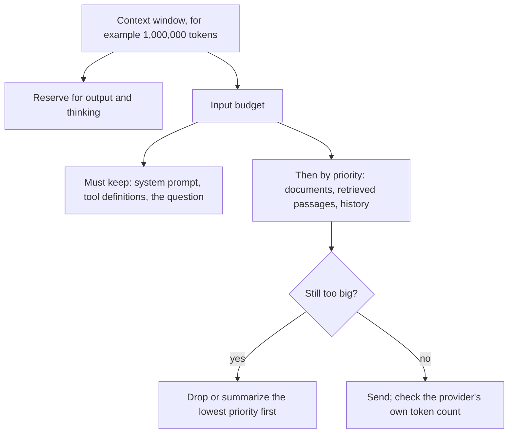
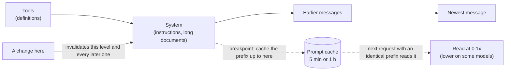

# The AI Engineering Stack, Part 04: Context

*October 13, 2026; reader tests and a fix to `placement_test.py` (a separate timeout message, `--timeout` and `--no-think`) added October 20, 2026. Part 04 of 13 (claude/engineering-stack-plan.md). Tags in this part: 199 [V], 79 [T], 6 [R], 15 [U] and 7 [I], counted in Sections 1 to 12 and the checks after them. Still open: no AI model runs on the test machine, so placement tests on a real model and caching on a live API are [R] or described from documentation. No independent study opened here tests the newest models (GPT-6, Claude 5.x, Gemini 3.x) for a position effect [U]. The lab's reader tests ran on Windows by script on October 20, 2026, the placement test on qwen3:1.7b at a reduced size [T]; the typed Windows steps and macOS haven't been run [R]. The lab's stand-in models and their accuracy curves are invented for teaching [I]; the code that measures them is tested [T].*

**What this part gives you.** How to decide what goes into a model's context window and where to put it, and how to make the parts that repeat cheap. **Context** is everything the model reads in one request: instructions, tool definitions, documents, the conversation so far. It has a hard size limit, it costs money per token, and models use long contexts less reliably than short ones. **Prompt caching** lets a provider reuse the work it did on the start of a prompt it has seen before, if that start is exactly the same, so the order you put things in decides your bill. Everything here is free and needs no model, account or API key.

## How to read this part

The tags are Part 01's. **[V: KEY]** points to Section 12, which gives each source's class and the place used. **[T]** ran on the test machine. **[R]** is a reader test. **[U]** names what would settle it. **[I]** is invented for teaching. Source classes: official documentation (OD), peer-reviewed (PR), preprint (PP), vendor or personal blog (VB, PB). A vendor's docs are the authority on how its product works, not on how good it is. Prices are list prices read on October 13, 2026; they change, so check before you budget.

**The test machine:** Ubuntu 24.04 in a cloud container, October 13, 2026, with Python 3.13.16, 3.12.3 and 3.11.17. It has no GPU and runs no AI model.

**This part covers two topics** (plan, Section 7): T05, the context budget and placement, and T06, provider prompt caching. The prompting technique around long documents (tags, quoting first, compression) is in claude/taxonomy-of-prompt-engineering-3e.md (the taxonomy), Sections 4.1, 7.4, 8 and 11.6, and in claude/prompt-construction-guide-2e.md (the guide). This part links to them instead of repeating them. Retrieval, which decides which documents to bring in at all, is Part 05; memory across sessions is Part 06; the KV cache inside a serving engine is Part 11.

## 1. In plain words

**T05, the context budget and placement.** A model can only read so much at once. That limit is its **context window**, measured in **tokens**, the pieces of words a model reads [V: OTK]. Everything counts against it: the system prompt, the tool definitions, every document, every past turn and the answer the model writes [V: ACW]. So a request is a budget. You decide what must go in, what can go if there's room, and what to leave out.

*The problem it solves.* Two problems. A request that doesn't fit fails, or worse, gets cut without telling you (Section 3.3). And a request that fits can still go wrong: accuracy falls as inputs get longer, across the model families tested in the studies read here [V: CHR, RUL, NOL], and some models use facts in the middle of a long input less well than facts at the start or end [V: LIU].

*Analogy.* Packing a suitcase with a weight limit for a trip. The essentials go in first. Then what you'll probably need, until you hit the limit. A heavier case isn't better: the more you pack, the harder it is to find the one thing you need.

**T06, provider prompt caching.** Before a model writes a word, it processes every token of your prompt. If the next request starts with exactly the same text (the same system prompt, the same long document), the provider can keep that work and reuse it. You pay less for the reused part, and the reply can start sooner [V: APC, OPC, GCC]. The catch is the word *exactly*: one changed character early in the prompt means everything after it is processed again [V: APC].

*Analogy.* A restaurant kitchen that preps the sauce once for the whole evening instead of once per plate. It works only if every plate uses the same sauce. Change the recipe at the start of the line and the prep is wasted.

**Where it sits in the stack** (plan, Section 5). The context budget sits in the **Context** layer: it decides what the model reads. Prompt caching is a cache kept where the model runs, so it sits in the **Runtime** layer (plan tie-break rule 1), but your lever is prompt order, which is why it's taught here. Both are measured with Part 02's evals and costed with Part 13's.

## 2. Definitions

Every term is also in claude/engineering-stack-glossary.md.

| Plain words | Technical term | Notes |
|---|---|---|
| The piece of text a model reads as one unit, often part of a word | Token | About 4 characters of English on average, by OpenAI's and Google's rules of thumb [V: OTK, GTK] |
| The program that splits text into tokens | Tokenizer; encoding | Differs between vendors and model generations [V: ATC, TIK] |
| Everything the model reads and writes in one request, and its maximum size | Context; context window | Includes input, output and any thinking [V: ACW, OCS] |
| Planning which parts of a request go in, within the window | Context budget | This series' term for the planning, not a vendor feature |
| Choosing and arranging what goes into the window | Context engineering | Anthropic: curating "the smallest possible set of high-signal tokens" [V: ACE] |
| What happens when a request is too big | Overflow; truncation | An error, or dropped content, depending on the provider (Section 3.3) |
| Replacing old turns with a summary written by the model | Compaction | A server feature at Anthropic and OpenAI [V: ACO, OCP] |
| Removing old tool results or thinking from the history | Context editing | Anthropic, beta [V: ACX] |
| A model using facts at the start and end of a long input better than facts in the middle | Position effect; "lost in the middle"; U-shaped curve | Named by Liu et al. for 2023 models [V: LIU] |
| Accuracy falling as the input gets longer | Length degradation; "context rot" | "Context rot" is Chroma's name [V: CHR] |
| A test that hides one fact in a long input and asks for it | Needle in a haystack (NIAH) | The simplest long-context test; it can overstate ability [V: RUL, HEL] |
| Reusing the processed start of a prompt in a later request | Prompt caching; prefix caching | The provider stores the processed form, not your text's meaning [V: APC] |
| The start of a prompt that repeats exactly across requests | Prefix | |
| The place in a prompt where you ask the provider to cache everything before it | Breakpoint; `cache_control` | Anthropic's name; up to 4 per request [V: APC] |
| Storing a prefix the first time; using it again later | Cache write; cache read (hit) | A write can cost more than normal input; a read costs much less [V: APC, OPC] |
| A request that finds no usable cached prefix | Cache miss | |
| How long a cached prefix stays usable | Lifetime; time to live (TTL) | 5 minutes or 1 hour at Anthropic; 30 minutes or more at OpenAI's newest models [V: APC, OPC] |
| The number of reuses at which caching starts to save money | Break-even point | Section 3.6 |
| The model's stored working state for each processed token | KV cache (key-value cache) | What a prefix cache keeps; Part 11 covers it inside engines [V: VPC, SGL] |
| A shortcut that leaks information through how long something takes | Timing side channel | How caches shared between users were detected [V: GUA] |

## 3. How it works

### 3.1 Tokens, and how to count them

A model doesn't read letters or words; it reads tokens. A tokenizer splits text into pieces from a fixed vocabulary. Common words are one token, rare words several, and numbers, code and other languages often take more tokens per character than English prose.

**Rules of thumb, and their limits.** OpenAI: "1 token is approximately 4 characters", about three quarters of a word, so 100 tokens is about 75 English words [V: OTK]. Google: about 4 characters, and 100 tokens is 60 to 80 English words [V: GTK]. Anthropic publishes no ratio, but says that Claude Opus 4.7 and later models (and the Fable and Mythos models) use a newer tokenizer that turns the same text into "approximately 30 percent more tokens than on earlier models" [V: ATC]. So the same document can cost nearly a third more on one model than on another from the same vendor. A rule of thumb is for rough planning only; count with the vendor's tool before relying on a number near a limit.

**Counting properly.**

| Vendor | Tool | Notes |
|---|---|---|
| Anthropic | `POST /v1/messages/count_tokens` (`client.messages.count_tokens` in the Python SDK) | Free, with its own requests-per-minute limits; counts system prompt, tools, images and PDFs; the result "is an estimate" [V: ATC] |
| OpenAI | `POST /v1/responses/input_tokens` | Counts the full Responses input, including tools and files, with the formatting tokens a plain tokenizer misses; the page doesn't say whether it's free [V: OTC][U: OpenAI's pricing or reference page] |
| OpenAI, offline | `tiktoken` (MIT, 0.14.0, August 17, 2026) | Plain text only. Its model table maps gpt-5, gpt-4.1 and gpt-4o to the `o200k_base` encoding and has no entry for GPT-6 models, so `encoding_for_model("gpt-6-astra")` would fail [V: TIK]. No OpenAI page read here names GPT-6's encoding [U: OpenAI's model docs]. The first use downloads the encoding file from `openaipublic.blob.core.windows.net`, which the test machine's network blocks [T] |
| Google | `countTokens` | Counts a request's input, media included; an image of up to 384 pixels per side is 258 tokens [V: GTK] |

The lab's `estimate_tokens` uses the 4-characters rule and is labelled an estimate [T]. Its planner's `growth` setting says how much bigger the real counts may be: 1.3 for a tokenizer that gives about 30% more tokens. It divides the budget by 1.3, which is a margin of 1 - 1/1.3, about 23%, not 30% (Section 3.2) [T].

### 3.2 The budget

**The arithmetic.** For one request:

> input budget = window - reserved output

where *window* is the model's context window in tokens and *reserved output* is the largest answer you allow, thinking included (`max_tokens` at Anthropic) [V: ACW]. Then:

> remaining = input budget - (system + tools + documents + history + question)

If *remaining* is below zero, something has to go. Two things are easy to forget. Tool definitions count, and so do cached prefixes: caching "changes what you pay for those tokens, not whether they count" [V: ACW].

**Current windows** (read October 13, 2026; they change):

| Model family | Window | Output limit | Long-input price step |
|---|---|---|---|
| Claude Fable 5.1 and 5, Mythos 5.1 and 5, Opus 5.5 to 4.6, Sonnet 5.5, 5 and 4.6, Haiku 5.5 | 1,000,000 tokens, no beta header needed | Up to 128,000 | None, except Haiku 5.5: prompts over 100,000 tokens cost more [V: ACW, APR] |
| Other Claude models, for example Sonnet 4.5 | 200,000 | Varies | |
| OpenAI GPT-6 Astra, GPT-6.1 Sol, GPT-6 Luna | 1,050,000: up to 922,000 in and 128,000 out | 128,000 | Over 272,000 input tokens, the whole request is billed at 2x input and 1.5x output [V: OMD] |
| Google Gemini 3.8 Flash; Gemini 3.1 Pro (preview) | 1,048,576 input | 65,536 | 3.1 Pro: $2 per million input tokens up to 200,000, $4 above [V: GMD, GPR] |

For OpenAI's GPT-6 models the window is shared: 922,000 + 128,000 = 1,050,000 [T].

**Planning, step by step** (diagram below; `token_budget.py`):

1. Reserve the output. If the answer can be long or the model thinks, reserve generously.
2. Put in what the request can't work without: the instructions, the tool definitions, the question.
3. Add the rest in order of priority. A piece that doesn't fit is left out, and smaller, lower-priority pieces can still go in after it.
4. Drop or summarize the lowest-priority pieces. Never let the provider decide what to drop for you (Section 3.3).
5. Check the real count with the vendor's counter before sending a request near the limit.



**Worked example** [T]. A 1,000,000-token window with 128,000 reserved for output leaves 872,000 for input. A system prompt (2,000), tool definitions (6,000) and the question (200) must stay. Three documents compete: a contract (400,000 tokens, priority 5), a policy handbook (250,000, priority 3) and an old email thread (300,000, priority 1). The plan keeps the contract and the handbook, uses 658,200 tokens, and drops the email thread. If the real counts are 30% higher (growth 1.3), the budget shrinks to 670,769 and the same plan still fits, with only 12,569 tokens to spare: a sign to count properly before sending. The first part of the output:

```
$ python token_budget.py
1. Planning a request for a 1,000,000-token window, 128,000 reserved for output
   input budget 872,000; used 658,200; left 213,800
   kept:    system prompt, tool definitions, contract.pdf as text, policy handbook, question
   dropped: old email thread
   if real counts are 30% higher (growth 1.3): budget 670,769; left 12,569; dropped: old email thread
```

Fitting isn't the same as working. On a conversation-memory test, Chroma found "significantly higher performance on focused prompts compared to full prompts" across all the models it ran: a focused prompt of about 300 tokens against the full history of about 113,000 [V: CHR]. (Not all of its 18 models were in every experiment, its appendix says [V: CHR].) A smaller, better-chosen context usually beats a bigger one, which is what Part 05's retrieval is for.

### 3.3 When it doesn't fit

Providers handle an oversized request in different ways, and the difference matters: some refuse, some cut.

| Where | What happens | How you'd notice |
|---|---|---|
| Anthropic | Input alone over the window: HTTP 400, "prompt is too long". On Claude 4.5 and newer, input plus `max_tokens` over the window is accepted, and generation stops with `stop_reason: "model_context_window_exceeded"`. Nothing is cut silently [V: ACW] | An error, or that stop reason |
| OpenAI, Responses API | `truncation` defaults to `disabled`: an input over the window fails with a 400 error. Set to `auto`, it drops items "from the beginning of the conversation" to fit [V: OTR] | With `auto`: whether the reply says what was dropped wasn't checked [U: OpenAI's reference] |
| Ollama (a local runtime) | For chat requests, truncation is on by default: the oldest messages are dropped until the rest fits, keeping system messages and always the last message, and the server logs this only at debug level [V: OLS] | Only from `prompt_eval_count`, the number of prompt tokens Ollama reports it processed: compare it with your own count |
| llama.cpp server | The context size comes from the model unless set (`-c`, `--ctx-size`); context shift is off by default [V: LCS] | The README read doesn't say whether an oversized prompt errors or is cut [U: a test against the server] |

Ollama's default context length is documented three ways on its own pages: by graphics memory (4K, 32K or 256K tokens) on the context-length page, 4096 in the FAQ, and 2048 in the Modelfile reference [V: OLC]. Set `num_ctx` yourself in each request, or `OLLAMA_CONTEXT_LENGTH` for the server, and check with `ollama ps` [V: OLC].

The lab's `placement_test.py` uses Ollama's other endpoint, `/api/generate`, and stops with an error when `prompt_eval_count` reaches `num_ctx`, since a prompt that fills the context was probably cut [T: against a stand-in server]. The lab also plays the same six-message chat (5,000 tokens) through three rules with a 4,096-token limit (the second part of `token_budget.py`'s output) [T]:

```
2. The same chat sent to three overflow rules, input limit 4,096 tokens
   chat total 5,000 tokens; the first user turn holds the key fact
   error (Anthropic, OpenAI default)        status 400; dropped None
   drop oldest (OpenAI truncation auto)     status 200; dropped [0, 1]
   keep system and last (Ollama chat)       status 200; dropped [1]
```

Both cutting rules lose the first user turn, which held the key fact, and both return success. The drop-oldest rule also drops the system message at position 0, since it is the oldest item in this simulation. Whether OpenAI's `auto` can drop instructions sent in the separate `instructions` field wasn't checked [U: OpenAI's reference]. An error you can see is better than a cut you can't.

**Shrinking a long conversation on purpose.** Both big vendors now do this on the server:

- **Anthropic compaction** (beta) replaces older turns with a summary the model writes. There are two kinds: on demand (header `compact-2026-09-04`, which the docs recommend wherever available) and at a token threshold (header `compact-2026-01-12`, default trigger 150,000 input tokens, minimum 50,000) [V: ACO]. The summary is an extra model call, billed and reported in `usage.iterations` [V: ACO]. Anthropic's context-windows page calls compaction "the primary strategy" for long conversations [V: ACW].
- **Anthropic context editing** (beta) clears old tool results (`clear_tool_uses_20250919`, default trigger 100,000 input tokens, keeping the last 3 tool uses) or old thinking blocks [V: ACX]. Clearing "invalidates cached prompt prefixes", so the docs advise clearing enough at once to be worth the new cache write [V: ACX].
- **OpenAI compaction** works automatically through `context_management` with a `compact_threshold`, or on request at `/responses/compact`; the result is an encrypted item, "opaque and not intended to be human-interpretable" [V: OCP]. Whether it's generally available or beta isn't stated [U: OpenAI's changelog].

Anthropic's engineering post adds the techniques an application can use itself: keep identifiers and fetch the full text just in time, keep structured notes outside the context, and give sub-agents their own context so they return short summaries ("often 1,000-2,000 tokens") [V: ACE]. It calls clearing old tool results "one of the safest lightest touch forms of compaction" [V: ACE].

### 3.4 Where to put things

**What Liu et al. found (2023 models).** "Lost in the Middle" tested question answering over 10, 20 or 30 documents, exactly one of which held the answer, plus a key-value lookup task [V: LIU]. Accuracy was "often highest when relevant information occurs at the beginning or end" and lowest in the middle: a U-shaped curve [V: LIU]. For GPT-3.5-Turbo with 20 documents, accuracy by the position of the answer document was 75.8% (first), 57.2% (5th), 53.8% (10th), 55.4% (15th) and 63.2% (20th) [V: LIU, Table 6]. That's a drop of 22.0 percentage points from the first position to the worst middle one, and at the 10th and 15th positions it scored below its closed-book score of 56.1%, with no documents at all [V: LIU, Table 1][T]. The models were all from 2023: GPT-3.5-Turbo, Claude-1.3, MPT-30B-Instruct, LongChat-13B and others [V: LIU]. Its own advice: put the most relevant documents first (rerank) and keep retrieved lists short, since going from 20 to 50 documents added only about 1.5 points for GPT-3.5-Turbo [V: LIU, §5]. Repeating the question before and after the data fixed the key-value task but barely changed document question answering [V: LIU, §4.2].

**What later studies found.** The picture splits in two.

- *Length hurts, robustly.* RULER (17 models, 2024): near-perfect on the simple needle test, but only about half kept satisfactory performance at 32,000 tokens, though all claimed at least that much [V: RUL]. NoLiMa (13 models, ICML 2025): with needles that share few words with the question, 11 of 13 models fell below half their short-context score at 32,000 tokens; GPT-4o went from 99.3% to 69.7%, that is to 70.2% of its base score [V: NOL][T]. Chroma (18 models including Claude Opus 4, GPT-4.1, Gemini 2.5 Pro and Qwen3, July 2025): performance "grows increasingly unreliable as input length grows", even on simple tasks [V: CHR]. HELMET (59 models, ICLR 2025) adds that "synthetic tasks like NIAH do not reliably predict downstream performance" [V: HEL].
- *Position matters less, and depends on the task.* Chroma's needle test found "no notable variation" across 11 positions, but its repeated-words task did better when the unique word was near the beginning [V: CHR]. NoLiMa saw a middle dip on one-step questions at 32,000 tokens; on two-step questions length dominated: larger contexts "shift the entire trendline downward toward zero", with performance "declining even at the edges" [V: NOL, §4.4.2]. Veseli et al. (preprint, 2025) found the U-shape strongest when the input fills up to half the window, turning into a bias toward the end beyond that [V: VES]. A February 2026 preprint testing GPT-5, Grok-4, GPT-4 and Gemini 2.5 says the problem is "largely resolved in newer models", but its abstract doesn't show how position was tested, so it's weak evidence [V: ESM]. A 2026 preprint on Gemini 2.5 Flash, GPT-5-mini, Claude 4.5 Haiku and DeepSeek-v3.2 found accuracy drops when the needed evidence is spread across the input [V: EBR].

**What this means.** No independent study read here tests the newest models (GPT-6, Claude 5.x, Gemini 3.x) for a position effect [U: such a study, or your own test with the lab's harness]. The safe reading: finding one fact is now usually robust to position; using many facts, or reasoning across them, still gets worse with length, and position may still matter there. Even the vendors say so: Google's docs say that with many needles "the model does not perform with the same accuracy" [V: GLC], and OpenAI's GPT-4.1 guide says performance can "degrade as more items are required to be retrieved" [V: OG41].

**What the vendors advise, and where they disagree.**

| Vendor | Advice | Scope |
|---|---|---|
| Anthropic | For inputs of 20,000 tokens or more, put long documents "near the top of your prompt", above the query and instructions; queries at the end "can improve response quality by up to 30 percent in tests"; wrap each document in tags with its source; ask the model to quote the relevant parts first [V: ABP] | The 30% has no model, benchmark or date: a vendor claim |
| OpenAI (GPT-4.1 guide) | Instructions at both the beginning and the end of a long context work best; if only once, above the context is better than below [V: OG41] | GPT-4.1 (the guide is undated; the model is `gpt-4.1-2025-04-14`); newer guides not read [U] |
| Google | Put the query at the end, after the other context [V: GLC] | Gemini long-context page, updated June 22, 2026 |

They agree on long material first, then the question. They differ on instructions: OpenAI's guide says that if instructions appear once, above the context is better, while Anthropic and Google put the question last. "Instructions" and "query" may not mean the same thing to each of them. When it matters, repeat the key instruction after the material, then test on your model (below).

**Measure it yourself.** The lab's `placement_test.py` is a needle test: it hides one fact, the *needle* (a locker code), among filler documents, moves it through five positions, and reports accuracy per position with a 95% Wilson interval (Part 02, Section 3.4). Its verdict says "U-shaped" only if both ends beat the worst middle position by at least 10 points *and* the intervals don't overlap. Tested on two invented stand-ins [I], it finds the built-in U and finds nothing in the flat one [T]:

```
$ python placement_test.py
Stand-in with a built-in U-shaped bias [I], 200 trials per position
   position   1: 177/200 =  88.5%  (95% interval  83.3 to  92.2)
   position   6: 122/200 =  61.0%  (95% interval  54.1 to  67.5)
   position  11: 112/200 =  56.0%  (95% interval  49.1 to  62.7)
   position  16: 142/200 =  71.0%  (95% interval  64.4 to  76.8)
   position  20: 180/200 =  90.0%  (95% interval  85.1 to  93.4)
   verdict: U-shaped (lowest middle position 11)
Stand-in with no position bias [I], 200 trials per position
   position   1: 148/200 =  74.0%  (95% interval  67.5 to  79.6)
   position   6: 148/200 =  74.0%  (95% interval  67.5 to  79.6)
   position  11: 146/200 =  73.0%  (95% interval  66.5 to  78.7)
   position  16: 162/200 =  81.0%  (95% interval  75.0 to  85.8)
   position  20: 156/200 =  78.0%  (95% interval  71.8 to  83.2)
   verdict: no clear position effect (lowest middle position 11)
```

The flat stand-in's numbers wander by 8 points from chance alone, which is why the verdict needs the intervals: with 10 trials per position, even a 20-point gap isn't enough (the lab's check 12) [T]. The same script runs against a local Ollama model with `--ollama` (Section 8, step 7) [T: its test and report, on qwen3:1.7b at 50 documents with thinking off, on the owner's Windows PC, October 20, 2026].

### 3.5 Prompt caching

**What's being reused.** To process a prompt, a model computes stored working state for each token, the **KV cache** (Part 11). That state for token 500 depends on tokens 1 to 499, so it can be reused only when everything before it is the same. That's why caching works on a **prefix**: the identical start of a prompt [V: VPC, SGL]. Anthropic: "Cache hits require 100% identical prompt segments" [V: APC].

**The order that matters.** At Anthropic, a request is cached in the order tools, then system, then messages, and a change at one level invalidates that level and everything after it [V: APC]. Changing the tools clears everything; changing thinking or effort settings clears the message blocks [V: APC]. OpenAI routes each request by a hash of its first tokens, tools included [V: OPC]. The practical rule is the same everywhere: what never changes first, what changes last.



**The providers' rules** (read October 13, 2026):

| | Anthropic (Claude API) | OpenAI (GPT-5.6 and later) | Google Gemini |
|---|---|---|---|
| Turned on by | You: one top-level `cache_control` (automatic: the breakpoint moves to the last cacheable block as a chat grows), or `cache_control` on up to 4 blocks [V: APC] | On by default; explicit breakpoints also supported [V: OPC] | Implicit caching on by default for Gemini 2.5 and newer; explicit caches through `client.caches.create` (beta) [V: GCC] |
| Minimum length | 512 tokens on the newest models (Fable 5.1 and 5, Mythos 5.1 and 5, Opus 5.5 and 5, Sonnet 5.5, Haiku 5.5); 1,024 on Sonnet 5, Opus 4.8 and Sonnet 4.6 and 4.5; up to 4,096 on older ones. Shorter prefixes are "processed without caching, and no error is returned" [V: APC] | 1,024 visible input tokens [V: OPC] | Implicit: 4,096 on Gemini 3.8 Flash, 3.6 Flash and 3.1 Pro; 2,048 on 2.5 Flash and Pro. Explicit: not stated [V: GCC][U] |
| Write | 1.25x base input (5-minute lifetime) or 2x (1 hour) [V: APC] | 1.25x; earlier models: no write charge [V: OPC, OPP] | Storage per million tokens per hour, by model (Section 3.6) [V: GPR] |
| Read | 0.1x; 0.05x on Opus 5.5 and Sonnet 5.5; 0.025x on Fable 5.1 and Mythos 5.1 [V: APR] | 0.1x; 0.05x on GPT-6.1 Sol [V: OPC, OPP] | 0.1x on every model listed (computed from the price table) [V: GPR][T] |
| Lifetime | 5 minutes, refreshed free on each hit; or `"ttl": "1h"` [V: APC] | At least 30 minutes after the last write or use (`prompt_cache_options.ttl`, only value `30m`) [V: OPC] | Explicit: 1 hour unless set; implicit: not stated [V: GCC] |
| Lookback | Each breakpoint checks at most 20 block positions back for an earlier entry [V: APC] | Implicit mode checks "up to 20 earlier eligible message endings" [V: OPC] | Not stated [U] |
| Reported as | `cache_creation_input_tokens`, `cache_read_input_tokens`, `input_tokens` (the uncached tail) [V: APC] | `usage.input_tokens_details.cached_tokens` and `cache_write_tokens` [V: OPC] | `usage_metadata` [V: GCC] |
| Shared with | Isolated between organizations; per workspace on the Claude API [V: APC] | "not shared across organizations" [V: OPC] | Not checked [U] |

Others work the same way. DeepSeek caches on disk by default and bills a hit at about 0.02x of a miss on its flash model [V: DSC]. Amazon Bedrock offers explicit `cachePoint`s with up to 4 checkpoints and a 5-minute lifetime reset on each hit, and says "Repeating an identical prompt doesn't guarantee a cache hit" [V: BRK]. Read the other implicit caches the same way: Bedrock calls its implicit caching "best effort", DeepSeek "best-effort", and Google lists "no cost saving guarantee" [V: BRK, DSC, GCC].

**Rate limits differ too.** At Anthropic, cache reads don't count toward the input-tokens-per-minute limit on most models, so with an 80% hit rate a 2,000,000-token limit lets through 10,000,000 input tokens per minute [V: ARL][T]. At OpenAI, "Cached input tokens still count toward tokens-per-minute limits" [V: OPC].

**Watch the lifetime, using the lab's stand-in.** `cache_sim.py` models Anthropic's documented rules: order, breakpoints, exact prefixes, lookback, lifetime refreshed on each hit, and the minimum length [T]. It's a model of the documentation, not the provider's code. A chat about one 8,000-token document, with the breakpoint after the document. The cached prefix is 10,000 tokens: tool definitions (400), system prompt (1,600) and the document (8,000). `input_tokens` is the part after the breakpoint, which grows as the chat does: the question (50), then question, answer and new question (400), and so on. The first part of the output:

```
$ python cache_sim.py
A. Stable prefix, three turns one minute apart
   turn 0: {'cache_read_input_tokens': 0, 'cache_creation_input_tokens': 10000, 'input_tokens': 50}
   turn 1: {'cache_read_input_tokens': 10000, 'cache_creation_input_tokens': 0, 'input_tokens': 400}
   turn 2: {'cache_read_input_tokens': 10000, 'cache_creation_input_tokens': 0, 'input_tokens': 750}

B. A timestamp at the top of the system prompt changes every request
   turn 0: {'cache_read_input_tokens': 0, 'cache_creation_input_tokens': 10000, 'input_tokens': 50}
   turn 1: {'cache_read_input_tokens': 0, 'cache_creation_input_tokens': 10000, 'input_tokens': 400}
   turn 2: {'cache_read_input_tokens': 0, 'cache_creation_input_tokens': 10000, 'input_tokens': 750}
```

In B, one line ("Time now: 09:01") at the top of the system prompt makes every request a fresh write. Priced at 1.25x for writes and 0.1x for reads, the three turns cost 31,200 token-units with no caching, 15,700 with a stable prefix, and 38,700 with the timestamp: caching set up badly costs more than no caching at all [T]. The fix is to move anything that changes (the date, the user's name, retrieved passages) below the breakpoint.

Two more cases from the same script [T]. When the second turn arrives 6 minutes later, a 5-minute entry has expired and is written again, while a 1-hour entry is read. And a 300-token prefix on a model with a 512-token minimum is never cached, and no error says so, exactly as Anthropic documents [V: APC]:

```
C. Second turn arrives 6 minutes later: 5-minute versus 1-hour lifetime
   5-minute: {'cache_read_input_tokens': 0, 'cache_creation_input_tokens': 10000, 'input_tokens': 400}
   1-hour:   {'cache_read_input_tokens': 10000, 'cache_creation_input_tokens': 0, 'input_tokens': 400}

D. A 300-token prefix with a breakpoint, model minimum 512
   request 0: {'cache_read_input_tokens': 0, 'cache_creation_input_tokens': 0, 'input_tokens': 305}
   request 1: {'cache_read_input_tokens': 0, 'cache_creation_input_tokens': 0, 'input_tokens': 305}
```

A real API reports the same three fields, so the check is the same: after the second request, `cache_read_input_tokens` should be above zero. If it's zero, something in the prefix changed or the entry expired.

**What caching doesn't do.** It doesn't change the answer: "Prompt caching has no effect on output token generation" [V: APC]. It speeds up the processing of the prompt, not the writing of the reply: vLLM's docs say it "does not reduce the time of generating new tokens" [V: VPC]. And it doesn't make a cached prefix free of the window: those tokens still count [V: ACW].

### 3.6 The cost arithmetic

**Break-even, symbol by symbol.** Measure cost in units of one prefix at the base input price. Let *w* be the write multiplier, *r* the read multiplier and *k* the number of later requests that read the cache. Without caching, 1 + *k* requests cost 1 + *k*. With caching, they cost *w* + *r*·*k*. Caching wins when

> *w* + *r*·*k* < 1 + *k*, that is, when *k* > (*w* - 1) / (1 - *r*).

For Anthropic's 5-minute cache, (1.25 - 1) / (1 - 0.1) = 0.28, so one read is enough. For the 1-hour cache, (2 - 1) / 0.9 = 1.11, so two reads are needed [T]. Lower read rates (0.05x, 0.025x) don't change those counts [T]. Anthropic's pricing page says the same: caching "pays off after one cache read for the 5-minute duration", and after two for the 1-hour one [V: APR]. OpenAI's GPT-5.6 and later charge the same 1.25x to write and 0.1x to read (0.05x on GPT-6.1 Sol), so again a single read [V: OPC][T].

**Worked totals.** Claude Sonnet 5.5 costs $2 per million input tokens and reads at 0.05x [V: APR]. For a 100,000-token prefix, prefix cost only (output and the uncached tail are left out) [T]:

| Requests | No cache | 5-minute cache | 1-hour cache |
|---|---|---|---|
| 2 | $0.40 | $0.26 | $0.41 |
| 10 | $2.00 | $0.34 | $0.49 |

And the worst case: if every request arrives after the 5-minute entry has expired, each one pays the write price, and 10 requests cost $2.50, 1.25x the uncached cost [T]. A cache that never gets read is a surcharge.

**Gemini's explicit caches charge for storage by the hour.** Each use of a cached million tokens saves (input price - cached price); storage costs a fixed amount per hour. So you need storage / saving uses per hour to break even. On the October 13 prices [V: GPR], that's 0.74 uses per hour on Gemini 3.8 Flash ($0.75 input, $0.075 cached, $0.50 storage), 2.5 on Gemini 3.1 Pro preview ($2, $0.20, $4.50) and 4.0 on Gemini 2.5 Pro ($1.25, $0.125, $4.50) [T]. This leaves out any charge for creating the cache, which the pages read didn't state [U: Google's caching docs]. Gemini 3.8 Flash and 3.6 Flash prices double on January 1, 2027 [V: GPR].

**Independent measurements.** Vendors quote list-price ratios; OpenAI's caching page says input can be "discounted up to 95%" [V: OPC]. One study measured real agent runs: Lumer et al. (preprint, 2026) ran a deep-research agent with a 10,000-token system prompt, 40 sessions per condition per model [V: LUM]. Against no caching, cost fell 79 to 81% on GPT-5.2, 78 to 79% on Claude Sonnet 4.5, 46 to 48% on GPT-4o and 28 to 41% on Gemini 2.5 Pro, across three caching strategies [V: LUM, Table 2]. Time to first token didn't always improve: it ranged from 8.8% slower to 30.9% faster depending on model and strategy [V: LUM]. The abstract reports the rosier "41-80%" and "13-31%"; its own table's lowest results fall below both ranges [V: LUM][T]. Its advice matches this part's: cache the stable system prompt, keep tool definitions fixed, put changing content last, and don't cache tool results [V: LUM]. Its models and January 2026 prices are now a generation old.

### 3.7 Prefix caches in engines you run yourself

If you run a model yourself (Part 11), the engine can do the same reuse, with no price but a real speed gain on long shared prefixes.

- **vLLM** hashes each full block of KV cache from the previous block's hash and the block's tokens, caches only full blocks, and evicts the least recently used first [V: VPC]. A per-request `cache_salt` limits sharing to requests with the same salt, to stop timing attacks between users of a shared server; the default hash has been SHA-256 since v0.11 [V: VPC]. In the source of release 0.31.0 (October 5, 2026), `enable_prefix_caching` defaults to `True`, while the docs still tell you to set it [V: VPC][T: read from the release tag]. Like every prefix cache, it helps the prompt-processing step only [V: VPC].
- **SGLang**'s RadixAttention keeps finished requests' KV cache in a radix tree and evicts the least recently used leaf first; its paper measured cache hit rates of 50% to 99% across its benchmarks and up to 6.4x throughput, on its authors' own system [V: SGL]. Its server's eviction policy defaults to LRU [V: SGA]. In the release 0.5.21 source, the server's `disable_radix_cache` setting (help text: "Disable RadixAttention for prefix caching.") defaults to `False`, so the cache is on unless you turn it off [V: SGA][T: read from the release tag, `arg_groups/fields/memory.py`].
- **llama.cpp**'s server reuses the previous request's KV cache by default (`cache_prompt`), and warns that "enabling this option can cause nondeterministic results" [V: LCS].
- **Ollama** keeps a model loaded for 5 minutes by default (`keep_alive`) and reports `prompt_eval_cached_count`, "Number of prompt tokens read from the cache", but doesn't document how the reuse works [V: OLF][U: Ollama's source].

### 3.8 Caching and privacy

A shared cache can leak. If your prompt is cached because someone else sent it first, your reply starts faster, and a careful attacker can time that. Gu et al. (preprint, 2025) audited 17 API providers in autumn 2024 with timing tests and found caching at 8 of them, shared across users at 7 (including OpenAI's and Azure's text-embedding-3-small) and kept per organization at Anthropic and OpenAI's GPT-4o mini [V: GUA]. After they disclosed it, "at least five providers made changes"; only OpenAI's embedding fix is named [V: GUA]. As a side result, the timing told them that OpenAI's embedding model is a decoder-only Transformer [V: GUA]. Today the big vendors' docs state isolation: Anthropic between organizations and per workspace on its own API, OpenAI across organizations [V: APC, OPC]. Inside one organization, a cache is still shared across its users. Design accordingly: don't rely on timing being private between people who share an API key.

## 4. Gemini said, evidence says

| Gemini (ledger row) | Evidence | Section |
|---|---|---|
| Self-attention cost is quadratic, O(N^2) (P2-01) | Confirmed: O(n²·d) per layer for full self-attention (ledger P2-01). It's why long inputs cost more compute; what it means for serving is Part 11 | 3.2 |
| Attention quality "frequently degrades" with length; models "ignore" mid-prompt information (P2-02) | Half right. Length degradation is robust across current studies [V: RUL, NOL, CHR, HEL]. "Ignore" is too strong: Liu et al.'s 2023 models were less accurate in the middle, not blind [V: LIU], and for current models the position effect is weaker and task-dependent [V: CHR, NOL, VES] | 3.4 |
| The context window is a finite, curated resource (P2-03) | Confirmed: Anthropic's own definition [V: ACE] | 1, 3.2 |
| Context engineering "inherently" involves manipulating the KV cache (P2-04) | Corrected. Three separate things: choosing what goes in (this part's Sections 3.2 to 3.4), provider prompt caching, where you mark or order a stable prefix (3.5), and KV reuse inside an engine you run (3.7, Part 11). Anthropic's context-engineering post never mentions the KV cache (ledger P2-04) | 3.5, 3.7 |
| Recomputing shared prefixes wastes compute (P2-05, P2-06) | Confirmed, and now sold as a feature: Anthropic, OpenAI and Google all cache identical prefixes, automatically or when you mark them [V: APC, OPC, GCC] | 3.5 |
| RadixAttention matches prefixes by "depth-first search" (P2-07) | Corrected: prefixes are matched by radix-tree lookup; depth-first order is the paper's scheduling order (ledger P2-07) [V: SGL] | 3.7 |
| Anthropic's guidance, SGLang and LangChain are "critical" tools (P2-11) | Overstated. SGLang matters if you run your own server; API users get caching from the provider [V: APC, SGL] | 6 |
| Sliding-window truncation that keeps system instructions through KV reuse (P2-12) | Illustrative [I]. The documented versions today are server compaction and context editing; note that clearing content invalidates the cache [V: ACO, ACX] | 3.3 |
| Put "aggressively summarized" documents in the middle to fight attention decay (P2-13) | Unsupported. Liu et al. advise reranking relevant passages to the front and keeping lists short [V: LIU, §5]; no source read recommends summaries in the middle | 3.4 |
| SGLang serves "thousands" of requests sharing one system prompt (P2-14) | Overstated: no such figure. The paper reports cache hit rates of 50% to 99% in its benchmarks and 52.4% and 74.1% in a low-traffic Chatbot Arena deployment [V: SGL] | 3.7, 5 |
| The KV cache grows linearly with length (P2-15) | Confirmed; the arithmetic is Part 11's (ledger P2-15) | Part 11 |
| Curriculum: caching middleware that tracks tokens and evicts stale context (P2-16) | Illustrative [I]; this part's lab builds the token planner and a cache simulator instead | 8 |

## 5. Examples

**Real examples.**

1. *Caching in a research agent* [V: LUM]. Lumer et al. ran a deep-research agent with a 10,000-token system prompt on four models, 40 sessions per condition. Caching the system prompt cut cost by 78 to 81% on GPT-5.2 and Claude Sonnet 4.5, and by 28 to 41% on Gemini 2.5 Pro; at 50,000-token prompts the savings reached 89% and 88% on GPT-5.2 and Claude. Caching everything, tool results included, sometimes made the first token slower. A preprint, with now-superseded models and prices.
2. *A prefix cache in production* [V: SGL]. SGLang's authors report cache hit rates of 52.4% and 74.1% from a month of Chatbot Arena traffic, a low-traffic deployment. Even a public chat service, with strangers' prompts, shares a lot of prefix (mostly system prompts and earlier turns).
3. *Less context, better answers* [V: CHR]. On LongMemEval, a conversation-memory test, Chroma reports "significantly higher performance on focused prompts compared to full prompts" across all the models it ran: about 300 tokens against the full history of about 113,000. Chroma makes ChromaDB, an open-source search database, so read it as a vendor's report; the result is in line with RULER and NoLiMa [V: RUL, NOL].

**A fully worked example: a question-and-answer session over a contract** [I: the contract and session are invented; the arithmetic is tested].

*Input.* A contract of 360,000 characters, about 90,000 tokens by the 4-characters rule (`estimate_tokens`) [T]. A system prompt of 1,500 tokens. Eight questions over 20 minutes, never more than 4 minutes apart. The model: Claude Sonnet 5.5, $2 per million input tokens, cache reads at 0.05x [V: APR].

*Step 1, budget.* 90,000 + 1,500 + a few hundred tokens of question fit easily in a 1,000,000-token window, with 128,000 reserved for output. Count the real number with `count_tokens` before going live; on this model the newer tokenizer may give about 30% more than the estimate [V: ATC].

*Step 2, placement.* System prompt first; then the contract inside `<document>` tags with its source; then the question, with the key instruction ("answer only from the contract; quote the clause") repeated after the document (Section 3.4) [V: ABP, OG41].

*Step 3, caching.* One breakpoint, after the contract. The date, the user's name and the question go below it. Gaps under 4 minutes keep a 5-minute entry alive, because each hit refreshes it [V: APC]; the 1-hour lifetime isn't needed.

*Step 4, cost of the prefix* (output left out):

```
$ python -c "from cache_cost import *; b=F(2,10**6); r=F(1,20); print(float(cost_without_cache(90_000,8,b)), float(cost_with_cache(90_000,8,b,F(125,100),r)), float(cost_with_cache(90_000,8,b,F(2),r)))"
1.44 0.288 0.423
```

$1.44 without caching, $0.29 with the 5-minute cache, $0.42 with the 1-hour one [T]. 

*Step 5, check.* After the second question, `cache_read_input_tokens` should be about 91,500 and `cache_creation_input_tokens` 0 [V: APC]. If the read count is 0, something above the breakpoint changed.

*Output.* A session that costs about a fifth of the uncached price for the shared part, with every fact the questions need in a fixed place the model sees first.

## 6. What you need

Checked October 13, 2026. Versions from PyPI [V: PYPI].

| Tool | What it's for | Licence | Cost | Runs on | Account or key? | Maintained | Official source |
|---|---|---|---|---|---|---|---|
| Python and the lab's scripts | Budgets, overflow rules, cache arithmetic, a cache simulator, a placement test | Python's licence | Free | Python 3.11 to 3.13 [T] | No | This series | The lab zip |
| tiktoken | Counting OpenAI tokens offline | MIT | Free | Python 3.9 or later | No; downloads its encoding file once [T] | 0.14.0, August 17, 2026 | PyPI, `tiktoken` |
| anthropic | Claude API, including `count_tokens` and caching | Apache-2.0 (MIT up to 1.14.0) | Free; API usage is paid, token counting is free [V: ATC] | Python 3.10 or later | An API key (Part 01, Section 3.5) | 2.3.0, October 23, 2026; was 1.13.0 on October 9. Re-checked October 26, 2026: 2.0.0's one listed breaking change is the default API version (2026-10-21), and `client.messages.count_tokens` is still there [V] | PyPI |
| openai | OpenAI API, including `input_tokens` and caching | Apache-2.0 | Free; API usage is paid | Python 3.10 or later | An API key | 3.37.0, October 22, 2026; was 3.29.0 on October 11. Re-checked October 26, 2026: the SDK counts tokens with the beta method `client.beta.responses.input_tokens.count` [V] | PyPI |
| Ollama | Running a local model, for the placement test | MIT (Python client 0.6.3) | Free | Part 11 | No | Part 11 | docs.ollama.com |
| vLLM | A self-hosted engine with automatic prefix caching | Apache-2.0 | Free | Python 3.11 to below 3.15 since 0.32.0 (3.10 before) [T: PyPI]; a GPU (Part 11) | No | 0.32.0, October 18, 2026 [T: PyPI, October 26]; the rest of this row was checked at 0.31.0 | PyPI, `vllm` |
| SGLang | A self-hosted engine with RadixAttention | Apache-2.0 | Free | Python 3.10 or later; a GPU (Part 11) | No | 0.5.21, October 1, 2026 | PyPI, `sglang` |

**The picks.**

- **Best default for a solo builder on a hosted API:** count with the vendor's own counter, plan with a margin, put stable material first, and turn on caching (at Anthropic, one top-level `cache_control`; at OpenAI and Gemini it's already on) [V: ATC, APC, OPC, GCC]. Then watch the usage fields: caching that never reads is a surcharge (Section 3.6).
- **For production:** explicit breakpoints after the parts that change at different speeds (tools, then system prompt and documents, then history), the 1-hour lifetime when requests come more than 5 minutes apart but at least twice an hour, and an alert when the cache-read share drops [V: APC]. Test the placement on your model with your own documents (Section 8, step 7).
- **Best free option:** a local model through Ollama with `num_ctx` set explicitly, because its defaults differ between its own pages and it cuts long chats without telling you [V: OLC, OLS].
- **When not to bother with caching:** prompts under the minimum (512 to 4,096 tokens, by model), or requests too rare to reuse a prefix within its lifetime [V: APC, OPC]. When not to use a long context at all: when retrieval can find the few passages that matter (Part 05); smaller focused contexts did better for every model Chroma ran on that test [V: CHR].

## 7. Set it up

**Before you start.** Part 01's setup: Python 3.11 to 3.13, and the series folder `ai-stack` in your home folder (Part 01, Section 7). Unzip `engineering-stack-lab-part-04.zip` into `ai-stack`; you get a folder named `engineering-stack-lab-part-04`. On Windows, right-click the zip and choose Extract All; on macOS, double-click it, then move the folder into `ai-stack`; on Linux, in the folder that holds the zip, `python3 -m zipfile -e engineering-stack-lab-part-04.zip ~/ai-stack` (Part 01's way, which works even without the `unzip` program) [T on Linux]. The core lab needs nothing installed.

In code blocks, a line starting with `$ ` is a command: type what follows the `$ `, not the `$` itself. The lines after it are what the computer printed.

### 7.1 Windows 10 or 11 [R: the typed steps below haven't been run on Windows; this lab ran there by script on October 20, 2026]

In PowerShell:

```
cd $HOME\ai-stack\engineering-stack-lab-part-04
py -V:3.13 -m venv .venv
.venv\Scripts\Activate.ps1
python run_lab.py
```

Expect `13 of 13 checks passed.` If PowerShell refuses to run `Activate.ps1`, see Part 01, Section 7.6.

### 7.2 macOS [R: no macOS test machine]

```
cd ~/ai-stack/engineering-stack-lab-part-04
python3.13 -m venv .venv
source .venv/bin/activate
python run_lab.py
```

### 7.3 Linux (Ubuntu 24.04) [T]

The same commands as macOS, with `python3` in place of `python3.13` if your Python 3 is 3.11 to 3.13 (Ubuntu 24.04's is 3.12). Expect `13 of 13 checks passed.` (the full output is in Section 8, step 6). If `python3 -m venv` says that ensurepip is not available, install Ubuntu's venv package with `sudo apt install python3-venv` and try again [R: the test machine already had it].

### 7.4 Optional: the tiktoken comparison [T: on the owner's Windows PC, October 20, 2026; the encoding file is blocked on the test machine]

```
python -m pip install --require-hashes -r requirements-optional.txt
python run_lab.py --with-tiktoken
```

The install pins tiktoken 0.14.0 and its six dependencies with hashes, and installed cleanly here [T]. The check itself failed on the test machine because tiktoken's first use downloads the `o200k_base` file from `openaipublic.blob.core.windows.net`, which this network blocks; the script says so instead of crashing [T]. On a normal connection, expect `14 of 14 checks passed.` [T: on the owner's Windows PC, October 20, 2026]. To see the counts themselves (three lines, one per sample text, then a PASS line), run `python optional_tiktoken_check.py` [T: on the owner's Windows PC, October 20, 2026, which printed 32 tokens for the 176-character English sample (estimate 44), 25 for the code (estimate 23) and 30 for the numbers and IDs (estimate 16)].

### 7.5 A tour

| Command | What it does |
|---|---|
| `python token_budget.py` | The budget plan and the three overflow rules (Sections 3.2, 3.3) |
| `python cache_cost.py` | Break-even reads, the Sonnet 5.5 totals and Gemini's storage break-even (3.6) |
| `python cache_sim.py` | The cache simulator's four cases (3.5) |
| `python placement_test.py` | The position test on two stand-ins, 200 trials per position; `--ollama MODEL` runs it on a local model, 10 trials per position (50 model calls) unless you set `--trials`; `--timeout SECONDS` sets the wait per call (default 300) and `--no-think` turns a thinking model's thinking off (3.4) [T: against a stand-in server] |
| `python paper_numbers.py` | Re-derives the numbers this part quotes from its sources; its first line ends `'edge_minus_worst_middle': 22.0, 'middle_positions_below_closed_book': [10, 15], 'best_below_oracle': 12.5}` (positions counted from 1; the last number is the 12.5-point gap between the best position and the oracle's 88.3%) [T] |
| `python run_lab.py` | 13 checks; `--with-tiktoken` adds one, which reports only pass or fail |
| `python mutation_check.py` | Breaks the code 15 ways and expects each check to catch it |

**Seeing an exit code.** Right after a command, `echo $?` on macOS and Linux [T], or `echo $LASTEXITCODE` in PowerShell [R], prints the code the command ended with. For `run_lab.py`: 0 means every check passed, 1 means at least one failed; 2 means Python couldn't open the file at all, usually because you're in the wrong folder [T].

### 7.6 Common errors and fixes

| What you see | Why | Fix |
|---|---|---|
| `can't open file '.../run_lab.py': [Errno 2] No such file or directory` | The terminal isn't in the lab folder | `cd` into the lab folder [T] |
| `ModuleNotFoundError: No module named 'cache_cost'` (or `'cache_sim'`) | A `python -c` command from Section 5 or 9 was run outside the lab folder | `cd` into the lab folder [T] |
| `[FAIL] check 14: tiktoken_counts: FAIL  tiktoken is not installed in this environment` | `--with-tiktoken` without the optional install, or in another environment | Section 7.4 [T] |
| `FAIL  could not load o200k_base; the first use downloads it from openaipublic.blob.core.windows.net (ProxyError)` | tiktoken can't reach the site that hosts its encoding files | Allow that site once, or skip the optional check [T] |
| `[FAIL] check 1: python_version` | Python 3.14 or newer, or 3.10 or older | Make the environment with Python 3.13 (Part 01, Section 7) |
| `Could not reach Ollama at http://127.0.0.1:11434 (<urlopen error [Errno 111] Connection refused>). Is it running?` from `--ollama` | Ollama isn't running (on Windows the error number differs) | Start Ollama (Part 11), then rerun [T on Linux; R on Windows] |
| `Ollama didn't answer within 300 seconds: the model is slow on this computer. ...` from `--ollama` (lab copies from before October 20, 2026 print `Could not reach Ollama at http://127.0.0.1:11434 (timed out). Is it running?` instead) | Ollama is running, but one call took longer than the limit per call [T: against a stand-in server] | Lower `--docs` and `--num-ctx`, or raise `--timeout`. A thinking model such as qwen3 can still run past the limit: at 50 documents and 4096 one call of many did on the owner's PC, and only turning thinking off kept every call under 80 seconds [T: the owner's Windows PC, October 20, 2026]; `--no-think` does that, as the Windows run's wrapper did [T: against a stand-in server] |
| `RuntimeError: prompt filled the context; raise num_ctx` | The prompt reached Ollama's context limit, so it was probably cut | Raise `--num-ctx`, or lower `--docs` [T: against a stand-in server] |
| `[notice] A new release of pip is available` during the optional install | An older pip (24.0 on Python 3.11 and 3.12 here) | Not an error; ignore it [T] |

### 7.7 How to uninstall

`deactivate`, move up one folder with `cd ..`, and delete the lab folder: `rm -rf engineering-stack-lab-part-04` on macOS and Linux [T], `Remove-Item -Recurse -Force engineering-stack-lab-part-04` in PowerShell [R]. The virtual environment and tiktoken go with it. tiktoken keeps its downloaded encoding outside the lab: in `TIKTOKEN_CACHE_DIR` if set, else `DATA_GYM_CACHE_DIR`, else a `data-gym-cache` folder in the system's temporary folder (`/tmp/data-gym-cache` on Linux); delete that folder too if you want it gone [T: read from tiktoken 0.14.0's `load.py`].

## 8. Hands-on lab: budgets, caches and a position test

**Goal.** Plan a context within a window, see what each overflow rule throws away, watch a prompt cache hit and miss, work out when caching pays, and measure a position effect with a test that can tell a real effect from noise.

**Prerequisites.** Section 7 for your system. **Time:** about 30 minutes by hand, 1 minute automated. **Cost:** none. **Pinned:** the standard library only; the optional check pins tiktoken 0.14.0 with hashes. **Data:** invented for teaching [I]. **Files:** the `engineering-stack-lab-part-04` folder (listings in the appendix).

**Steps.** Outputs are from the test machine, Python 3.13.16, October 13, 2026 [T].

1. **Plan a budget.** Run `python token_budget.py`. Part 1 of its output is in Section 3.2: with 872,000 tokens of input budget it keeps the contract and the handbook and drops the email thread; with growth 1.3 the same plan still fits, with 12,569 tokens to spare. Open `token_budget.py`, change the email thread's priority from 1 to 9 (the line `Part("old email thread", 300_000, priority=1, order=3)`), and run it again. Now the thread stays and the handbook goes: `kept: system prompt, tool definitions, contract.pdf as text, old email thread, question` [T]. The growth line now reads `dropped: contract.pdf as text`: with the smaller budget the 400,000-token contract no longer fits after the thread, so it's left out, and the smaller handbook goes in after it (step 3 of Section 3.2) [T]. Change the priority back to 1 when you're done.
2. **See what overflow does.** Part 2 of the same output (Section 3.3). The error rule refuses; the two cutting rules both drop the first user turn and return success.
3. **Break a cache on purpose.** Run `python cache_sim.py` (Section 3.5). Case A reads 10,000 tokens on turns 1 and 2; case B, with a timestamp at the top, never reads. The last line:
   ```
   Cost of the three turns in base-price token units (write 1.25x, read 0.1x):
      no caching 31,200; stable prefix 15,700; timestamp at top 38,700
   ```
4. **Work out the break-even.** Run `python cache_cost.py`. Its first line on lower read rates covers the 1-hour cache, the only one where they could matter:
   ```
   1. Break-even: reads needed after one write before caching costs less
      Anthropic 5-minute         write 1.25x, read 0.10x -> 1 read(s)
      Anthropic 1-hour           write 2.00x, read 0.10x -> 2 read(s)
      OpenAI GPT-5.6 and later   write 1.25x, read 0.10x -> 1 read(s)
      1-hour cache with 0.05x and with 0.025x reads: 2 and 2 reads

   2. Claude Sonnet 5.5: $2 per million input tokens, reads 0.05x; 100,000-token prefix
       2 requests: no cache $0.4000; 5-minute $0.2600; 1-hour $0.4100
      10 requests: no cache $2.0000; 5-minute $0.3400; 1-hour $0.4900
      10 requests, each arriving after the entry expired: $2.5000 (1.25x the uncached cost)

   3. Gemini explicit caching: uses per hour to cover storage (per million tokens)
      Gemini 3.8 Flash                 0.74 uses per hour
      Gemini 3.1 Pro Preview (<=200K)  2.50 uses per hour
      Gemini 2.5 Pro                   4.00 uses per hour
   ```
5. **Measure position.** Run `python placement_test.py` (Section 3.4). Then run it with fewer trials, `python placement_test.py --trials 20`. Now the stand-in that does have a U-shape is reported as `no clear position effect`: 80% at both ends against 50% at position 6, but the intervals (58.4 to 91.9 and 29.9 to 70.1) overlap [T]. Too few trials can hide a real effect, just as they can invent one.
6. **Run the checks.** `python run_lab.py`:
   ```
   [PASS] check 1: python_version: 3.13.16
   [PASS] check 2: budget_plan: kept the must-keep parts; dropped b, then c and b with growth 1.5
   [PASS] check 3: overflow_rules: error 400; drop-oldest [0, 1]; keep-system-and-last [1]
   [PASS] check 4: estimate_is_rough: 1, 100 and 0 tokens for 1, 400 and 0 characters
   [PASS] check 5: break_even: 5-minute 1, 1-hour 2, 1-hour at 0.025x 2
   [PASS] check 6: sonnet_totals: cents [40, 26, 41, 200, 34, 49]; always-expired costs 1.25x
   [PASS] check 7: gemini_storage: [0.74, 2.5, 4.0]
   [PASS] check 8: cache_stable_prefix: turns read [0, 10000, 10000]
   [PASS] check 9: cache_timestamp_breaks_it: reads [0, 0, 0]; cost 38,700 vs 31,200 uncached
   [PASS] check 10: cache_lifetime: 5-minute miss at 6 minutes; 1-hour hit; refreshed entry hit at 8 minutes
   [PASS] check 11: cache_minimum_and_order: no caching below 512 tokens; bad order and 5 breakpoints refused
   [PASS] check 12: placement_harness: U stand-in: 5/5 U-shaped; flat: 0/5 U-shaped
   [PASS] check 13: quoted_numbers: Liu gap 22.0 points; NoLiMa 70.2%; 10,000,000 tokens per minute
   13 of 13 checks passed.
   ```
   The same 13 of 13 with Python 3.12.3 and 3.11.17 [T].
7. **Optional, on a local model** [T: at 50 documents with thinking off, on the owner's Windows PC, October 20, 2026; no model runs on the test machine]. With Ollama installed (Part 11) and a small model pulled, run `python placement_test.py --ollama MODEL --docs 200 --num-ctx 16384 --trials 10` (50 model calls). Each document is about 34 tokens, so 200 documents make a prompt of about 7,000 tokens [T: measured on the generated text with the 4-characters rule]. Expect a header line, five lines of accuracy and a verdict [T: against a stand-in server]. With 10 trials, only a large effect will show as "U-shaped"; raise `--trials` for a firmer answer, at the cost of more time on a computer without a graphics card. On the owner's test PC (an Intel Core i5-9500T, no graphics card) with qwen3:1.7b, one 200-document call took 386 seconds: Ollama counted 7,533 prompt tokens, read at 35 per second, and the model then thought for 321 tokens before answering. That is over the script's 300-second limit per call, so the run stopped with a "timed out" message (Section 7.6); `--timeout` now raises the limit, and `--no-think` turns thinking off [T: against a stand-in server]. With `--docs 50 --num-ctx 4096` a call took about 97 seconds, yet one call in a full run still passed the limit; with Ollama's thinking turned off, all 50 calls took 34 to 78 seconds [T: the owner's Windows PC, October 20, 2026].

**Automated check, and breaking it on purpose.** `python mutation_check.py` makes 15 small breaks, one at a time, in a copy of the lab, and expects `run_lab.py` to fail each time: for example, the cache fingerprint ignoring the text, expired entries still counting as hits, the minimum length ignored, the verdict ignoring the intervals, a copied figure from Liu et al. wrong by 4 points [T]:

```
$ python mutation_check.py
[OK] unbroken copy: pass
[OK] must-keep parts not reserved (token_budget.py): run_lab fail
...
[OK] copied figure wrong (paper_numbers.py): run_lab fail
Every mutation behaved as expected.
```

The same on Python 3.12.3 and 3.11.17 [T]. Two checks first passed broken code: the Ollama rule's "always keep the last message" and the verdict's interval test. Each got a new test case that the broken version fails [T].

## 9. Teach it

**Learning objectives.** After this part you can:

1. estimate a request's tokens, and say why the estimate can be a third off on a newer tokenizer;
2. plan a context within a window, reserving output first, and say what each provider does when a request is too big;
3. say what "lost in the middle" measured, on which models, and what current studies add;
4. order a prompt so its stable part can be cached, and check from the usage fields that it was;
5. work out the break-even point of a cache from its write and read prices, including storage for Gemini's explicit caches.

**Prerequisites.** Parts 01 to 03. Reading a little Python.

**Common misconceptions.**

- *"A 1M-token window means I can just send everything."* It fits; it doesn't mean it works. Accuracy falls with length across the studies read [V: CHR, RUL, NOL], and a focused 300-token prompt beat a 113,000-token one for every model Chroma ran on that test [V: CHR].
- *"Models ignore the middle of the prompt."* 2023 models were less accurate there, not blind [V: LIU]; for current models single-fact recall is mostly robust to position, while many-fact tasks still suffer with length [V: CHR, NOL].
- *"A token is a word."* About three quarters of a word in English, by OpenAI's rule of thumb [V: OTK], and not the same between tokenizers [V: ATC].
- *"Caching changes the answer."* It doesn't; it reuses the processed prompt [V: APC].
- *"Caching always saves money."* A write costs 1.25x or 2x; if nothing reads it, you pay more (the lab's timestamp case cost 38,700 units against 31,200 without caching) [T].
- *"Cached tokens don't count toward the window."* They do [V: ACW].

**Exercises, with checked answers.**

1. *What does a 2x write need?* Using the break-even formula, how many reads does a cache with a 2x write and a 0.1x read need before it pays? Answer: (2 - 1) / (1 - 0.1) = 1.11, so 2 reads. Check: `python -c "from cache_cost import *; print(break_even_reads(F(2), F(1,10)))"` prints `2` [T].
2. *Fix the timestamp case.* In `cache_sim.py`, case B puts `Time now: 09:0{i}. ` at the start of the system text. Where should it go so that turns 1 and 2 read the cache? Answer: below the breakpoint, in the messages. Try it: `python -c "from cache_sim import *; r=conversation('stable'); r=[b+[Block('messages','Time now: 09:0%d' % i, 10)] for i,b in enumerate(r)]; print([u['cache_read_input_tokens'] for u in run(r,[0,60,120])])"` prints `[0, 10000, 10000]` [T].
3. *When does Gemini's explicit cache pay for itself?* For Gemini 2.5 Pro at $1.25 input, $0.125 cached and $4.50 storage per million tokens per hour (prompts up to 200,000 tokens), how many uses per hour? Answer: 4.50 / (1.25 - 0.125) = 4.0 [T]. Fewer than 4 uses an hour, and implicit caching (no storage charge) or no caching is cheaper [V: GPR].

**Five-question self-check.** Answers follow.

1. What counts toward a context window?
2. What does OpenAI's Responses API do by default when the input is too long, and what does Ollama's chat do?
3. On which models did Liu et al. measure the U-shaped curve, and what did NoLiMa add?
4. Why does a timestamp at the top of a system prompt break caching?
5. Why does Anthropic's 1-hour cache need two reads to pay off when the 5-minute one needs one?

*Answers.* (1) Everything: system prompt, tools, messages, documents, the output and any thinking, and cached tokens too [V: ACW]. (2) OpenAI returns a 400 error unless `truncation` is `auto` [V: OTR]; Ollama drops the oldest messages, keeping system messages and the last one, without an error [V: OLS]. (3) 2023 models such as GPT-3.5-Turbo and Claude-1.3 [V: LIU]; NoLiMa found that 11 of 13 later models fell below half their short-context score at 32,000 tokens when the needle shares few words with the question [V: NOL]. (4) A cache hit needs an identical prefix; a changing first line makes every request's prefix new [V: APC]. (5) The write costs 2x instead of 1.25x, so it takes (2 - 1) / 0.9 = 1.11 reads to make up the difference [T].

**You've got it when** you can open any prompt your application sends, say which parts are stable, put them first with a breakpoint after them, predict the usage fields of the second request, and explain to someone else why the long contract goes before the question.

**Best next resources** (checked to exist on October 13, 2026):

- Anthropic, "Prompt caching" and "Context windows" (the platform docs) [V: APC, ACW].
- OpenAI, "Prompt caching" guide [V: OPC].
- Google, "Long context" and "Context caching" [V: GLC, GCC].
- Liu et al., "Lost in the Middle", arXiv 2307.03172 [V: LIU]; NoLiMa, arXiv 2502.05167 [V: NOL].
- Anthropic, "Effective context engineering for AI agents" [V: ACE].

**A tutor prompt to practice with.** Paste this into Claude (modelled on claude/github-tutor-prompt.md):

```
Help me practise planning context windows and prompt caching.

How to teach me: one idea at a time, a question I answer before you go on,
and a worked number for each idea. When I'm wrong, show me the arithmetic
rather than the answer, so I can find the mistake myself.

Topics, in order:
1. Tokens and counting (why estimates are rough; tokenizers differ).
2. A context budget: reserve output, keep the essentials, add by priority.
3. What providers do with an input that's too long.
4. Position effects: what 2023 studies found and what later ones changed.
5. Prompt caching: prefix order, breakpoints, lifetimes, usage fields.
6. Break-even arithmetic, including storage-priced caches.

For any price, limit or model name, tell me it may have changed since your
training and that I should check the provider's page, because these change
often. If you aren't sure of a fact, say so instead of guessing.

Start by asking what I'm building and which provider I use.
```

**What to learn next.** Part 05, retrieval: finding the few passages that belong in the context, instead of sending everything. Then Part 13 for budgets and cost tracking across a whole application.

## 10. Limits and debates

- **The position-effect question isn't settled for the newest models.** No independent study read here tests GPT-6, Claude 5.x or Gemini 3.x [U]. The studies that exist disagree in emphasis: one 2026 preprint calls the problem "largely resolved" [V: ESM], while others find the effect depends on the task and on how full the window is [V: NOL, VES, CHR]. Test on your own model and documents.
- **Needle tests flatter models.** Simple needle tests are near-perfect while harder tasks fail [V: RUL]; HELMET found that "synthetic tasks like NIAH do not reliably predict downstream performance" [V: HEL]. The lab's placement test is a needle test too, good for finding a position effect, not for proving a model can use a long context.
- **Vendor quality claims are unreplicated.** Anthropic's "up to 30 percent" for queries at the end has no model, benchmark or date [V: ABP]. OpenAI's "up to 95%" is a list-price ratio, not a measured saving [V: OPC]. The one independent measurement read found 28% to 81% lower cost, depending on model [V: LUM].
- **Implicit caching is best effort.** Google lists Gemini's implicit caching with "no cost saving guarantee", and Bedrock warns that an identical prompt "doesn't guarantee a cache hit" [V: GCC, BRK]. OpenAI routes by "machine load" and a hash of the first tokens, and more than about 15 requests per minute on one prefix can spill to other machines [V: OPC].
- **An unreplicated oddity.** A single-author 2026 preprint reports that Claude Sonnet 4.6's cache has "a two-tier architecture with a sharp threshold near 3,500 tokens", below which the hit rate plateaus near 0.83 over 30-call sessions [V: SON]. Anthropic documents exact-match rules and fixed minimums instead [V: APC], and no replication was found here.
- **Compaction is lossy.** A summary drops detail, and OpenAI's compacted item is opaque, so you can't read what it kept [V: OCP]. Clearing tool results also breaks the cache [V: ACX].
- **Privacy.** In tests run in 2024 (published 2025), shared caches leaked through timing at seven providers [V: GUA]; the big vendors now isolate by organization [V: APC, OPC], but users of one key or organization still share.
- **Cost.** Long contexts cost more than short ones even with caching, and some models charge a higher rate above a threshold (OpenAI over 272,000 input tokens, Gemini 3.1 Pro over 200,000, Haiku 5.5 over 100,000) [V: OMD, GPR, APR].
- **When this is the wrong tool.** When the corpus is too big for any window, or most of it is irrelevant to each question: that's retrieval (Part 05). When the same knowledge is needed in every call for months: consider whether fine-tuning (Part 12) or a smaller system prompt serves better.

**Where this part touches project docs** (flagged, not applied; the owner decides at the end of the series, plan Section 8):

1. *Taxonomy flag 3 (position effects, §4.1 and §7.4).* The ledger's settlement stands, with more evidence: the U-shape is documented for 2023 models [V: LIU]; for later models the effect is weaker and task-dependent, and length degradation is the robust finding [V: NOL, VES, CHR, HEL]. Suggested scope for the analogy: "in 2023 models, and in some tasks since".
2. *Taxonomy flag 4 (§11.6, "typically 0.1×").* Settled: still true for most Claude models; 0.05x on Opus 5.5 and Sonnet 5.5, and 0.025x on Fable 5.1 and Mythos 5.1 [V: APR].
3. *New: taxonomy §11.6 on OpenAI.* It says OpenAI caches prefixes of 1,024 tokens or more "with read discounts of up to 90%" (read September 2026). On October 13, 2026, OpenAI's page says "up to 95%", and models from GPT-5.6 on charge 1.25x for cache writes, which earlier ones didn't [V: OPC, OPP]. Not an error at the time; a freshness note for the next edition.
4. *New: Anthropic's long-context page moved.* Sources that cite Anthropic's "long context tips" page should point to "Prompting best practices", heading "Long context prompting", which the old address now serves [V: ABP].

## 11. Skill opportunity

claude/new-skills-appendix.md lists **long-context-placer**, a skill that rewrites a long prompt so critical instructions appear at the beginning and again at the end. This part's evidence supports the "again at the end" half for documents-then-question layouts [V: ABP, GLC, OG41] but not a fixed rule, since the vendors differ (Section 3.4). A stronger version would also do this part's other two jobs: plan the budget with a margin, and order the prompt for caching, putting changing content below the breakpoint. Its scripts would be `token_budget.py` and `cache_cost.py`, and its eval pack could use `cache_sim.py` (does the rewritten prompt still hit the cache?) and `placement_test.py` [T]. Build it with the project's skill rules.

## 12. Sources

All opened October 13, 2026, by the lead session or one of two researcher agents, except where a source key says it comes from an earlier part's ledger. Web pages were read through a fetch tool that summarizes each page, so quotes and numbers were asked for verbatim, and decisive ones were read twice (Liu et al.'s Table 6 by the lead session; release-tag source for vLLM and SGLang by the lead session). Most vendor pages show no date; the date given is when they were read. Grade: confidence from 1 to 10 that the source supports the use made of it.

| Key | Source | Class | Used for | Grade |
|---|---|---|---|---|
| ABP | Anthropic, "Prompting best practices", heading "Long context prompting" (the old long-context-tips address now serves it). https://platform.claude.com/docs/en/build-with-claude/prompt-engineering/claude-prompting-best-practices | OD | Documents near the top; "up to 30 percent"; tags and quoting (3.4) | 8 |
| ACE | Anthropic, "Effective context engineering for AI agents", September 29, 2025 (modified January 6, 2026). https://www.anthropic.com/engineering/effective-context-engineering-for-ai-agents | VB | Definition; just-in-time retrieval, compaction, notes, sub-agents (2, 3.3) | 8 |
| ACO | Anthropic, "Compaction" and "Threshold compaction". https://platform.claude.com/docs/en/build-with-claude/compaction ; https://platform.claude.com/docs/en/build-with-claude/compaction-threshold | OD | Beta headers, trigger defaults, billing (3.3) | 9 |
| ACW | Anthropic, "Context windows". https://platform.claude.com/docs/en/build-with-claude/context-windows | OD | Window sizes; what counts; overflow behaviour; "primary strategy" (3.2, 3.3) | 9 |
| ACX | Anthropic, "Context editing". https://platform.claude.com/docs/en/build-with-claude/context-editing | OD | Clearing tool results and thinking; cache invalidation (3.3) | 9 |
| APC | Anthropic, "Prompt caching". https://platform.claude.com/docs/en/build-with-claude/prompt-caching | OD | Order, breakpoints, minimums, lifetimes, lookback, usage fields, isolation (3.5) | 9 |
| APR | Anthropic, "Pricing". https://platform.claude.com/docs/en/about-claude/pricing | OD | Per-model prices and read multipliers; break-even statement (3.5, 3.6) | 9 |
| ARL | Anthropic, "Rate limits". https://platform.claude.com/docs/en/api/rate-limits | OD | Cache-aware input limits; the 10,000,000 example (3.5) | 9 |
| ATC | Anthropic, "Token counting". https://platform.claude.com/docs/en/build-with-claude/token-counting | OD | Free counting; estimate; about 30% more tokens on newer models (3.1) | 9 |
| BRK | AWS, "Prompt caching for faster model inference", Amazon Bedrock user guide. https://docs.aws.amazon.com/bedrock/latest/userguide/prompt-caching.html | OD | Checkpoints, lifetime, "doesn't guarantee a cache hit" (3.5) | 8 |
| CHR | Chroma, "Context Rot: How Increasing Input Tokens Impacts LLM Performance", July 14, 2025. https://www.trychroma.com/research/context-rot | VB (vendor technical report) | 18 models; length degradation; needle and repeated-words position results; LongMemEval (3.2, 3.4) | 7 |
| DSC | DeepSeek, "Context Caching" and "Models & Pricing". https://api-docs.deepseek.com/guides/kv_cache ; https://api-docs.deepseek.com/quick_start/pricing | OD | On-disk caching; hit price (3.5) | 8 |
| EBR | Ebrahimzadeh and Salili, arXiv 2601.02023 (v2, July 14, 2026). https://arxiv.org/abs/2601.02023 | PP | Spread-out evidence is harder (3.4) | 6 |
| ESM | Esmi et al., arXiv 2602.14188 (February 15, 2026). https://arxiv.org/abs/2602.14188 | PP | "largely resolved" claim; method not shown in the abstract (3.4, 10) | 4 |
| GCC | Google, "Context caching". https://ai.google.dev/gemini-api/docs/caching ; https://ai.google.dev/gemini-api/docs/generate-content/caching (updated October 9, 2026) | OD | Implicit and explicit caching, minimums, lifetime (3.5) | 8 |
| GLC | Google, "Long context". https://ai.google.dev/gemini-api/docs/long-context (updated June 22, 2026) | OD | Query at the end; many-needle accuracy (3.4) | 8 |
| GMD | Google, Gemini models pages. https://ai.google.dev/gemini-api/docs/models ; https://ai.google.dev/gemini-api/docs/models/gemini-3.8-flash ; https://ai.google.dev/gemini-api/docs/models/gemini-3.1-pro-preview | OD | Current models and limits (3.2) | 8 |
| GPR | Google, "Gemini Developer API pricing". https://ai.google.dev/gemini-api/docs/pricing | OD | Prices, the 200K step, cache storage, the 2027 change; first part of the page read (3.2, 3.6) | 7 |
| GTK | Google, "Understand and count tokens". https://ai.google.dev/gemini-api/docs/tokens (updated September 23, 2026) | OD | 4 characters; 60 to 80 words; image tokens (3.1) | 8 |
| GUA | Gu et al., "Auditing Prompt Caching in Language Model APIs", arXiv 2502.07776 (v2, July 13, 2025). https://arxiv.org/abs/2502.07776 | PP | 17 providers; sharing found at 7; changes after disclosure (3.8) | 8 |
| HEL | Yen et al., HELMET, arXiv 2410.02694 (ICLR 2025). https://arxiv.org/abs/2410.02694 | PR | 59 models; needle tests don't predict downstream performance (3.4, 10) | 8 |
| LCS | llama.cpp, server README. https://github.com/ggml-org/llama.cpp/blob/master/tools/server/README.md | OD | `--ctx-size`; `cache_prompt` and its warning (3.3, 3.7) | 8 |
| LIU | Liu et al., "Lost in the Middle: How Language Models Use Long Contexts", arXiv 2307.03172v3 (November 20, 2023); its TACL publication wasn't confirmed on the TACL site [U]. https://arxiv.org/abs/2307.03172 | PP | Tasks, models, Tables 1 and 6, §4.2, §5 (3.4) | 9 |
| LUM | Lumer et al., "Don't Break the Cache", arXiv 2601.06007v2 (January 31, 2026). https://arxiv.org/abs/2601.06007 | PP | Measured cost and latency with caching; abstract versus table (3.6, 5) | 7 |
| NOL | Modarressi et al., NoLiMa, arXiv 2502.05167v3 (ICML 2025). https://arxiv.org/abs/2502.05167 | PR | 11 of 13 below half at 32K; GPT-4o figures; §4.4.2 position analysis (3.4) | 8 |
| OCP | OpenAI, "Compaction" guide. https://developers.openai.com/api/docs/guides/compaction.md | OD | Server compaction; opaque item (3.3) | 8 |
| OCS | OpenAI, "Conversation state". https://developers.openai.com/api/docs/guides/conversation-state.md | OD | What the window includes (2) | 8 |
| OG41 | OpenAI, "GPT-4.1 prompting guide" (cookbook). https://developers.openai.com/cookbook/examples/gpt4-1_prompting_guide.md | OD | Instructions at both ends; degradation with more items (3.4) | 8 |
| OLC | Ollama, "Context length", FAQ and Modelfile reference. https://docs.ollama.com/context-length ; https://docs.ollama.com/faq ; https://docs.ollama.com/modelfile | OD | Three different defaults; how to set `num_ctx` (3.3) | 8 |
| OLF | Ollama, FAQ (`keep_alive`) and `/api/generate` reference. https://docs.ollama.com/faq.md ; https://docs.ollama.com/api/generate.md | OD | 5-minute keep-alive; `prompt_eval_cached_count` (3.7) | 8 |
| OLS | Ollama source, server/prompt.go and server/routes.go (main branch, read October 13, 2026). https://github.com/ollama/ollama | OD (source code) | Chat truncation on by default; what it keeps; debug-level log (3.3) | 8 |
| OMD | OpenAI, models page and GPT-6 Astra, GPT-6.1 Sol and GPT-6 Luna pages. https://developers.openai.com/api/docs/models.md ; https://developers.openai.com/api/docs/models/gpt-6-astra.md ; https://developers.openai.com/api/docs/models/gpt-6.1-sol.md ; https://developers.openai.com/api/docs/models/gpt-6-luna.md | OD | Windows, output limits, the 272K price step (3.2) | 9 |
| OPC | OpenAI, "Prompt caching". https://developers.openai.com/api/docs/guides/prompt-caching.md | OD | Defaults, minimum, write and read prices, lifetime, routing, isolation, rate limits (3.5) | 9 |
| OPP | OpenAI, "Pricing". https://developers.openai.com/api/docs/pricing.md | OD | Cache-write column; per-model prices (3.5) | 8 |
| OTC | OpenAI, "Counting tokens". https://developers.openai.com/api/docs/guides/token-counting.md | OD | `input_tokens` endpoint (3.1) | 8 |
| OTK | OpenAI Help Center, "What are tokens and how to count them?". https://help.openai.com/en/articles/4936856-what-are-tokens-and-how-to-count-them | OD | 4 characters; 100 tokens is about 75 words (1, 3.1) | 8 |
| OTR | OpenAI API reference, Responses `truncation` (read from its Terraform resource page). https://developers.openai.com/api/reference/terraform/resources/responses | OD | `disabled` by default; `auto` drops from the beginning (3.3) | 7 |
| PYPI | The Python Package Index, JSON API, read October 13, 2026. https://pypi.org/pypi/NAME/json | OD | Versions, dates, licences (6) | 9 |
| RUL | Hsieh et al., RULER, arXiv 2404.06654 (v3, August 6, 2024). https://arxiv.org/abs/2404.06654 | PP | 17 models; half satisfactory at 32K (3.4) | 8 |
| SGA | SGLang, server arguments docs, and the v0.5.21 release source. https://docs.sglang.io/docs/advanced_features/server_arguments.md ; https://github.com/sgl-project/sglang/blob/v0.5.21/python/sglang/srt/arg_groups/fields/memory.py | OD | LRU eviction default; `disable_radix_cache` defaults to `False` (3.7) | 7 |
| SGL | Zheng et al., "SGLang: Efficient Execution of Structured Language Model Programs", arXiv 2312.07104v2 (June 6, 2024). https://arxiv.org/abs/2312.07104 | PP | RadixAttention, LRU leaf eviction, hit rates, Chatbot Arena (3.5, 3.7, 4, 5) | 8 |
| SON | Song, arXiv 2607.15516v1 (July 17, 2026). https://arxiv.org/abs/2607.15516 | PP | Two-tier cache claim, unreplicated (10) | 4 |
| TIK | tiktoken on PyPI, and tiktoken/model.py (main branch). https://pypi.org/project/tiktoken/ ; https://github.com/openai/tiktoken | OD | Version, licence, encoding map, no GPT-6 entry (3.1) | 9 |
| VES | Veseli et al., arXiv 2508.07479 (August 10, 2025). https://arxiv.org/abs/2508.07479 | PP | U-shape strongest up to half the window (3.4) | 6 |
| VPC | vLLM, "Automatic Prefix Caching" design and feature pages, and vllm/config/cache.py at release v0.31.0. https://docs.vllm.ai/en/latest/design/prefix_caching.html ; https://docs.vllm.ai/en/latest/features/automatic_prefix_caching.html ; https://raw.githubusercontent.com/vllm-project/vllm/v0.31.0/vllm/config/cache.py | OD | Block hashing, eviction, `cache_salt`, SHA-256, on by default in 0.31.0; prefill only (3.5, 3.7) | 9 |

## Run on your computer

These need a Windows or macOS computer, or a local model, which the test machine doesn't have. Run them from the lab folder with its environment active, and send back the output; each [R] above then becomes [T] with the date.

| Test | Command | Expected result |
|---|---|---|
| R1 | `python run_lab.py` | `13 of 13 checks passed.` |
| R2 | `python mutation_check.py` | `Every mutation behaved as expected.` |
| R3 | `python -m pip install --require-hashes -r requirements-optional.txt`, then `python run_lab.py --with-tiktoken`; for the counts themselves, `python optional_tiktoken_check.py` | `14 of 14 checks passed.`; the second command prints three lines of token counts and a PASS line |
| R4 | With Ollama and a small model (Part 11): `python placement_test.py --ollama MODEL --docs 200 --num-ctx 16384 --trials 10` | Five accuracy lines and a verdict; send the whole output |

**Results so far** (October 20, 2026, on the owner's test PC: Windows 11 Pro, Python 3.13.16, a fresh virtual environment made from the lab zip, Ollama v0.40.6 with qwen3:1.7b; run by script, not typed; record in claude/engineering-stack-windows-run-2026-10-20.md) [T]: R1 printed `13 of 13 checks passed.` R2 printed `Every mutation behaved as expected.`, with all 15 mutations OK, both with the script's UTF-8 output setting and without it. R3 installed tiktoken 0.14.0 and its six dependencies with their hashes checked and printed `14 of 14 checks passed.`; `optional_tiktoken_check.py` then printed 32, 25 and 30 tokens for the three samples, against estimates of 44, 23 and 16. R4 as written didn't finish on this PC: its first call passed the script's 300-second limit (Section 8, step 7). So the same test ran through a small wrapper outside the lab (`placement_think_off.py`, in the record) that turns Ollama's thinking off and allows 900 seconds per call, at `--docs 50 --num-ctx 4096 --trials 10`: 1,888 prompt tokens per call, 34 to 78 seconds a call, 38 minutes in all. qwen3:1.7b was right 10 of 10 times at every position (95% interval 72.2 to 100.0), and the verdict was `no clear position effect`. A prompt this short is far below where the studies in Section 3.4 found position effects, so this shows the harness working on a real model, not an absence of the effect.

## Checks run on this part

The findings, each with its fix, are recorded in claude/engineering-stack-part-04-review.md.

- **Blind source check.** Two checkers on a different model (Claude Sonnet) received only the part's claims and their source links, never the part: 85 claims about context windows, tokens, overflow and position effects, and 69 about prompt caching and engines. They found 128 supported, 23 partly supported, none contradicted, and 3 they couldn't check (a placeholder link, and two claims that needed the worked example they weren't given). Every partly supported claim was re-read at its source by the author before it was changed. The main fixes: "every model" became "the models it ran" for Chroma's tests, whose appendix says not all 18 models were in every experiment; NoLiMa's two-step result is now quoted ("downward toward zero"); OpenAI's lookback ("up to 20 earlier eligible message endings") replaced "automatic routing"; Google's "no cost saving guarantee" replaced a paraphrase in quotation marks; the vLLM feature page now backs both "docs still tell you to set it" and "doesn't speed up generation"; Lumer et al.'s results are in their Table 2, not Table 1; and the SGLang default was settled from its release source.
- **Beginner test.** A fresh agent followed Sections 3 and 7 to 9 literally on the Linux test machine with Python 3.13.16 (pip 26.2.1), 3.12.3 and 3.11.17 (pip 24.0), including the optional install. Every output the part shows matched what the scripts printed, and all three exercises gave the stated answers. It reported 15 problems; the author reproduced each before fixing it. The most serious: the "30% margin" was the wrong size (30% more tokens needs a budget divided by 1.3, a 23% margin), so the planner now takes a `growth` factor and the worked example changed; the planner skips a piece that doesn't fit and keeps adding smaller ones, which the text now says; `--with-tiktoken` shows only pass or fail, not the counts; the wrong-folder error in Section 7.6 was the wrong message; and an uninstalled tiktoken printed FAIL and SKIP on one line. Also fixed: Linux unzip now uses Part 01's `python3 -m zipfile`, the 10,000-token cached prefix is explained, `paper_numbers.py` counts positions from 1 and its output is shown, `--ollama` defaults to 10 trials and fails with one clear line when Ollama isn't running, "needle" and `prompt_eval_count` are defined, and tiktoken's cache folder was read from its source.
- **Lab checks.** After the fixes, `run_lab.py` passed 13 of 13 checks and `mutation_check.py` reported all 15 mutations caught, with Python 3.13.16, 3.12.3 and 3.11.17 on October 13, 2026 [T]. A script compared every output block in Sections 3 to 8 with a fresh run of its command: all matched [T]. The `--ollama` path ran against a stand-in server, including the "prompt filled the context" error [T]. Both diagrams render with mermaid-cli 12.0.0 [T].
- **Windows run.** On October 20, 2026, the owner's Windows 11 PC ran R1 to R3 by script with Python 3.13.16: 13 of 13, every mutation caught, and 14 of 14 with tiktoken 0.14.0. R4 at 200 documents stopped at the 300-second limit per call; at 50 documents it ran with thinking off, 50 of 50 right [T]. The record is claude/engineering-stack-windows-run-2026-10-20.md.

## Cheat sheet

**Terms.** Token: the unit a model reads, about 4 characters of English. Context window: everything one request can hold, output included. Budget: what you plan to put in it. Position effect: better use of facts at the edges than in the middle. Prompt cache: the provider's stored work on an identical prefix. Breakpoint: where you ask it to cache. Break-even: the reads that pay for a write.

**Settings (read October 13, 2026; check before use).**

```
Anthropic  cache_control={"type": "ephemeral"}             top level (automatic) or on a block
Anthropic  cache_control={"type": "ephemeral", "ttl": "1h"}
Anthropic  client.messages.count_tokens(model=..., messages=..., system=..., tools=...)
OpenAI     caching on by default; prompt_cache_key=...    optional; groups related requests
OpenAI     truncation="disabled" (default) or "auto"
Gemini     implicit caching on by default; client.caches.create(...) for explicit caches
Ollama     "options": {"num_ctx": 16384}   or OLLAMA_CONTEXT_LENGTH=16384 ollama serve
```

**Commands.**

```
python token_budget.py
python cache_cost.py
python cache_sim.py
python placement_test.py --trials 200
python run_lab.py
python mutation_check.py
```

**Decision rules.**

1. Reserve the output first, then the essentials, then the rest by priority. Plan with a margin, and count with the vendor's counter near the limit.
2. Never let a provider cut for you. Prefer an error to silent truncation; set Ollama's `num_ctx` yourself.
3. Long documents first, the question last; repeat the key instruction after the documents. Test placement on your own model before trusting any rule.
4. Order for caching: tools, then system prompt and fixed documents, then history, then what changes. Nothing that changes goes above the breakpoint.
5. Check the second request's `cache_read_input_tokens` (or `cached_tokens`). Zero means the prefix changed or the entry expired.
6. A 5-minute cache pays after one read; a 1-hour cache after two. A cache nobody reads costs more than none.
7. Smaller, focused contexts beat bigger ones. If most of the corpus is irrelevant to each question, retrieve (Part 05).

## Appendix: lab listings

The lab folder, `engineering-stack-lab-part-04`, as tested. `requirements-optional.txt` pins tiktoken 0.14.0 and six dependencies with every published file's SHA-256 hash; it is 383 lines long, so only its first entry is listed here, and the full file is in the zip.

### token_budget.py

```python
"""Plan what fits in a context window, and show what each overflow rule does.

Part 04 of The AI Engineering Stack. Standard library only.

Token counts here are estimates (about 4 characters per token for English,
the rule of thumb OpenAI and Google publish). Count with the provider's own
counter before relying on a number near the limit.
"""
from __future__ import annotations

import math
from dataclasses import dataclass, field


def estimate_tokens(text: str, chars_per_token: float = 4.0) -> int:
    """Rough token estimate for English text. Never 0 for non-empty text."""
    if not text:
        return 0
    return max(1, math.ceil(len(text) / chars_per_token))


@dataclass
class Part:
    """One piece of a request: a system prompt, a document, a chat turn."""
    name: str
    tokens: int
    priority: int = 0          # higher is kept first
    must_keep: bool = False    # the request is useless without it
    order: int = 0             # position in the request, for reporting


@dataclass
class Plan:
    window: int
    reserved_output: int
    kept: list = field(default_factory=list)
    dropped: list = field(default_factory=list)

    @property
    def input_budget(self) -> int:
        return self.window - self.reserved_output

    @property
    def used(self) -> int:
        return sum(p.tokens for p in self.kept)

    @property
    def remaining(self) -> int:
        return self.input_budget - self.used


class BudgetError(ValueError):
    """The parts that must be kept don't fit, so no plan exists."""


def plan_context(parts, window: int, reserved_output: int, growth: float = 1.0) -> Plan:
    """Keep must-keep parts, then add the rest in priority order. A part that
    doesn't fit is dropped, and smaller, lower-priority parts can still go in.

    `growth` is how much bigger the real counts may be than these estimates:
    1.3 if a newer tokenizer gives about 30% more tokens for the same text.
    The budget is divided by it, which is the same as a margin of
    1 - 1/1.3, about 23%.
    """
    if reserved_output >= window:
        raise BudgetError("reserved output leaves no room for input")
    plan = Plan(window=window, reserved_output=reserved_output)
    if growth < 1:
        raise BudgetError("growth below 1 would assume fewer tokens than estimated")
    budget = math.floor((window - reserved_output) / growth)
    must = [p for p in parts if p.must_keep]
    need = sum(p.tokens for p in must)
    if need > budget:
        raise BudgetError(f"must-keep parts need {need} tokens; budget is {budget}")
    plan.kept.extend(must)
    used = need
    rest = sorted((p for p in parts if not p.must_keep),
                  key=lambda p: (-p.priority, p.order))
    for p in rest:
        if used + p.tokens <= budget:
            plan.kept.append(p)
            used += p.tokens
        else:
            plan.dropped.append(p)
    plan.kept.sort(key=lambda p: p.order)
    return plan


# Overflow rules, as the providers document them (Part 04, Section 3.3).
# Each takes chat messages [(role, tokens)] and a token limit for the input.

def overflow_error(messages, limit):
    """Anthropic and OpenAI by default: refuse the request (HTTP 400)."""
    total = sum(t for _, t in messages)
    if total > limit:
        return {"status": 400, "kept": None, "dropped": None}
    return {"status": 200, "kept": list(range(len(messages))), "dropped": []}


def overflow_drop_oldest(messages, limit):
    """OpenAI Responses with truncation "auto": drop items from the start."""
    idx = list(range(len(messages)))
    dropped = []
    while idx and sum(messages[i][1] for i in idx) > limit:
        dropped.append(idx.pop(0))
    return {"status": 200 if idx else 400, "kept": idx, "dropped": dropped}


def overflow_keep_system_and_last(messages, limit):
    """Ollama's chat default, read from its source: drop the oldest messages,
    but keep system messages and always the last message. No error is
    returned; the server logs it only at debug level."""
    keep_always = {i for i, (role, _) in enumerate(messages) if role == "system"}
    keep_always.add(len(messages) - 1)
    idx = list(range(len(messages)))
    dropped = []
    while sum(messages[i][1] for i in idx) > limit:
        removable = [i for i in idx if i not in keep_always]
        if not removable:
            break
        dropped.append(removable[0])
        idx.remove(removable[0])
    return {"status": 200, "kept": idx, "dropped": dropped}


def demo():
    print("1. Planning a request for a 1,000,000-token window, 128,000 reserved for output")
    parts = [
        Part("system prompt", 2_000, must_keep=True, order=0),
        Part("tool definitions", 6_000, must_keep=True, order=1),
        Part("contract.pdf as text", 400_000, priority=5, order=2),
        Part("old email thread", 300_000, priority=1, order=3),
        Part("policy handbook", 250_000, priority=3, order=4),
        Part("question", 200, must_keep=True, order=5),
    ]
    plan = plan_context(parts, window=1_000_000, reserved_output=128_000)
    print(f"   input budget {plan.input_budget:,}; used {plan.used:,}; left {plan.remaining:,}")
    print("   kept:   ", ", ".join(p.name for p in plan.kept))
    print("   dropped:", ", ".join(p.name for p in plan.dropped) or "nothing")
    g = plan_context(parts, window=1_000_000, reserved_output=128_000, growth=1.3)
    print(f"   if real counts are 30% higher (growth 1.3): budget {math.floor(g.input_budget / 1.3):,};"
          f" left {math.floor(g.input_budget / 1.3) - g.used:,}; dropped:",
          ", ".join(p.name for p in g.dropped) or "nothing")

    print("\n2. The same chat sent to three overflow rules, input limit 4,096 tokens")
    chat = [("system", 300), ("user", 1_500), ("assistant", 900),
            ("user", 1_200), ("assistant", 700), ("user", 400)]
    total = sum(t for _, t in chat)
    print(f"   chat total {total:,} tokens; the first user turn holds the key fact")
    for name, rule in [("error (Anthropic, OpenAI default)", overflow_error),
                       ("drop oldest (OpenAI truncation auto)", overflow_drop_oldest),
                       ("keep system and last (Ollama chat)", overflow_keep_system_and_last)]:
        r = rule(chat, 4_096)
        print(f"   {name:40s} status {r['status']}; dropped {r['dropped']}")


if __name__ == "__main__":
    demo()
```

### cache_cost.py

```python
"""Prompt-caching cost arithmetic: break-even points and worked totals.

Part 04 of The AI Engineering Stack. Standard library only.

Multipliers and prices were read from the providers' pages on
October 13, 2026 (Part 04, Section 6, and the freshness ledger). They change;
pass your own numbers rather than trusting these defaults later.
"""
from __future__ import annotations

from fractions import Fraction as F

# Multipliers of the base (uncached) input price.
ANTHROPIC_5M = {"write": F(125, 100), "read": F(1, 10)}
ANTHROPIC_1H = {"write": F(2), "read": F(1, 10)}
OPENAI_GPT56_PLUS = {"write": F(125, 100), "read": F(1, 10)}
OPENAI_EARLIER = {"write": F(1), "read": None}  # read rate varies by model


def cost_without_cache(prefix_tokens: int, requests: int, base_price: F) -> F:
    """Every request pays full price for the shared prefix."""
    return F(prefix_tokens) * requests * base_price


def cost_with_cache(prefix_tokens: int, requests: int, base_price: F,
                    write: F, read: F, writes: int = 1) -> F:
    """`writes` requests write the cache; the rest read it.

    writes=1 means the entry never expired between uses. If it expired
    before every reuse, writes equals requests and nothing is ever read.
    """
    if not 1 <= writes <= requests:
        raise ValueError("writes must be between 1 and requests")
    reads = requests - writes
    return F(prefix_tokens) * base_price * (write * writes + read * reads)


def break_even_reads(write: F, read: F) -> int:
    """Smallest number of reads k after one write for which caching costs less.

    Without caching, 1 + k requests cost (1 + k) units; with caching,
    write + read * k. Caching wins when k > (write - 1) / (1 - read).
    """
    if read >= 1:
        raise ValueError("a read must cost less than an uncached input")
    threshold = (write - 1) / (1 - read)
    if threshold < 0:
        return 0
    return int(threshold) + 1  # strictly more than the threshold


def gemini_explicit_uses_per_hour(input_price: F, cached_price: F,
                                  storage_per_hour: F) -> F:
    """Uses of a cached million tokens per hour needed to pay for storage.

    Each use saves (input - cached); storage costs storage_per_hour.
    Leaves out any charge for creating the cache, which the pages read did
    not state.
    """
    saving = input_price - cached_price
    if saving <= 0:
        raise ValueError("cached price must be below input price")
    return storage_per_hour / saving


def usd(x: F) -> str:
    return f"${float(x):,.4f}"


def demo():
    print("1. Break-even: reads needed after one write before caching costs less")
    for name, m in [("Anthropic 5-minute", ANTHROPIC_5M),
                    ("Anthropic 1-hour", ANTHROPIC_1H),
                    ("OpenAI GPT-5.6 and later", OPENAI_GPT56_PLUS)]:
        print(f"   {name:26s} write {float(m['write']):.2f}x, read {float(m['read']):.2f}x"
              f" -> {break_even_reads(m['write'], m['read'])} read(s)")
    print("   1-hour cache with 0.05x and with 0.025x reads:",
          break_even_reads(F(2), F(1, 20)), "and", break_even_reads(F(2), F(1, 40)), "reads")

    print("\n2. Claude Sonnet 5.5: $2 per million input tokens, reads 0.05x; 100,000-token prefix")
    base = F(2, 1_000_000)
    sonnet55_read = F(1, 20)
    for n in (2, 10):
        none = cost_without_cache(100_000, n, base)
        five = cost_with_cache(100_000, n, base, ANTHROPIC_5M["write"], sonnet55_read)
        hour = cost_with_cache(100_000, n, base, ANTHROPIC_1H["write"], sonnet55_read)
        print(f"   {n:2d} requests: no cache {usd(none)}; 5-minute {usd(five)}; 1-hour {usd(hour)}")
    worst = cost_with_cache(100_000, 10, base, ANTHROPIC_5M["write"], sonnet55_read, writes=10)
    print(f"   10 requests, each arriving after the entry expired: {usd(worst)}"
          f" ({float(worst / cost_without_cache(100_000, 10, base)):.2f}x the uncached cost)")

    print("\n3. Gemini explicit caching: uses per hour to cover storage (per million tokens)")
    rows = [("Gemini 3.8 Flash", F(75, 100), F(75, 1000), F(50, 100)),
            ("Gemini 3.1 Pro Preview (<=200K)", F(2), F(20, 100), F(450, 100)),
            ("Gemini 2.5 Pro", F(125, 100), F(125, 1000), F(450, 100))]
    for name, inp, cached, storage in rows:
        u = gemini_explicit_uses_per_hour(inp, cached, storage)
        print(f"   {name:32s} {float(u):.2f} uses per hour")


if __name__ == "__main__":
    demo()
```

### cache_sim.py

```python
"""A stand-in for a provider's prompt cache, to see why prompt order matters.

Part 04 of The AI Engineering Stack. Standard library only.

It follows the rules Anthropic documents for explicit breakpoints (Part 04,
Section 3.5): blocks in the order tools, then system, then messages; a cache
entry is written only at a block marked as a breakpoint; a hit needs the
whole prefix up to that point to be identical; each breakpoint looks back at
most 20 block positions for an earlier entry; an entry lives 5 minutes (or 1
hour), and each hit refreshes it; a prefix shorter than the model's minimum
is processed without caching, with no error. It is a model of the
documented behaviour, not the provider's code. Other details (for example a
run of tool_use blocks counting as one position) are left out.
"""
from __future__ import annotations

import hashlib
from dataclasses import dataclass

LEVELS = ("tools", "system", "messages")
LOOKBACK = 20


@dataclass(frozen=True)
class Block:
    level: str          # "tools", "system" or "messages"
    text: str
    tokens: int
    breakpoint: bool = False
    ttl: int = 300      # seconds: 300 (5 minutes) or 3600 (1 hour)


class OrderError(ValueError):
    pass


def check_order(blocks):
    ranks = [LEVELS.index(b.level) for b in blocks]
    if ranks != sorted(ranks):
        raise OrderError("blocks must go tools, then system, then messages")
    if sum(b.breakpoint for b in blocks) > 4:
        raise OrderError("at most 4 breakpoints")


def prefix_key(blocks, end):
    """Fingerprint of blocks[0:end]; any change anywhere before `end` changes it."""
    h = hashlib.sha256()
    for b in blocks[:end]:
        h.update(f"{b.level}\x00{b.text}\x00".encode())
    return h.hexdigest()


class PromptCache:
    def __init__(self, minimum_tokens: int = 1024):
        self.minimum = minimum_tokens
        self.entries = {}   # key -> (expires_at, ttl)

    def request(self, blocks, now: float) -> dict:
        """Process one request at time `now` (seconds). Returns usage counts
        named like Anthropic's: cache_read_input_tokens,
        cache_creation_input_tokens and input_tokens."""
        check_order(blocks)
        cum = [0]
        for b in blocks:
            cum.append(cum[-1] + b.tokens)
        total = cum[-1]
        bps = [i + 1 for i, b in enumerate(blocks) if b.breakpoint]  # prefix ends
        if not bps:
            return {"cache_read_input_tokens": 0, "cache_creation_input_tokens": 0,
                    "input_tokens": total}

        # Longest earlier entry that is still alive, within the lookback window
        # of some breakpoint.
        hit_end = 0
        for bp in bps:
            for end in range(bp, max(0, bp - LOOKBACK), -1):
                key = prefix_key(blocks, end)
                entry = self.entries.get(key)
                if entry and entry[0] > now and end > hit_end:
                    hit_end = end
                    break
        if hit_end:
            key = prefix_key(blocks, hit_end)
            _, ttl = self.entries[key]
            self.entries[key] = (now + ttl, ttl)   # a hit refreshes the lifetime

        # Write an entry at each breakpoint beyond the hit, if long enough.
        written_to = hit_end
        for bp in bps:
            if bp <= hit_end:
                continue
            if cum[bp] < self.minimum:
                continue   # too short: processed without caching, no error
            ttl = blocks[bp - 1].ttl
            self.entries[prefix_key(blocks, bp)] = (now + ttl, ttl)
            written_to = bp
        read = cum[hit_end]
        created = cum[written_to] - cum[hit_end]
        return {"cache_read_input_tokens": read,
                "cache_creation_input_tokens": created,
                "input_tokens": total - read - created}


def cost_units(usage, write=1.25, read=0.1):
    """Cost in units of 'one token at the base input price'."""
    return (usage["input_tokens"] + write * usage["cache_creation_input_tokens"]
            + read * usage["cache_read_input_tokens"])


def conversation(system_text, doc_tokens=8_000, turns=3, ttl=300):
    """Requests for a chat about one long document, one per user turn."""
    reqs = []
    history = []
    for t in range(turns):
        history = history + [Block("messages", f"question {t}", 50)]
        blocks = [Block("tools", "search tool definition", 400),
                  Block("system", system_text, 1_600),
                  Block("system", "the document", doc_tokens, breakpoint=True, ttl=ttl)]
        blocks += history
        reqs.append(blocks)
        history = history + [Block("messages", f"answer {t}", 300)]
    return reqs


def run(reqs, times, minimum=1024):
    cache = PromptCache(minimum)
    return [cache.request(b, t) for b, t in zip(reqs, times)]


def demo():
    stable = "You answer questions about the attached document."
    print("A. Stable prefix, three turns one minute apart")
    a = run(conversation(stable), [0, 60, 120])
    for i, u in enumerate(a):
        print(f"   turn {i}: {u}")

    print("\nB. A timestamp at the top of the system prompt changes every request")
    reqs = [conversation(f"Time now: 09:0{i}. " + stable)[i] for i in range(3)]
    b = run(reqs, [0, 60, 120])
    for i, u in enumerate(b):
        print(f"   turn {i}: {u}")

    print("\nC. Second turn arrives 6 minutes later: 5-minute versus 1-hour lifetime")
    c5 = run(conversation(stable, turns=2, ttl=300), [0, 360])
    c60 = run(conversation(stable, turns=2, ttl=3600), [0, 360])
    print(f"   5-minute: {c5[1]}")
    print(f"   1-hour:   {c60[1]}")

    print("\nD. A 300-token prefix with a breakpoint, model minimum 512")
    tiny = [[Block("system", "short instructions", 300, breakpoint=True),
             Block("messages", "hi", 5)]] * 2
    for i, u in enumerate(run(tiny, [0, 10], minimum=512)):
        print(f"   request {i}: {u}")

    none_cost = sum(b.tokens for r in conversation(stable) for b in r)  # all at base price
    print("\nCost of the three turns in base-price token units (write 1.25x, read 0.1x):")
    print(f"   no caching {none_cost:,.0f}; stable prefix {sum(map(cost_units, a)):,.0f};"
          f" timestamp at top {sum(map(cost_units, b)):,.0f}")


if __name__ == "__main__":
    demo()
```

### placement_test.py

```python
"""Measure whether a model's accuracy depends on where a fact sits in its context.

Part 04 of The AI Engineering Stack. Standard library only.

The test hides one fact (a locker code) among filler documents, moves it
through every position, asks for it, and reports accuracy per position with
a 95% Wilson interval. Two stand-in models make the harness testable without
any AI model: one with a built-in U-shaped bias and one with none. Their
behaviour is invented [I]; only the harness is under test.

Reader test (needs Ollama running locally and a pulled model; nothing is
sent anywhere else):
    python placement_test.py --ollama MODEL_NAME --trials 10
On a slow computer, raise --timeout (seconds per call, default 300); for a
thinking model such as qwen3, --no-think asks Ollama to answer directly.
"""
from __future__ import annotations

import argparse
import json
import math
import random
import urllib.request

FILLER = ("Locker {n} is on floor {f}. Cleaning staff check it on {d}. "
          "Its door was repainted last spring and the hinge was oiled.")
DAYS = ["Monday", "Tuesday", "Wednesday", "Thursday", "Friday"]


def build_context(n_docs, gold_pos, code, rng):
    """n_docs short documents; the one at gold_pos holds the code."""
    docs = []
    for i in range(n_docs):
        n = 100 + i
        text = FILLER.format(n=n, f=rng.randint(1, 9), d=rng.choice(DAYS))
        if i == gold_pos:
            text += f" The access code for the blue locker is {code}."
        docs.append(f"Document {i + 1}: {text}")
    question = "What is the access code for the blue locker? Reply with the four digits only."
    return "\n".join(docs), question


def wilson(k, n, z=1.959963984540054):
    if n == 0:
        return (0.0, 1.0)
    p = k / n
    den = 1 + z * z / n
    centre = (p + z * z / (2 * n)) / den
    half = z * math.sqrt(p * (1 - p) / n + z * z / (4 * n * n)) / den
    return (max(0.0, centre - half), min(1.0, centre + half))


class StandInU:
    """Invented stand-in: answers correctly with a probability that is high at
    the edges and low in the middle, shaped loosely like the U-curve Liu et al.
    reported for 2023 models. Illustrative only."""
    def __init__(self, edge=0.9, middle=0.55, seed=0):
        self.edge, self.middle = edge, middle
        self.rng = random.Random(seed)

    def answer(self, context, question, gold_pos, n_docs, code):
        x = gold_pos / max(1, n_docs - 1)          # 0 at the start, 1 at the end
        p = self.middle + (self.edge - self.middle) * (2 * x - 1) ** 2
        return code if self.rng.random() < p else "0000"


class StandInFlat(StandInU):
    """Invented stand-in with the same average accuracy at every position."""
    def answer(self, context, question, gold_pos, n_docs, code):
        return code if self.rng.random() < 0.75 else "0000"


class OllamaModel:
    """Calls a local Ollama server. Sets num_ctx explicitly, because Ollama
    otherwise uses a default context that may silently cut a long prompt."""
    def __init__(self, model, num_ctx=8192, host="http://127.0.0.1:11434",
                 timeout=300, think=None):
        self.model, self.num_ctx, self.host = model, num_ctx, host
        self.timeout, self.think = timeout, think

    def answer(self, context, question, gold_pos, n_docs, code):
        body = {"model": self.model, "stream": False,
                "prompt": f"{context}\n\n{question}",
                "options": {"num_ctx": self.num_ctx, "temperature": 0}}
        if self.think is not None:
            body["think"] = self.think   # Ollama's switch for thinking models
        req = urllib.request.Request(f"{self.host}/api/generate",
                                     data=json.dumps(body).encode(),
                                     headers={"Content-Type": "application/json"})
        with urllib.request.urlopen(req, timeout=self.timeout) as r:
            out = json.loads(r.read())
        if out.get("prompt_eval_count", 0) and out["prompt_eval_count"] >= self.num_ctx:
            raise RuntimeError("prompt filled the context; raise num_ctx")
        return out.get("response", "")


def run_test(model, n_docs=20, positions=None, trials=40, seed=1):
    rng = random.Random(seed)
    positions = positions or [0, n_docs // 4, n_docs // 2, 3 * n_docs // 4, n_docs - 1]
    results = {}
    for pos in positions:
        right = 0
        for _ in range(trials):
            code = f"{rng.randint(0, 9999):04d}"
            ctx, q = build_context(n_docs, pos, code, rng)
            if code in model.answer(ctx, q, pos, n_docs, code):
                right += 1
        results[pos] = (right, trials)
    return results


def verdict(results, gap_points=10.0):
    """'U-shaped' only if both ends beat the worst middle position by at least
    gap_points AND the intervals don't overlap; else 'no clear position effect'."""
    pos = sorted(results)
    first, last, middle = pos[0], pos[-1], pos[1:-1]
    acc = {p: results[p][0] / results[p][1] for p in pos}
    lo = {p: wilson(*results[p])[0] for p in pos}
    hi = {p: wilson(*results[p])[1] for p in pos}
    worst = min(middle, key=lambda p: acc[p])
    clear = all(100 * (acc[e] - acc[worst]) >= gap_points and lo[e] > hi[worst]
                for e in (first, last))
    return ("U-shaped" if clear else "no clear position effect"), worst


def report(results):
    for p in sorted(results):
        k, n = results[p]
        lo, hi = wilson(k, n)
        print(f"   position {p + 1:3d}: {k:3d}/{n} = {100 * k / n:5.1f}%"
              f"  (95% interval {100 * lo:5.1f} to {100 * hi:5.1f})")
    v, worst = verdict(results)
    print(f"   verdict: {v} (lowest middle position {worst + 1})")
    return v


def main():
    ap = argparse.ArgumentParser()
    ap.add_argument("--ollama", metavar="MODEL")
    ap.add_argument("--num-ctx", type=int, default=8192)
    ap.add_argument("--docs", type=int, default=20)
    ap.add_argument("--trials", type=int, default=None,
                    help="per position; default 200 for the stand-ins, 10 for --ollama")
    ap.add_argument("--timeout", type=float, default=300,
                    help="seconds to wait for each --ollama call (default 300)")
    ap.add_argument("--no-think", action="store_true",
                    help="ask Ollama to turn a thinking model's thinking off")
    a = ap.parse_args()
    if a.ollama:
        trials = a.trials or 10
        print(f"Local model {a.ollama}, {a.docs} documents, num_ctx {a.num_ctx},"
              f" {trials} trials per position ({5 * trials} model calls),"
              f" {a.timeout:g} seconds per call{', thinking off' if a.no_think else ''}")
        model = OllamaModel(a.ollama, a.num_ctx, timeout=a.timeout,
                            think=False if a.no_think else None)
        try:
            report(run_test(model, a.docs, trials=trials))
        except OSError as error:   # urllib's URLError and timeouts are OSErrors
            if isinstance(getattr(error, "reason", error), TimeoutError):
                print(f"Ollama didn't answer within {a.timeout:g} seconds: the model is slow on"
                      " this computer. Lower --docs and --num-ctx, raise --timeout, or for a"
                      " thinking model add --no-think.")
            else:
                print(f"Could not reach Ollama at http://127.0.0.1:11434 ({error}). Is it running?")
            raise SystemExit(1)
        return
    a.trials = a.trials or 200
    print(f"Stand-in with a built-in U-shaped bias [I], {a.trials} trials per position")
    report(run_test(StandInU(), a.docs, trials=a.trials))
    print(f"Stand-in with no position bias [I], {a.trials} trials per position")
    report(run_test(StandInFlat(), a.docs, trials=a.trials))


if __name__ == "__main__":
    main()
```

### paper_numbers.py

```python
"""Re-derive numbers Part 04 quotes, so the arithmetic is tested, not trusted.

Each value is copied from the source named beside it (read October 13, 2026);
the checks test the arithmetic and the comparisons the text makes.
"""
from fractions import Fraction as F

# Liu et al., "Lost in the Middle" (arXiv 2307.03172v3), GPT-3.5-Turbo,
# 20 documents. Table 6 (Appendix G.2): accuracy by gold-document index.
LIU_20DOC = {0: 75.8, 4: 57.2, 9: 53.8, 14: 55.4, 19: 63.2}
LIU_CLOSED_BOOK = 56.1   # Table 1
LIU_ORACLE = 88.3        # Table 1

# NoLiMa (arXiv 2502.05167, ICML 2025), abstract: GPT-4o at 32K.
NOLIMA_GPT4O_BASE, NOLIMA_GPT4O_32K = 99.3, 69.7

# OpenAI GPT-6 Astra model page: context, max input, max output.
ASTRA = {"context": 1_050_000, "input": 922_000, "output": 128_000}

# Anthropic rate-limits page: 2M ITPM limit, 80% cache hit rate.
ITPM, HIT_RATE = 2_000_000, F(8, 10)

# Lumer et al., "Don't Break the Cache" (arXiv 2601.06007v2): cost cut and
# time-to-first-token change, abstract versus Table 1 ranges (percent).
LUMER_ABSTRACT = {"cost": (41, 80), "ttft": (13, 31)}
LUMER_TABLE = {"cost": (28, 81), "ttft": (-8.8, 30.9)}


def liu_checks():
    out = {}
    out["edge_minus_worst_middle"] = round(LIU_20DOC[0] - min(LIU_20DOC[i] for i in (4, 9, 14)), 1)
    # positions counted from 1, as the text does (the table's index + 1)
    out["middle_positions_below_closed_book"] = [i + 1 for i in (4, 9, 14)
                                                 if LIU_20DOC[i] < LIU_CLOSED_BOOK]
    out["best_below_oracle"] = round(LIU_ORACLE - max(LIU_20DOC.values()), 1)
    return out


def nolima_share():
    return round(100 * NOLIMA_GPT4O_32K / NOLIMA_GPT4O_BASE, 1)


def astra_adds_up():
    return ASTRA["input"] + ASTRA["output"] == ASTRA["context"]


def effective_input_per_minute():
    return int(ITPM / (1 - HIT_RATE))


def lumer_table_lows_below_abstract():
    """The abstract's lower ends (41% cost, 13% time) are above the lowest
    results in the paper's own table (28% and -8.8%, a slowdown)."""
    return all(LUMER_TABLE[k][0] < LUMER_ABSTRACT[k][0] for k in LUMER_ABSTRACT)


if __name__ == "__main__":
    print("Liu et al., GPT-3.5-Turbo, 20 documents:", liu_checks())
    print("NoLiMa, GPT-4o at 32K as a share of its base score:", nolima_share(), "%")
    print("GPT-6 Astra input plus output equals the context window:", astra_adds_up())
    print("Anthropic example, input tokens per minute at an 80% hit rate:",
          f"{effective_input_per_minute():,}")
    print("Lumer et al. table's lowest results fall below the abstract's ranges:",
          lumer_table_lows_below_abstract())
```

### optional_tiktoken_check.py

```python
"""Optional reader test: compare the 4-characters-per-token estimate with
tiktoken's o200k_base counts.

Install first (hash-pinned): python -m pip install --require-hashes -r requirements-optional.txt
The first call downloads the encoding file from openaipublic.blob.core.windows.net,
so it needs that site to be reachable once; later runs use a local cache.
o200k_base is the encoding tiktoken maps to gpt-5 and gpt-4o; tiktoken 0.14.0
has no entry for GPT-6 models, so treat its counts for those as estimates.
"""
import sys

from token_budget import estimate_tokens

SAMPLES = {
    "plain English": ("The committee met on Tuesday to review the budget. Members asked "
                      "for clearer reporting on travel costs and agreed to meet again "
                      "next month after the auditors finish their work."),
    "Python code": ("def mean(xs):\n    if not xs:\n        raise ValueError('empty')\n"
                    "    return sum(xs) / len(xs)\n"),
    "numbers and IDs": "Order 4821-ZX-0093 shipped 2026-10-13 to 80521; total $1,284.77.",
}


def main():
    try:
        import tiktoken
    except ImportError:
        print("FAIL  tiktoken is not installed in this environment (see the install line at the top)")
        return 1
    try:
        enc = tiktoken.get_encoding("o200k_base")
    except Exception as error:  # first use downloads the encoding file
        print("FAIL  could not load o200k_base; the first use downloads it from "
              f"openaipublic.blob.core.windows.net ({type(error).__name__})")
        return 1
    ok = True
    for name, text in SAMPLES.items():
        real = len(enc.encode(text))
        est = estimate_tokens(text)
        ok &= real > 0
        print(f"{name:16s} {len(text):4d} chars  o200k_base {real:3d} tokens"
              f"  ({len(text) / real:.2f} chars per token)  estimate {est:3d}")
    print("PASS" if ok else "FAIL", " tiktoken counted every sample")
    return 0 if ok else 1


if __name__ == "__main__":
    sys.exit(main())
```

### run_lab.py

```python
"""Run every Part 04 check. Ends with "N of N checks passed." when all pass.

python run_lab.py                 core checks (standard library only)
python run_lab.py --with-tiktoken also the optional tiktoken comparison
"""
import subprocess
import sys
from fractions import Fraction as F

import cache_cost
import paper_numbers
import placement_test
import token_budget as tb
from cache_sim import Block, OrderError, PromptCache, conversation, cost_units, run

CHECKS = []


def check(func):
    CHECKS.append(func)
    return func


@check
def python_version():
    """Python is 3.11, 3.12 or 3.13 (the series' range)."""
    return (3, 11) <= sys.version_info[:2] <= (3, 13), sys.version.split()[0]


@check
def budget_plan():
    """Must-keep parts stay, the lowest priority goes first, and a margin drops more."""
    parts = [tb.Part("system", 2_000, must_keep=True, order=0),
             tb.Part("a", 400_000, priority=5, order=1),
             tb.Part("b", 300_000, priority=1, order=2),
             tb.Part("c", 250_000, priority=3, order=3),
             tb.Part("question", 200, must_keep=True, order=4)]
    plan = tb.plan_context(parts, 1_000_000, 128_000)
    names = [p.name for p in plan.dropped]
    if names != ["b"] or plan.used > plan.input_budget:
        return False, f"dropped {names}, used {plan.used}"
    tight = [p.name for p in tb.plan_context(parts, 1_000_000, 128_000, growth=1.5).dropped]
    if tight != ["c", "b"]:
        return False, f"with growth 1.5 dropped {tight}"
    try:
        tb.plan_context([tb.Part("huge", 900_000, must_keep=True)], 1_000_000, 128_000)
        return False, "no error when must-keep parts overflow"
    except tb.BudgetError:
        pass
    return True, "kept the must-keep parts; dropped b, then c and b with growth 1.5"


@check
def overflow_rules():
    """Refuse (400), drop the oldest items, or keep system and last (silent)."""
    chat = [("system", 300), ("user", 1_500), ("assistant", 900),
            ("user", 1_200), ("assistant", 700), ("user", 400)]
    e = tb.overflow_error(chat, 4_096)
    d = tb.overflow_drop_oldest(chat, 4_096)
    k = tb.overflow_keep_system_and_last(chat, 4_096)
    ok = (e["status"] == 400 and d["dropped"] == [0, 1] and k["dropped"] == [1]
          and 0 in k["kept"] and 5 in k["kept"] and k["status"] == 200)
    # A last message that alone overflows is still kept (Ollama never drops it).
    one = tb.overflow_keep_system_and_last([("system", 300), ("user", 5_000)], 4_096)
    ok = ok and one["kept"] == [0, 1]
    return ok, f"error {e['status']}; drop-oldest {d['dropped']}; keep-system-and-last {k['dropped']}"


@check
def estimate_is_rough():
    """The estimate never returns 0 for text and is about 4 characters per token."""
    ok = tb.estimate_tokens("a") == 1 and tb.estimate_tokens("x" * 400) == 100 \
        and tb.estimate_tokens("") == 0
    return ok, "1, 100 and 0 tokens for 1, 400 and 0 characters"


@check
def break_even():
    """One read pays back a 1.25x write; a 2x write needs two reads."""
    got = (cache_cost.break_even_reads(F(125, 100), F(1, 10)),
           cache_cost.break_even_reads(F(2), F(1, 10)),
           cache_cost.break_even_reads(F(2), F(1, 40)))
    return got == (1, 2, 2), f"5-minute {got[0]}, 1-hour {got[1]}, 1-hour at 0.025x {got[2]}"


@check
def sonnet_totals():
    """Sonnet 5.5 (base $2 per million, reads 0.05x), 100,000-token prefix."""
    base, read = F(2, 1_000_000), F(1, 20)
    rows = []
    for n in (2, 10):
        rows += [cache_cost.cost_without_cache(100_000, n, base),
                 cache_cost.cost_with_cache(100_000, n, base, F(125, 100), read),
                 cache_cost.cost_with_cache(100_000, n, base, F(2), read)]
    cents = [round(float(x) * 100) for x in rows]
    worst = cache_cost.cost_with_cache(100_000, 10, base, F(125, 100), read, writes=10)
    ok = cents == [40, 26, 41, 200, 34, 49] and worst == F(125, 100) * rows[3]
    return ok, f"cents {cents}; always-expired costs {float(worst / rows[3]):.2f}x"


@check
def gemini_storage():
    """Uses per hour to pay for Gemini explicit-cache storage."""
    u = [round(float(cache_cost.gemini_explicit_uses_per_hour(*r)), 2) for r in
         [(F(75, 100), F(75, 1000), F(50, 100)), (F(2), F(20, 100), F(450, 100)),
          (F(125, 100), F(125, 1000), F(450, 100))]]
    return u == [0.74, 2.5, 4.0], f"{u}"


@check
def cache_stable_prefix():
    """A stable prefix is written once and read on the next two turns."""
    a = run(conversation("You answer questions about the attached document."), [0, 60, 120])
    ok = (a[0]["cache_creation_input_tokens"] == 10_000 and a[0]["cache_read_input_tokens"] == 0
          and all(u["cache_read_input_tokens"] == 10_000 for u in a[1:])
          and all(u["cache_creation_input_tokens"] == 0 for u in a[1:]))
    return ok, f"turns read {[u['cache_read_input_tokens'] for u in a]}"


@check
def cache_timestamp_breaks_it():
    """A changing line at the top means every turn writes and none reads,
    so caching costs more than not caching."""
    stable = "You answer questions about the attached document."
    reqs = [conversation(f"Time now: 09:0{i}. " + stable)[i] for i in range(3)]
    b = run(reqs, [0, 60, 120])
    none = sum(x.tokens for r in reqs for x in r)
    cost = sum(map(cost_units, b))
    ok = all(u["cache_read_input_tokens"] == 0 for u in b) and cost > none
    return ok, f"reads {[u['cache_read_input_tokens'] for u in b]}; cost {cost:,.0f} vs {none:,} uncached"


@check
def cache_lifetime():
    """After 6 minutes a 5-minute entry has expired; a 1-hour entry hasn't.
    A hit refreshes the lifetime."""
    stable = "s"
    c5 = run(conversation(stable, turns=2, ttl=300), [0, 360])
    c60 = run(conversation(stable, turns=2, ttl=3600), [0, 360])
    chain = run(conversation(stable, turns=3, ttl=300), [0, 240, 480])
    ok = (c5[1]["cache_read_input_tokens"] == 0 and c60[1]["cache_read_input_tokens"] == 10_000
          and chain[2]["cache_read_input_tokens"] == 10_000)
    return ok, "5-minute miss at 6 minutes; 1-hour hit; refreshed entry hit at 8 minutes"


@check
def cache_minimum_and_order():
    """Below the minimum nothing is cached and no error is raised; wrong block
    order and a fifth breakpoint are refused."""
    tiny = [[Block("system", "short", 300, breakpoint=True), Block("messages", "hi", 5)]] * 2
    d = run(tiny, [0, 10], minimum=512)
    if any(u["cache_read_input_tokens"] or u["cache_creation_input_tokens"] for u in d):
        return False, "cached a prefix below the minimum"
    cache = PromptCache()
    for bad in ([Block("messages", "m", 10), Block("system", "s", 10)],
                [Block("system", str(i), 300, breakpoint=True) for i in range(5)]):
        try:
            cache.request(bad, 0)
            return False, "accepted a bad request"
        except OrderError:
            pass
    return True, "no caching below 512 tokens; bad order and 5 breakpoints refused"


@check
def placement_harness():
    """The harness finds the built-in U-shape and finds none in the flat stand-in,
    on five different seeds each."""
    u = [placement_test.verdict(placement_test.run_test(placement_test.StandInU(seed=s),
                                                        trials=200, seed=s))[0] for s in range(5)]
    f = [placement_test.verdict(placement_test.run_test(placement_test.StandInFlat(seed=s),
                                                        trials=200, seed=s))[0] for s in range(5)]
    ok = all(v == "U-shaped" for v in u) and all(v == "no clear position effect" for v in f)
    # 10 trials per position: a 20-point gap whose intervals overlap is not enough.
    small = {0: (9, 10), 4: (7, 10), 9: (7, 10), 14: (7, 10), 19: (9, 10)}
    ok = ok and placement_test.verdict(small)[0] == "no clear position effect"
    return ok, f"U stand-in: {u.count('U-shaped')}/5 U-shaped; flat: {f.count('U-shaped')}/5 U-shaped"


@check
def quoted_numbers():
    """Numbers quoted in Part 04 re-derive from their sources' figures."""
    liu = paper_numbers.liu_checks()
    ok = (liu["edge_minus_worst_middle"] == 22.0 and liu["middle_positions_below_closed_book"] == [10, 15]
          and paper_numbers.nolima_share() == 70.2 and paper_numbers.astra_adds_up()
          and paper_numbers.effective_input_per_minute() == 10_000_000
          and paper_numbers.lumer_table_lows_below_abstract())
    return ok, (f"Liu gap {liu['edge_minus_worst_middle']} points; NoLiMa "
                f"{paper_numbers.nolima_share()}%; 10,000,000 tokens per minute")


def optional(script, needle):
    r = subprocess.run([sys.executable, script], capture_output=True, text=True, timeout=300)
    text = r.stdout + r.stderr
    return r.returncode == 0 and needle in text, text.strip().splitlines()[-1] if text.strip() else "no output"


def main():
    def tiktoken_counts():
        return optional("optional_tiktoken_check.py", "PASS")

    if "--with-tiktoken" in sys.argv:
        CHECKS.append(tiktoken_counts)
    passed = 0
    for number, func in enumerate(CHECKS, 1):
        try:
            ok, detail = func()
        except Exception as error:  # a crash counts as a failed check
            ok, detail = False, f"{type(error).__name__}: {error}"
        print(f"[{'PASS' if ok else 'FAIL'}] check {number}: {func.__name__}: {detail}")
        passed += ok
    print(f"{passed} of {len(CHECKS)} checks passed.")
    sys.exit(0 if passed == len(CHECKS) else 1)


if __name__ == "__main__":
    main()
```

### mutation_check.py

```python
"""Prove each check can fail: break the code on purpose, expect run_lab to fail.

Each mutation copies the lab to a temporary folder, makes one small edit,
runs run_lab.py there and expects a non-zero exit. The unbroken copy must
pass. Ends with "Every mutation behaved as expected." when all do.
"""
import shutil
import subprocess
import sys
import tempfile
from pathlib import Path

HERE = Path(__file__).resolve().parent

MUTATIONS = [  # (file, text to find, replacement, what it breaks)
    ("token_budget.py", "if p.must_keep]", "if False]", "must-keep parts not reserved"),
    ("token_budget.py", "key=lambda p: (-p.priority, p.order))", "key=lambda p: p.order)",
     "priority ignored"),
    ("token_budget.py", "/ growth)", ")", "growth ignored"),
    ("token_budget.py", "keep_always.add(len(messages) - 1)", "pass", "Ollama rule drops the last message"),
    ("token_budget.py", 'return {"status": 400, "kept": None, "dropped": None}',
     'return {"status": 200, "kept": [], "dropped": []}', "overflow silently accepted"),
    ("cache_cost.py", "return int(threshold) + 1", "return int(threshold)", "break-even off by one"),
    ("cache_cost.py", "write * writes + read * reads", "write + read * reads", "expired writes not charged"),
    ("cache_sim.py", 'h.update(f"{b.level}\\x00{b.text}\\x00".encode())',
     'h.update(f"{b.level}\\x00{b.tokens}\\x00".encode())', "fingerprint ignores text"),
    ("cache_sim.py", "if entry and entry[0] > now", "if entry", "expired entries still hit"),
    ("cache_sim.py", "self.entries[key] = (now + ttl, ttl)   # a hit refreshes",
     "pass  # a hit refreshes", "hits don't refresh the lifetime"),
    ("cache_sim.py", "if cum[bp] < self.minimum:", "if False:", "minimum length ignored"),
    ("cache_sim.py", "if ranks != sorted(ranks):", "if False:", "block order not checked"),
    ("placement_test.py", "and lo[e] > hi[worst]", "", "verdict ignores the intervals"),
    ("placement_test.py", "(2 * x - 1) ** 2", "0.5", "U stand-in loses its bias"),
    ("paper_numbers.py", "9: 53.8", "9: 57.8", "copied figure wrong"),
]


def run_copy(edit=None):
    with tempfile.TemporaryDirectory() as tmp:
        for path in HERE.glob("*.py"):
            shutil.copy(path, tmp)
        if edit:
            target = Path(tmp) / edit[0]
            text = target.read_text(encoding="utf-8")
            if edit[1] not in text:
                return "missing"
            target.write_text(text.replace(edit[1], edit[2], 1), encoding="utf-8")
        result = subprocess.run([sys.executable, "run_lab.py"], cwd=tmp,
                                capture_output=True, text=True, timeout=300)
        return "pass" if result.returncode == 0 else "fail"


def main():
    good = True
    control = run_copy()
    print(f"[{'OK' if control == 'pass' else 'BAD'}] unbroken copy: {control}")
    good &= control == "pass"
    for edit in MUTATIONS:
        outcome = run_copy(edit)
        ok = outcome == "fail"
        good &= ok
        print(f"[{'OK' if ok else 'BAD'}] {edit[3]} ({edit[0]}): run_lab {outcome}")
    print("Every mutation behaved as expected." if good else "Some mutations did not.")
    sys.exit(0 if good else 1)


if __name__ == "__main__":
    main()
```

### README.md

````markdown
# Part 04 lab: context budgets, prompt caching and position tests

Companion to claude/engineering-stack-part-04-context.md (The AI Engineering Stack, Part 04).
Standard library only; no AI model, account or API key is needed.

```
python run_lab.py          # 13 checks; ends "13 of 13 checks passed."
python mutation_check.py   # breaks the code 15 ways; ends "Every mutation behaved as expected."
```

Scripts you can run on their own:

| File | What it shows |
|---|---|
| token_budget.py | Planning what fits in a window, with a safety margin; three overflow rules (refuse, drop oldest, keep system and last) |
| cache_cost.py | Break-even reads for cache writes; worked totals; Gemini storage break-even |
| cache_sim.py | A stand-in prompt cache: stable prefix, a timestamp that breaks it, lifetimes, the minimum length |
| placement_test.py | A needle-position test with 95% intervals, on two invented stand-ins, or on a local Ollama model |
| paper_numbers.py | Re-derives numbers the part quotes |

Optional reader tests (need your computer):

```
python -m pip install --require-hashes -r requirements-optional.txt
python run_lab.py --with-tiktoken                 # 14 checks; downloads o200k_base on first use
python placement_test.py --ollama MODEL --docs 200 --num-ctx 16384 --trials 10
```

Tested October 13, 2026 on Ubuntu 24.04 with Python 3.13.16, 3.12.3 and 3.11.17.
````

### requirements-optional.txt (first entry)

```
# Optional tiktoken comparison (run_lab.py --with-tiktoken). Read October 13, 2026.
# Install: python -m pip install --require-hashes -r requirements-optional.txt
tiktoken==0.14.0 \
    --hash=sha256:087538c080e5ff421abd3a0785ed63c5111d06af98e6cd0d374dbe5969147ca3 \
    --hash=sha256:10f31e63e40313f2e518d87f7086cfa44e45f64cc14d8ae14103b41220c30a14 \
    --hash=sha256:11d8211b290855d2721334ff17dd9b3a17bfb26872be01f25d73612ef7ece890 \
    --hash=sha256:144a3fc369f92b7d548995217c5d6e84038d3572157a0f6f34080d65291d0f78 \
    --hash=sha256:149d97453c4c98c04b081d64a85e635921269b532710d6faf81e9e82b790e7d3 \
    --hash=sha256:14b47e3674f2624803a8acc8fb367b7e24fc53055f9df3296482fe9a3a34a232 \
    --hash=sha256:151d37a150c8f3dfc5f4345597b10e101876bd1bd13494e0185af6b508758d2e \
    --hash=sha256:18a1b651c4b032004bf7b4f1713391a54b2a341a52c6e8a2b59acae9d16e13c7 \
    --hash=sha256:19d643d701fdaa70e5b9c7f8f96abcaffe77ca5e482a3a1a7dde46feb4284695 \
    --hash=sha256:1b6e4adcfd285c44502aed51df98aaaca4f0fea028165dbf8a9e857b9f98d8ea \
    --hash=sha256:1f83081065ee5833d35b49e9180f3d8d15622a603dd1c435da0da6cc12b3662f \
    --hash=sha256:2157f52e4b4d7ac5ecc7457b3716834706e7ef9a46f5144029bfeb7cf71f4e06 \
    --hash=sha256:231dec90efcdccf1b565a1416107736f1e09b1a08fe736ef9d6363e626d03874 \
    --hash=sha256:26cc4b4840fa0e9f4b72ed489883e12f57e00d1021ca794720e3c29a12f0edef \
    --hash=sha256:26e60f6a956ee171ab728b37b8439905d7ea1db435c30f9822f291e9861c861d \
    --hash=sha256:2cc19ac87b41c9493c9778ff5847f0c8bbcf5bd0ec6b87ce06c1c802adc8a771 \
    --hash=sha256:2ea70afba6b9eddbf22c165142e5f0a2ad7aa36a452873c48b57bb2aeb8492ae \
    --hash=sha256:2ec16eb585332c55d022d86354e209ddf27326b1ea3477585ab248e7776d3b1f \
    --hash=sha256:2fc834fbe3f6a0736905c36ab709537e6840dbd63b982dc9e0216ae7d305ba1a \
    --hash=sha256:380873f330b741c4435574f37edb20813d04603ace2d53e0a63560e1fec83010 \
    --hash=sha256:3b12e54f8bec91433e41aff65d8d1f209a4f678081163747079806e5361f6c91 \
    --hash=sha256:3c5349c9f916283bba32bec8af69b763e4faa304dc004d0eaaea66a3cf004c1f \
    --hash=sha256:3de75343041a1c57333b1e707ac8a9769738241d7d6a55d39e12cf84548337c6 \
    --hash=sha256:3fd7c14b1cb45b486c39fc9b3443bb341f3e2fc7e6f31247f3435a5836651632 \
    --hash=sha256:447ada49af4898b5e992f0b5799d2f3af385921102c211947ce3fe960dd919da \
    --hash=sha256:4d8d91d68353bd167fdf26467e5ff9e56aaa5f87d6410c0238608629e4dc0d33 \
    --hash=sha256:50a7e5646cbac2a8f7c3e8c0934ffda1a4357ee9c44b652434b23c3ed54d0900 \
    --hash=sha256:561e7580f84a79859af1ef6f676968e9030fcc3fe195700b15235bca64f009c9 \
    --hash=sha256:60c47ca69ddda0dea8256fffd12e1b86f4b59734a20e4a70c61f63cc5f021df4 \
    --hash=sha256:6eb94895c45f26bb8f5546e5fd8a069efcf6e3f108ea9d5cbe3bf6f7f3983438 \
    --hash=sha256:728303a072163130c5b477b1f20d6211895569c1d5302c24ffc93a3009160871 \
    --hash=sha256:78571efc311c30b73f31eb949a921d6dac39a5d9dc42d1cfa8f8db157b3447b1 \
    --hash=sha256:7896eea257fe497a2b7134474d909156c6744ce8da35bce88011a960e008aa0d \
    --hash=sha256:7aab286a020660a039097912a088236b985d18a3090d73f136c4413d29d37ca0 \
    --hash=sha256:7b7acbb7a4b8383707bce22ad3c162006478c27b56368acd3e1fcb1658a80425 \
    --hash=sha256:7db45b98e94adf4173a5cd7422b150999a7ee11ff847783a14f6e1b80cc38cb6 \
    --hash=sha256:86951a971c53979ec857bd8c4a32dc227ab0fd33f6c12a3bd62d3fbf5f0bfcaa \
    --hash=sha256:86f66c85e796f5d05d5c4a60ec1d40cbfebc47a32464053528c797163fa9ab89 \
    --hash=sha256:8e947aefe98ef74cce94923f90e48c98fe34eb1ec0a6bfdfadfc5a96359bfc36 \
    --hash=sha256:90a762670c7f968184723769a06ed51f5cf5ce5dcd1e30164f25c72d85c2d1f1 \
    --hash=sha256:94f77b60a8ab23580db19ae822744c9716c1720020d2179ca5605112d12326f1 \
    --hash=sha256:979c1524f753b662b0f3cd261b135afe6659cce33caaa7a5ea00dd1756b3055c \
    --hash=sha256:a140e83317fef02faeeb78d9a8efac623887f2feaf0055c55dcdb2b17f0226ad \
    --hash=sha256:aa428a559d5fd02ae619aacaace86c7474a1f2702d2c01fc828908dd60f20f7a \
    --hash=sha256:b950248272f1b303dc32986396e2dccfa10cf6d1e83ec8f0bba1776660305482 \
    --hash=sha256:c2edf09b381fafbc014ae8e018ed25087abb9a3dafa8465a0ea63c6558c47a79 \
    --hash=sha256:c3093001ddce822b4587e6e94bf6de36a5f97b3f31de1c9fc8d4fda144c59ff4 \
    --hash=sha256:c6cb9896a82b9ee44e15ba0b5c8044072f2e4d48acaa704c8d3feeef5ad9487c \
    --hash=sha256:c77d4a3e1deb2707819df92046b89aad1ac81d27e07616b797cbff3f62c037da \
    --hash=sha256:ca4db6ff5c5bf600f9b7761a0070ed44dfe5797a76bd432fb978bc480ef40c58 \
    --hash=sha256:cbe2cc3bba939bcdaf103e03df9d5039d33887080b315624be28ec69059e5f94 \
    --hash=sha256:cd8ca1305c1c902fe42c486165f2e4808d9997625c98ffb05b9e0366d99d3948 \
    --hash=sha256:d0781223705199b289faa59601bb9c2441712d4c600dd13c43d8fd6a33d22cd5 \
    --hash=sha256:d6cebe67765569df3dafac8474e4eccf5c19d24140492567a5e58a11445732a4 \
    --hash=sha256:e067f4cbcc5d036e8aff7fe7a6b530a8f4de2e4616ad9005a24a1879e24e6450 \
    --hash=sha256:e2eca764c53490f8930dbce329e0769f11108d87d908282a80c5c130e26e7037 \
    --hash=sha256:e3442bbb2f0c588cec876061e37ae67b455b9df9978b003c8fe30e45f2ef5b42 \
    --hash=sha256:e4ddf863b59347deaa92302dcd90e5eb003cdc9be06ec2b692c38d1bdd9efd49 \
    --hash=sha256:e9c5fe393aab56469f04e432ff851216d3def3436cf5f07e442a240164bf500f \
    --hash=sha256:eceeff0c62419bc78d4b6e70a4762a4d25df3ae8f2d5946e3853ce93e7a57098 \
    --hash=sha256:f2af4a336ea56d6c14f27741a0e1d8294a35dd0b038bcf990d232ebb54eb994b \
    --hash=sha256:f3d6cf93fbe2e7117eb7bedca684216fbe328a41f0843ce34245451d8eb2df1c \
    --hash=sha256:f5e7665f6624e052e5e7f6a36919ab69279decdc976d7b16b4fa15e1897d0513 \
    --hash=sha256:f702e0aeeb6506e57687e881c59e844ebe8f0a6a097ddafe20e3ab25f387be4e
# ... six more packages, each with all its file hashes: regex 2026.9.29, requests 2.34.2,
# certifi 2026.7.22, charset-normalizer 3.5.2, idna 3.20, urllib3 2.8.0
```
