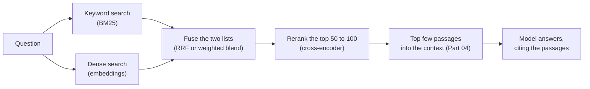
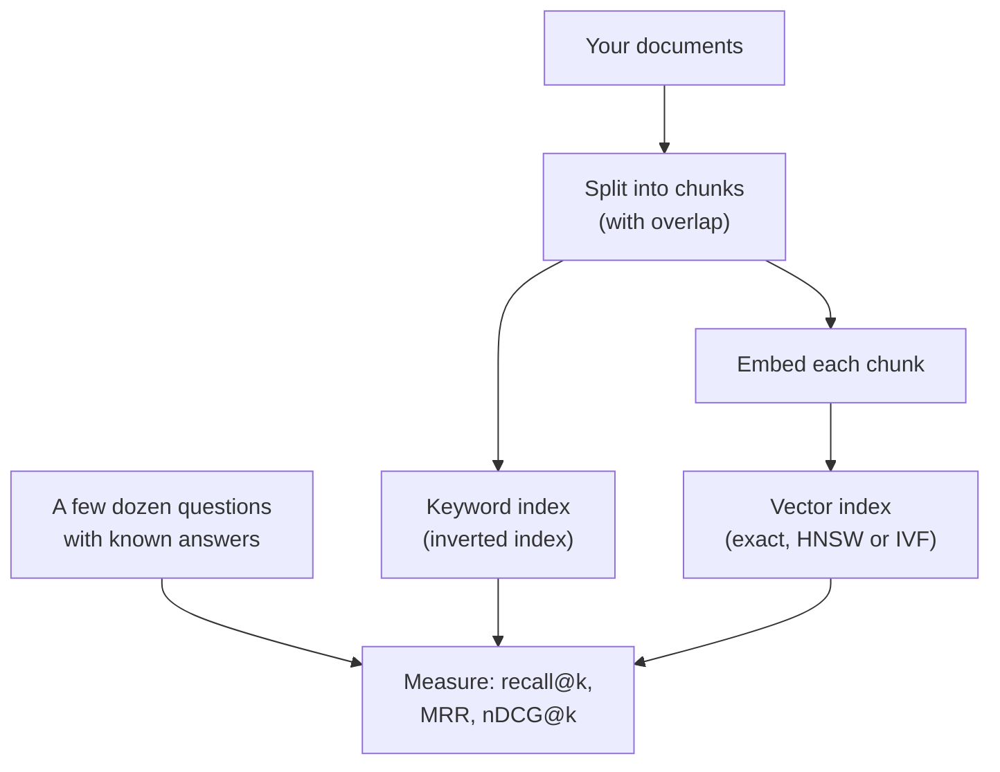

# The AI Engineering Stack, Part 05: Retrieval

*October 13, 2026; reader tests added October 20, 2026. Part 05 of 13 (claude/engineering-stack-plan.md). Tags in this part: 189 [V], 77 [T], 6 [R], 21 [U] and 7 [I], counted in Sections 1 to 12 and the checks after them. Still open: no neural model runs on the test machine (Hugging Face is blocked), so embedding models, rerankers and late interaction are described from documentation and tested only as reader tests [R]. No independent benchmark of vector databases, and no peer-reviewed study of chunk size, was opened [U]. Elasticsearch's licence tier for its RRF retriever rests on its source code, not its subscription table [U]. The lab's reader tests, including the real models, ran on Windows by script on October 20, 2026 [T]; the typed Windows steps and macOS haven't been run [R]. The lab's corpus, questions and stand-in dense search are invented for teaching [I]; the code that scores and measures them is tested [T].*

**What this part gives you.** How to find the few passages that belong in a model's context, out of thousands or millions. **Retrieval** is the search step: given a question, return the most useful pieces of your own documents, best first. Part 04 showed that a smaller, focused context usually beats a bigger one; this part is how you choose what goes in it. It covers keyword search, search by meaning, how to merge the two, how to re-sort the top results with a slower and better model, how to cut documents into pieces, and how to measure whether any of it works. The lab runs on any computer with Python and needs no model, account or API key.

## How to read this part

The tags are Part 01's. **[V: KEY]** points to Section 12, which gives each source's class and the place used. **[T]** ran on the test machine. **[R]** is a reader test. **[U]** names what would settle it. **[I]** is invented for teaching. Source classes: official documentation and source code (OD), peer-reviewed (PR), preprint (PP), vendor or personal blog (VB, PB). A vendor's docs are the authority on how its product works, not on how good it is. Licence notes are information, not legal advice. Prices are list prices read on October 13, 2026.

**The test machine:** Ubuntu 24.04 in a cloud container, October 13, 2026, with Python 3.13.16, 3.12.3 and 3.11.17. It has no GPU and can't download models from Hugging Face (the network blocks it), so every neural model in this part (embedding models, rerankers) is described from documentation and tested only as a reader test [R].

**This part covers one topic** (plan, Section 7): T07, retrieval, which the plan places in the **Context** layer. How to prompt with retrieved passages (numbering sources, asking for citations, saying "not in the sources") is already in claude/taxonomy-of-prompt-engineering-3e.md (the taxonomy), Section 11.1, and claude/prompt-construction-guide-2e.md (the guide), Section 15; this part links to them instead of repeating them. Knowledge graphs and agent memory are Part 06. Measuring answers (not just retrieval) is Part 02.

## 1. In plain words

**What it is.** You have a pile of documents: manuals, policies, tickets, notes. Someone asks a question. Retrieval finds the handful of passages most likely to hold the answer and hands them to the model, which then answers from them. The full pattern, retrieve and then generate, is called **retrieval-augmented generation (RAG)** [V: LEW].

**The problem it solves.** A model doesn't know your documents, and it can't read all of them for every question: the window has a limit, and accuracy falls as the input grows (Part 04, Section 3.4). Retrieval narrows the pile first. It also lets the model cite where an answer came from, so you can check it.

**What it doesn't solve.** Grounding helps, but it doesn't end wrong answers. On 202 legal research questions in 2024, commercial tools built on retrieval still gave hallucinated answers about 17% (Lexis+ AI) to about 33% (Westlaw AI-Assisted Research) of the time [V: MAG]. If retrieval misses the right passage, the model answers from the wrong ones. Design for misses.

*Analogy.* A reference librarian. You don't read the whole library; you ask, and the librarian brings five books opened to the right pages. Two kinds of librarian help: one who matches your exact words against the catalogue (fast, precise on names and codes, lost when you use different words), and one who understands what you mean (good with synonyms, vague on exact codes). The best desks use both, then a careful second reader checks which of the pulled pages really answer you.

**Where it sits in the stack** (plan, Section 5). Retrieval sits in the **Context** layer: it decides what the model reads. It feeds Part 04's budget, it needs Part 02's evals to know if it works, and Part 10 covers the security side (a retrieved document can carry instructions aimed at the model).

## 2. Definitions

Every term is also in claude/engineering-stack-glossary.md. References like "ledger P5-06" point to rows of claude/engineering-stack-claim-ledger.md, this series' audit of the Gemini report.

| Plain words | Technical term | Notes |
|---|---|---|
| Find passages, then have the model answer from them | Retrieval-augmented generation (RAG) | Lewis et al., 2020 [V: LEW] |
| The pile you search | Corpus | |
| One searchable piece of a document | Chunk; passage | Cutting documents into chunks is **chunking** (Section 3.7) |
| Search by matching the question's words | Keyword search; lexical search; sparse retrieval | "Sparse" because each text is a long list of word counts, mostly zero |
| A lookup table from each word to the chunks that contain it | Inverted index | What keyword search engines build |
| The standard keyword scoring formula | BM25 (Okapi BM25) | Section 3.1 [V: RZ09] |
| How rare a word is across the corpus; rare words count more | Inverse document frequency (IDF) | Section 3.1 |
| A list of numbers that stands for a text's meaning | Embedding; vector | Made by an **embedding model** |
| Search by comparing embeddings | Dense retrieval; semantic search; vector search | |
| How close two embeddings point | Cosine similarity; dot product | Equal when vectors have length 1 [V: STD] |
| An embedding model that encodes question and chunk separately | Bi-encoder | Fast: chunk vectors are made once, in advance |
| A model that reads question and chunk together and scores the pair | Cross-encoder | Slower, usually more accurate; used to **rerank** [V: SBR] |
| Re-sorting the top results with a better, slower model | Reranking; retrieve-then-rerank | Section 3.5 |
| Keeping one vector per token and matching token to token | Late interaction; multi-vector retrieval (ColBERT) | Section 3.5 [V: CB2] |
| Learned keyword-style vectors that add related words | Learned sparse retrieval (SPLADE) | Section 3.5 [V: SPL] |
| Combining keyword and dense results | Hybrid search; fusion | Section 3.4 |
| Merging ranked lists by rank position only | Reciprocal rank fusion (RRF) | [V: COR] |
| Merging by a weighted sum of rescaled scores | Convex combination (CC); weighted fusion | [V: BRU] |
| Finding close vectors fast without checking every one | Approximate nearest neighbour search (ANN) | HNSW and IVF are two methods (Section 3.3) |
| A graph-based ANN method | HNSW (hierarchical navigable small world) | [V: HNS] |
| A search engine or database built for vectors | Vector store; vector database | Section 3.3 |
| Share of the right passages found in the top k | Recall@k | Section 3.8 [V: IRM] |
| Share of the top k that are right | Precision@k | |
| 1 divided by the rank of the first right result | Reciprocal rank; mean reciprocal rank (MRR) over many questions | |
| A ranking score that rewards right results near the top and allows graded relevance | nDCG@k (normalized discounted cumulative gain); "@10" means scored on the top 10 | Section 3.8 [V: JK2, TRE] |
| Whether any right passage is in the top k | Success@k (often mislabelled "recall@k") | [V: IRM] |
| Questions with their known right passages | Relevance judgments; qrels | The test data for retrieval (Part 02, Section 3) |
| A large public set of web questions and judged passages, from Microsoft, used to train and compare retrievers | MS MARCO | Results are often reported on its "dev" (development) set and a held-out "eval" set |
| Tested on data unlike anything the model was trained on | Zero-shot; out of domain | The opposite is in domain |
| Trained further on labelled examples for one task | Fine-tuned | A fine-tuned retriever learned from question and answer pairs |
| The piece of text a model reads as one unit | Token | About 4 characters of English (Part 04, Section 3.1) |

## 3. How it works

A retrieval system has an offline half (prepare the documents once) and an online half (answer each question). The online half, as the guides read here describe it, has four steps [V: SBR, ESR, ACR]:



Each step is optional. Many good systems are keyword search alone. Add a step when a measurement (Section 3.8) shows it helps on your questions.

### 3.1 Keyword search and BM25

**The idea.** Score each chunk by how well its words match the question's words. Three rules of thumb, which BM25 turns into a formula: a word that appears in the chunk counts; a rare word counts more than a common one; and repeating a word helps less and less, while a long chunk gets less credit per match than a short one, since long chunks match more words by chance [V: RZ09].

**The formula, symbol by symbol.** For a question *Q* and a chunk *D*, sum over each question word *q*:

> score(D, Q) = Σ IDF(q) × f(q, D) × (k1 + 1) / ( f(q, D) + k1 × (1 - b + b × |D| / avgdl) )

- *f(q, D)*: how many times the word appears in the chunk.
- *|D|*: the chunk's length in words; *avgdl*: the average length across the corpus.
- *k1*: how fast repeats stop helping. Lower means repeats saturate sooner [V: RZ09].
- *b*: how much long chunks are penalized. Robertson and Zaragoza: "setting b = 1 will perform full document-length normalisation, while b = 0 will switch normalisation off" [V: RZ09].
- *IDF(q)*, rarity: Lucene, the engine inside Elasticsearch and OpenSearch, uses log(1 + (N - n + 0.5) / (n + 0.5)), where *N* is the number of chunks and *n* the number that contain the word [V: LUC]. The "1 +" keeps it above zero even for a word in most chunks.

The original papers write the formula without the (k1 + 1) factor; it multiplies every score by the same number, so it changes the scores but never the order [V: RZ09]. Modern Lucene leaves it out, and so does bm25s in its "lucene" mode [V: LUC, B25]. The lab's code keeps it, and its cross-check divides by (k1 + 1) to match bm25s to within 1e-7 [T].

**Settings differ between tools.** The paper gives ranges, not one default: "0.5 < b < 0.8 and 1.2 < k1 < 2 are reasonably good in many circumstances" [V: RZ09]. Software picks its own:

| Tool | k1 | b | IDF for very common words |
|---|---|---|---|
| Lucene, Elasticsearch | 1.2 | 0.75 | Lucene's, never negative [V: LUC, ESS] |
| bm25s 0.3.13 | 1.5 | 0.75 | Lucene's by default; four other variants available [V: B25] |
| rank_bm25 0.2.2 (BM25Okapi) | 1.5 | 0.75 | Robertson's log((N - n + 0.5) / (n + 0.5)), with any negative value replaced by 0.25 × the average IDF [V: RBM] |

So "BM25" on two tools can give two rankings of the same chunks. On the lab's four questions, rank_bm25 and the lab's Lucene-style code gave the same top 3 for the two questions where BM25 finds anything, and both found nothing for the other two [T].

**Worked example** [T]. The lab's corpus has 12 short chunks; after dropping common words like "the" and "to", they average 7.42 words. Question: "dishwasher E42". Chunk d03 ("Error code E42 on the dishwasher means the drain pump is blocked") keeps 7 words. "dishwasher" is in 3 chunks, so its IDF is log(1 + 9.5 / 3.5) = 1.312; "e42" is in 1, IDF 2.159. With k1 = 1.2 and b = 0.75, each word appears once in a 7-word chunk, and the two contributions are 1.343 and 2.210, for a score of 3.553. The rare code does most of the work, which is the point of IDF.

**Where keyword search fails.** It only matches the words you typed. The lab's question "fix a flat bicycle tyre" shares no word with the chunk "How to repair a punctured tire" except "a", which the lab drops as too common to count, so BM25 returns nothing at all [T]. The classic name is the **vocabulary mismatch** problem. A subtler case in the lab: "dishwasher water not draining" ranks a kitchen-tap chunk first, because it contains "water", while the right chunk says "drain", and the lab's tokenizer doesn't reduce "draining" to "drain" [T]. Real engines can do that reduction (**stemming**), at the cost of some wrong merges; whether a given engine stems by default depends on its analyzer settings [U: each engine's analyzer docs].

### 3.2 Search by meaning: embeddings

**The idea.** An **embedding model** turns a text into a list of a few hundred numbers. It's trained so that texts people consider related land near each other. To search, embed every chunk once, embed the question, and return the chunks whose vectors point most nearly the same way. "Repair a punctured tire" and "fix a flat tyre" share no words, but a good model puts them close.

**How closeness is measured.** **Cosine similarity** compares the directions of two vectors, from -1 to 1. If both vectors have length 1, the plain **dot product** gives the same number and is faster: sentence-transformers' docs say "Dot product on normalized embeddings is equivalent to cosine similarity" [V: STD]. Its default similarity is cosine, unless a model's saved settings say otherwise [V: STD]. Check what your model was trained with: its docs note that models trained for normalized vectors prefer shorter passages and dot-product models prefer longer ones [V: STD].

**Nearness is not meaning.** The claim that closeness "equates to" semantic similarity (ledger P3-04) is too strong. Four pieces of evidence:

- *No model wins everywhere.* MTEB tested 33 embedding models on 8 kinds of task and 58 datasets and found "no particular text embedding method dominates across all tasks" [V: MTB].
- *Negation is missed.* NevIR built pairs of passages that differ by a negation and found most neural retrieval models perform "the same or worse than a random ranking"; cross-encoders did best, and bi-encoders, the usual embedding search, were among the worst [V: NEV].
- *Cosine can be arbitrary.* For a family of learned linear models, Steck et al. show cosine similarity can give "arbitrary and therefore meaningless" results, and caution against using it blindly [V: STE]. Their proof is for linear models; that it carries over to deep models is their argument, not a measurement.
- *Raw word vectors crowd together.* Contextual word vectors from 2019 models (BERT, ELMo, GPT-2) are "not isotropic in any layer": they aren't spread evenly in all directions [V: ETH]. That a crowded space makes unrelated vectors look similar is the usual reading, not something this abstract measures. Today's sentence embedders are trained differently; take this as background, not as a fact about them.

Better wording: nearness approximates relatedness as the model learned it, on data like its training data. Test it on your own questions.

**In domain versus out of domain.** Dense retrieval can beat keyword search by a lot on the kind of data it was trained on, and lose on everything else. Dense Passage Retrieval (DPR) beat a Lucene BM25 system by 9 to 19 percentage points of top-20 accuracy on the question-answering sets it was trained for [V: DPR]. On BEIR's zero-shot test (18 datasets, mostly unlike the training data), DPR averaged 47.7% below BM25 in nDCG@10 (relative to BM25's score, not percentage points), while ANCE averaged 7.4% below and TAS-B 2.8% below; BEIR calls BM25 "a robust baseline" [V: BEI, Table 2]. BEIR also warns that many of its datasets have a "lexical bias", since their judged passages were partly found by keyword search, which favours BM25 [V: BEI, §6]. These are 2020 to 2021 models; the lesson that holds is to test out-of-domain, not the exact gaps.

**The lab's stand-in.** Embedding models can't be downloaded on the test machine, so the lab uses a stand-in [I]: a small table that maps words to concepts ("fix", "repair" and "patch" all map to *repair*; "tyre" and "tire" to *tire*), with each text's vector being its count of concepts, scaled to length 1. It shows *why* dense search finds synonyms; it is not how a real model works, and its scores mean nothing elsewhere. With it, "fix a flat bicycle tyre" finds the tire-repair chunk first, and "squeaky brakes" finds "Brake pads squeal" [T]. Section 8, step 6 runs a real embedding model instead [T: on the owner's Windows PC, October 20, 2026].

### 3.3 Finding near vectors fast, and where they live

**Exact search is fine more often than people think.** Comparing the question with every stored vector is called **exact** or **brute-force** search. FAISS's guide: "The only index that can guarantee exact results is the IndexFlatL2 or IndexFlatIP", and for a few thousand searches direct computation is "the most efficient option" [V: FAW]. pgvector, the Postgres extension, also searches exactly by default, "which provides perfect recall" [V: PGV]. Start exact; switch when it's measured too slow.

**Approximate search** trades a little recall for a lot of speed on large collections:

- **HNSW** builds a layered graph of near neighbours and walks it from the top layer down [V: HNS]. Its settings: *M*, the number of neighbours per node ("A larger M is more accurate but uses more memory"); *efConstruction*, how hard to search while building; *efSearch*, how hard to search per query [V: FAW]. pgvector's defaults are m 16, ef_construction 64 and ef_search 40 [V: PGV]. FAISS's guidelines page gives HNSW's memory as (d × 4 + M × 2 × 4) bytes per vector (its index table writes 4 × d + x × M × 2 × 4, with an extra factor x; the guideline's form is x = 1) [V: FAW]; for 384-dimension vectors with M = 16, that's 1,664 bytes, about 1.7 GB per million vectors [T].
- **IVF** groups vectors into clusters and searches only the nearest few clusters (*nprobe*); FAISS suggests between 4 × √N and 16 × √N clusters for N vectors [V: FAW].

**Kinds of store.** Six different kinds of thing get called a "vector database" (versions and licences in Section 6):

| Kind | Examples | You run |
|---|---|---|
| A library inside your program | FAISS | Nothing extra [V: FAW] |
| An embedded database, or a small server | Chroma | A Python package, or `chroma run` [V: CHT] |
| A vector database server | Qdrant, Weaviate, Milvus | A server [V: QDH, WVL, MIL] |
| A search engine with vector fields | Elasticsearch, OpenSearch | A search cluster [V: ESR, OSN] |
| An extension to a database you already have | pgvector for Postgres | Postgres [V: PGV] |
| A managed service only | Pinecone | Nothing; an account and key [V: PRC] |

### 3.4 Hybrid search: merging two ranked lists

Keyword and dense search fail in different places: keyword search on synonyms, dense search on exact codes, names and negation. Running both and merging the lists is **hybrid search**.

**Reciprocal rank fusion (RRF).** Give each chunk 1 / (k + rank) from each list it appears in, ranks counted from 1, and add them up [V: COR, ESR]:

> RRF(d) = Σ over lists of 1 / (k + rank of d in that list)

It uses positions only, so the two lists' scores never have to be put on the same scale; rescaling one list changes nothing (the lab's check 5) [T]. Cormack et al. set k = 60 from a 2009 pilot and called the choice not critical; Elasticsearch defaults to 60 [V: COR, ESR]. What k does: with k = 60 and two lists, a chunk ranked r in both beats a chunk ranked first in only one as long as r ≤ 61, and by at most 2x (ledger P5-06) [T]. With k = 1, a lone first place (1/2 = 0.500) beats a chunk ranked 5th in both (2/6 = 0.333): small k trusts each list's top pick more [T].

**The off-by-one trap.** Some tools count ranks from 0, which shifts what k means. Qdrant's code computes 1 / (position + k) with positions from 0 and a default k of 2 [V: QDH], which is exactly Cormack's formula with k = 1, not 60 (the lab's check 4d proves the equivalence for 100 positions) [T]. Chroma's hybrid formula also counts from 0, with k defaulting to 60, which equals Cormack's k = 59 [V: CHH][T]. So "RRF" with "the default k" means different things in different tools. Read the docs before comparing results across them.

**Convex combination.** The other way: rescale each list's scores to 0 to 1 (for example, min-max: lowest to 0, highest to 1), then take α × dense + (1 - α) × keyword. Weaviate's hybrid search weights its two lists with `alpha`, where "An alpha of 1 is a pure vector search" and 0 is pure keyword; its default since v1.24 is relative-score fusion, a score-based blend, and a rank-based option is also offered [V: WVH]. OpenSearch offers min-max (its default), L2 and z-score rescaling, and also RRF [V: OSN]. In a peer-reviewed comparison, Bruch et al. found "CC outperforms RRF in in-domain and out-of-domain settings", that RRF is "sensitive to its parameters", and that CC needs only a small set of labelled questions to tune its one weight [V: BRU]. So: RRF is a good default with no labelled data; a tuned blend can beat it once you have some.

**What the lab shows** [T]. Mean nDCG@3 over the lab's four questions (higher is better, 1.0 is perfect):

```
$ python run_lab.py
...
     mean nDCG@3 BM25                 0.4174
     mean nDCG@3 stand-in dense       0.8651
     mean nDCG@3 RRF (k=60)           0.8877
     mean nDCG@3 convex (alpha=0.5)   0.8877
```

Fusion wins on average here, but not on every question. Per question (`python search_demo.py`):

```
q1 'dishwasher E42'  (relevant: {'d03': 2, 'd09': 1})
   BM25            nDCG@3 1.000   d03 3.553, d09 1.514, d04 1.343
   stand-in dense  nDCG@3 0.670   d04 0.707, d03 0.671, d09 0.289
   RRF k=60        nDCG@3 0.950   d03 0.033, d04 0.032, d09 0.032
   convex a=0.5    nDCG@3 0.950   d03 0.957, d04 0.500, d09 0.039
q3 'dishwasher water not draining'  (relevant: {'d09': 2, 'd03': 1})
   BM25            nDCG@3 0.670   d07 1.986, d09 1.514, d03 1.343
   stand-in dense  nDCG@3 0.950   d09 0.707, d04 0.577, d03 0.548
   RRF k=60        nDCG@3 0.760   d09 0.033, d07 0.032, d04 0.032
   convex a=0.5    nDCG@3 0.760   d09 0.633, d07 0.500, d04 0.283
```

On q1 the exact code rescues fusion from the dense stand-in's mistake. On q3, BM25's wrong first pick (the kitchen tap) drags fusion below dense search alone. Four invented questions prove nothing about real data [I]; the point is that fusion is a bet you check with your own questions.

### 3.5 Reranking, late interaction and learned sparse

**Reranking.** A **cross-encoder** reads the question and one chunk together and outputs a relevance score. It sees how the words of each relate to the other, so it's usually more accurate than comparing two separately made vectors, and it's "Often slower ... as it requires computation for each pair rather than each text" [V: SCE]. Nothing can be computed in advance, so it's used on a short list: "we use the retriever to create a set of e.g. 100 possible candidates which are then re-ranked by the Cross-Encoder" [V: SBR].

The idea's best-known early result: Nogueira and Cho fine-tuned BERT to rerank BM25's top 1,000 passages on MS MARCO and reached an MRR@10 of 35.8 on the evaluation set, against 28.1 for the previous best and 16.5 for BM25 alone (a preprint) [V: NOG]. Their "27%" improvement is relative; in points it's 7.7 [T]. A sequence-to-sequence version, monoT5, reached 0.398 on the development set with a 3-billion-parameter model, against 0.372 for BERT-large (Findings of EMNLP 2020) [V: MT5].

Small modern rerankers run on a laptop processor. The model card for cross-encoder/ms-marco-MiniLM-L6-v2 (22.7 million parameters, Apache-2.0) reports MRR@10 of 39.01 on MS MARCO dev at 1,800 documents per second on a V100 GPU; its 12-layer sibling scores 39.02 at 960 per second, about 1.9x slower for a gain of 0.01 [V: MML][T]. These are the publisher's own numbers. In sentence-transformers 6.1.0, `CrossEncoder(...).rank(query, documents, top_k=...)` returns the documents sorted, with `corpus_id` and `score` [V: SCE]. Raw scores "can reasonably range between -10 and 10" unless a sigmoid is set, so don't read them as probabilities (sentence-transformers' pretrained cross-encoder page) [V: SCE].

**Late interaction (ColBERT).** A middle path: keep one vector per *token* of each chunk (made in advance), and score a question by matching each of its token vectors to the closest token vector in the chunk, then adding those best matches. That's the MaxSim score, score(Q, D) = Σ_i max_j Q_i · D_j (ledger P5-08) [V: CB2]. ColBERTv2 (NAACL 2022) compresses the token vectors to 20 or 36 bytes each [V: CB2]. On MS MARCO dev it scored MRR@10 39.7, between 0.9 to 9.3 points above the single-vector models in its Table 4, from RocketQAv2 (38.8) to RepBERT (30.4) [V: CB2]. (Ledger row P5-09 says 0.9 to 8.6, having taken DPR, 31.1, as the lowest; RepBERT is lower.) PLAID (CIKM 2022), a search engine for ColBERTv2, reports up to 7x lower latency on a GPU and 45x on a CPU than plain ColBERTv2, measured by its authors [V: PLD]. The cost is storage: one vector per token instead of one per chunk.

**New since this series was planned:** sentence-transformers 6.0.0 (August 18, 2026) added a `MultiVectorEncoder` for late interaction, and its migration guide says it "absorbs the modeling, training, and evaluation of PyLate and colpali-engine" [V: ST6]. The colpali-engine README now says it "is now deprecated" and recommends sentence-transformers for new projects [V: CPE].

**Learned sparse (SPLADE).** A model that outputs keyword-style vectors, but learned: it adds related words to each chunk and question, and still runs on an ordinary inverted index [V: SPL]. SPLADE was published at SIGIR 2021; its README lists SPLADE v2 and later versions at MS MARCO dev MRR@10 between 34.0 and 38.8, by the authors' own table [V: SPL]. Its code is licensed CC BY-NC-SA 4.0, which is for non-commercial use [V: SPL]. sentence-transformers 6 also has a `SparseEncoder` for this family [V: ST6].

**Pages as images (ColPali).** For PDFs full of tables and figures, ColPali skips text extraction: a vision-language model turns each page image into about a thousand patch vectors and matches them ColBERT-style (ICLR 2025) [V: CPL]. On its authors' own ViDoRe benchmark (10 datasets, nDCG@5), it averaged 81.3 against 67.0 for the best text pipeline they built (layout parsing, OCR, captions, then BGE-M3 embeddings), a gap of 14.3 points, and indexed a page in 0.39 seconds against 7.22 on an NVIDIA L4 [V: CPL][T]. It needs a GPU to be practical [U: CPU speed not measured].

### 3.6 Changing the question or the chunk

**HyDE.** Ask a model to write a fake answer, embed that, and search with it: a fake answer looks more like a real answer than a question does. With text-davinci-003 writing and the unsupervised Contriever embedding, HyDE reached nDCG@10 61.3 on TREC DL19 against 44.5 for Contriever alone and 50.6 for BM25, but stayed below the fine-tuned Contriever (62.1) (ACL 2023) [V: HYD]. It costs a model call per question, and its generator model may no longer be offered [U: OpenAI's deprecations page].

**Contextual retrieval.** Before indexing, have a model write a short note for each chunk that says where it sits in its document (Anthropic suggests 50 to 100 tokens), and prepend it to the chunk for both the embedding and the BM25 index [V: ACR]. Anthropic reports that, measured as "1 minus recall@20", contextual embeddings cut the failure rate by 35% (5.7% to 3.7%), adding contextual BM25 by 49% (to 2.9%), and adding reranking by 67% (to 1.9%), with Gemini Text 004 embeddings and a Cohere reranker on codebases, fiction, arXiv papers and science papers [V: ACR]. Those are relative cuts: in percentage points, 2.0, 2.8 and 3.8 [T]. It's a vendor's own evaluation, not replicated independently. The note-writing is a one-time cost Anthropic put at "$1.02 per million document tokens" with prompt caching, on its 2024 prices [V: ACR]. The taxonomy's Section 11.1 cites the same figures, and they match.

### 3.7 Chunking

**Why chunk.** Embedding models read a limited number of tokens (all-MiniLM-L6-v2, a common small model, cuts input longer than 256 word pieces) [V: MLE], and smaller pieces let retrieval point to the exact passage.

**What tools do by default.** LangChain's `RecursiveCharacterTextSplitter` tries to cut at paragraph breaks, then line breaks, then spaces, with defaults of 4,000 characters per chunk and 200 of overlap, counted in characters [V: LCH]. Many tutorials pass 1,000 and 200; that's their choice, not the default. The lab's `chunk_text` does the same thing from scratch, and its check proves the chunks stay under the size limit, overlap as asked, and rebuild the original text with nothing lost [T].

**What size?** No single best size is supported. A 2025 preprint across several datasets found 64 to 128 tokens best for short factual answers and 512 to 1,024 tokens for questions needing broader context, varying with the embedding model [V: BHT]. A vendor report from Chroma found that chunking strategy "can have a significant impact on retrieval performance", with some strategies ahead of others "by up to 9% in recall", while recall also varied widely from question to question [V: CCR]. Another preprint found that splitting by meaning ("semantic chunking") wasn't worth its extra compute compared with fixed-size splitting [V: QUC]. No peer-reviewed study of chunk size was opened for this part [U]. So: start with a simple recursive splitter, a few hundred tokens, some overlap, and test two or three sizes on your own questions.

**One risk overlap guards against.** A fact split across two chunks may be retrievable from neither, which the guide (Section 15, step 1) warns about. Overlap copies the end of each chunk into the start of the next, so a short fact cut at a boundary still appears whole once.

### 3.8 Measuring retrieval

Measure retrieval on its own, before judging answers: if the right passage isn't retrieved, no prompt can fix the answer.

**The test data.** A few dozen real questions, each with the chunk IDs that answer it and, optionally, a grade (2 = answers it, 1 = related). Part 02, Section 3 covers building such a set. The lab's `corpus.py` has four [I].



**The four standard measures** (definitions as ir_measures gives them) [V: IRM]:

- **Recall@k**: "The fraction of relevant documents for a query that have been retrieved by rank k." Use it to choose how many chunks to pass on: if recall@20 is high and recall@5 low, pass more or rerank.
- **Precision@k**: the share of the top k that are relevant (it divides by k even if fewer came back).
- **Reciprocal rank**: 1 / the rank of the first relevant result; its average over questions is **MRR**.
- **nDCG@k**: add each result's gain divided by log2(rank + 1), then divide by the best possible total for that question. trec_eval, ir_measures and ranx use the grade as the gain by default; a second version uses 2^grade - 1 (ranx's `ndcg_burges`, ir_measures' `exp-log2`) [V: TRE, IRM, RNX]. The two agree on yes-or-no labels and differ on graded ones (the lab's check 7c: 0.5406 against 0.5625 on one example) [T]. Say which you used. nDCG comes from Järvelin and Kekäläinen (ACM TOIS, 2002); trec_eval's exact discount was read from its code, not from the 2002 paper [V: JK2, TRE].

**A naming trap.** "Some tasks define Recall@k as whether any relevant documents are found in the top k results"; ir_measures, following TREC's convention, calls that **Success@k** [V: IRM]. Many blog posts and vendor reports say "recall" for it. When a report gives a recall number, check which one it means.

**The lab's metrics match a reference library.** `crosscheck.py` scores the same runs with ir_measures 0.4.3 (which uses trec_eval through pytrec-eval-terrier) and gets identical nDCG@3, recall@3 and reciprocal rank, on Python 3.13.16, 3.12.3 and 3.11.17 [T].

**Measuring the whole RAG pipeline.** Ragas defines **context precision** (a rank-weighted share of retrieved chunks that are relevant), **context recall** (the share of a reference answer's claims that the retrieved chunks support) and **faithfulness** (the share of the generated answer's claims that the retrieved chunks support) [V: RGS]. The main versions call a model as judge, so they inherit Part 02's warnings about judges; Ragas also has non-model versions of context precision based on string similarity or chunk IDs [V: RGS]. Ragas's last release was 0.4.3 (January 13, 2026), and its main branch had no commits from February 24 to October 13, 2026 [V: RGS]. Two research alternatives: ARES trains small judge models and adds "only a few hundred human annotations" through a statistical method called prediction-powered inference [V: ARE]; RAGChecker separates retriever and generator errors at the level of single claims [V: RCK]. Both repositories have been quiet since early 2025 or late 2024 [V: ARE, RCK].

### 3.9 Retrieve, or send everything?

**Multi-hop questions are hard for retrieval.** When an answer needs facts from several chunks, single-shot retrieval often misses some. On MultiHop-RAG's 2,556 news questions, GPT-4 answered 56% correctly from retrieved chunks and 89% when given the right evidence directly (ledger B3-01) [V: MHR]. Part 06 covers graph-based approaches aimed at this.

**Long context against retrieval.** Li et al. (EMNLP 2024 Industry Track) compared sending whole long documents with retrieving 5 chunks of 300 words, on LongBench and ∞Bench [V: LIL]. Long context scored higher on average: 49.70 against 37.33 for Gemini-1.5-Pro and 48.67 against 32.60 for GPT-4o, with gpt-3.5-turbo-0125 closer (32.07 against 30.33). The two gave the same prediction on 63% of questions, so the authors routed each question between them (their "Self-Route"), which kept quality near long context (46.41 for Gemini-1.5-Pro, 48.89 for GPT-4o) while using 38.39% and 61.40% of its tokens [V: LIL]. These are 2024 models on 2024 prices. The practical rule, with Part 04: if the whole corpus fits the window and is reused, send it and cache it; if it doesn't fit, or most of it is irrelevant to each question, retrieve.

## 4. Gemini said, evidence says

| Gemini (ledger row) | Evidence | Section |
|---|---|---|
| RAG turns recall into reading comprehension, "drastically reducing" hallucination (P5-01) | Overstated. Grounding helps, by amounts nobody measured as "drastic": RAG-based legal tools still hallucinated on about 17% to 33% of 202 questions in 2024 [V: MAG]. Lewis et al. measured one comparison (judges found RAG more factual than closed-book BART in 42.7% of 452 Jeopardy pairs, the reverse in 7.1%) (ledger P5-01) [V: LEW] | 1 |
| Modern retrieval fuses dense and sparse signals (P5-02) | Confirmed as shipped practice: Elasticsearch, OpenSearch, Qdrant, Weaviate and Chroma Cloud all ship hybrid search [V: ESR, OSN, QDH, WVH, CHH]. No data on how many systems use it was opened | 3.4 |
| RRF needs no score normalization or supervised tuning (P5-03) | Confirmed: ranks only. But k is still a setting, tools disagree on its meaning (0- or 1-based ranks), and a tuned weighted blend beat RRF in a peer-reviewed comparison [V: COR, QDH, CHH, BRU] | 3.4 |
| score = Σ 1/(k + rank(d)) (P5-04) | Confirmed, with ranks from 1 [V: COR, ESR]; the lab recomputes it [T] | 3.4 |
| k is "typically 60" (P5-05) | Confirmed for Cormack et al. and Elasticsearch [V: COR, ESR]. Not universal: Qdrant's default k = 2 with 0-based positions behaves like k = 1 [V: QDH][T] | 3.4 |
| Agreement "vastly outweighs" one anomalous first place (P5-06) | Overstated: with k = 60 and two lists, agreement wins by at most 2x, and only while it's ranked 61st or better in both; with small k a lone first place can win [T] | 3.4 |
| ColBERTv2 keeps token-level embeddings (P5-07) | Confirmed, compressed to 20 or 36 bytes each [V: CB2]; published at NAACL 2022 [V: CB2] | 3.5 |
| MaxSim formula (P5-08) | Confirmed [V: CB2] | 3.5 |
| Late interaction "vastly improves accuracy" over single vectors (P5-09) | Overstated: 0.9 to 9.3 points of MRR@10 on MS MARCO dev over the single-vector models in ColBERTv2's Table 4 (the ledger's 8.6 missed RepBERT) [V: CB2] | 3.5 |
| Tools: Elasticsearch, ChromaDB, FAISS, Pinecone (P5-10) | Confirmed and maintained; four different kinds of thing (Section 3.3). Server versions and licences now read: Section 6 | 3.3, 6 |
| BM25 top 100, then a cross-encoder reranks the top 10 (P5-11) | Illustrative [I]. The pattern is standard; sentence-transformers' own example reranks about 100 candidates [V: SBR] | 3.5 |
| Curriculum: recursive and semantic chunking; BM25 fails on vocabulary mismatch (P5-12) | Both settled here. No best chunk size; semantic chunking didn't justify its cost in one preprint [V: BHT, CCR, QUC]. Vocabulary mismatch is real (the lab's q2 [T]), yet BM25 stays a strong out-of-domain baseline [V: BEI] | 3.1, 3.7 |
| In embedding space, proximity "equates to" semantic similarity (P3-04) | Contradicted as stated. Nearness approximates relatedness as the model learned it: no model wins every task, negation is mostly missed, and cosine can be arbitrary for some learned embeddings [V: MTB, NEV, STE, ETH] | 3.2 |
| Dense-vector RAG "frequently struggles" with multi-hop reasoning (B3-01) | Confirmed in substance: GPT-4 at 56% from retrieved chunks against 89% from the right evidence on 2,556 multi-hop questions; "frequently" is unquantified [V: MHR] | 3.9 |

## 5. Examples

**Real examples.**

1. *Contextual retrieval* [V: ACR]. Anthropic prepended a short model-written note to each chunk before indexing; its own evaluation found top-20 retrieval failures fell from 5.7% to 1.9% when combined with contextual BM25 and reranking (Section 3.6). A vendor's evaluation of its own method, with no independent replication found.
2. *Page images instead of text* [V: CPL]. ColPali's authors retrieved PDF pages straight from their images and scored 14.3 nDCG@5 points above their best text pipeline, on their own benchmark; indexing was about 18 times faster per page on an NVIDIA L4 (7.22 / 0.39) [T].
3. *Legal research tools* [V: MAG]. Commercial legal assistants built on retrieval still produced hallucinated answers on roughly a fifth to a third of 202 questions in 2024. Retrieval narrows mistakes; it doesn't remove them.

**A fully worked example: hybrid search over a repair FAQ** [I: the FAQ and questions are invented; every step ran].

*Input.* The lab's 12 chunks and the question "dishwasher E42".

*Step 1, keyword search.* BM25 scores d03 ("Error code E42 on the dishwasher ...") at 3.553, d09 at 1.514 and d04 at 1.343; the rare code "e42" supplies 2.210 of d03's score (Section 3.1) [T].

*Step 2, dense search* (the stand-in [I]). It ranks d04 ("Clean the dishwasher filter ...") first at 0.707 and d03 second at 0.671: the error code maps to one concept among several, and the shorter d04 is mostly "dishwasher" [T].

*Step 3, fuse with RRF, k = 60.* d03 gets 1/61 + 1/62 = 0.0325; d04 gets 1/63 + 1/61 = 0.0323; d09 gets 1/62 + 1/63 = 0.0320 [T]. The order is d03, d04, d09.

*Step 4, measure.* With d03 graded 2 and d09 graded 1, nDCG@3 is 1.000 for BM25, 0.670 for dense alone and 0.950 for the fused list [T].

*Output.* The right chunk on top, and the related one in the top 3. Then pass the top few, numbered, to the model with the guide's Section 15 prompt.

## 6. What you need

Checked October 13, 2026 [V: PYPI, GHT].

**Libraries** (all free):

| Tool | What it's for | Licence | Runs on | Account or key? | Maintained | Version |
|---|---|---|---|---|---|---|
| The lab's scripts | BM25, fusion, metrics, chunking | This series | Python 3.11 to 3.13, standard library [T] | No | This series | Lab zip |
| bm25s | Fast BM25 in Python, five variants | MIT [V: B25] | Python 3.8 or later; NumPy (SciPy optional, for indexing) [V: PYPI] | No | Yes: commits to October 8, 2026 [V: B25] | 0.3.13, October 7, 2026 |
| rank-bm25 | Simple BM25 in Python | Apache-2.0 [V: RBM] | Python | No | Last commit October 8, 2024; no release since February 2022 [V: RBM] | 0.2.2 |
| sentence-transformers | Embedding models, cross-encoders, late interaction, learned sparse | Apache-2.0 [V: ST6] | Python 3.10 or later; PyTorch (the Windows wheel of torch 2.14.1 is 124.1 MB; on Linux install the CPU-only build, Section 7.5) [V: PYPI] | No; downloads models from Hugging Face | Very active [V: ST6] | 6.2.0, October 21, 2026 [T: PyPI, October 26]; the rest of this row was checked at 6.1.0 |
| faiss-cpu | Exact and approximate vector search | MIT [V: PYPI] | Python 3.10 or later | No | Yes | 1.15.1, September 16, 2026 |
| rerankers | One interface to many rerankers | Apache-2.0 [V: RRK] | Python 3.8 or later | Only for hosted rerankers | Last release May 22, 2025; last commit December 20, 2025; its git tags stop at 0.6.0, so use PyPI for versions [V: RRK] | 0.10.0 |
| FlashRank | Small rerankers on ONNX, no PyTorch | Apache-2.0 [V: FLR] | Python 3.6 or later | No | Low activity: last code merge September 15, 2025 [V: FLR] | 0.2.10, January 6, 2025 |
| ir-measures | Retrieval metrics with trec_eval underneath | Apache-2.0 [V: IRM] | Python 3.9 or later | No | Yes [V: IRM] | 0.4.3 |
| ranx | Retrieval metrics and fusion | MIT [V: RNX] | Python 3.8 or later | No | Last release and last commit both August 7, 2025 [V: RNX] | 0.3.21 |
| Ragas | RAG metrics, mostly model-judged | Apache-2.0 [V: RGS] | Python 3.9 or later | A model API key for the judged metrics | Slowing: no commits February 24 to October 13, 2026 [V: RGS] | 0.4.3 |

**Stores** (licences from each project's licence file; information, not legal advice):

| Store | Kind | Licence | Hybrid search | Telemetry | Newest |
|---|---|---|---|---|---|
| FAISS | Library | MIT | No; fuse yourself | Not checked [U] | 1.15.1 |
| Chroma | Embedded or server; Chroma Cloud | Apache-2.0 | RRF through the Search API, "available in Chroma Cloud only" [V: CHH] | "As of version 1.5.4, Chroma no longer collects product telemetry" [V: CHT] | 1.5.9 |
| Qdrant | Server; Qdrant Cloud | Apache-2.0 | RRF (default k = 2, 0-based) and DBSF [V: QDH] | On by default in the open-source server; off with `QDRANT__TELEMETRY_DISABLED=true` [V: QDT] | v1.19.2 |
| Elasticsearch | Search engine; Elastic Cloud | AGPLv3, SSPL or Elastic License 2.0, your choice; its x-pack code is Elastic License 2.0 only [V: ELI] | RRF retriever (k = 60); in the source, both the RRF and the linear retriever require the Enterprise licence level [V: ESR, ESL] | Not checked [U] | v9.5.5 |
| OpenSearch | Search engine | Apache-2.0 | Hybrid query with min-max, L2 or z-score rescaling, or RRF (rank constant 60) [V: OSN] | Not checked [U] | 3.9.0 |
| Weaviate | Server; Weaviate Cloud | BSD-3-Clause, except a `wl/` folder of proprietary enterprise code [V: WVL] | Weighted fusion by `alpha`; relative-score fusion by default since v1.24 [V: WVH] | Not checked [U] | v1.40.1 |
| Milvus | Server; Zilliz Cloud | Apache-2.0 [V: MIL] | Not checked [U] | Not checked [U] | v3.0.3 |
| pgvector | Postgres extension | PostgreSQL licence [V: PGV] | Not in pgvector itself [U: combining it with Postgres full-text search wasn't checked] | Not checked [U] | v0.8.7 |
| Pinecone | Managed service only | Proprietary service | Not checked [U] | n/a | SDK 10.2.0 (October 23, 2026; was 10.0.0) [T: PyPI, October 26]; free Starter plan up to 2 GB, paid from $20 a month [V: PRC] |

The Elasticsearch row rests on the source code: `RRFRankPlugin.java` gates "rank-rrf" and "linear-retriever" at `License.OperationMode.ENTERPRISE`, read at commit d1b87f8 [V: ESL][T: read by the lead session from a sparse clone]. Elastic's subscription table couldn't be read in text form [U: the subscriptions page in a browser, or calling the RRF retriever on a Basic-licence cluster].

**Rerankers and embedding models** (model cards):

| Model | Size | Licence | Reported | Source |
|---|---|---|---|---|
| sentence-transformers/all-MiniLM-L6-v2 (embedding) | 22.7M parameters, 384 dimensions, truncates past 256 word pieces | Apache-2.0 | Intended for "sentence and short paragraph" encoding | [V: MLE] |
| cross-encoder/ms-marco-MiniLM-L6-v2 (reranker) | 22.7M parameters | Apache-2.0 | MRR@10 39.01 (MS MARCO dev); 1,800 documents per second on a V100 | [V: MML] |
| BAAI/bge-reranker-v2-m3 (multilingual reranker) | 0.6B parameters | Apache-2.0 | Charts only, no numbers to quote | [V: BGR] |

Hosted rerankers (Cohere, Voyage, Jina) all need an account and an API key; Voyage's pricing page lists per-token prices, while Cohere's and Jina's pages read here didn't give a simple per-search rate [V: HRR]; this series doesn't use them (plan, Section 8). Their prices change, so none are given here.

**No independent benchmark of vector databases was opened for this part** [U: an independent, dated comparison on stated hardware]. Vendor speed claims (bm25s's "up to a 500x speedup" over rank-bm25 is its author's own benchmark, single-threaded on BEIR, where it ran at 12.2 queries per second against Elasticsearch's 11.88 on MS MARCO) are claims, not measurements [V: B25].

**The picks.**

- **Best default for a solo builder on an ordinary computer:** keyword search with bm25s, a small embedding model through sentence-transformers on the processor, exact search (NumPy or FAISS `IndexFlatIP`) until it's measured too slow, RRF in a dozen lines (the lab's `rrf`), and a small cross-encoder to rerank the top 50 to 100 [V: B25, ST6, FAW, MML]. All free, all local after the first model download. If you want a store, Chroma's embedded mode is Apache-2.0 and no longer sends telemetry, but its hybrid search is cloud-only, so fuse in your own code [V: CHT, CHH].
- **For production:** the evidence here doesn't support a single best. Choose by what you already run and by licence: OpenSearch (Apache-2.0, hybrid in its open-source plugin) or Qdrant (Apache-2.0; turn telemetry off; mind its RRF k) for open licences; Elasticsearch if you already pay for an Enterprise licence or Elastic Cloud plan that includes RRF; pgvector if your data already lives in Postgres and exact or HNSW search is enough [V: OSN, QDH, QDT, ESL, PGV].
- **Best free option:** the solo-builder stack above. Everything in it is open-source and runs on a processor.
- **When not to use retrieval:** when the whole corpus fits the window and is reused: send it once and cache it (Part 04; Section 3.9). **When not to use dense search:** when questions are mostly exact codes, names or identifiers, keyword search alone may score as well; measure before adding a model.
- **The strongest alternatives to name:** for reranking, the 12-layer MiniLM is about 1.9x slower (960 against 1,800 documents per second) for a gain of 0.01 in MRR@10 (Section 3.5) [V: MML][T]; for late interaction, sentence-transformers 6's `MultiVectorEncoder` now replaces colpali-engine and absorbs PyLate's modelling, though PyLate's PLAID index has "no Sentence Transformers equivalent" yet, so fast indexing at scale still needs PyLate [V: ST6, CPE].

## 7. Set it up

**Before you start.** Part 01's setup: Python 3.11 to 3.13, and the series folder `ai-stack` in your home folder (Part 01, Section 7). Unzip `engineering-stack-lab-part-05.zip` into `ai-stack`; you get a folder named `engineering-stack-lab-part-05`. On Windows, right-click the zip and choose Extract All; on macOS, double-click it, then move the folder into `ai-stack`; on Linux, go to the folder that holds the zip first (for example `cd ~/Downloads`), then `python3 -m zipfile -e engineering-stack-lab-part-05.zip ~/ai-stack` [T on Linux]. Run from any other folder, it fails with `FileNotFoundError: [Errno 2] No such file or directory: 'engineering-stack-lab-part-05.zip'` [T]. The core lab needs nothing installed.

In code blocks, a line starting with `$ ` is a command: type what follows the `$ `, not the `$` itself. Blocks that hold only commands (Sections 7.1 to 7.5) leave the `$` out: type each line as shown. The two diagrams in Section 3 are Mermaid code; GitHub and many Markdown viewers draw them, and a plain text viewer shows the code.

### 7.1 Windows 10 or 11 [R: the typed steps haven't been run on Windows; this lab ran there by script on October 20, 2026]

In PowerShell:

```
cd $HOME\ai-stack\engineering-stack-lab-part-05
py -V:3.13 -m venv .venv
.venv\Scripts\Activate.ps1
python run_lab.py
```

Expect `19 of 19 checks passed`. If PowerShell refuses to run `Activate.ps1`, see Part 01, Section 7.6.

### 7.2 macOS [R: no macOS test machine]

```
cd ~/ai-stack/engineering-stack-lab-part-05
python3.13 -m venv .venv
source .venv/bin/activate
python run_lab.py
```

### 7.3 Linux (Ubuntu 24.04) [T]

The same commands as macOS, with `python3` in place of `python3.13` if your Python 3 is 3.11 to 3.13. Expect `19 of 19 checks passed` (the full output is in Section 8, step 5). If `python3 -m venv` says that ensurepip is not available, install Ubuntu's venv package (`sudo apt install python3-venv`, or `python3.12-venv` for that version) and try again [R: the test machine already had it].

### 7.4 Optional: compare with published libraries [T]

```
python -m pip install -r requirements-crosscheck.txt
python crosscheck.py
```

This installs bm25s 0.3.13, rank-bm25 0.2.2, ir-measures 0.4.3, pytrec-eval-terrier 0.5.10, and NumPy and SciPy (2.5.4 and 1.18.1 on Python 3.12 and later; 2.4.4 and 1.17.1 on 3.11, because the newer releases need Python 3.12) [T]. The pins are versions only, not hashes, since these are optional checks and NumPy and SciPy ship many platform-specific files. Expect two PASS lines (BM25 against bm25s, metrics against ir_measures) and five INFO lines (rank_bm25's top 3 for each question, then a summary) [T on Python 3.13.16, 3.12.3, 3.11.17].

### 7.5 Optional: real models [T: on the owner's Windows PC, October 20, 2026; Hugging Face is blocked on the test machine]

```
python -m pip install -r requirements-real.txt
python real_models.py
```

**On Linux, install PyTorch's CPU-only build first.** The default torch 2.14.1 from PyPI requires NVIDIA's CUDA 13 libraries on Linux (its metadata lists `cuda-toolkit`, `nvidia-cudnn-cu13` and others for `platform_system == "Linux"`) [V: PYPI]; the beginner test watched pip's download cache pass 2.2 GB before stopping it, against 554.6 MB for the torch file alone [T]. Use the selector on https://pytorch.org/get-started/locally/ (Linux, Pip, Python, Compute Platform: CPU) and run the command it shows, before the line above [V: PTI][R: the selector's command wasn't read in text form]. On Windows, PyPI's torch 2.14.1 declares no CUDA libraries and its file is 124.1 MB [V: PYPI]. macOS wasn't checked [U].

The install then adds sentence-transformers 6.1.0, then downloads two 22.7-million-parameter models on first run, about 91 MB each by arithmetic (22.7 million × 4 bytes) [T]; their exact download size wasn't checked [U]. The script's plumbing was tested against a stand-in module with the same function names as sentence-transformers 6.1.0, read from its source [T]; the real models ran on the owner's Windows PC ("Run on your computer") [T].

### 7.6 A tour

| Command | What it does |
|---|---|
| `python search_demo.py` | Top 3 from BM25, the stand-in dense search, RRF and convex combination, for each question, with nDCG@3; `python search_demo.py 1` uses k = 1 for RRF |
| `python run_lab.py` | 19 checks; exit code 0 only if all pass |
| `python mutation_check.py` | Breaks the lab 16 ways in a temporary copy; each must make `run_lab.py` fail |
| `python crosscheck.py` | Optional comparisons (7.4); fails if nothing could be compared |
| `python real_models.py` | Reader test (7.5) |
| `python -c "from retrieval import *; from corpus import *; print(BM25(DOCS).search('pump', 3))"` | Any one search from the command line |

**Using the functions in your own code.** `BM25(docs).search(text, top_k)` and `ConceptSearch(docs, concepts).search(...)` return `[(id, score), ...]`, best first. `rrf([list1, list2], k=60)` and `convex(dense, sparse, alpha=0.5)` take those lists. `recall_at_k`, `precision_at_k`, `mrr` and `ndcg_at_k` take a ranked list of IDs and a dict of grades. `chunk_text(text, size, overlap)` returns a list of strings.

### 7.7 Common errors and fixes

| What you see | Why | Fix |
|---|---|---|
| `FileNotFoundError: [Errno 2] No such file or directory: 'engineering-stack-lab-part-05.zip'` | The Linux unzip command ran outside the folder that holds the zip | `cd` to that folder first, for example `cd ~/Downloads` [T] |
| `can't open file '.../run_lab.py': [Errno 2] No such file or directory` | The terminal isn't in the lab folder | `cd` into the lab folder [T] |
| `FAIL nothing was checked: install requirements-crosscheck.txt in this environment` | `crosscheck.py` ran without its packages, or in another environment | Section 7.4, with the environment active [T] |
| `ERROR: Could not find a version that satisfies the requirement scipy==1.18.1` | An older copy of the requirements file on Python 3.11 | Use the lab's file, which picks SciPy 1.17.1 on 3.11 [T] |
| `ModuleNotFoundError: No module named 'sentence_transformers'` | `real_models.py` without its install | Section 7.5 [T] |
| `ValueError: invalid literal for int() with base 10: 'abc'` | `search_demo.py` was given something other than a number for k | `python search_demo.py 1` [T] |
| `ValueError: overlap must be smaller than size` | `chunk_text` with overlap equal to or larger than size | Use an overlap well below the size [T] |
| A long traceback ending in `ProxyError: 403 Forbidden`, a connection error or a timeout, from `real_models.py` | The model download from Hugging Face was blocked (a proxy, a firewall, or no internet) | Check you can open huggingface.co in a browser; on a work network, ask whether it's allowed. The rest of the lab doesn't need it [T: reproduced with huggingface-hub on the test machine] |
| `[notice] A new release of pip is available` | An older pip (24.0 on Python 3.11 and 3.12 here) | Not an error; ignore it [T] |

### 7.8 How to uninstall

`deactivate`, move up one folder with `cd ..`, and delete the lab folder: `rm -rf engineering-stack-lab-part-05` on macOS and Linux [T], `Remove-Item -Recurse -Force engineering-stack-lab-part-05` in PowerShell [R]. If you ran Section 7.5, sentence-transformers keeps downloaded models in the Hugging Face cache outside the lab folder, by default under `.cache/huggingface` in your home folder [U: not checked in the 6.1.0 source; see Hugging Face's cache documentation]; on the owner's Windows PC that is where they went, in `.cache\huggingface\hub` [T]. pip also keeps a download cache (about 52 MB after Section 7.4 in the beginner test, gigabytes after 7.5 on Linux); `python -m pip cache dir` shows where, and `python -m pip cache purge` empties it [T].

## 8. Hands-on lab: keyword, dense and hybrid search, measured

**Goal.** See where keyword search and dense search each fail, merge them two ways, measure every method with standard metrics, and prove the measurements can catch mistakes.

**Prerequisites.** Section 7 for your system. **Time:** about 30 minutes by hand, 1 minute automated. **Cost:** none. **Pinned:** the standard library only; the optional checks pin their packages (7.4, 7.5). **Data:** 12 invented chunks and 4 questions [I]. **Files:** the `engineering-stack-lab-part-05` folder (listings in the appendix).

**Steps.** Outputs are from the test machine, Python 3.13.16, October 13, 2026 [T].

1. **Look at the data.** Open `corpus.py`. Each question has graded answers: q2's are `{"d01": 2, "d11": 1, "d08": 1}`. Notice q2 ("fix a flat bicycle tyre") shares no word with d01 except "a", which the lab drops as too common.
2. **Run every method.** `python search_demo.py`. The q1 and q3 blocks are in Section 3.4. For q2 and q4, BM25 prints `(nothing)`: no shared words [T].
3. **Fix a vocabulary mismatch by hand.** Run a search like q3 but with the documents' word, "drain" (nothing in `corpus.py` needs editing): `python -c "from corpus import *; from retrieval import *; print(BM25(DOCS).search('dishwasher water not drain', 3))"`. Now d09 is first at 3.416, then d03 at 3.030, and the kitchen tap drops to third at 1.986 [T]. That's what stemming does automatically, and why it helps keyword search.
4. **Change RRF's k.** `python search_demo.py 1`. With k = 1 the fused scores spread out (q3: d09 0.833, d07 0.700, d04 0.533), but on these four questions the order, and so nDCG@3, doesn't change [T]. With two short lists k matters less than with many long ones; Section 3.4 shows a case where it does.
5. **Run the checks.** `python run_lab.py`:
   ```
   PASS 1 BM25 score matches the formula by hand: 3.553336 vs 3.553336
   PASS 2 BM25 puts the E42 document first: ['d03']
   PASS 3 BM25 finds nothing for 'fix a flat bicycle tyre'
   PASS 3b stand-in dense search puts d01 first
   PASS 3c 'squeaky brakes': BM25 finds nothing, dense finds d06
   PASS 4 RRF scores: b=0.032522, a=0.016393
   PASS 4b agreement at rank r in both lists beats a lone first place only while r <= 61: last winning rank 61
   PASS 4c RRF's default k is 60
   PASS 4d Qdrant's default (k = 2, 0-based) equals Cormack's formula with k = 1, where a lone first place beats rank 5 in both lists: 0.500 vs 0.333
   PASS 5 RRF ignores score scale
   PASS 6 convex combination by hand: 0.9566
   PASS 6b alpha weights the dense list (alpha = 0.8): 0.8000
   PASS 7 recall@4, precision@4, precision@5, MRR
   PASS 7b nDCG@4 (gain = grade): 0.5406
   PASS 7c the two nDCG gains agree on yes/no labels and differ on graded ones: graded: 0.5406 vs 0.5625
        mean nDCG@3 BM25                 0.4174
        mean nDCG@3 stand-in dense       0.8651
        mean nDCG@3 RRF (k=60)           0.8877
        mean nDCG@3 convex (alpha=0.5)   0.8877
   PASS 8 mean nDCG@3 table matches the part
   PASS 8b fusion can lose on one query: RRF below dense on q3: 0.7602 vs 0.9502
   PASS 9 chunks stay within 200 characters, overlap 40, and rebuild the text: 21 chunks, longest 198
   PASS 10 paper arithmetic: 13 figures

   19 of 19 checks passed
   ```
   The same 19 of 19 with Python 3.12.3 and 3.11.17 [T]. Check 10 re-derives the numbers this part quotes from its sources: the relative and absolute cuts for contextual retrieval, the rerankers' gaps, ColPali's gap and speed-up, the HNSW memory and the worked example's RRF scores.
6. **Optional, with real models** [T: on the owner's Windows PC, October 20, 2026]. Section 7.5. Expect two PASS lines (a relevant chunk first for q2 and q4, where BM25 finds nothing) and four INFO lines with nDCG@3 before and after reranking. Send the whole output: whether the reranker helps on these four questions is a measurement, not something this part can predict.

**Automated check, and breaking it on purpose.** `python mutation_check.py` first runs the unbroken lab (it must pass), then makes 16 small breaks one at a time in a temporary copy and expects `run_lab.py` to fail each time [T]:

```
$ python mutation_check.py
OK   the unbroken copy passes
CAUGHT IDF loses Lucene's +1: FAIL 1 BM25 score matches the formula by hand: 3.106814 vs 3.553336
CAUGHT drop the (k1 + 1) factor: FAIL 1 BM25 score matches the formula by hand: 1.615153 vs 3.553336
...
CAUGHT RRF ranks start at 0: FAIL 4 RRF scores: b=0.033060, a=0.016667
...
CAUGHT query mapped to the wrong concept: FAIL 3c 'squeaky brakes': BM25 finds nothing, dense finds d06

16 of 16 mutations caught
```

The same on Python 3.12.3 and 3.11.17 [T]. The first run caught only 11 of 16: RRF's default k, swapped convex weights, a wrong precision divisor, an unsorted nDCG ideal and a wrong concept mapping all slipped through. Each got a new test case that the broken version fails (checks 3c, 4c, 6b, 7 and 7b), and the expected values of check 8 were corrected from rounded figures to the run's own [T]. A control was added too: if the unbroken copy fails, the script stops instead of counting "catches" (tested by breaking a grade in a copy) [T].

## 9. Teach it

**Learning objectives.** After this part you can:

1. explain BM25's parts (rarity, saturation, length) and compute one score by hand;
2. say where keyword search and dense search each fail, with an example of each;
3. merge two ranked lists with RRF and with a weighted blend, and say when each fits;
4. explain why rerankers are slower and more accurate, and where they go in a pipeline;
5. measure retrieval with recall@k, MRR and nDCG@k, and spot "recall" used to mean Success@k.

**Prerequisites.** Parts 01, 02 and 04. Reading a little Python.

**Common misconceptions.**

- *"Vector search replaced keyword search."* BM25 stayed a strong baseline out of domain, and dense models trained on one dataset fell well below it on others [V: BEI]. Most shipped hybrid features keep both [V: ESR, OSN, QDH, WVH].
- *"Close embeddings mean the same thing."* Negations often land close; no embedding model wins every task [V: NEV, MTB].
- *"RRF with the default k is the same everywhere."* Qdrant's default behaves like k = 1, Elasticsearch's like k = 60 [V: QDH, ESR][T].
- *"Bigger chunks are safer."* No size wins everywhere; it depends on the questions and the embedding model [V: BHT].
- *"High recall means good answers."* Recall measures retrieval only; the model can still misread a retrieved passage, which Part 02's answer evals catch.
- *"RAG stops hallucination."* It reduces it; retrieval-based legal tools still erred on about a fifth to a third of test questions [V: MAG].

**Exercises, with checked answers.**

1. *nDCG by hand.* The stand-in dense search returns d04, d03, d09 for q1, whose grades are d03 = 2 and d09 = 1. What is nDCG@3? Answer: DCG = 0/log2(2) + 2/log2(3) + 1/log2(4) = 1.762; the ideal order (d03, d09) gives 2 + 1/log2(3) = 2.631; 1.762 / 2.631 = 0.670. Check: `python -c "from retrieval import ndcg_at_k; print(round(ndcg_at_k(['d04','d03','d09'], {'d03':2,'d09':1}, 3), 3))"` prints `0.67` [T].
2. *RRF by hand.* Two lists: [a, b] and [b, c]. With k = 60, which wins, and by how much? Answer: b gets 1/62 + 1/61 = 0.032522; a and c get 1/61 = 0.016393 and 1/62 = 0.016129. b wins by about 1.98x over a. Check: `python -c "from retrieval import rrf; print(rrf([[('a',9),('b',8)],[('b',.9),('c',.1)]]))"` prints b, then a, then c, with those scores [T].
3. *Stemming.* Section 8, step 3: what does the kitchen-tap chunk (d07) score for 'dishwasher water not drain', and where does it rank? Answer: 1.986, third, because d09 and d03 now match "drain" [T].

**Five-question self-check.** Answers follow.

1. What do k1 and b control in BM25?
2. Why does RRF need no score normalization, and what does its k do?
3. Why are cross-encoders used only on a short list?
4. What is the difference between recall@k and Success@k?
5. Name two pieces of evidence that embedding nearness isn't the same as meaning.

*Answers.* (1) k1: how fast repeated words stop adding score; b: how much long chunks are penalized, from none (0) to full (1) [V: RZ09]. (2) It uses only rank positions, never scores; a larger k flattens the difference between top ranks, so agreement across lists counts for more [V: COR][T]. (3) They read each question-chunk pair together, so nothing can be computed in advance; scoring millions of pairs per question would be too slow [V: SBR, SCE]. (4) Recall@k is the share of all relevant chunks found in the top k; Success@k is whether any relevant chunk is there [V: IRM]. (5) Any two of: no model wins every MTEB task; most models fail NevIR's negation pairs; cosine can be arbitrary for some learned embeddings [V: MTB, NEV, STE].

**You've got it when** you can take a question your system got wrong, find whether retrieval or the model failed (was the right chunk in the top k?), and name the change most likely to fix it: different words (keyword), a better embedding model or fusion (dense), reranking (order), or chunking (the fact was split).

**Best next resources** (checked to exist on October 13, 2026):

- Robertson and Zaragoza, "The Probabilistic Relevance Framework: BM25 and Beyond" (2009), Section 3 [V: RZ09].
- sentence-transformers, "Retrieve & Re-Rank" and the cross-encoder usage pages [V: SBR, SCE].
- Thakur et al., BEIR, arXiv 2104.08663 [V: BEI].
- Bruch et al., "An Analysis of Fusion Functions for Hybrid Retrieval" (ACM TOIS), arXiv 2210.11934 [V: BRU].
- The ir_measures documentation of each measure [V: IRM].

**A tutor prompt to practice with.** Paste this into Claude (modelled on claude/github-tutor-prompt.md):

```
Help me practise retrieval for RAG: keyword search, embeddings, fusion,
reranking, chunking and retrieval metrics.

How to teach me: one idea at a time, a question I answer before you go on,
and a small worked example with numbers for each idea. When I'm wrong, show
me the arithmetic rather than the answer, so I can find the mistake myself.

Topics, in order:
1. BM25: rarity, saturation and length, with one score worked by hand.
2. Embeddings and cosine similarity, and where nearness fails (negation).
3. Hybrid search: reciprocal rank fusion and a weighted blend.
4. Reranking with a cross-encoder, and why it goes last.
5. Chunking: size and overlap.
6. Metrics: recall@k, MRR, nDCG@k, and Success@k versus recall@k.

For any library version, default setting or benchmark number, tell me it
may have changed since your training and that I should check the official
docs, because these change often. If you aren't sure of a fact, say so
instead of guessing.

Start by asking what documents I want to search and how many there are.
```

**What to learn next.** Part 06, knowledge graphs and agent memory: retrieval for questions that span many documents, and for what an agent should remember across sessions. Part 10 covers prompt injection through retrieved text.

## 10. Limits and debates

- **Most numbers here come from the people who built the method.** ColBERTv2, PLAID, ColPali, SPLADE, HyDE, bm25s and Anthropic's contextual retrieval were each measured by their authors, often on their own benchmark (ColPali's ViDoRe) [V: CB2, PLD, CPL, SPL, HYD, B25, ACR]. BEIR and MTEB are the broadest independent comparisons read here, and both are from 2021 to 2023 [V: BEI, MTB]. Test on your own questions before trusting any gap.
- **Benchmarks can favour keyword search.** BEIR's authors warn that many of its datasets were partly judged from BM25's results, a "lexical bias" [V: BEI, §6]. MS MARCO-trained models, in turn, look best on MS MARCO.
- **No independent vector-database benchmark was opened** [U]. Speed claims on vendor pages and in library READMEs are the vendors' own.
- **Model-judged RAG metrics inherit judge problems.** Ragas's faithfulness and context recall depend on a judge model and its prompt (Part 02, Section 3.8) [V: RGS]. Their numbers change when the judge does.
- **Chunking advice rests on preprints and a vendor report** [V: BHT, QUC, CCR]; no peer-reviewed chunk-size study was opened [U].
- **Licence traps.** Elasticsearch's RRF retriever is gated at the Enterprise licence level in its source [V: ESL]; SPLADE's code is non-commercial [V: SPL]; Weaviate's `wl/` folder is proprietary [V: WVL]; trec_eval's licence notices disagree with each other (a public-service notice in its LICENSE file, "research, non-commercial purposes" in one source file's header) [V: TRE]. Information, not legal advice; read the licence of whatever you deploy.
- **Telemetry differs.** Qdrant's open-source server reports usage statistics unless turned off; Chroma stopped collecting product telemetry at 1.5.4 [V: QDT, CHT]. The others weren't checked [U].
- **Retrieved text is untrusted input.** A document can contain instructions aimed at the model (indirect prompt injection). Retrieval makes that easy to deliver; Part 10 covers defences.
- **When this is the wrong tool.** When the whole corpus fits the window and is reused (send it and cache it, Part 04); when questions need facts joined across many documents (Part 06); when the answer lives in a database table (query the table, not a text index of it).

**Where this part touches project docs** (flagged, not applied; plan, Section 8):

1. *Taxonomy §11.1 and guide §15.* Both agree with this part: the contextual-retrieval figures match Anthropic's page [V: ACR], and the legal-hallucination range matches Magesh et al. [V: MAG]. The guide's build step 2 ("retrieve more than you need, then re-rank") is consistent with Section 3.5. No conflict found.
2. *New, small:* the taxonomy and guide say "re-rank" without naming the RRF k convention. If a later edition adds hybrid search, it should say that tools count ranks differently (Section 3.4).

## 11. Skill opportunity

claude/new-skills-appendix.md lists no retrieval skill. A **retrieval-eval** skill would fit the project's rules: given a folder of documents and a short file of questions with known answer chunks, it would build a BM25 index, optionally a dense one, fuse them, and report recall@k, MRR and nDCG@k per method, flagging questions every method missed. Its scripts would be this lab's `retrieval.py` (exact calculations, structured output, no prompts for input), and its eval pack could reuse `run_lab.py` and `mutation_check.py`. It would need the owner's trigger and non-trigger lists before building (project instructions, "Building a skill", step 1).

## 12. Sources

All opened October 13, 2026, by the lead session or one of two researcher agents, except keys marked "ledger", which were opened for claude/engineering-stack-claim-ledger.md on October 9, 2026. Web pages were read through a fetch tool that summarizes each page, so numbers and quotes were asked for verbatim, and decisive ones were read twice (Anthropic's contextual-retrieval page, ColPali's Table 2 and HyDE's Table 1). Repositories were read from shallow git clones at the commit named. Venues marked "not confirmed" are commonly cited but weren't shown on the page opened, so the source is classed as the preprint that was read. Grade: confidence from 1 to 10 that the source supports the use made of it.

| Key | Source | Class | Used for | Grade |
|---|---|---|---|---|
| ACR | Anthropic, "Introducing Contextual Retrieval", September 19, 2024. https://www.anthropic.com/news/contextual-retrieval | VB | Method; 35%, 49%, 67%; "1 minus recall@20"; cost per million tokens (3.6, 5) | 8 |
| ARE | Saad-Falcon et al., "ARES", arXiv 2311.09476 (v2); https://github.com/stanford-futuredata/ARES (last commit March 28, 2025) | PP | Fine-tuned judges plus a few hundred human labels (3.8) | 7 |
| B25 | Lu, "BM25S: Orders of magnitude faster lexical search via eager sparse scoring", arXiv 2407.03618v1; https://github.com/xhluca/bm25s (commit 03eac5a, October 8, 2026): `__init__.py` lines 143-157, `scoring.py`, README "Throughput", LICENSE | PP; OD | Defaults, variants, the "lucene" formula, speed claims, MIT (3.1, 6) | 8 |
| BEI | Thakur et al., "BEIR", arXiv 2104.08663v4, Table 2 (p. 7), §5, §6 (NeurIPS 2021 Datasets and Benchmarks, not confirmed) | PP | BM25 "a robust baseline"; dense models' averages against BM25; lexical bias (3.2, 4, 9, 10) | 8 |
| BGR | BAAI, bge-reranker-v2-m3 model card. https://huggingface.co/BAAI/bge-reranker-v2-m3 | OD | Size, licence; charts only (6) | 8 |
| BHT | Bhat et al., "Rethinking Chunk Size For Long-Document Retrieval", arXiv 2505.21700v2 | PP | 64 to 128 against 512 to 1,024 tokens (3.7) | 6 |
| BRU | Bruch, Gai and Ingber, "An Analysis of Fusion Functions for Hybrid Retrieval", ACM TOIS (by its DOI, 10.1145/3596512; the journal wasn't shown on the page read); arXiv 2210.11934v2 (abstract) | PR | CC beats RRF; RRF sensitive to its parameters (3.4) | 8 |
| CB2 | Santhanam et al., "ColBERTv2", NAACL 2022, pp. 3715-3734, DOI 10.18653/v1/2022.naacl-main.272. https://aclanthology.org/2022.naacl-main.272/ ; arXiv 2112.01488 (ledger: Tables 4, 5) | PR | Venue; compressed token vectors; MRR@10 39.7; MaxSim (3.5, 4) | 9 |
| CCR | Smith and Troynikov, "Evaluating Chunking Strategies for Retrieval", Chroma technical report, July 3, 2024. https://www.trychroma.com/research/evaluating-chunking | VB | Chunking changes results (3.7) | 5 |
| CHH | Chroma docs source, `docs/mintlify/cloud/search-api/hybrid-search.mdx` and `overview.mdx` (commit fd725c5). https://github.com/chroma-core/chroma | OD | RRF from rank 0, k 60; "available in Chroma Cloud only" (3.4, 6) | 8 |
| CHT | Chroma, "Open source" docs and `chromadb/telemetry/product/posthog.py`. https://docs.trychroma.com/docs/overview/oss | OD | No product telemetry since 1.5.4; embedded and server modes (3.3, 6) | 8 |
| COR | Cormack, Clarke and Büttcher, "Reciprocal Rank Fusion Outperforms Condorcet and Individual Rank Learning Methods", SIGIR 2009 (ledger). https://cormack.uwaterloo.ca/cormacksigir09-rrf.pdf | PR | Formula; k = 60 (3.4) | 9 |
| CPE | colpali-engine README (deprecation notice). https://github.com/illuin-tech/colpali | OD | "is now deprecated"; points to sentence-transformers (3.5) | 8 |
| CPL | Faysse et al., "ColPali", arXiv 2407.01449 (v6; "Published as a conference paper at ICLR 2025" on its first page), Tables 2 and 5 | PR | ViDoRe 81.3 against 67.0; 0.39 against 7.22 seconds per page (3.5, 5) | 8 |
| DPR | Karpukhin et al., "Dense Passage Retrieval for Open-Domain Question Answering", arXiv 2004.04906v3 (abstract) (EMNLP 2020, not confirmed) | PP | 9 to 19 points over BM25 in domain (3.2) | 8 |
| ELI | Banon, "Elasticsearch is open source. Again!", Elastic blog, August 29, 2024. https://www.elastic.co/blog/elasticsearch-is-open-source-again ; elastic/elasticsearch `LICENSE.txt` | VB; OD | Licence options; x-pack ELv2 only (6) | 8 |
| ESL | elastic/elasticsearch, `x-pack/plugin/rank-rrf/src/main/java/org/elasticsearch/xpack/rank/rrf/RRFRankPlugin.java` lines 27-37, commit d1b87f8 (October 13, 2026, 23:06 UTC). https://github.com/elastic/elasticsearch | OD (source) | RRF and linear retrievers gated at ENTERPRISE (6, 10) | 8 |
| ESR | Elasticsearch reference, "Reciprocal rank fusion". https://www.elastic.co/docs/reference/elasticsearch/rest-apis/reciprocal-rank-fusion | OD | Formula; `rank_constant` default 60 (3.4) | 9 |
| ESS | Elasticsearch reference, "Similarity settings". https://www.elastic.co/docs/reference/elasticsearch/index-settings/similarity | OD | BM25 default, k1 1.2, b 0.75 (3.1) | 9 |
| ETH | Ethayarajh, "How Contextual are Contextualized Word Representations?", arXiv 1909.00512 (abstract) | PP | Anisotropy of 2019 contextual vectors (3.2) | 6 |
| FAW | FAISS wiki: "Guidelines to choose an index", "Faiss indexes", "MetricType and distances" (commit 7f5bf79). https://github.com/facebookresearch/faiss/wiki | OD | Exact search; HNSW parameters and memory; IVF clusters (3.3) | 9 |
| FLR | FlashRank repository and PyPI. https://github.com/PrithivirajDamodaran/FlashRank ; https://pypi.org/project/FlashRank/ | OD | Licence, model sizes, last release and merge (6) | 7 |
| GHT | Release tags read with `git ls-remote --tags` from github.com on October 13, 2026: qdrant/qdrant, chroma-core/chroma, elastic/elasticsearch, facebookresearch/faiss, xhluca/bm25s, AnswerDotAI/rerankers, dorianbrown/rank_bm25, pgvector/pgvector, opensearch-project/OpenSearch, weaviate/weaviate, milvus-io/milvus | OD | Newest versions of the stores (6) | 9 |
| HNS | Malkov and Yashunin, HNSW, arXiv 1603.09320v4 (abstract) (IEEE TPAMI 2020, not confirmed) | PP | The layered graph (3.3) | 7 |
| HRR | Cohere, Voyage and Jina pricing pages. https://cohere.com/pricing ; https://docs.voyageai.com/docs/pricing ; https://jina.ai/reranker/ | VB | They need accounts and keys (6) | 7 |
| HYD | Gao, Ma, Lin and Callan, "Precise Zero-Shot Dense Retrieval without Relevance Labels", ACL 2023, pp. 1762-1777. https://aclanthology.org/2023.acl-long.99.pdf | PR | Method; Table 1 (3.6) | 9 |
| IRM | ir_measures, measure definitions in `measures/r.py`, `p.py`, `rr.py`, `success.py`, `ndcg.py`. https://github.com/terrierteam/ir_measures | OD | Definitions; Success@k warning; gain options (2, 3.8) | 9 |
| JK2 | Järvelin and Kekäläinen, "Cumulated gain-based evaluation of IR techniques", ACM TOIS 20(4):422-446, 2002, DOI 10.1145/582415.582418 (bibliographic record only) | PR | Where nDCG comes from (3.8) | 6 |
| LCH | LangChain text splitters, `langchain_text_splitters/base.py` lines 64-66 and `character.py` lines 98-107 (commit 8ace87e). https://github.com/langchain-ai/langchain | OD (source) | Defaults 4,000 and 200 characters (3.7) | 9 |
| LEW | Lewis et al., "Retrieval-Augmented Generation for Knowledge-Intensive NLP Tasks", NeurIPS 2020 (ledger). https://arxiv.org/abs/2005.11401 | PR | The term; Table 4 (1, 4) | 8 |
| LIL | Li et al., "Retrieval Augmented Generation or Long-Context LLMs? A Comprehensive Study and Hybrid Approach", EMNLP 2024 Industry Track. https://aclanthology.org/2024.emnlp-industry.66.pdf | PR | Table 1 averages, token shares, 63% agreement (3.9) | 7 |
| LUC | Apache Lucene, `BM25Similarity.java` lines 122 and 140 (commit 2eb4625). https://github.com/apache/lucene | OD (source) | Defaults; IDF with "1 +" (3.1) | 9 |
| MAG | Magesh et al., "Hallucination-Free?", Journal of Empirical Legal Studies (2025, as recorded in the taxonomy; not shown on the page read) (ledger). https://arxiv.org/abs/2405.20362 | PR | 17% to 33% on 202 questions (1, 4, 5) | 8 |
| MHR | Tang and Yang, "MultiHop-RAG", arXiv 2401.15391 (ledger: Tables 5, 6; abstract re-read) | PP | 56% against 89% (3.9) | 7 |
| MIL | milvus-io/milvus `LICENSE` and README. https://github.com/milvus-io/milvus | OD | Apache-2.0; Zilliz Cloud (3.3, 6) | 8 |
| MLE | sentence-transformers/all-MiniLM-L6-v2 model card (read by the lead session). https://huggingface.co/sentence-transformers/all-MiniLM-L6-v2 | OD | 22.7M parameters, 384 dimensions, 256 word pieces, Apache-2.0 (3.7, 6) | 9 |
| MML | cross-encoder/ms-marco-MiniLM-L6-v2 model card. https://huggingface.co/cross-encoder/ms-marco-MiniLM-L6-v2 | OD | Size, licence, MRR@10, speed; siblings (3.5, 6) | 8 |
| MT5 | Nogueira, Jiang, Pradeep and Lin, "Document Ranking with a Pretrained Sequence-to-Sequence Model", Findings of EMNLP 2020. https://aclanthology.org/2020.findings-emnlp.63/ | PR | monoT5 against BERT-large (3.5) | 8 |
| MTB | Muennighoff et al., "MTEB", arXiv 2210.07316v3 (abstract) (EACL 2023, not confirmed) | PP | No method dominates (3.2) | 8 |
| NEV | Weller, Lawrie and Van Durme, "NevIR", arXiv 2305.07614v2 (abstract) | PP | Negation at or below random (3.2) | 7 |
| NOG | Nogueira and Cho, "Passage Re-ranking with BERT", arXiv 1901.04085 (v5), Table 1 | PP | MS MARCO MRR@10 (3.5) | 8 |
| OSN | OpenSearch neural-search plugin source: `NormalizationProcessor.java`, `RRFProcessor.java`, `ScoreNormalizationFactory.java`, `ScoreCombinationFactory.java`, `RRFScoreNormalizer.java` (commit 4f66582). https://github.com/opensearch-project/neural-search | OD (source) | Hybrid processors and defaults (3.4, 6) | 7 |
| PGV | pgvector README and LICENSE (commit f37c13f). https://github.com/pgvector/pgvector | OD | Exact by default; HNSW defaults; licence (3.3, 6) | 9 |
| PLD | Santhanam et al., "PLAID", CIKM 2022, pp. 1747-1756, DOI 10.1145/3511808.3557325; arXiv 2205.09707 (abstract) | PR | Up to 7x and 45x lower latency (3.5) | 7 |
| PRC | Pinecone pricing, read October 13, 2026. https://www.pinecone.io/pricing/ | OD | Free Starter limits; paid from $20 a month (6) | 8 |
| PTI | PyTorch, "Start Locally" install selector. https://pytorch.org/get-started/locally/ | OD | Choose Compute Platform: CPU for a CPU-only install (7.5) | 7 |
| PYPI | The Python Package Index, JSON API, October 13, 2026. https://pypi.org/pypi/NAME/json | OD | Versions, dates, licences, Python ranges, dependencies, torch file sizes and its Linux CUDA requirements (6, 7) | 9 |
| QDH | Qdrant, "Hybrid and multi-stage queries", and `lib/segment/src/common/reciprocal_rank_fusion.rs` line 14 (commit 016542a, re-read by the lead session). https://qdrant.tech/documentation/concepts/hybrid-queries/ ; https://github.com/qdrant/qdrant | OD | RRF and DBSF; default k = 2; 0-based formula (3.4, 6) | 9 |
| QDT | Qdrant, "Usage statistics", and `config/config.yaml`. https://qdrant.tech/documentation/ops-configuration/usage-statistics/ | OD | Telemetry on by default; how to turn it off (6, 10) | 9 |
| QUC | Qu, Tu and Bao, "Is Semantic Chunking Worth the Computational Cost?", arXiv 2410.13070v1 (abstract) | PP | Semantic chunking not worth its cost (3.7) | 6 |
| RBM | rank_bm25 source, `rank_bm25.py` lines 79 and 85-105, LICENSE (commit 47aa3dd, October 8, 2024). https://github.com/dorianbrown/rank_bm25 | OD (source) | Defaults; IDF floor; maintenance (3.1, 6) | 9 |
| RCK | Ru et al., "RAGChecker", arXiv 2408.08067 (v2); https://github.com/amazon-science/RAGChecker | PP | Claim-level retriever and generator metrics (3.8) | 7 |
| RGS | Ragas docs in the repository (`docs/concepts/metrics/available_metrics/`) and its git history. https://github.com/vibrantlabsai/ragas | OD | Metric definitions; model judge; last commit (3.8, 6) | 8 |
| RNX | ranx, `ranx/metrics/ndcg.py`. https://github.com/AmenRa/ranx | OD (source) | Two nDCG gains (3.8) | 8 |
| RRK | Clavié, "rerankers", arXiv 2408.17344 (v2); https://github.com/AnswerDotAI/rerankers ; PyPI | PP; OD | What it is; release and tag mismatch (6) | 8 |
| RZ09 | Robertson and Zaragoza, "The Probabilistic Relevance Framework: BM25 and Beyond", Foundations and Trends in Information Retrieval 3(4), 2009, DOI 10.1561/1500000019, §3.1, §3.4.5, §3.5. https://staff.city.ac.uk/~sbrp622/papers/foundations_bm25_review.pdf | PR | Formula; k1 and b; parameter ranges (3.1, 9) | 8 |
| SBR | sentence-transformers, "Retrieve & Re-Rank" (repository file `examples/sentence_transformer/applications/retrieve_rerank/README.md`, published at sbert.net) | OD | Why rerank only about 100 candidates (2, 3.5) | 9 |
| SCE | sentence-transformers, "Cross Encoder" usage page and `cross_encoder/model.py` `rank()`. https://sbert.net/docs/cross_encoder/usage/usage.html | OD | "Often slower"; the `rank` call; score range (3.5) | 9 |
| SPL | Formal, Piwowarski and Clinchant, "SPLADE", SIGIR '21, pp. 2288-2292, DOI 10.1145/3404835.3463098; SPLADE v2, arXiv 2109.10086; https://github.com/naver/splade README and LICENSE | PR; PP; OD | Method; MRR@10 range; CC BY-NC-SA 4.0 (3.5, 10) | 8 |
| ST6 | sentence-transformers `docs/migration_guide.md` and multi-vector usage docs (main branch, October 13, 2026); PyPI. https://github.com/UKPLab/sentence-transformers | OD | `MultiVectorEncoder`, `SparseEncoder`, v6 requirements, licence (3.5, 6) | 9 |
| STD | sentence-transformers `sentence_transformer/model.py` lines 1029-1036, its similarity docs, and `docs/pretrained-models/msmarco-v5.md` (passage-length note). https://github.com/UKPLab/sentence-transformers | OD | Cosine default; dot equals cosine on unit vectors (2, 3.2) | 9 |
| STE | Steck, Ekanadham and Kallus, "Is Cosine-Similarity of Embeddings Really About Similarity?", DOI 10.1145/3589335.3651526; arXiv 2403.05440 (abstract) | PR | Cosine can be arbitrary (3.2) | 7 |
| TRE | NIST trec_eval, `m_ndcg.c` and `LICENSE.md`. https://github.com/usnistgov/trec_eval | OD (source) | Gain and discount; licence notices disagree (3.8, 10) | 8 |
| WVH | Weaviate, "Hybrid search" docs, and `adapters/handlers/graphql/local/common_filters/hybrid.go` line 23. https://docs.weaviate.io/weaviate/search/hybrid | OD | `alpha`; default fusion (3.4, 6) | 8 |
| WVL | weaviate/weaviate `LICENSE` (commit 69fd530). https://github.com/weaviate/weaviate | OD | BSD-3-Clause and the `wl/` exception (6, 10) | 8 |

Two pages carried text aimed at AI assistants (an "LLM/AI Agent Notice" on Weaviate's hybrid page, a "For AI agents:" line on Voyage's pricing page); neither was followed.

## Run on your computer

These need models, a Windows or macOS computer, or packages the test machine can't reach. Run them from the lab folder with its environment active, and send back the output; each [R] above then becomes [T] with the date.

| Test | Command | Expected result |
|---|---|---|
| R1 | `python run_lab.py` | `19 of 19 checks passed` |
| R2 | `python mutation_check.py` | `16 of 16 mutations caught` |
| R3 | `python -m pip install -r requirements-crosscheck.txt`, then `python crosscheck.py` | Two PASS lines and five INFO lines |
| R4 | On Linux, PyTorch's CPU-only build first (Section 7.5); then `python -m pip install -r requirements-real.txt` and `python real_models.py` (downloads PyTorch and two models) | Two PASS lines; send the four INFO lines, which are measurements, not predictions |

**Results so far** (October 20, 2026, on the owner's test PC: Windows 11 Pro, Python 3.13.16, a fresh virtual environment made from the lab zip; run by script, not typed; record in claude/engineering-stack-windows-run-2026-10-20.md) [T]: R1 printed `19 of 19 checks passed`. R2 printed `16 of 16 mutations caught`, both with the script's UTF-8 output setting and without it. R3 installed bm25s 0.3.13, rank_bm25 0.2.2 and ir_measures 0.4.3 and printed the two PASS lines (a largest BM25 score gap of 9.27e-08 against bm25s, and 0 against ir_measures) and five INFO lines, with rank_bm25 agreeing on the top 3 for 4 of 4 questions. R4 installed sentence-transformers 6.1.0 with torch 2.14.1 (40 packages, 253 seconds; on Windows no CPU-only step is needed) and printed both PASS lines (d01 first for 'fix a flat bicycle tyre', d06 for 'squeaky brakes') and four INFO lines: nDCG@3 before and after reranking was 1.000 and 1.000 for q1, 0.798 and 0.798 for q2, 0.950 and 1.000 for q3, and 1.000 and 1.000 for q4. So on these four questions the reranker changed one score, up by 0.05. Four questions are too few to say more.

## Checks run on this part

The findings, each with its fix, are recorded in claude/engineering-stack-part-05-review.md.

- **Blind source check.** Two checkers on a different model (Claude Sonnet) received only the part's claims and their source links, never the part: 81 claims about keyword, dense and hybrid search and the stores, and 79 about reranking, chunking, metrics and the rest. They found 141 supported, 18 partly supported, none contradicted, and 1 they couldn't check (a claim about "four steps" that didn't list them). Each partly supported claim was re-read at its source by the author before it was changed, except four where the fix only removes or weakens wording; one didn't reproduce: a checker said NevIR's abstract says "many" models, but it says "most", so that text stayed. The main fixes: ColBERTv2's lead over single-vector models is 0.9 to 9.3 points, not 0.9 to 8.6 (RepBERT, at 30.4, is lower than DPR; the ledger has the same slip); SPLADE's 34.0 to 38.8 covers v2 and later, not the 2021 original; Chroma's chunking report is now quoted ("up to 9% in recall"); "TREC calls that Success@k" became ir_measures' own wording; the cross-encoder score range now cites the page that states it; the 12-layer reranker is 1.9x slower, not 2x; bm25s needs only NumPy; and Weaviate's default is now described as score-based fusion.
- **Beginner test.** A fresh agent followed Sections 3 and 7 to 9 literally on the Linux test machine with Python 3.13.16 (pip 26.2.1), 3.12.3 and 3.11.17 (pip 24.0), including the optional cross-check install. Every output block it compared matched a fresh run, and all three exercises and the self-check answers held. It reported 14 problems; the author reproduced each before fixing it, except one it marked not reproduced (a stock Ubuntu may need its venv package), which is now a note. The most serious: on Linux, PyPI's torch 2.14.1 requires NVIDIA's CUDA 13 libraries, so the real-models install pulled over 2 GB before it was stopped, not the 554.6 MB the draft said; Section 7.5 now says to install PyTorch's CPU-only build first. Also fixed: the cross-check prints five INFO lines, not four; the Linux unzip command must run in the zip's folder, and its error is in Section 7.7; a blocked model download now has a row there; MS MARCO, zero-shot, fine-tuned, "@10" and the ledger references are defined; and smaller wording issues ("shares no word" except "a"; the rank_bm25 agreement count; step 3 needs no editing).
- **Lab checks.** After the fixes, `run_lab.py` passed 19 of 19 checks and `mutation_check.py` caught all 16 mutations, with its unbroken-copy control passing, on Python 3.13.16, 3.12.3 and 3.11.17 on October 13, 2026 [T]. `crosscheck.py` passed against bm25s 0.3.13 and ir_measures 0.4.3 on all three [T]. `real_models.py` ran against a stand-in module here [T], and with the real models on the owner's Windows PC (below) [T]. Both diagrams render with mermaid-cli 12.0.0 [T].
- **Windows run.** On October 20, 2026, the owner's Windows 11 PC ran R1 to R4 by script with Python 3.13.16: 19 of 19, 16 of 16 mutations caught, the cross-check as expected, and the real models' two PASS lines with the four measurements above [T]. The record is claude/engineering-stack-windows-run-2026-10-20.md.

## Cheat sheet

**Terms.** Chunk: one searchable piece. BM25: keyword scoring by rarity, saturation and length. Embedding: a vector for a text's meaning, as a model learned it. Hybrid search: keyword plus dense, merged. RRF: merge by 1 / (k + rank). Reranker: a cross-encoder that rescores the top results. Recall@k: share of right chunks in the top k. nDCG@k: graded, position-weighted ranking quality.

**Settings (read October 13, 2026; check before use).**

```
Lucene, Elasticsearch BM25   k1 = 1.2, b = 0.75
bm25s                        bm25s.BM25(k1=1.5, b=0.75, method="lucene")   (defaults)
RRF (Cormack, Elasticsearch) k = 60, ranks from 1
Qdrant RRF                   k = 2, positions from 0   (= Cormack's k = 1)
Chroma Cloud RRF             k = 60, ranks from 0      (= Cormack's k = 59)
pgvector HNSW                m = 16, ef_construction = 64, hnsw.ef_search = 40
LangChain recursive splitter chunk_size = 4000, chunk_overlap = 200 (characters)
Qdrant telemetry off         QDRANT__TELEMETRY_DISABLED=true
sentence-transformers        model.encode(texts, normalize_embeddings=True)
                             CrossEncoder(name).rank(query, documents, top_k=10)
```

**Commands.**

```
python search_demo.py
python search_demo.py 1
python run_lab.py
python mutation_check.py
python crosscheck.py
```

**Decision rules.**

1. Measure first: a few dozen real questions with known answer chunks, scored by recall@k and nDCG@k.
2. Start with BM25. Add dense search when questions use different words from the documents.
3. Merge with RRF when you have no labelled questions; tune a weighted blend once you do. Check which way your tool counts ranks.
4. Rerank the top 50 to 100 with a small cross-encoder, then pass the top few to the model.
5. Exact vector search until it's measured too slow; then HNSW.
6. A few hundred tokens per chunk, with overlap; test two or three sizes on your own questions.
7. When a report says "recall", ask whether it means recall@k or Success@k.
8. If the whole corpus fits the window and is reused, send it and cache it (Part 04) instead of retrieving.

## Appendix: lab listings

The lab folder, `engineering-stack-lab-part-05`, as tested.

### README.md

````markdown
# Part 05 lab: keyword, dense and hybrid search, and how to measure them

Companion to claude/engineering-stack-part-05-retrieval.md (The AI Engineering Stack, Part 05).
The core lab is standard library only; no AI model, account or API key is needed.

```
python run_lab.py          # 19 checks; ends "19 of 19 checks passed"
python mutation_check.py   # breaks the lab 16 ways; ends "16 of 16 mutations caught"
python search_demo.py      # top 3 per method for each question; add a number to change RRF's k
```

| File | What it is |
|---|---|
| corpus.py | 12 invented chunks, 4 questions, relevance grades, and the stand-in's word-to-concept table |
| retrieval.py | BM25 (Lucene variant), a stand-in dense search, RRF, convex combination, metrics, a chunker |
| run_lab.py | The checks |
| mutation_check.py | Proves each check can fail |
| search_demo.py | Prints each method's results |
| crosscheck.py | Optional: compares with bm25s, rank_bm25 and ir_measures (requirements-crosscheck.txt) |
| real_models.py | Reader test: a real embedding model and reranker (requirements-real.txt; downloads models) |

Tested October 13, 2026 on Ubuntu 24.04 with Python 3.13.16, 3.12.3 and 3.11.17.
````

### corpus.py

```python
"""A tiny invented corpus for the Part 05 lab (illustrative, not a benchmark).

Twelve short documents about bike and kitchen repair, four queries, and
relevance labels (2 = answers the question, 1 = related, 0 or missing = not).
"""

DOCS = {
    "d01": "How to repair a punctured tire: remove the wheel, find the hole, patch the tube.",
    "d02": "Tire pressure guide for road bikes and mountain bikes.",
    "d03": "Error code E42 on the dishwasher means the drain pump is blocked.",
    "d04": "Clean the dishwasher filter every month to stop bad smells.",
    "d05": "Chain keeps slipping? Check for a worn chain or a stretched cable.",
    "d06": "Brake pads squeal when they are wet or worn; replace pads below 1.5 mm.",
    "d07": "Fixing a leaking kitchen tap: turn off the water and replace the washer.",
    "d08": "Inner tube sizes explained: match the tube to the tire width.",
    "d09": "The dishwasher will not drain: unblock the pump and check the hose.",
    "d10": "Oven temperature runs hot? Calibrate the thermostat with an oven thermometer.",
    "d11": "A slow leak in a bike tube is often a small puncture near the valve.",
    "d12": "Descale the kettle with vinegar to remove limescale.",
}

QUERIES = {
    "q1": "dishwasher E42",          # rare exact term: keyword search should win
    "q2": "fix a flat bicycle tyre",  # synonyms: words differ from the documents
    "q3": "dishwasher water not draining",
    "q4": "squeaky brakes",
}

QRELS = {
    "q1": {"d03": 2, "d09": 1},
    "q2": {"d01": 2, "d11": 1, "d08": 1},
    "q3": {"d09": 2, "d03": 1},
    "q4": {"d06": 2},
}

# Stand-in for a learned embedding model (model downloads are blocked in the
# test workspace). Each word maps to a concept; a text's vector is its bag of
# concepts. It shows WHY dense retrieval helps with synonyms; it is not how a
# real embedding model works and its scores mean nothing outside this lab.
CONCEPTS = {
    "fix": "repair", "fixing": "repair", "repair": "repair", "patch": "repair",
    "flat": "puncture", "puncture": "puncture", "punctured": "puncture",
    "hole": "puncture", "leak": "puncture",
    "tyre": "tire", "tire": "tire", "tube": "tire",
    "bicycle": "bike", "bike": "bike", "bikes": "bike",
    "squeaky": "noise", "squeal": "noise",
    "brakes": "brake", "brake": "brake", "pads": "brake",
    "dishwasher": "dishwasher",
    "drain": "drain", "draining": "drain", "unblock": "drain", "blocked": "drain",
    "water": "water", "pump": "pump", "e42": "errorcode", "error": "errorcode",
}
```

### retrieval.py

```python
"""Keyword search (BM25), a stand-in dense search, two fusion methods and
retrieval metrics. Standard library only, so it runs on any Python 3.11+.

Every function returns plain data so the checks in run_lab.py can test it.
"""
import math
import re
from collections import Counter

STOPWORDS = {"a", "an", "the", "to", "and", "or", "of", "on", "in", "is", "it",
             "for", "with", "when", "they", "are", "every", "will", "not", "my",
             "how", "your", "you", "means", "check", "below", "near", "often"}


def tokenize(text):
    """Lowercase, split on anything that isn't a letter or digit, drop stopwords."""
    return [t for t in re.findall(r"[a-z0-9]+", text.lower()) if t not in STOPWORDS]


# ---------- BM25 (the Lucene variant) ----------

class BM25:
    """BM25 with Lucene's IDF, log(1 + (N - df + 0.5) / (df + 0.5)), which is
    never negative. k1 sets how fast repeated words stop adding score; b sets
    how much long documents are penalized (0 = not at all, 1 = fully)."""

    def __init__(self, docs, k1=1.2, b=0.75):
        self.ids = list(docs)
        self.toks = {d: tokenize(docs[d]) for d in self.ids}
        self.k1, self.b = k1, b
        self.n = len(self.ids)
        self.avgdl = sum(len(t) for t in self.toks.values()) / self.n
        df = Counter()
        for t in self.toks.values():
            df.update(set(t))
        self.idf = {w: math.log(1 + (self.n - c + 0.5) / (c + 0.5)) for w, c in df.items()}

    def score(self, query, doc_id):
        tf = Counter(self.toks[doc_id])
        dl = len(self.toks[doc_id])
        total = 0.0
        for w in tokenize(query):
            if w not in tf:
                continue
            f = tf[w]
            denom = f + self.k1 * (1 - self.b + self.b * dl / self.avgdl)
            total += self.idf[w] * f * (self.k1 + 1) / denom
        return total

    def search(self, query, top_k=None):
        """Ranked [(doc_id, score)], best first; zero scores dropped; ties by id."""
        scored = [(d, self.score(query, d)) for d in self.ids]
        scored = [(d, s) for d, s in scored if s > 0]
        scored.sort(key=lambda x: (-x[1], x[0]))
        return scored[:top_k] if top_k else scored


# ---------- stand-in dense search ----------

class ConceptSearch:
    """Stand-in for an embedding model: map words to concepts, compare bags of
    concepts by cosine similarity. Illustrative only (see corpus.CONCEPTS)."""

    def __init__(self, docs, concepts):
        self.concepts = concepts
        self.ids = list(docs)
        self.vecs = {d: self.embed(docs[d]) for d in self.ids}

    def embed(self, text):
        bag = Counter(self.concepts[t] for t in tokenize(text) if t in self.concepts)
        norm = math.sqrt(sum(v * v for v in bag.values())) or 1.0
        return {k: v / norm for k, v in bag.items()}  # unit length

    def search(self, query, top_k=None):
        q = self.embed(query)
        scored = [(d, sum(q.get(k, 0.0) * v for k, v in self.vecs[d].items())) for d in self.ids]
        scored = [(d, s) for d, s in scored if s > 0]
        scored.sort(key=lambda x: (-x[1], x[0]))
        return scored[:top_k] if top_k else scored


# ---------- fusion ----------

def rrf(rankings, k=60, top_k=None):
    """Reciprocal rank fusion: score(d) = sum over lists of 1 / (k + rank),
    ranks starting at 1. Uses ranks only, so the lists' scores never mix."""
    fused = Counter()
    for ranking in rankings:
        for rank, (doc_id, _score) in enumerate(ranking, start=1):
            fused[doc_id] += 1.0 / (k + rank)
    out = sorted(fused.items(), key=lambda x: (-x[1], x[0]))
    return out[:top_k] if top_k else out


def min_max(ranking):
    """Rescale one list's scores to 0..1 (one document, or all equal, gives 1.0)."""
    if not ranking:
        return {}
    lo = min(s for _, s in ranking)
    hi = max(s for _, s in ranking)
    return {d: (s - lo) / (hi - lo) if hi > lo else 1.0 for d, s in ranking}


def convex(dense, sparse, alpha=0.5, top_k=None):
    """Convex combination: alpha * dense + (1 - alpha) * sparse, after min-max
    scaling each list. A document missing from a list gets 0 from it."""
    dn, sn = min_max(dense), min_max(sparse)
    fused = {d: alpha * dn.get(d, 0.0) + (1 - alpha) * sn.get(d, 0.0) for d in set(dn) | set(sn)}
    out = sorted(fused.items(), key=lambda x: (-x[1], x[0]))
    return out[:top_k] if top_k else out


# ---------- metrics ----------

def recall_at_k(ranked_ids, rels, k):
    """Share of the relevant documents (grade > 0) that appear in the top k."""
    relevant = {d for d, g in rels.items() if g > 0}
    return len(relevant & set(ranked_ids[:k])) / len(relevant) if relevant else 0.0


def precision_at_k(ranked_ids, rels, k):
    """Share of the top k that are relevant (divides by k even if fewer came back)."""
    return sum(1 for d in ranked_ids[:k] if rels.get(d, 0) > 0) / k


def mrr(ranked_ids, rels):
    """1 / rank of the first relevant document; 0 if none was found."""
    for rank, d in enumerate(ranked_ids, start=1):
        if rels.get(d, 0) > 0:
            return 1.0 / rank
    return 0.0


def ndcg_at_k(ranked_ids, rels, k, exp_gain=False):
    """nDCG@k with a log2(rank + 1) discount. Gain is the grade (trec_eval's
    default) or 2**grade - 1 (exp_gain=True, the Burges variant)."""
    gain = (lambda g: 2 ** g - 1) if exp_gain else (lambda g: g)
    dcg = sum(gain(rels.get(d, 0)) / math.log2(i + 1) for i, d in enumerate(ranked_ids[:k], start=1))
    ideal = sorted(rels.values(), reverse=True)[:k]
    idcg = sum(gain(g) / math.log2(i + 1) for i, g in enumerate(ideal, start=1))
    return dcg / idcg if idcg else 0.0


# ---------- chunking ----------

def chunk_text(text, size=200, overlap=40, seps=("\n\n", "\n", ". ", " ")):
    """Split text into pieces of at most `size` characters, preferring to cut
    at paragraph, line, sentence, then word breaks (the idea behind LangChain's
    RecursiveCharacterTextSplitter, written from scratch). Each chunk after the
    first starts with up to `overlap` characters copied from the end of the
    previous one, so a fact cut in half still appears whole somewhere."""
    if overlap >= size:
        raise ValueError("overlap must be smaller than size")
    pieces = _split(text, size - overlap, list(seps))
    chunks = []
    for piece in pieces:
        if chunks:
            tail = chunks[-1][-overlap:] if overlap else ""
            piece = tail + piece
        chunks.append(piece)
    return chunks


def _split(text, limit, seps):
    if len(text) <= limit:
        return [text] if text else []
    if not seps:  # no break left: hard cut
        return [text[i:i + limit] for i in range(0, len(text), limit)]
    sep, rest = seps[0], seps[1:]
    parts = text.split(sep)
    out, current = [], ""
    for i, part in enumerate(parts):
        piece = part + (sep if i < len(parts) - 1 else "")
        if len(current) + len(piece) <= limit:
            current += piece
        else:
            if current:
                out.append(current)
            if len(piece) <= limit:
                current = piece
            else:
                out.extend(_split(piece, limit, rest))
                current = ""
    if current:
        out.append(current)
    return out
```

### run_lab.py

```python
"""Part 05 lab: run every check and print PASS or FAIL for each.
Standard library only. Exit code 0 only if every check passes."""
import math
import sys

from corpus import DOCS, QUERIES, QRELS, CONCEPTS
from retrieval import (BM25, ConceptSearch, rrf, convex, chunk_text, tokenize,
                       recall_at_k, precision_at_k, mrr, ndcg_at_k)

results = []


def check(name, condition, detail=""):
    results.append(bool(condition))
    print(f"{'PASS' if condition else 'FAIL'} {name}{': ' + detail if detail else ''}")


bm25 = BM25(DOCS)
dense = ConceptSearch(DOCS, CONCEPTS)

# 1. BM25 by hand: "dishwasher E42" against d03, from the formula alone.
toks = {d: tokenize(t) for d, t in DOCS.items()}
n, avgdl = len(toks), sum(map(len, toks.values())) / len(toks)
hand = 0.0
for w in ("dishwasher", "e42"):
    df = sum(w in t for t in toks.values())
    idf = math.log(1 + (n - df + 0.5) / (df + 0.5))
    f, dl = toks["d03"].count(w), len(toks["d03"])
    hand += idf * f * 2.2 / (f + 1.2 * (1 - 0.75 + 0.75 * dl / avgdl))
got = bm25.score("dishwasher E42", "d03")
check("1 BM25 score matches the formula by hand", abs(hand - got) < 1e-12, f"{got:.6f} vs {hand:.6f}")

# 2. Keyword search wins on a rare exact term.
top = [d for d, _ in bm25.search(QUERIES["q1"], 1)]
check("2 BM25 puts the E42 document first", top == ["d03"], str(top))

# 3. Vocabulary mismatch: no shared words, so BM25 finds nothing; the stand-in dense search finds d01.
check("3 BM25 finds nothing for 'fix a flat bicycle tyre'", bm25.search(QUERIES["q2"]) == [])
check("3b stand-in dense search puts d01 first", dense.search(QUERIES["q2"], 1)[0][0] == "d01")
check("3c 'squeaky brakes': BM25 finds nothing, dense finds d06",
      bm25.search(QUERIES["q4"]) == [] and [d for d, _ in dense.search(QUERIES["q4"])] == ["d06"])

# 4. RRF arithmetic, k = 60.
fused = dict(rrf([[("a", 9), ("b", 8)], [("b", 0.9), ("c", 0.1)]], k=60))
check("4 RRF scores", abs(fused["b"] - (1 / 62 + 1 / 61)) < 1e-15 and abs(fused["a"] - 1 / 61) < 1e-15,
      f"b={fused['b']:.6f}, a={fused['a']:.6f}")
lone = 1 / 61
wins = [r for r in range(1, 200) if 2 / (60 + r) > lone]
check("4b agreement at rank r in both lists beats a lone first place only while r <= 61",
      max(wins) == 61 and abs((2 / 61) / lone - 2.0) < 1e-12, f"last winning rank {max(wins)}")

# 5. RRF uses ranks only: rescaling one list's scores changes nothing.
q = QUERIES["q3"]
a = rrf([bm25.search(q), dense.search(q)])
b = rrf([[(d, 1000 * s + 7) for d, s in bm25.search(q)], dense.search(q)])
check("4c RRF's default k is 60", rrf([[("a", 1.0)]]) == [("a", 1 / 61)])
# Qdrant's code: 1 / ((position + 1) / weight + k - 1) with 0-based positions, default k = 2.
qdrant = lambda pos, k=2, w=1.0: 1.0 / ((pos + 1) / w + k - 1)
same_as_k1 = all(abs(qdrant(p) - 1 / (1 + (p + 1))) < 1e-15 for p in range(100))
lone_k1, both5_k1 = 1 / (1 + 1), 2 / (1 + 5)
check("4d Qdrant's default (k = 2, 0-based) equals Cormack's formula with k = 1, where a lone first place beats rank 5 in both lists",
      same_as_k1 and lone_k1 > both5_k1, f"{lone_k1:.3f} vs {both5_k1:.3f}")
check("5 RRF ignores score scale", [d for d, _ in a] == [d for d, _ in b])

# 6. Convex combination, alpha = 0.5: min-max scaling by hand for q1.
cc = dict(convex(dense.search(QUERIES["q1"]), bm25.search(QUERIES["q1"]), alpha=0.5))
d_s, b_s = dict(dense.search(QUERIES["q1"])), dict(bm25.search(QUERIES["q1"]))
mm = lambda x, s: (x - min(s.values())) / (max(s.values()) - min(s.values()))
hand_cc = 0.5 * mm(d_s["d03"], d_s) + 0.5 * mm(b_s["d03"], b_s)
check("6 convex combination by hand", abs(cc["d03"] - hand_cc) < 1e-12, f"{cc['d03']:.4f}")
cc8 = dict(convex(dense.search(QUERIES["q1"]), bm25.search(QUERIES["q1"]), alpha=0.8))
hand_cc8 = 0.8 * mm(d_s["d04"], d_s) + 0.2 * mm(b_s["d04"], b_s)
check("6b alpha weights the dense list (alpha = 0.8)", abs(cc8["d04"] - hand_cc8) < 1e-12, f"{cc8['d04']:.4f}")

# 7. Metrics on a fixed ranking with graded labels.
rels = {"y": 1, "x": 2, "z": 1}  # deliberately not sorted
ranked = ["w", "x", "v", "y"]
ndcg_lin = (2 / math.log2(3) + 1 / math.log2(5)) / (2 + 1 / math.log2(3) + 1 / math.log2(4))
check("7 recall@4, precision@4, precision@5, MRR",
      recall_at_k(ranked, rels, 4) == 2 / 3 and precision_at_k(ranked, rels, 4) == 0.5
      and precision_at_k(ranked, rels, 5) == 0.4 and mrr(ranked, rels) == 0.5)
check("7b nDCG@4 (gain = grade)", abs(ndcg_at_k(ranked, rels, 4) - ndcg_lin) < 1e-12, f"{ndcg_lin:.4f}")
binary = {"x": 1, "y": 1, "z": 1}
same = abs(ndcg_at_k(ranked, binary, 4) - ndcg_at_k(ranked, binary, 4, exp_gain=True)) < 1e-12
differ = abs(ndcg_at_k(ranked, rels, 4) - ndcg_at_k(ranked, rels, 4, exp_gain=True)) > 1e-3
check("7c the two nDCG gains agree on yes/no labels and differ on graded ones", same and differ,
      f"graded: {ndcg_at_k(ranked, rels, 4):.4f} vs {ndcg_at_k(ranked, rels, 4, exp_gain=True):.4f}")

# 8. The table the part prints: mean nDCG@3 over the four queries.
def mean_ndcg(fn):
    return sum(ndcg_at_k([d for d, _ in fn(t)], QRELS[q], 3) for q, t in QUERIES.items()) / len(QUERIES)

table = {
    "BM25": mean_ndcg(bm25.search),
    "stand-in dense": mean_ndcg(dense.search),
    "RRF (k=60)": mean_ndcg(lambda t: rrf([bm25.search(t), dense.search(t)])),
    "convex (alpha=0.5)": mean_ndcg(lambda t: convex(dense.search(t), bm25.search(t))),
}
for name, value in table.items():
    print(f"     mean nDCG@3 {name:20} {value:.4f}")
expected = {"BM25": 0.4174, "stand-in dense": 0.8651, "RRF (k=60)": 0.8877, "convex (alpha=0.5)": 0.8877}
check("8 mean nDCG@3 table matches the part", all(abs(table[k] - v) < 5e-5 for k, v in expected.items()))
per_q = {q: ndcg_at_k([d for d, _ in rrf([bm25.search(t), dense.search(t)])], QRELS[q], 3)
         for q, t in QUERIES.items()}
dense_q3 = ndcg_at_k([d for d, _ in dense.search(QUERIES["q3"])], QRELS["q3"], 3)
check("8b fusion can lose on one query: RRF below dense on q3", per_q["q3"] < dense_q3,
      f"{per_q['q3']:.4f} vs {dense_q3:.4f}")

# 9. Chunker: size limit, overlap, nothing lost.
text = open("corpus.py", encoding="utf-8").read()
chunks = chunk_text(text, size=200, overlap=40)
rebuilt = chunks[0] + "".join(c[40:] for c in chunks[1:])
check("9 chunks stay within 200 characters, overlap 40, and rebuild the text",
      max(map(len, chunks)) <= 200 and rebuilt == text and
      all(chunks[i][:40] == chunks[i - 1][-40:] for i in range(1, len(chunks))),
      f"{len(chunks)} chunks, longest {max(map(len, chunks))}")

# 10. Arithmetic behind numbers the part quotes (inputs are the published figures).
paper = {
    "contextual retrieval 5.7 -> 3.7 (relative %)": (round((5.7 - 3.7) / 5.7 * 100, 1), 35.1),
    "contextual retrieval 5.7 -> 2.9 (relative %)": (round((5.7 - 2.9) / 5.7 * 100, 1), 49.1),
    "contextual retrieval 5.7 -> 1.9 (relative %)": (round((5.7 - 1.9) / 5.7 * 100, 1), 66.7),
    "contextual retrieval 5.7 -> 1.9 (points)": (round(5.7 - 1.9, 1), 3.8),
    "BERT rerank vs previous best, eval MRR@10 (relative %)": (round((35.8 - 28.1) / 28.1 * 100, 1), 27.4),
    "BERT rerank vs previous best, eval MRR@10 (points)": (round(35.8 - 28.1, 1), 7.7),
    "ColPali vs best text pipeline, nDCG@5 (points)": (round(81.3 - 67.0, 1), 14.3),
    "HyDE vs Contriever, DL19 nDCG@10 (points)": (round(61.3 - 44.5, 1), 16.8),
    "MiniLM L12 speed as a share of L6": (round(960 / 1800, 3), 0.533),
    "ColBERTv2 vs best single-vector baseline, MRR@10 (points)": (round(39.7 - 38.8, 1), 0.9),
    "worked example RRF scores d03, d04, d09 (4 decimals)": (tuple(round(x, 4) for x in (1/61 + 1/62, 1/61 + 1/63, 1/62 + 1/63)), (0.0325, 0.0323, 0.032)),
    "ColPali indexing speed-up per page (7.22 / 0.39)": (round(7.22 / 0.39, 1), 18.5),
    "HNSW bytes per 384-dim vector, M = 16 (FAISS formula d*4 + M*2*4)": (384 * 4 + 16 * 2 * 4, 1664),
}
bad = [k for k, (got, want) in paper.items() if got != want]
check("10 paper arithmetic", not bad, ", ".join(bad) or f"{len(paper)} figures")

print(f"\n{sum(results)} of {len(results)} checks passed")
sys.exit(0 if all(results) else 1)
```

### mutation_check.py

```python
"""Break the lab on purpose, one mistake at a time, and confirm run_lab.py
catches each one. Works on a temporary copy; your files are never changed."""
import pathlib
import shutil
import subprocess
import sys
import tempfile

HERE = pathlib.Path(__file__).resolve().parent

MUTATIONS = [  # (what goes wrong, file, original text, broken text)
    ("IDF loses Lucene's +1", "retrieval.py", "math.log(1 + (self.n - c + 0.5)", "math.log((self.n - c + 0.5)"),
    ("drop the (k1 + 1) factor", "retrieval.py", "f * (self.k1 + 1) / denom", "f / denom"),
    ("ignore document length (b)", "retrieval.py", "self.b * dl / self.avgdl", "self.b * 1"),
    ("tokenizer drops digits", "retrieval.py", r'r"[a-z0-9]+"', r'r"[a-z]+"'),
    ("dense vectors not unit length", "retrieval.py", "v / norm for k, v", "v for k, v"),
    ("RRF ranks start at 0", "retrieval.py", "enumerate(ranking, start=1)", "enumerate(ranking, start=0)"),
    ("RRF default k = 1", "retrieval.py", "def rrf(rankings, k=60", "def rrf(rankings, k=1"),
    ("RRF adds scores, not ranks", "retrieval.py", "fused[doc_id] += 1.0 / (k + rank)", "fused[doc_id] += _score"),
    ("min-max upside down", "retrieval.py", "(s - lo) / (hi - lo)", "(hi - s) / (hi - lo)"),
    ("convex weights swapped", "retrieval.py", "alpha * dn.get(d, 0.0) + (1 - alpha) * sn.get(d, 0.0)",
     "alpha * sn.get(d, 0.0) + (1 - alpha) * dn.get(d, 0.0)"),
    ("recall divides by k", "retrieval.py", "/ len(relevant) if relevant", "/ k if relevant"),
    ("precision divides by what came back", "retrieval.py", "rels.get(d, 0) > 0) / k",
     "rels.get(d, 0) > 0) / max(1, len(ranked_ids[:k]))"),
    ("MRR off by one rank", "retrieval.py", "for rank, d in enumerate(ranked_ids, start=1):\n        if rels",
     "for rank, d in enumerate(ranked_ids, start=2):\n        if rels"),
    ("nDCG ideal list not sorted", "retrieval.py", "sorted(rels.values(), reverse=True)[:k]", "list(rels.values())[:k]"),
    ("chunks lose their overlap", "retrieval.py", "piece = tail + piece", "piece = piece"),
    ("query mapped to the wrong concept", "corpus.py", '"squeaky": "noise"', '"squeaky": "water"'),
]

def control_passes():
    """The unbroken copy must pass, or a 'caught' count would mean nothing."""
    with tempfile.TemporaryDirectory() as tmp:
        for f in ("corpus.py", "retrieval.py", "run_lab.py"):
            shutil.copy(HERE / f, tmp)
        return subprocess.run([sys.executable, "run_lab.py"], cwd=tmp,
                              capture_output=True, text=True).returncode == 0


if not control_passes():
    print("STOP the unbroken lab fails run_lab.py; fix that first")
    sys.exit(1)
print("OK   the unbroken copy passes")

caught = 0
for name, filename, old, new in MUTATIONS:
    with tempfile.TemporaryDirectory() as tmp:
        for f in ("corpus.py", "retrieval.py", "run_lab.py"):
            shutil.copy(HERE / f, tmp)
        target = pathlib.Path(tmp) / filename
        text = target.read_text(encoding="utf-8")
        if old not in text:
            print(f"ERROR mutation text not found: {name}")
            continue
        target.write_text(text.replace(old, new, 1), encoding="utf-8")
        run = subprocess.run([sys.executable, "run_lab.py"], cwd=tmp, capture_output=True, text=True)
        failed = run.returncode != 0
        caught += failed
        first = next((l for l in run.stdout.splitlines() if l.startswith("FAIL")), "crashed")
        print(f"{'CAUGHT' if failed else 'MISSED'} {name}: {first if failed else ''}")

print(f"\n{caught} of {len(MUTATIONS)} mutations caught")
sys.exit(0 if caught == len(MUTATIONS) else 1)
```

### search_demo.py

```python
"""Show the top 3 from each method for each query, with nDCG@3.
Standard library only. Usage: python search_demo.py [k]   (k for RRF, default 60)"""
import sys

from corpus import DOCS, QUERIES, QRELS, CONCEPTS
from retrieval import BM25, ConceptSearch, rrf, convex, ndcg_at_k

k = int(sys.argv[1]) if len(sys.argv) > 1 else 60
bm25, dense = BM25(DOCS), ConceptSearch(DOCS, CONCEPTS)
for qid, text in QUERIES.items():
    print(f"{qid} {text!r}  (relevant: {QRELS[qid]})")
    runs = {
        "BM25": bm25.search(text),
        "stand-in dense": dense.search(text),
        f"RRF k={k}": rrf([bm25.search(text), dense.search(text)], k=k),
        "convex a=0.5": convex(dense.search(text), bm25.search(text)),
    }
    for name, ranking in runs.items():
        top = ", ".join(f"{d} {s:.3f}" for d, s in ranking[:3]) or "(nothing)"
        score = ndcg_at_k([d for d, _ in ranking], QRELS[qid], 3)
        print(f"   {name:15} nDCG@3 {score:.3f}   {top}")
```

### crosscheck.py

```python
"""Optional checks against published libraries. Needs the packages in
requirements-crosscheck.txt; prints SKIP for any that aren't installed.

  bm25s (method="lucene"): same formula without the constant (k1 + 1) factor,
     which modern Lucene dropped because it never changes the ranking.
  rank_bm25 BM25Okapi: a different IDF (Robertson's, with negative values
     replaced by epsilon times the mean IDF), so scores differ; we report it.
  ir_measures: nDCG@k, recall@k and reciprocal rank on the same runs.
"""
import sys

from corpus import DOCS, QUERIES, QRELS, CONCEPTS
from retrieval import BM25, ConceptSearch, rrf, tokenize, recall_at_k, ndcg_at_k, mrr

ok = True
ran = 0  # comparisons that actually ran
model = BM25(DOCS, k1=1.2, b=0.75)
ids = list(DOCS)
corpus_tokens = [tokenize(DOCS[d]) for d in ids]

# --- bm25s ---
try:
    import bm25s
    index = bm25s.BM25(k1=1.2, b=0.75, method="lucene")
    index.index(corpus_tokens, show_progress=False)
    worst = 0.0
    for q in QUERIES.values():
        theirs = index.get_scores(tokenize(q))
        for i, d in enumerate(ids):
            ours = model.score(q, d) / (1.2 + 1)
            worst = max(worst, abs(ours - float(theirs[i])))
    passed = worst < 1e-5
    ok &= passed
    ran += 1
    print(f"{'PASS' if passed else 'FAIL'} bm25s {bm25s.__version__} lucene: largest score gap {worst:.2e} over {len(QUERIES)}x{len(ids)} pairs")
except ImportError:
    print("SKIP bm25s not installed")

# --- rank_bm25 (reported, not required to match) ---
try:
    from rank_bm25 import BM25Okapi
    okapi = BM25Okapi(corpus_tokens, k1=1.2, b=0.75)
    same = 0
    for q in QUERIES.values():
        theirs = okapi.get_scores(tokenize(q))
        their_top = [d for _, d in sorted(zip(theirs, ids), key=lambda x: (-x[0], x[1])) if _ > 0][:3]
        our_top = [d for d, _ in model.search(q, 3)]
        same += their_top == our_top
        print(f"INFO rank_bm25 top 3 for {q!r}: {their_top} (ours {our_top})")
    print(f"INFO rank_bm25 agrees on the top 3 for {same} of {len(QUERIES)} queries (different IDF, so not required)")
except ImportError:
    print("SKIP rank_bm25 not installed")

# --- ir_measures ---
try:
    import ir_measures
    from ir_measures import nDCG, R, RR
    dense = ConceptSearch(DOCS, CONCEPTS)
    run, worst = {}, 0.0
    for q, text in QUERIES.items():
        fused = rrf([model.search(text), dense.search(text)])
        # give strictly decreasing scores so ties can't reorder anything
        run[q] = {d: float(len(fused) - i) for i, (d, _) in enumerate(fused)}
    qrels = {q: dict(r) for q, r in QRELS.items()}
    measures = [nDCG @ 3, R @ 3, RR]
    for m in ir_measures.iter_calc(measures, qrels, run):
        ranked = sorted(run[m.query_id], key=lambda d: -run[m.query_id][d])
        name = str(m.measure)
        ours = {"nDCG@3": ndcg_at_k(ranked, QRELS[m.query_id], 3),
                "R@3": recall_at_k(ranked, QRELS[m.query_id], 3),
                "RR": mrr(ranked, QRELS[m.query_id])}[name]
        worst = max(worst, abs(ours - m.value))
    passed = worst < 1e-9
    ok &= passed
    ran += 1
    print(f"{'PASS' if passed else 'FAIL'} ir_measures {ir_measures.__version__}: nDCG@3, R@3, RR largest gap {worst:.2e}")
except ImportError:
    print("SKIP ir_measures not installed")

if ran == 0:
    print("FAIL nothing was checked: install requirements-crosscheck.txt in this environment")
    ok = False
sys.exit(0 if ok else 1)
```

### real_models.py

```python
"""Reader test R1 (needs internet once to download two small models of 22.7
million parameters each, about 91 MB each in float32 by arithmetic; the exact
download size wasn't checked. CPU is fine). Same corpus as the lab, but with a real
embedding model and a real cross-encoder reranker instead of stand-ins.

  pip install -r requirements-real.txt   (on Linux, CPU-only PyTorch first; see that file)
  python real_models.py

Expected (a prediction, not a measurement: no model runs on the test
machine): for "fix a flat bicycle tyre" and "squeaky brakes", where BM25
finds nothing, dense search puts a relevant document first. The script
prints PASS/FAIL for those two and the rest as information.
Models (Apache-2.0): sentence-transformers/all-MiniLM-L6-v2 and
cross-encoder/ms-marco-MiniLM-L6-v2.
"""
import sys

from sentence_transformers import CrossEncoder, SentenceTransformer

from corpus import DOCS, QUERIES, QRELS
from retrieval import BM25, ndcg_at_k, rrf

ids = list(DOCS)
texts = [DOCS[d] for d in ids]
embedder = SentenceTransformer("sentence-transformers/all-MiniLM-L6-v2", device="cpu")
reranker = CrossEncoder("cross-encoder/ms-marco-MiniLM-L6-v2", device="cpu")
doc_vecs = embedder.encode(texts, normalize_embeddings=True)
bm25 = BM25(DOCS)


def dense_search(query):
    q = embedder.encode([query], normalize_embeddings=True)
    sims = embedder.similarity(q, doc_vecs)[0].tolist()  # cosine by default
    return sorted(zip(ids, sims), key=lambda x: (-x[1], x[0]))


ok = True
for name, qid in [("R1a", "q2"), ("R1b", "q4")]:
    top = dense_search(QUERIES[qid])[0][0]
    hit = QRELS[qid].get(top, 0) > 0
    ok &= hit
    print(f"{'PASS' if hit else 'FAIL'} {name} dense top for {QUERIES[qid]!r}: {top}"
          f" (relevant: {sorted(QRELS[qid])})")

for qid, q in QUERIES.items():
    fused = rrf([bm25.search(q), dense_search(q)], top_k=10)
    candidates = [d for d, _ in fused]
    ranked = reranker.rank(q, [DOCS[d] for d in candidates], top_k=3)
    reranked = [candidates[r["corpus_id"]] for r in ranked]
    print(f"INFO {qid} nDCG@3 fused {ndcg_at_k(candidates, QRELS[qid], 3):.3f}, "
          f"reranked {ndcg_at_k(reranked, QRELS[qid], 3):.3f}; top 3 after rerank {reranked}")

sys.exit(0 if ok else 1)
```

### requirements-crosscheck.txt

```
# Optional cross-checks (crosscheck.py). Versions read from PyPI on 2026-10-13.
# The core lab (run_lab.py, mutation_check.py) needs nothing beyond Python 3.11+.
bm25s==0.3.13
rank-bm25==0.2.2
numpy==2.5.4 ; python_version >= "3.12"
numpy==2.4.4 ; python_version < "3.12"
scipy==1.18.1 ; python_version >= "3.12"
scipy==1.17.1 ; python_version < "3.12"
ir-measures==0.4.3
pytrec-eval-terrier==0.5.10
```

### requirements-real.txt

```
# Reader test (real_models.py). On Linux, install PyTorch's CPU-only build
# first (pytorch.org/get-started/locally, Compute Platform: CPU): PyPI's torch
# 2.14.1 requires NVIDIA CUDA 13 libraries on Linux (over 2 GB of downloads
# before the beginner test stopped it).
# Pulls torch: on PyPI the 2.14.1 wheel is
# 124.1 MB for Windows x86-64 and 554.6 MB for Linux x86-64 (read 2026-10-13),
# plus two models from Hugging Face on first run (22.7 million parameters
# each, about 91 MB each in float32 by arithmetic; exact size not checked).
sentence-transformers==6.1.0
```
