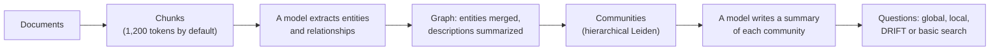
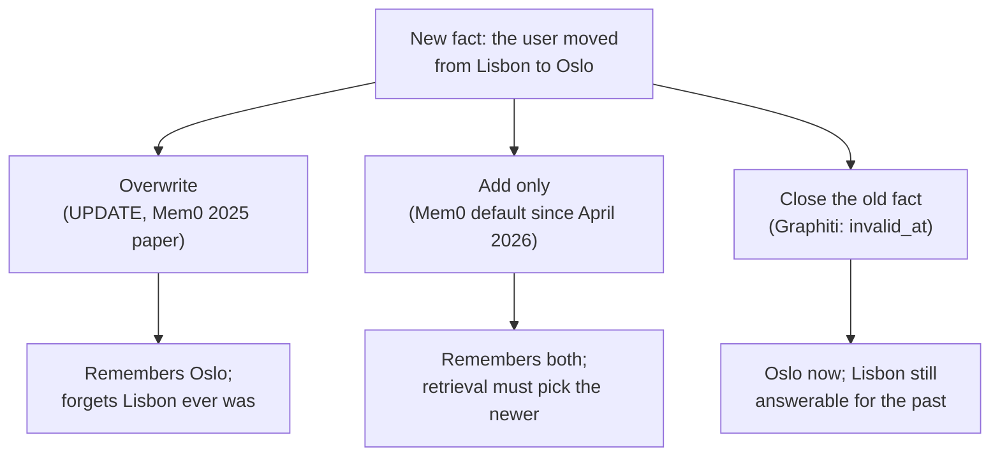

# The AI Engineering Stack, Part 06: Graphs and Memory

*October 14, 2026; reader tests added October 20, 2026. Part 06 of 13 (claude/engineering-stack-plan.md). Tags in this part: 153 [V], 58 [T], 6 [R], 8 [U] and 5 [I], counted in Sections 1 to 12 and the checks after them. Still open: no model, graph database or memory product runs on the test machine, so GraphRAG indexing, Neo4j and the memory products are described from their documentation and source code [R]. No independent benchmark of graph databases or memory products was opened, and no measurement of entity extraction by current models [U]. The lab's reader tests ran on Windows by script on October 20, 2026 [T]; the typed Windows steps and macOS haven't been run [R]. The lab's notes, names and extraction rules are invented for teaching [I]; the code that builds, scores and checks them is tested [T].*

**What this part gives you.** Two ways to give a model knowledge that plain retrieval (Part 05) handles badly. A **knowledge graph** stores facts as things and the links between them, so a question that needs two or three facts joined together can follow the links. **Agent memory** keeps what an assistant learned in one conversation for the next one, and has to decide what to do when a remembered fact changes. Both are built around a model, not inside it: the model itself remembers nothing between calls. The lab builds a small graph and three kinds of memory on any computer with Python, with no model, account or API key.

## How to read this part

The tags are Part 01's. **[V: KEY]** points to Section 12, which gives each source's class and the place used. **[T]** ran on the test machine. **[R]** is a reader test. **[U]** names what would settle it. **[I]** is invented for teaching. Source classes: official documentation and source code (OD), standards (SB), peer-reviewed (PR), preprint (PP), vendor or personal blog (VB, PB). A vendor's docs are the authority on how its product works, not on how good it is. Licence notes are information, not legal advice. References like "ledger P3-05" point to rows of claude/engineering-stack-claim-ledger.md, this series' audit of the Gemini report.

**The test machine:** Ubuntu 24.04 in a cloud container, October 14, 2026, with Python 3.13.16, 3.12.3 and 3.11.17. It has no GPU, runs no AI model and can't download from Hugging Face. Graph databases, GraphRAG indexing and the memory products all need a server, a model or a key, so they are described from their documentation and source code and marked [R] where a reader can run them.

**This part covers two topics** (plan, Section 7): T08, GraphRAG and knowledge graphs, and T09, agent memory, both in the **Context** layer. Retrieval basics (BM25, embeddings, fusion, metrics) are Part 05; this part builds on them. Prompting with retrieved facts is in claude/prompt-construction-guide-2e.md (the guide), Section 15. Memory poisoning as an attack gets a short section here and the full treatment in Part 10.

## 1. In plain words

**T08, knowledge graphs and GraphRAG.** A knowledge graph is a map of facts: **nodes** for things (a service, a team, a person) and **edges** for how they connect ("owned by", "leads", "depends on"). Ask "who leads the team that owns the ledger database?" and the answer sits in two separate notes: one says which team owns the database, another who leads that team. Plain retrieval finds notes that look like the question, one at a time; a graph lets a program walk from the database to the team to the leader. **GraphRAG** is the name Microsoft gave its method of having a model build such a graph from documents and summarize groups of related things, so it can answer broad questions about a whole collection [V: EDG].

*Analogy.* An address book against a family tree. Retrieval is an address book: fast when you know whose entry you want. A graph is a family tree: slower to draw, but it answers "who is my cousin's grandmother?" by following lines.

**What it costs.** Someone, usually a model, has to turn text into nodes and edges, and that step is expensive and lossy. Microsoft's own README warns that "GraphRAG indexing can be an expensive operation" [V: MGR], and in one independent study only about 65.5% to 65.8% of answer entities made it into the model-built graph [V: HAN].

**T09, agent memory.** A model is stateless: each call starts from what is in its context, and nothing is kept between calls (ledger P3-01) [V: COA]. "Memory" is a system around the model that saves facts, preferences or past events and puts the relevant ones back into the context next time. The hard part isn't storing; it's deciding what to keep, what to bring back, and what to do when a stored fact stops being true.

*Analogy.* A notebook a forgetful colleague carries. Useful if they write the right things and cross out what changed; harmful if they copy whatever a stranger tells them, or never cross anything out.

**Where it sits in the stack** (plan, Section 5). Both topics sit in the **Context** layer: they decide what the model reads. They depend on retrieval (Part 05) to find the right facts, on evals (Part 02) to know if it helps, and on security (Part 10) because whatever gets written to memory can come back later as an instruction.

## 2. Definitions

Every term is also in claude/engineering-stack-glossary.md.

| Plain words | Technical term | Notes |
|---|---|---|
| A map of facts as things and links | Knowledge graph | |
| A thing in the graph; a link between two things | Node (vertex); edge (relationship) | |
| Nodes and edges that each carry key-value details | Property graph | Neo4j's model: a relationship has a start node, an end node, "exactly one type" and a direction [V: NPG] |
| A fact written as subject, predicate, object | Triple; RDF (Resource Description Framework) | "An RDF graph is a set of RDF triples" (W3C, the World Wide Web Consortium) [V: RDF] |
| The query language Neo4j introduced | Cypher; openCypher | |
| The ISO standard query language for property graphs | GQL (ISO/IEC 39075:2024) | Published April 2024 [V: GQL] |
| Turning text into nodes and edges | Entity and relation extraction | Usually a model call per chunk |
| Deciding that two names mean the same thing | Entity resolution | "ledger DB" and "ledger database" |
| A group of nodes more connected to each other than to the rest | Community | Found by **community detection** |
| A score for how well a split into communities fits the edges | Modularity | Section 3.3 |
| Two common community-detection methods | Louvain; Leiden | Leiden guarantees connected communities [V: LEI] |
| A question whose answer needs several facts joined | Multi-hop question | |
| Microsoft's graph-based retrieval method and library | GraphRAG | Global, local, DRIFT and basic search [V: MGR] |
| Memory for the current decision cycle, the step the agent is on | Working memory | CoALA [V: COA] |
| Memory of what happened before | Episodic memory | CoALA [V: COA] |
| Memory of facts about the world and the agent | Semantic memory | CoALA [V: COA] |
| The weights plus the agent's own code | Procedural memory | CoALA [V: COA] |
| Memory work done in the background, not during the reply | Sleep-time compute; "dreaming" (Letta) | [V: LTC] |
| When a fact became true; when it stopped | Valid time (`valid_at`, `invalid_at`) | Graphiti's edge fields [V: GRA] |
| Planting false or hostile entries in an agent's memory | Memory poisoning | OWASP ASI06 [V: OWA] |
| Escaping a folder with `..` in a file path | Path traversal | [V: AMT] |
| A score from 0 to 1 that balances finding the right items against finding wrong ones | F1 (micro F1 averages over all items) | Part 02, Section 2 |
| Public question sets used to compare methods | NQ (Natural Questions, one fact each); HotpotQA and MultiHop-RAG (questions needing several facts); Re-TACRED (relation extraction) | |
| Tested without task examples; trained further on task examples | Zero-shot; fine-tuned | Part 05, Section 2 |

The products named in the table (Neo4j, Letta, Graphiti, Mem0) and the OWASP project are introduced in Sections 3.1, 3.7 and 3.10.

## 3. How it works

### 3.1 Two ways to store a graph

**Property graphs.** In Neo4j's model, nodes have labels and "any number of key-value pairs as properties"; a relationship "must always have a start node, an end node, and exactly one type", "must have a direction", and "can have properties, like nodes" [V: NPG]. So `(billing service)-[:OWNED_BY {since: 2024}]->(Payments team)` is one edge with a property.

**RDF triples.** The W3C's RDF writes every fact as a triple, subject, predicate, object, and "An RDF graph is a set of RDF triples" [V: RDF]. Objects can be other nodes or literals, "values such as strings, numbers, and dates" [V: RDF]. A detail about a link (since when) needs extra triples rather than a property on the edge. The version opened here is RDF 1.1, a W3C Recommendation of February 25, 2014; RDF 1.2 wasn't checked [U: its status line on w3.org].

**Query languages.** Neo4j's Cypher describes patterns: `MATCH (s {name: "ledger database"})-[:OWNED_BY]->(t)<-[:LEADS]-(p) RETURN p.name`. ISO published GQL, a standard query language for property graphs, in April 2024 as ISO/IEC 39075:2024 [V: GQL]. openCypher calls itself "a key inspiration for the ISO/IEC 39075 GQL project" and says its specification "evolves towards" GQL; Neo4j says it is "working towards full GQL conformance" [V: OCY]. So Cypher shaped GQL but isn't yet the same thing, which settles a question the ledger deferred.

### 3.2 From text to graph

Most graphs for RAG are built by a model reading chunks. Microsoft GraphRAG's standard pipeline, from its documentation [V: MGR]:



Its documentation estimates graph extraction at "roughly 75% of indexing cost", and offers a cheaper `fast` method that replaces the model with noun phrases and co-occurrence, which "tends to be quite a bit noisier" [V: MGR]. Those are Microsoft's estimates, with no model or corpus given.

**Extraction misses things.** In an independent study, graphs built by GPT-4o-mini contained only about 65.8% (HotpotQA) and 65.5% (NQ) of the entities that appear in the answers, and graphs built by the larger GPT-4o gave better answers (MultiHop-RAG accuracy 75.08 against 71.17, with a 70-billion-parameter answering model) [V: HAN]. Older measurements were worse: in a 2023 preprint, zero-shot GPT-4 scored micro F1 15.5 on Re-TACRED relation extraction against 91.4 for the best fine-tuned model, though strict exact-match scoring penalizes free-form answers [V: ZHU]. No 2025 or 2026 measurement on current models was found [U].

**Entity resolution.** The same thing gets written different ways, and a graph that keeps "ledger DB" and "ledger database" as two nodes can't connect facts about them. neo4j-graphrag's `SimpleKGPipeline` resolves entities by default, but its docstring says it merges only "entities with same label and name", using an exact-match resolver; fuzzy and spaCy-based resolvers exist but must be switched on [V: N4G]. A 2025 preprint names "redundant entities and unreliable relationships" as the main noise in model-built graphs and reports better QA after removing them [V: DNK].

**The lab shows why it matters** [T]. Ten invented notes become ten triples (a pattern-matching stand-in replaces the model [I]). With names kept exactly as written, the graph has 11 nodes and can't answer "who leads the team that owns the ledger database?", because note n8 says "ledger DB". Normalizing names (lowercase, collapse spaces, one alias) gives 10 nodes and the answer, with the two notes it came from:

```
$ python demo.py
...
2. Graph with exact names: 11 nodes
   Who leads the team that owns the ledger database? no answer
...
2. Graph with normalized names: 10 nodes
   Who leads the team that owns the ledger database? [('avery lin', ['n8', 'n2'])]
```

No single note holds both hops (the lab's check 3c) [T]. That's the multi-hop case graphs are for.

### 3.3 Communities, modularity, Louvain and Leiden

GraphRAG's global search depends on grouping the graph into communities and summarizing each one [V: EDG, MGR].

**Modularity, symbol by symbol.** For a split of the graph into communities c:

> Q = Σ over c of [ L_c / m − (d_c / 2m)² ]

- *m*: the total edge weight (here, the number of edges);
- *L_c*: the weight of edges inside community c;
- *d_c*: the sum of the degrees (edge ends) of c's nodes.

The first term is the share of edges inside the community; the second is the share you'd expect by chance. Q near 0 means no better than random; higher means more inside than expected. The lab's graph (with resolved names) has 10 edges; splitting it into the two teams puts 5 edges inside each, and each side's degrees sum to 10, so Q = 2 × (5/10 − (10/20)²) = 0.5 [T]. networkx 3.7 and 3.6.1 compute the same value for the same split [T].

**Louvain** starts with every node alone, moves each node to the neighbouring community that raises Q most until nothing moves, then merges communities and repeats. **Leiden** fixes a flaw: "the Louvain algorithm may yield arbitrarily badly connected communities", while Leiden's communities are "guaranteed to be connected" (Traag, Waltman and van Eck, Scientific Reports, 2019) [V: LEI]. GraphRAG uses hierarchical Leiden with at most 10 nodes per cluster, and pins its Leiden library below version 1.3 because 1.3 "changes Leiden clustering output", a reminder that communities depend on the implementation [V: MGR].

**In the lab** [T]. The lab's graph is two separate pieces (no edge joins the two teams), so the right answer is obvious; that's on purpose, to make the arithmetic checkable by hand. Local moving alone stops at 4 small communities; with the merging step, the resolved graph splits into the two teams. networkx's own `louvain_communities` (seed 7) finds the same two [T]. Without entity resolution, the duplicate ledger node pulls "billing service" and "ledger database" into a separate community, and modularity is slightly *higher* (0.505 against 0.500) [T]: a higher score doesn't mean a truer graph. From `python demo.py`:

```
2. Graph with exact names: 11 nodes
   Who leads the team that owns the ledger database? no answer
   communities (modularity 0.505):
      ['Avery Lin', 'Finance group', 'Payments team', 'ledger DB']
      ['Discovery team', 'Product group', 'Rowan Park', 'index store', 'search service']
      ['billing service', 'ledger database']

2. Graph with normalized names: 10 nodes
   Who leads the team that owns the ledger database? [('avery lin', ['n8', 'n2'])]
   communities (modularity 0.500):
      ['avery lin', 'billing service', 'finance group', 'ledger database', 'payments team']
      ['discovery team', 'index store', 'product group', 'rowan park', 'search service']
```

**Tools.** networkx (BSD-3-Clause) has Louvain built in; version 3.7 (September 21, 2026) added Leiden, with its default metric CPM rather than modularity, and needs Python 3.12 or later; in 3.6.1, the last for Python 3.11, the Leiden function raises `NotImplementedError` unless a separate backend is installed [V: NXR][T]. leidenalg and igraph are GPL, which matters if you ship code that includes them [V: PYPI].

### 3.4 Asking the graph

**GraphRAG's four query modes** [V: MGR]:

| Mode | What it does |
|---|---|
| Local | Combines "relevant data from the AI-extracted knowledge-graph with text chunks of the raw documents", for questions about specific entities |
| Global | Map-reduce over community summaries; the docs call it "a resource-intensive method" |
| DRIFT | Local search that also uses community information, for a broader starting point |
| Basic | "a rudimentary implementation of basic vector RAG", for comparison |

**Other patterns.** **Text-to-Cypher**: a model writes the query from the question; neo4j-graphrag ships a `Text2CypherRetriever`, and a 2024 preprint built a 44,387-example dataset for it [V: N4G, T2C]. **Vector plus graph**: find entry nodes by embedding similarity, then traverse; neo4j-graphrag's `VectorCypherRetriever` and `HybridCypherRetriever` (ledger B3-05) [V: N4G]. **HippoRAG** (NeurIPS 2024) links passages through a model-built graph and ranks with Personalized PageRank [V: HIP]. **Think-on-Graph** lets a model search an existing curated graph step by step; it targets graphs like Wikidata rather than building its own [V: TOG].

### 3.5 Does GraphRAG beat plain retrieval?

It depends on the question. Two independent comparisons, both from 2025 to 2026:

- **Han et al.** (preprint; graphs built with GPT-4o-mini) [V: HAN]. On single-hop questions plain RAG did best: NQ F1 64.78 against 63.01 for the best graph method (Community-GraphRAG local search), about 1.8 points. On multi-hop questions the best graph method, HippoRAG2, did a little better: HotpotQA 63.01 (the same figure as NQ's, by coincidence) against 60.04, MultiHop-RAG accuracy 70.27 against 67.02, about 3 points each [T: the differences]; other graph methods gained less, and a method using only graph triples lost heavily (HotpotQA 25.02) [V: HAN]. Answers came mainly from Llama-3.1-8B-Instruct, with Llama-3.1-70B-Instruct in further tables [V: HAN]. Microsoft-style global search "often struggles on QA" (NQ 54.48). On questions about time order in MultiHop-RAG, graphs did much better (local 50.60, global 53.34, against RAG's 30.70).
- **Xiang et al., "When to use Graphs in RAG"** (ICLR 2026; answers by GPT-4o-mini; a medical corpus and a novels corpus) [V: GRB]. Plain RAG matched or beat graph methods on fact retrieval, and graphs helped on complex reasoning and summaries. On the novels, Microsoft GraphRAG scored 50.93 on complex reasoning against 41.35 for RAG; on the medical corpus it was below plain RAG on every accuracy column (fact retrieval 38.63 against 63.72). Its abstract says recent studies find GraphRAG "frequently underperforms vanilla RAG on many real-world tasks".

**Cost.** In the same ICLR study, the average prompt per question was about 900 tokens for vector RAG, about 39,000 for GraphRAG local search and about 331,000 for global search (331,375 against 879 on the novels: 377 times as many) [V: GRB][T]. HippoRAG2 used about 1,000 and was among the strongest graph methods in both studies, best on the multi-hop sets in one [V: HAN, GRB].

**The 2024 headline needs a caveat.** Microsoft's paper reported that model judges preferred its "global approaches" to vector RAG on comprehensiveness in 72% to 83% of comparisons on podcast transcripts and 72% to 80% on news articles (§5.1; ledger B3-04) [V: EDG]. Han et al. found that position bias "is clearly present" when model judges compare RAG and GraphRAG summaries: reversing the order gave "substantially different, and in some cases opposite, judgments" [V: HAN]. Treat judge-based win rates as weak evidence (Part 02, Section 3.8).

**LazyGraphRAG.** Microsoft Research's blog describes a version that skips model extraction at indexing time and claims indexing "identical to vector RAG and 0.1% of the costs of full GraphRAG", with global-query quality comparable at "more than 700 times lower query cost" [V: LZY]. The 0.1% has no stated dataset or model, no independent replication was found, and it isn't in the open-source repository; the repo only links the post [V: LZY, MGR].

**Microsoft GraphRAG is now in maintenance mode.** Its README (the notice was added on August 14, 2026; read at version 3.3.0, October 8) says: "This project is largely in maintenance mode, and won't be accepting new PRs or implementing new features", with "bug fixes and dependency updates as appropriate, particularly to address CVEs", and that the code "serves as a demonstration and is not an officially supported Microsoft offering" [V: MGR][T: read by the lead session from the repository]. It's still a good reference implementation; it isn't a product to build a long-lived system on without planning for that.

### 3.6 Agent memory: what the research means by it

**CoALA's four kinds.** The Cognitive Architectures for Language Agents framework (TMLR 2024) divides an agent's memory into working memory ("active and readily available information ... for the current decision cycle") and three long-term kinds: episodic ("experience from earlier decision cycles"), semantic ("an agent's knowledge about the world and itself") and procedural [V: COA]. It names no storage technology (ledger P3-03).

**Procedural memory isn't "stored skills"** (ledger P3-05, corrected). CoALA: "Language agents contain two forms of procedural memory: implicit knowledge stored in the LLM weights, and explicit knowledge written in the agent's code" [V: COA]. It warns that letting an agent write to procedural memory is "significantly riskier than writing to episodic or semantic memory" [V: COA]. Skill files (claude/agent-skills-reference-v1-2.md) are a later product idea that fits the "agent's code" half.

**MemGPT's paging idea** (ledger P3-07, P3-09). MemGPT gave the model function calls to move text between its context and outside storage, "the illusion of an infinite context" [V: MGP]. Its core and archival memory vocabulary now belongs to history (Section 3.7).

**Hot path or background** (ledger P3-06, corrected). Memory work can happen during the reply, with the model calling memory tools (Anthropic's memory tool, MemGPT) [V: AMT, MGP], or in the background: Letta's retired server had an option that moves memory management "to a background agent thread", Letta Code's "dreaming" uses "background subagents" after a set number of steps or when the context is compacted, and LangMem has a background memory manager [V: LET, LTC, LMM]. Neither is the general rule; it's a design choice.

### 3.7 What ships as memory today

The products changed a lot in 2026 (read October 14, 2026):

| Product | What it is now | Licence | Needs a key by default | Telemetry by default |
|---|---|---|---|---|
| Anthropic memory tool (`memory_20250818`) | A tool in the Claude API; Claude asks to view, create, edit or delete files under `/memories`, and your code does it: "The memory tool operates client-side" [V: AMT] | API terms | Anthropic API key | n/a |
| OpenAI | ChatGPT has saved memories and chat-history reference, a consumer feature [V: OMF]; the API's conversation-state page offers Conversations and `previous_response_id`, not a cross-conversation memory feature [V: OCS] | API terms | OpenAI API key | n/a |
| Mem0 (`mem0ai` 2.2.1) | A library: a model extracts facts and stores them in a vector store; since April 2026, "Single-pass ADD-only extraction ... Memories accumulate; nothing is overwritten" [V: M0R] | Apache-2.0 | Yes in practice: defaults to OpenAI `gpt-5-mini` and `text-embedding-3-small` [V: M0R] | On, to PostHog; `MEM0_TELEMETRY=false` turns it off [V: M0R] |
| Graphiti (`graphiti-core` 0.30.2) | A temporal graph library behind Zep; needs Neo4j, FalkorDB or Neptune (Kuzu support is deprecated) [V: GRA] | Apache-2.0 | Yes: defaults to OpenAI [V: GRA] | On; `GRAPHITI_TELEMETRY_ENABLED=false` [V: GRA] |
| Zep | Hosted Zep Cloud; "Zep Community Edition is no longer supported" [V: ZEP] | Service terms | Zep key | Not checked [U] |
| Letta | The Python server is retired: "unsupported, and receives no fixes or security updates" [V: LET]. The PyPI name `letta` now ships Letta Code, a terminal agent with git-backed memory (MemFS) [V: LTC, LDC] | Apache-2.0 | Letta Cloud by default; local option [V: LTC] | On; `LETTA_CODE_TELEM=0` or `DO_NOT_TRACK=1` [V: LTC] |
| LangMem (`langmem` 0.0.30) | Memory tools and a background manager for LangGraph | MIT | Depends on the model you choose | Not checked [U] |

**A version trap** [V: LET, PYPI][T]. On PyPI, `letta` 0.16.8 (May 14, 2026) was the last of the old server; the next release, 0.32.13 (September 17, 2026), is a different program, Letta Code, shipped as native binary wheels, and 0.34.12 followed on October 12. Anyone who pins `letta<0.17` gets the retired server, and anyone who upgrades from it gets something else.

**Redis**, often named as a fast memory store, says it "delivers sub-millisecond latency", with no test conditions given: a vendor claim (ledger P3-07) [V: RDO]. Its licence changed twice: from 7.4 (announced March 20, 2024) RSALv2 or SSPLv1, "no longer ... BSD", and from Redis 8 (May 1, 2025) AGPLv3 added as a third choice [V: RDL].

### 3.8 When a remembered fact changes

Three designs, all in use [V: M0P, M0R, GRA]:



- **Overwrite.** Mem0's 2025 paper had four operations, ADD, UPDATE, DELETE and NOOP, with DELETE for "removal of memories contradicted by new information" [V: M0P].
- **Add only.** Mem0's current default stopped updating and deleting; it links related memories and relies on retrieval that takes time into account [V: M0R]. Teaching "Mem0 resolves contradictions with UPDATE and DELETE" is now out of date unless it's dated to the 2025 paper.
- **Close the old fact.** Graphiti gives every fact edge `valid_at`, `invalid_at` and `expired_at`; when a newer fact contradicts it, the old edge's `invalid_at` is set to the new one's `valid_at` [V: GRA]. A model decides which facts contradict; the dates are then plain code [V: GRA].

The lab runs all three on the same move (`python demo.py`) [T]:

```
3. The user moved from Lisbon (day 10) to Oslo (day 40)
   overwrite  current ['Oslo']   on day 20 []
   add_only   current ['Lisbon', 'Oslo']   on day 20 ['Lisbon']
   temporal   current ['Oslo']   on day 20 ['Lisbon']
```

Add-only hands both cities to the model and leaves it to choose; overwrite loses the past; the temporal design keeps both, labelled. The lab's check 7d also confirms that an old fact arriving late doesn't close a newer one [T].

### 3.9 Measuring memory, and the vendor dispute

**Benchmarks.** LoCoMo (ACL 2024) has very long multi-session conversations with question answering, event summarization and multimodal dialogue generation tasks; its ACL abstract says "600 turns and 16K tokens on avg., over up to 32 sessions", while the arXiv preprint says 300 turns and 9K tokens [V: LOC]. LongMemEval (ICLR 2025) has 500 questions testing "information extraction, multi-session reasoning, temporal reasoning, knowledge updates, and abstention", and reports "a 30% accuracy drop" for commercial assistants and long-context models across sustained interactions, without saying in the abstract whether that is relative or in points [V: LME].

**Everyone wins their own benchmark.** On LoCoMo with gpt-4o-mini, Mem0's paper (a vendor preprint) reports a judge score of 66.88 for Mem0, 68.44 with its graph variant, 65.99 for Zep and 52.90 for OpenAI's memory, and 72.90 for simply putting the whole conversation in context [V: M0P]. Its "26%" improvement over OpenAI is relative (13.98 points), and full context was the most accurate, by 6.02 points over Mem0 [T]; Mem0's case is latency and tokens. Letta's blog reports a plain filesystem agent at 74.0% [V: LBL]. Zep's blog says Mem0 configured Zep wrongly and reports 75.14% ± 0.17, and criticises LoCoMo itself (conversations short enough to fit in a context window, no knowledge-update questions) [V: ZBL]. Mem0's README now claims 92.5 on LoCoMo for its managed platform, "which includes proprietary optimizations not available in the open-source SDK" [V: M0R]. Different models, judges, prompts and filters: these numbers can't be ranked against each other. Test on your own conversations.

### 3.10 Memory as an attack surface

Whatever is written to memory comes back later as trusted context. AgentPoison (NeurIPS 2024) planted records in agents' memory or knowledge bases and reported an average attack success above 80% with a poison rate below 0.1% [V: APO]. MINJA (preprint) injected malicious records "by only interacting with the agent via queries and output observations", with no direct write access [V: MIN]. OWASP's Top 10 for Agentic Applications (December 2025) lists "ASI06: Memory & Context Poisoning" [V: OWA]. Anthropic's memory-tool docs tell developers that "Your implementation must validate every path in every command to prevent directory traversal attacks", with `/memories/../../secrets.env` as the example [V: AMT].

The lab includes two small controls [T]: writes from untrusted sources (tool output, web pages) wait in quarantine until approved (a design choice of this lab, not a quoted vendor or OWASP rule), and `safe_memory_path` refuses traversal, look-alike folders (`/memoriesX`), relative paths and backslashes. They reduce risk; they don't make memory safe. Part 10 covers injection defences in depth.

## 4. Gemini said, evidence says

| Gemini (ledger row) | Evidence | Section |
|---|---|---|
| Generation is stateless; the model has no memory outside its weights (P3-01) | Confirmed, per call [V: COA]; memory products are built around the model | 1 |
| Memory "relies on" a three-part taxonomy (P3-02) | Corrected in the ledger: CoALA has working memory plus three long-term kinds [V: COA] | 3.6 |
| Episodic memory is "typically" kept in NoSQL or MemGPT (P3-03) | Unsupported (ledger); the products read here use vector stores, graphs and plain files [V: M0R, GRA, AMT] | 3.7 |
| Procedural memory stores "executable skills, rules and configurations" (P3-05) | Corrected: CoALA's procedural memory is "implicit knowledge stored in the LLM weights, and explicit knowledge written in the agent's code" [V: COA] | 3.6 |
| Memory reads and writes run asynchronously in parallel with the model (P3-06) | Corrected: a design choice. Some systems work in the background (Letta's sleep-time and dreaming, LangMem's manager); others call memory tools during the reply [V: LET, LTC, LMM, AMT] | 3.6 |
| "Strictly necessary" tools: MemGPT, Redis ("sub-millisecond"), Pinecone, ChromaDB, Qdrant (P3-07) | Overstated (ledger). Redis's "sub-millisecond latency" is its own claim with no test conditions [V: RDO]; MemGPT's server, now Letta's, is retired [V: LET] | 3.7 |
| Examples: preference recall, scratchpads, vector-indexed history (P3-08) | Illustrative [I] | 5 |
| A MemGPT-style loop where the agent manages its own memory (P3-09) | Confirmed for MemGPT [V: MGP]; Anthropic's memory tool is today's documented version of the idea [V: AMT] | 3.6, 3.7 |
| Dense-vector RAG "frequently struggles" with multi-hop questions (B3-01) | Confirmed in substance (ledger: 56% from retrieved chunks against 89% from the right evidence); the best graph method gained about 3 points on two multi-hop sets in one study, and some graph methods lost [V: MHR, HAN] | 3.5 |
| GraphRAG has a model extract entities into a graph database such as Neo4j (B3-02) | Corrected (ledger): Microsoft GraphRAG builds its own index with Leiden communities and uses no graph database; neo4j-graphrag is a separate stack [V: EDG, MGR, N4G] | 3.2 |
| Retrieval uses graph traversal such as Cypher (B3-03) | Overstated (ledger): true of Neo4j's retrievers; Microsoft's global search is map-reduce over summaries [V: N4G, MGR] | 3.4 |
| This "drastically" improves global synthesis questions (B3-04) | Overstated: judge-based win rates of 72% to 83% (podcasts) and 72% to 80% (news) in Microsoft's paper [V: EDG], but position bias in such judges "is clearly present" [V: HAN]; independent studies find graphs help on reasoning and summaries and lose on simple facts, at up to 377 times the prompt tokens [V: GRB][T] | 3.5 |
| Hybrid GraphRAG combines vector similarity and traversal (B3-05) | Confirmed [V: N4G] | 3.4 |

## 5. Examples

**Real examples.**

1. *GraphRAG on two corpora* [V: GRB]. In the ICLR 2026 study, Microsoft GraphRAG beat plain RAG on complex reasoning over pre-20th-century novels (50.93 against 41.35) and lost on every accuracy measure over a medical corpus built from cancer guidelines. Same method, different corpora, opposite verdicts.
2. *Temporal questions* [V: HAN]. On MultiHop-RAG's questions about the order of events, graph-based local and global search scored 50.60 and 53.34 against plain RAG's 30.70: one kind of question where structure clearly helped.
3. *The memory benchmark dispute* [V: M0P, LBL, ZBL]. Mem0, Letta and Zep each published a LoCoMo result putting their own approach first, with different setups (Section 3.9). A plain filesystem agent scoring 74.0% in Letta's run is a useful reminder that a simple design is a fair baseline.

**A fully worked example: an ownership question over team notes** [I: the notes are invented; every step ran].

*Input.* Ten notes such as "The ledger DB is owned by the Payments team." and "Avery Lin leads the Payments team." The question: who leads the team that owns the ledger database?

*Step 1, extract.* Each note becomes one triple with its note ID: `('ledger DB', 'OWNED_BY', 'Payments team', 'n8')`, `('Avery Lin', 'LEADS', 'Payments team', 'n2')` [T]. In a real system a model does this, with the misses Section 3.2 describes.

*Step 2, resolve.* Exact names give 11 nodes, two of them the ledger; normalized names and one alias give 10 [T].

*Step 3, traverse.* From "ledger database", follow `OWNED_BY` forward to "payments team", then `LEADS` backward to "avery lin", collecting the notes used: n8 and n2 [T].

*Step 4, answer with sources.* Pass the two notes, not the whole graph, to the model, and ask it to answer from them and cite them (guide, Section 15).

*Output.* "Avery Lin [n2], whose team owns the ledger database [n8]." Without step 2 the traversal returns nothing, and a model given nothing may guess.

## 6. What you need

Checked October 14, 2026 [V: PYPI, GHT]. Licences from each project's licence file or registry entry; information, not legal advice.

**Graph tools.**

| Tool | What it's for | Licence | Runs | Account or key? | Maintained | Version |
|---|---|---|---|---|---|---|
| The lab's scripts | Triples, resolution, traversal, modularity, Louvain, three memory designs | This series | Python 3.11 to 3.13, standard library [T] | No | This series | Lab zip |
| networkx | Graphs in Python: paths, Louvain, Leiden (3.7) | BSD-3-Clause | 3.7 needs Python 3.12 or later; 3.6.1 for 3.11 [V: PYPI] | No | Yes | 3.7, September 21, 2026 |
| Microsoft GraphRAG (`graphrag`) | Model-built graph index with community summaries | MIT | Python 3.11 to 3.13 [V: PYPI] | A model API; `graphrag init` defaults to OpenAI `gpt-4.1` and `text-embedding-3-large` [V: MGR] | "largely in maintenance mode" [V: MGR] | 3.3.0, October 8, 2026 |
| Neo4j | Graph database server with Cypher | Community Edition GPLv3; Enterprise commercial [V: N4J] | A server (Java); AuraDB Free hosted: up to 200,000 nodes and 400,000 relationships, deleted after 30 days without activity, no card needed [V: AUR] | Free account for Aura | Yes | 2026.09.0 |
| neo4j-graphrag | Building and querying graphs in Neo4j with a model | Apache-2.0 [V: N4G] | Python 3.10 to 3.14; needs Neo4j | A model API or local model | Yes | 1.22.0, October 1, 2026 |
| Kuzu | Embedded graph database (no server) | MIT | Python library | No | **Archived**: "read-only" since October 10, 2025 [V: KUZ] | 0.11.3 |
| FalkorDB | Graph database (a Redis module) | Server SSPL v1; Python client MIT [V: FDB] | A server | No | Yes | client 1.8.0 |
| Apache AGE | Cypher in PostgreSQL | Apache-2.0 [V: AGE] | A Postgres extension | No | Yes | |
| Memgraph | In-memory graph database | BSL 1.1, which says it is "not an 'open source' license", becoming Apache-2.0 in 2030 [V: MGM] | A server | No | Yes | |

**Memory tools** are in Section 3.7's table, with licences, default keys and telemetry.

**No independent benchmark of graph databases or memory products was opened** [U]. Speed and accuracy claims on vendor pages (LazyGraphRAG's costs, Redis's latency, Mem0's 92.5) are their own.

**The picks.**

- **Best default for a solo builder:** first, make plain retrieval good (Part 05) and measure it. If multi-hop questions fail, build a small graph from your structured data, not a model-extracted one, in networkx, and resolve entity names before anything else [T]. For memory, start with something you can read: a folder of Markdown files behind a path check, like Anthropic's memory tool design, with your own code deciding what is written [V: AMT].
- **For production:** the evidence doesn't support one best. Neo4j has the most mature tooling around Cypher and neo4j-graphrag, under GPLv3 for Community Edition [V: N4J, N4G]; Apache AGE keeps the graph inside Postgres under Apache-2.0 [V: AGE]. For memory that must answer "what was true then?", a temporal design like Graphiti's is the documented option, with its OpenAI default and telemetry switched as you need [V: GRA].
- **Best free option:** networkx plus the lab's resolution step; Markdown files for memory.
- **When not to use a graph:** single-fact lookups, where plain RAG beat graph methods in Han et al. and matched or beat them on the novels corpus (on the medical corpus HippoRAG2 was slightly ahead) [V: HAN, GRB]; small corpora that fit in a context window (Part 04); and anything where a model-built graph's missing third of entities would hurt [V: HAN]. **When not to use memory:** when a user hasn't agreed to being remembered, or when facts change faster than you can keep them current.
- **Strongest alternatives to name:** HippoRAG2 was among the strongest graph methods in both independent studies and cheap per question [V: HAN, GRB]; for Microsoft GraphRAG specifically, plan for a library that gets bug fixes but no new features [V: MGR]. Kuzu, often recommended for embedded graphs, is archived [V: KUZ].

## 7. Set it up

**Before you start.** Part 01's setup: Python 3.11 to 3.13, and the series folder `ai-stack` in your home folder (Part 01, Section 7). Unzip `engineering-stack-lab-part-06.zip` into `ai-stack`; you get a folder named `engineering-stack-lab-part-06`. On Windows, right-click the zip and choose Extract All; on macOS, double-click it, then move the folder into `ai-stack`; on Linux, go to the folder that holds the zip (for example `cd ~/Downloads`), then `python3 -m zipfile -e engineering-stack-lab-part-06.zip ~/ai-stack` [T on Linux]. The core lab needs nothing installed.

Blocks of commands below are typed one line at a time, as shown. A line starting with `$ ` in an output block is the command that produced it.

### 7.1 Windows 10 or 11 [R: the typed steps haven't been run on Windows; this lab ran there by script on October 20, 2026]

In PowerShell:

```
cd $HOME\ai-stack\engineering-stack-lab-part-06
py -V:3.13 -m venv .venv
.venv\Scripts\Activate.ps1
python run_lab.py
```

Expect `21 of 21 checks passed`. If PowerShell refuses to run `Activate.ps1`, see Part 01, Section 7.6.

### 7.2 macOS [R: no macOS test machine]

```
cd ~/ai-stack/engineering-stack-lab-part-06
python3.13 -m venv .venv
source .venv/bin/activate
python run_lab.py
```

### 7.3 Linux (Ubuntu 24.04) [T]

The same commands as macOS, with `python3` in place of `python3.13` if your Python 3 is 3.11 to 3.13. Expect `21 of 21 checks passed`. If `python3 -m venv` says ensurepip is not available, install Ubuntu's venv package (`sudo apt install python3-venv`) and try again [R: the test machine already had it].

### 7.4 Optional: compare with networkx [T]

```
python -m pip install -r requirements-crosscheck.txt
python crosscheck.py
```

This installs networkx 3.7 on Python 3.12 and later, or 3.6.1 on Python 3.11 [T]. pip prints a line such as `Ignoring networkx: markers 'python_version < "3.12"' don't match your environment`: that's the other version's line being skipped, not an error [T]. Expect three PASS lines (modularity, the same two communities from networkx's Louvain, the same shortest path) and one INFO line: on 3.7, "networkx Leiden (modularity) finds 2 communities"; on 3.6.1, "networkx Leiden not usable here: NotImplementedError", because its Leiden needs a separate backend [T on Python 3.13.16, 3.12.3, 3.11.17].

### 7.5 Real graph databases and memory products [R]

Not part of the lab: each needs a server, a model or a key. Use a separate virtual environment for each (Part 01, Section 7). For Neo4j, its official download page (https://neo4j.com/download/ offers Neo4j Desktop, which includes the Enterprise Edition for developers) or AuraDB Free, an account you create yourself [V: AUR, NDL]; for GraphRAG, `python -m pip install graphrag==3.3.0`, then `graphrag init` (which asks for models), a model key, and its README's advice to "start small", since standard indexing has a model analyse each chunk [V: MGR]. Before using Mem0, Graphiti or Letta Code, set their telemetry switches (Section 3.7) and check which model they call by default.

### 7.6 A tour

| Command | What it does |
|---|---|
| `python demo.py` | The triples, both graphs' answers and communities, and the three memory designs (Section 3) |
| `python run_lab.py` | 21 checks; exit code 0 only if all pass |
| `python mutation_check.py` | Breaks the lab 16 ways in a temporary copy; each must make `run_lab.py` fail |
| `python crosscheck.py` | Optional networkx comparison (7.4); fails if networkx isn't installed |
| `python -c "from graph import *; g = build_graph(DOCS, 'normalized'); print(g.follow('search service', 'OWNED_BY', '^LEADS'))"` | One traversal: prints `[('rowan park', ['n4', 'n5'])]` [T] |

**In your own code.** `build_graph(docs, mode)` returns a graph; `g.follow(start, "REL", "^REL")` walks relation types (`^` means backwards) and returns answers with the notes used; `g.shortest_path(a, b)` ignores direction; `louvain(g.undirected_weights())` returns communities; `modularity(weights, communities)` scores them. `Memory(mode)` takes `"overwrite"`, `"add_only"` or `"temporal"`; `write(Fact(...))`, `current(...)`, `as_of(..., day)`; `safe_memory_path(path)` returns a clean path or raises `ValueError`.

### 7.7 Common errors and fixes

| What you see | Why | Fix |
|---|---|---|
| `FileNotFoundError: [Errno 2] No such file or directory: 'engineering-stack-lab-part-06.zip'` | The Linux unzip ran outside the zip's folder | `cd` to that folder first [T] |
| `can't open file '.../run_lab.py': [Errno 2] No such file or directory` | The terminal isn't in the lab folder | `cd` into the lab folder [T] |
| `FAIL nothing was checked: install requirements-crosscheck.txt in this environment` | networkx isn't installed in the active environment | Section 7.4 [T] |
| `ERROR: No matching distribution found for networkx==3.7` | `pip install networkx==3.7` on Python 3.11; 3.7 needs 3.12 or later | Use the lab's file, which picks 3.6.1 on 3.11 [T] |
| `KeyError` or FAIL lines after Section 8, step 3 | The alias table was left empty | Restore `ALIASES = {"ledger db": "ledger database"}` in `graph.py` [T] |
| `ValueError: outside /memories: ...` | `safe_memory_path` refused a path, as designed | Use a path under `/memories` [T] |
| `[notice] A new release of pip is available` | An older pip (24.0 on Python 3.11 and 3.12 here) | Not an error [T] |

### 7.8 How to uninstall

Before you `deactivate`, `python -m pip cache purge` empties pip's download cache [T]. Then `deactivate`, move up one folder with `cd ..`, and delete the lab folder: `rm -rf engineering-stack-lab-part-06` on macOS and Linux [T], `Remove-Item -Recurse -Force engineering-stack-lab-part-06` in PowerShell [R]. networkx goes with the environment.

## 8. Hands-on lab: a small graph and three kinds of memory

**Goal.** Build a graph from notes, see entity resolution decide whether a two-hop question can be answered, score communities by hand, and watch three memory designs handle a changed fact, with checks proved able to fail.

**Prerequisites.** Section 7 for your system. **Time:** about 30 minutes by hand, 1 minute automated. **Cost:** none. **Pinned:** the standard library only; the optional cross-check pins networkx (7.4). **Data:** ten invented notes and invented names [I]. **Files:** `graph.py`, `memory.py`, `run_lab.py` and `mutation_check.py` are listed in the appendix; `demo.py`, `crosscheck.py`, `requirements-crosscheck.txt` and `README.md` are in the zip.

**Steps.** Outputs are from the test machine, Python 3.13.16, October 14, 2026 [T].

1. **Read the notes.** Open `graph.py`: `DOCS` holds ten one-line notes, and `RELATIONS` maps four phrases to relation types. That table is the stand-in for a model's extraction [I].
2. **Build and ask.** Run `python demo.py`. Its graph blocks are in Section 3.3 and its memory block in Section 3.8: with exact names, "no answer"; with normalized names, `[('avery lin', ['n8', 'n2'])]`.
3. **Break resolution by hand.** In `graph.py`, change `ALIASES = {"ledger db": "ledger database"}` to `ALIASES = {}` and run `python demo.py` again. The normalized graph now has 11 nodes and no answer, like the exact one, because lowercasing alone can't make "ledger db" equal "ledger database" [T]. Put the alias back exactly as it was, `ALIASES = {"ledger db": "ledger database"}`; with it missing, `run_lab.py` fails four checks.
4. **Ask a different question.** `python -c "from graph import *; g = build_graph(DOCS, 'normalized'); print(g.follow('billing service', 'DEPENDS_ON', 'OWNED_BY', '^LEADS'))"` follows three hops: billing service, then the ledger database it depends on, the team that owns it, and that team's lead. It prints `[('avery lin', ['n7', 'n8', 'n2'])]` [T].
5. **Score a split by hand.** For the two-team split, count edges inside each team (5 and 5, of 10) and degrees (10 and 10): Q = 2 × (0.5 − 0.25) = 0.5. Check 5 in `run_lab.py` computes the same [T].
6. **Run the checks.** `python run_lab.py`:
   ```
   PASS 1 one triple per note, each with its source: 10 triples
   PASS 2 exact names: 11 nodes ('ledger DB' and 'ledger database' apart)
   PASS 2b normalized names: 10 nodes, one ledger node
   PASS 3 two hops, with provenance: avery lin, from notes n8 and n2: [('avery lin', ['n8', 'n2'])]
   PASS 3b the same question finds nothing without entity resolution
   PASS 3c no single note holds both hops
   PASS 4 shortest path rowan park -> index store: ['rowan park', 'discovery team', 'index store']
   PASS 4b no path between unconnected names
   PASS 5 modularity of the two-team split = 0.5 by hand: 0.5000
   PASS 5b one community for everything has modularity 0
   PASS 6 local moving alone stops at 4 communities: [...]
   PASS 6b with merging: the two teams: [...]
   PASS 6c without entity resolution the ledger splits off into its own community: 3 communities
   PASS 7 overwrite: only Oslo, history lost
   PASS 7b add-only: the stale city is still 'current'
   PASS 7c temporal: Oslo now, Lisbon on day 20
   PASS 7d temporal: an older fact arriving late doesn't close the newer one
   PASS 8 untrusted write is quarantined, memory unchanged
   PASS 8b the same write is stored once approved
   PASS 8c traversal and look-alike paths refused, normal ones kept: 5 of 5 refused
   PASS 9 paper arithmetic: 8 figures

   21 of 21 checks passed
   ```
   (`[...]` stands for the community lists; the full lists from `demo.py` are in Section 3.3.) The same 21 of 21 with Python 3.12.3 and 3.11.17 [T]. Check 9 re-derives the numbers this part quotes: Mem0's 13.98-point and 26% relative gain, full context's 6.02-point lead, the 377-times prompt cost, Han et al.'s three gaps (1.77, 2.97 and 3.25 points), and the 34.2% of answer entities missing from the graph.
7. **Optional, networkx** (Section 7.4): three PASS lines and one INFO line [T].

**Automated check, and breaking it on purpose.** `python mutation_check.py` runs the unbroken lab first (it must pass), then makes 16 breaks one at a time in a temporary copy, for example a modularity formula missing its expected term, backward edges walking forward, temporal memory that never closes old facts, the quarantine switched off, a path check that accepts `/memoriesX` [T]:

```
$ python mutation_check.py
OK   the unbroken copy passes
CAUGHT extractor drops the source note: FAIL 1 one triple per note, each with its source: 10 triples
...
CAUGHT path check accepts look-alike folders: FAIL 8c traversal and look-alike paths refused, normal ones kept: 4 of 5 refused

16 of 16 mutations caught
```

The same on Python 3.12.3 and 3.11.17 [T]. One planned mutation, letting local moving accept moves that don't raise modularity, was caught by nothing, because on this graph no such tie occurs: it doesn't change the result, so it was replaced with one that does (local moving that never moves) [T].

## 9. Teach it

**Learning objectives.** After this part you can:

1. say what a knowledge graph adds over plain retrieval, and name the question types where it helped and hurt in independent studies;
2. explain why entity resolution decides whether a multi-hop question can be answered;
3. compute modularity for a small split by hand, and say what Leiden fixes in Louvain;
4. name CoALA's four kinds of memory, and correct the common misreading of procedural memory;
5. compare overwrite, add-only and temporal memory on a changed fact, and name two controls against memory poisoning.

**Prerequisites.** Parts 01, 02, 04 and 05. Reading a little Python.

**Common misconceptions.**

- *"GraphRAG is better RAG."* It helped on multi-hop, temporal and summary questions and lost on single facts, at up to 377 times the prompt tokens for global search [V: HAN, GRB][T].
- *"A model can build the graph for me, accurately."* About a third of answer entities were missing from GPT-4o-mini-built graphs in one study [V: HAN].
- *"Higher modularity means a better graph."* In the lab, the graph with an unresolved duplicate scored slightly higher (0.505 against 0.500) [T].
- *"The model remembers me."* Models are stateless per call; memory is a system around them that stores and retrieves [V: COA].
- *"Procedural memory is where skills are saved."* In CoALA it is the model's weights and the agent's code [V: COA].
- *"The vendor with the best LoCoMo score has the best memory."* Each vendor reports itself first, with different setups [V: M0P, LBL, ZBL].

**Exercises, with checked answers.**

1. *Modularity.* A graph has 6 edges in a triangle a-b-c and a triangle d-e-f, joined by no edge. What is Q for the split {a, b, c}, {d, e, f}? Answer: m = 6, each side has L = 3 and degree sum 6: Q = 2 × (3/6 − (6/12)²) = 0.5. Check: `python -c "from graph import modularity; w = {frozenset(p): 1.0 for p in ['ab','bc','ca','de','ef','fd']}; print(modularity(w, [frozenset('abc'), frozenset('def')]))"` prints `0.5` [T].
2. *Who leads the search team's dependency owner?* Follow `DEPENDS_ON`, `OWNED_BY`, `^LEADS` from "search service": `python -c "from graph import *; g = build_graph(DOCS, 'normalized'); print(g.follow('search service', 'DEPENDS_ON', 'OWNED_BY', '^LEADS'))"`. Answer: `[('rowan park', ['n9', 'n10', 'n5'])]` [T].
3. *Temporal memory.* With `Memory("temporal")`, store Lisbon on day 10 and Oslo on day 40. What does `as_of("user", "home_city", 39)` return, and why not Oslo? Check: `python -c "from memory import *; m = Memory('temporal'); m.write(Fact('user', 'home_city', 'Lisbon', valid_at=10)); m.write(Fact('user', 'home_city', 'Oslo', valid_at=40)); print(m.as_of('user', 'home_city', 39))"`. Answer: `['Lisbon']`; Oslo becomes valid on day 40, and Lisbon's `invalid_at` is 40, so day 39 is still Lisbon's [T].

**Five-question self-check.** Answers follow.

1. What can a property graph attach directly to an edge that plain RDF needs extra triples for?
2. Name one question type where graph methods beat plain RAG and one where they lost, in the studies read here.
3. Why can't the lab's exact-name graph answer the ledger question?
4. What does Mem0's default do with a contradicted fact since April 2026, and what did its 2025 paper do?
5. Name two controls against memory poisoning, and one thing they don't guarantee.

*Answers.* (1) Key-value properties on the relationship itself, such as "since 2024" [V: NPG, RDF]. (2) Multi-hop or temporal questions (HotpotQA, MultiHop-RAG's time-order questions) favoured graphs; single-fact questions (NQ, and fact retrieval on the novels) favoured plain RAG [V: HAN, GRB]. (3) The ownership note says "ledger DB", so there are two ledger nodes and the path breaks [T]. (4) It keeps both ("nothing is overwritten"); the 2025 paper's DELETE removed "memories contradicted by new information" [V: M0R, M0P]. (5) Quarantine untrusted writes until approved, and validate every memory path; neither stops a trusted user from writing something false, or a model from being misled by what it reads [V: AMT, OWA][T].

**You've got it when** you can look at a failed answer and say whether retrieval, the graph (a missing or duplicate entity), or memory (a stale fact) caused it, and show the note IDs that prove it.

**Best next resources** (checked to exist on October 14, 2026):

- Han et al., "RAG vs. GraphRAG: A Systematic Evaluation and Key Insights", arXiv 2502.11371 [V: HAN].
- Xiang et al., "When to use Graphs in RAG", arXiv 2506.05690 (ICLR 2026) [V: GRB].
- Traag, Waltman and van Eck, "From Louvain to Leiden", Scientific Reports 9:5233 (2019) [V: LEI].
- Sumers et al., CoALA, arXiv 2309.02427, §4 [V: COA].
- Anthropic, "Memory tool" in the Claude API docs, including its security section [V: AMT].

**A tutor prompt to practice with.** Paste this into Claude (modelled on claude/github-tutor-prompt.md):

```
Help me practise knowledge graphs for retrieval and long-term memory for
AI agents.

How to teach me: one idea at a time, a question I answer before you go on,
and a small worked example for each idea. When I'm wrong, show me the
reasoning rather than the answer, so I can find the mistake myself.

Topics, in order:
1. Nodes, edges and properties; property graphs versus RDF triples.
2. Building a graph from text, and why entity resolution matters.
3. Modularity by hand, then Louvain and Leiden.
4. When graph retrieval beats plain retrieval, and what it costs.
5. Working, episodic, semantic and procedural memory.
6. What to do when a remembered fact changes, and memory poisoning.

For any product, version, default or benchmark score, tell me it may have
changed since your training and that I should check the official docs,
because these change often. If you aren't sure of a fact, say so instead of
guessing.

Start by asking what I want an agent or a search system to know.
```

**What to learn next.** Part 07, tools and protocols: how an agent reaches outside systems, including memory and graph stores, through MCP. Part 10 for prompt injection and memory poisoning in depth.

## 10. Limits and debates

- **Two independent studies, one a preprint.** Han et al. is a preprint and answered mainly with an 8-billion-parameter model, with a 70-billion one in further tables; the ICLR 2026 study used GPT-4o-mini and two corpora [V: HAN, GRB]. Neither tests the newest models [U].
- **Judge-based results are fragile.** GraphRAG's best-known win rates come from model judges, which show strong position bias on this very comparison [V: EDG, HAN].
- **Extraction quality on current models is unmeasured here.** The newest number read is answer-entity coverage of about 65% with GPT-4o-mini [V: HAN]; the relation-extraction F1 figures are from 2023 models [V: ZHU] [U: a 2025 or 2026 benchmark].
- **The products move fast.** Since mid-2025: Zep dropped its self-hosted edition (June 2025), Kuzu was archived (October 2025), Mem0 changed its update logic (April 2026), Microsoft GraphRAG went into maintenance mode (August 2026), and Letta retired its server and reused its PyPI name (2026) [V: ZEP, KUZ, M0R, MGR, LET]. Re-check before you build.
- **Memory benchmarks are disputed.** LoCoMo's own scale differs between its arXiv and ACL versions, a vendor criticises its questions, and every vendor reports itself first [V: LOC, ZBL, M0P, LBL]. An independent audit was seen only as a search result and not opened [U].
- **Defaults send data.** Mem0, Graphiti and Letta Code have telemetry on by default; Mem0 and Graphiti call OpenAI by default [V: M0R, GRA, LTC]. Remembered content may be personal: decide what you store, for how long, and whether users can see and delete it, as ChatGPT's memory lets them [V: OMF].
- **Licence traps.** Neo4j Community is GPLv3, FalkorDB's server SSPL, Memgraph BSL, leidenalg and igraph GPL, Redis 7.4 and later RSALv2, SSPLv1 or (from 8) AGPLv3 [V: N4J, FDB, MGM, PYPI, RDL]. Information, not legal advice.
- **When this is the wrong tool.** Data already in tables: query the tables. Questions answered by one passage: plain retrieval. A corpus that fits a context window: send it and cache it (Part 04).

**Where this part touches project docs** (flagged, not applied; plan, Section 8):

1. *Taxonomy §11.1* names GraphRAG (Microsoft, arXiv 2404.16130) for global questions. Not wrong; a freshness note for the next edition: Microsoft's repository is now "largely in maintenance mode", and independent studies find it loses on single-fact questions [V: MGR, HAN, GRB].
2. *Ledger rows P3-05 and P3-06* are corrected here (Section 4); the ledger itself is unedited, by the series' rule.

## 11. Skill opportunity

claude/new-skills-appendix.md lists no graph or memory skill. Two candidates fit the project's rules. A **graph-qa-check** skill could take a folder of notes and a question list, build a graph with an extraction step, report duplicate entities and questions whose paths break, and answer with the note IDs used; this lab's `graph.py` would be its script, and its eval pack could reuse `run_lab.py` and `mutation_check.py`. A **memory-hygiene** skill could review an agent's memory folder for stale facts (two values for one attribute with no end date), unsafe paths and writes from untrusted sources. Either needs the owner's trigger and non-trigger lists first (project instructions, "Building a skill", step 1).

## 12. Sources

All opened October 14, 2026, by the lead session or one of two researcher agents, except keys marked "ledger", opened for claude/engineering-stack-claim-ledger.md on October 9, 2026. Pages were read through a fetch tool that summarizes, so numbers and quotes were asked for verbatim, and decisive ones were read twice (the comparison tables of both independent studies, the Anthropic memory-tool page, Mem0's Table 2). Repositories were read from shallow git clones at the commit or tag named; the lead session re-read the GraphRAG maintenance notice, Letta's retirement notice and Mem0's add-only default in source. Grade: confidence from 1 to 10 that the source supports the use made of it.

| Key | Source | Class | Used for | Grade |
|---|---|---|---|---|
| AGE | Apache AGE, LICENSE and README. https://github.com/apache/age | OD | Apache-2.0; Cypher in Postgres (6) | 8 |
| AMT | Anthropic, "Memory tool", Claude API docs. https://platform.claude.com/docs/en/agents-and-tools/tool-use/memory-tool | OD | Client-side files, `memory_20250818`, path-traversal warning (3.6, 3.7, 3.10) | 9 |
| APO | Chen et al., "AgentPoison", NeurIPS 2024 (poster page https://neurips.cc/virtual/2024/poster/94715); arXiv 2407.12784 (abstract) | PR | Over 80% success at under 0.1% poison rate (3.10) | 7 |
| AUR | Neo4j pricing and Aura FAQ. https://neo4j.com/pricing/ ; https://neo4j.com/cloud/platform/aura-graph-database/faq/ | OD | AuraDB Free limits (6) | 8 |
| COA | Sumers et al., "Cognitive Architectures for Language Agents" (CoALA), TMLR 2024, arXiv 2309.02427v3, §4.1 | PR | Four kinds of memory; procedural memory; risk of writing to it (1, 2, 3.6, 4) | 9 |
| DNK | Zheng et al., "Less is More: Denoising Knowledge Graphs For Retrieval Augmented Generation", arXiv 2510.14271v1 (abstract) | PP | Redundant entities as noise (3.2) | 6 |
| EDG | Edge et al., "From Local to Global: A Graph RAG Approach to Query-Focused Summarization", arXiv 2404.16130v2, §5.1 (ledger; re-read by the lead session) | PP | The GraphRAG method; 72% to 83% judge win rates (1, 3.3, 3.5, 4) | 8 |
| FDB | FalkorDB, LICENSE and README. https://github.com/FalkorDB/FalkorDB ; PyPI `falkordb` | OD | SSPL server; MIT client (6) | 8 |
| GHT | Tags read with `git ls-remote --tags` from github.com on October 14, 2026: neo4j/neo4j, microsoft/graphrag, letta-ai/letta, networkx/networkx, mem0ai/mem0, getzep/graphiti, kuzudb/kuzu | OD | Newest tags (6) | 9 |
| GQL | ISO/IEC 39075:2024, catalogue page. https://www.iso.org/standard/76120.html | SB | GQL exists, April 2024 (2, 3.1) | 9 |
| GRA | Graphiti, README, `graphiti_core/edges.py`, `graphiti_core/utils/maintenance/edge_operations.py`, `graphiti_core/telemetry/telemetry.py` (main, October 14, 2026); PyPI `graphiti-core` 0.30.2. https://github.com/getzep/graphiti | OD | Temporal edges and contradiction handling; backends; OpenAI default; telemetry (2, 3.7, 3.8, 6) | 8 |
| GRB | Xiang et al., "When to use Graphs in RAG: A Comprehensive Analysis for Graph Retrieval-Augmented Generation", arXiv 2506.05690v3, Table 2 and token-cost tables; ICLR 2026 poster (https://iclr.cc/virtual/2026/poster/10007992) | PR | Results by task and corpus; tokens per query (3.5, 5, 9) | 8 |
| HAN | Han et al., "RAG vs. GraphRAG: A Systematic Evaluation and Key Insights", arXiv 2502.11371v3, §3.4, Tables 1, 2 and 5, §4.2, §4.7, §5.3 | PP | Models; single-hop and multi-hop results; entity coverage; construction model; judge position bias (1, 3.2, 3.5, 5) | 8 |
| HIP | Gutiérrez et al., "HippoRAG", NeurIPS 2024 (https://papers.nips.cc/paper_files/paper/2024/hash/6ddc001d07ca4f319af96a3024f6dbd1-Abstract-Conference.html); arXiv 2405.14831 | PR | Graph plus Personalized PageRank (3.4) | 8 |
| KUZ | Kuzu, README and repository banner. https://github.com/kuzudb/kuzu | OD | Archived October 10, 2025; MIT (6, 10) | 9 |
| LBL | Letta, "Benchmarking AI Agent Memory: Is a Filesystem All You Need?", August 12, 2025. https://www.letta.com/blog/benchmarking-ai-agent-memory | VB | 74.0% on LoCoMo with a filesystem (3.9, 5) | 6 |
| LDC | Letta docs, Letta Code memory (MemFS, dreaming). https://docs.letta.com/letta-code/memory | OD | Current memory design (3.7) | 7 |
| LEI | Traag, Waltman and van Eck, "From Louvain to Leiden: guaranteeing well-connected communities", Scientific Reports 9:5233 (2019), DOI 10.1038/s41598-019-41695-z | PR | What Leiden fixes (2, 3.3) | 8 |
| LET | letta-ai/letta, SECURITY.md and README (commit 5bcdd17, September 10, 2026); `archive` branch `letta/schemas/agent.py`. https://github.com/letta-ai/letta | OD | Server retired; background memory option (3.6, 3.7) | 9 |
| LME | Wu et al., "LongMemEval", ICLR 2025 (https://www.iclr.cc/virtual/2025/poster/28290); arXiv 2410.10813 (abstract) | PR | Five abilities, 500 questions, "30% accuracy drop" (3.9) | 7 |
| LMM | LangMem, README, `src/langmem/reflection.py` and git history. https://github.com/langchain-ai/langmem | OD | Background manager; no release since October 27, 2025 (3.6, 3.7) | 8 |
| LOC | Maharana et al., "Evaluating Very Long-Term Conversational Memory of LLM Agents" (LoCoMo), ACL 2024, pp. 13851-13870 (https://aclanthology.org/2024.acl-long.747/); arXiv 2402.17753 | PR | Tasks and scale; the two versions' figures (3.9) | 8 |
| LTC | Letta Code, README and `src/telemetry/index.ts` (commit of October 13, 2026). https://github.com/letta-ai/letta-code | OD | MemFS, dreaming, Letta Cloud default, telemetry (2, 3.6, 3.7) | 8 |
| LZY | Microsoft Research blog, "LazyGraphRAG: Setting a new standard for quality and cost", November 25, 2024 (updated June 6, 2025) | VB | Cost claims (3.5) | 6 |
| M0P | Chhikara et al., "Mem0: Building Production-Ready AI Agents with Scalable Long-Term Memory", arXiv 2504.19413v1, method section and Table 2 | PP (vendor-authored) | ADD, UPDATE, DELETE, NOOP; LoCoMo scores (3.8, 3.9) | 7 |
| M0R | Mem0 repository: README "New Memory Algorithm (April 2026)", `mem0/memory/main.py` line 944, `mem0/memory/telemetry.py`, LLM and embedder configs (commit d26ba5e, October 12, 2026); PyPI `mem0ai` 2.2.1. https://github.com/mem0ai/mem0 | OD | Add-only default; OpenAI defaults; telemetry; 92.5 platform claim (3.7, 3.8, 3.9) | 9 |
| MGM | Memgraph, LICENSE and `licenses/BSL.txt`. https://github.com/memgraph/memgraph | OD | BSL 1.1 terms (6) | 8 |
| MGP | Packer et al., "MemGPT: Towards LLMs as Operating Systems", arXiv 2310.08560v2 (ledger) | PP | Paging between context and storage (3.6) | 8 |
| MGR | Microsoft GraphRAG repository: README (maintenance notice), `docs/index/methods.md`, `docs/index/default_dataflow.md`, `docs/query/overview.md`, `docs/config/models.md`, `config/defaults.py`, `pyproject.toml` (commit 5faaaf4, October 8, 2026; the maintenance notice was added in commit 21f7bdf, August 14, 2026). https://github.com/microsoft/graphrag | OD | Pipeline, costs, query modes, defaults, maintenance status (1, 3.2 to 3.5, 6) | 9 |
| MHR | Tang and Yang, "MultiHop-RAG", arXiv 2401.15391 (ledger) | PP | 56% against 89% (4) | 7 |
| MIN | Dong et al., "Memory Injection Attacks on LLM Agents via Query-Only Interaction" (MINJA), arXiv 2503.03704v5 (abstract) | PP | Poisoning through queries alone (3.10) | 6 |
| N4G | neo4j-graphrag, `retrievers/__init__.py`, `experimental/pipeline/kg_builder.py`, resolver components; PyPI 1.22.0. https://github.com/neo4j/neo4j-graphrag-python | OD | Retrievers; exact-match resolution by default (3.2, 3.4, 6) | 9 |
| N4J | neo4j/neo4j at tag 2026.09.0: README.asciidoc "Licensing", LICENSE.txt. https://github.com/neo4j/neo4j | OD | GPLv3 Community; commercial Enterprise (6) | 9 |
| NDL | Neo4j download page, read October 14, 2026. https://neo4j.com/download/ | OD | What the download page offers (7.5) | 7 |
| NPG | Neo4j, "What is a graph database". https://neo4j.com/docs/getting-started/graph-database/ | OD | The property graph model (2, 3.1) | 8 |
| NXR | networkx release notes (`doc/release/release_3.7.rst`, `release_3.5.rst`) and the 3.7 and 3.6.1 wheels' `leiden.py` | OD | Leiden in 3.7; backend-only in 3.6.1 (3.3) | 9 |
| OCS | OpenAI, "Conversation state". https://developers.openai.com/api/docs/guides/conversation-state | OD | No cross-conversation memory on that page; 30-day storage of responses (3.7) | 7 |
| OCY | openCypher (https://opencypher.org/) and Neo4j Cypher Manual, "GQL conformance" | OD | Cypher's relation to GQL (3.1) | 7 |
| OMF | OpenAI Help Center, "Memory FAQ". https://help.openai.com/en/articles/8590148-memory-faq | OD | ChatGPT memory settings and deletion (3.7, 10) | 8 |
| OWA | OWASP GenAI Security Project, "Memory Is a Feature. It Is Also an Attack Surface", May 13, 2026, and the Top 10 for Agentic Applications resource page (December 9, 2025). https://genai.owasp.org/blog/memory-is-a-feature-it-is-also-an-attack-surface/ | SB | ASI06 Memory & Context Poisoning (2, 3.10) | 7 |
| PYPI | The Python Package Index, JSON API, October 14, 2026. https://pypi.org/pypi/NAME/json | OD | Versions, dates, licences, Python ranges, letta's release history (3.3, 3.7, 6) | 9 |
| RDF | W3C, "RDF 1.1 Concepts and Abstract Syntax", Recommendation, February 25, 2014. https://www.w3.org/TR/rdf11-concepts/ | SB | Triples and RDF graphs (2, 3.1) | 9 |
| RDL | Redis, "Redis adopts dual source-available licensing" (March 20, 2024) and "Redis is now available under the AGPLv3 open source license" (May 1, 2025); redis/redis LICENSE.txt | OD | Licence history (3.7, 10) | 9 |
| RDO | Redis, "What is Redis?: An Overview" (updated September 1, 2026). https://redis.io/tutorials/what-is-redis.md | VB | "sub-millisecond latency" claim (3.7, 4) | 7 |
| T2C | Ozsoy et al., "Text2Cypher", arXiv 2412.10064v1 (abstract) | PP | 44,387-example dataset (3.4) | 6 |
| TOG | Sun et al., "Think-on-Graph", arXiv 2307.07697v6 (abstract) | PP | Agent search over an existing graph (3.4) | 6 |
| ZBL | Zep, "Lies, Damn Lies, & Statistics: Is Mem0 Really SOTA in Agent Memory?", May 6, 2025 (updated June 3, 2026). https://blog.getzep.com/lies-damn-lies-statistics-is-mem0-really-sota-in-agent-memory/ | VB | 75.14% claim; LoCoMo critique (3.9) | 6 |
| ZEP | getzep/zep README (commit of October 13, 2026; the notice dates from June 29, 2025 in its history). https://github.com/getzep/zep | OD | Community Edition no longer supported (3.7, 10) | 8 |
| ZHU | Zhu et al., "LLMs for Knowledge Graph Construction and Reasoning", arXiv 2305.13168v4, Table 1 | PP | 2023 relation-extraction F1 (3.2) | 6 |

## Run on your computer

| Test | Command | Expected result |
|---|---|---|
| R1 | `python run_lab.py` | `21 of 21 checks passed` |
| R2 | `python mutation_check.py` | `16 of 16 mutations caught` |
| R3 | `python -m pip install -r requirements-crosscheck.txt`, then `python crosscheck.py` | Three PASS lines and one INFO line (the Leiden line differs between networkx 3.7 and 3.6.1; Section 7.4) |

Send back the output; each [R] above then becomes [T] with the date.

**Results so far** (October 20, 2026, on the owner's test PC: Windows 11 Pro, Python 3.13.16, a fresh virtual environment made from the lab zip; run by script, not typed; record in claude/engineering-stack-windows-run-2026-10-20.md) [T]: R1 printed `21 of 21 checks passed`. R2 printed `16 of 16 mutations caught`, both with the script's UTF-8 output setting and without it. R3 installed networkx 3.7 and printed three PASS lines (modularity gap 0.0, the same two communities from Louvain with seed 7, the same shortest path) and `INFO networkx Leiden (modularity) finds 2 communities`, as Section 7.4 gives for 3.7.

## Checks run on this part

The findings, each with its fix, are recorded in claude/engineering-stack-part-06-review.md.

- **Blind source check.** Two checkers on a different model (Claude Sonnet) received only the part's claims and their source links, never the part: 63 claims about graphs, GraphRAG and the tools, and 64 about memory, the comparisons and the rest. They found 112 supported, 14 partly supported, none contradicted, and 1 they couldn't check (a lead-in sentence without its list). The author re-read the decisive sources before changing anything. The main fixes: Microsoft's judge win rates are 72% to 83% on podcasts and 72% to 80% on news (re-read in its §5.1); Han et al. answered with a 70-billion-parameter model as well as the 8-billion one, and the "graphs built by GPT-4o did better" sentence now gives what the paper measured (answer accuracy 75.08 against 71.17, not entity coverage); HippoRAG2 is "among the strongest" graph methods, not the strongest; single-fact results are scoped to Han et al. and the novels corpus, since HippoRAG2 led slightly on medical facts; the GraphRAG notice now quotes "bug fixes and dependency updates ... particularly to address CVEs"; "in 2026 alone" became dated events since mid-2025 (Zep's notice is from June 2025, Kuzu's archive October 2025, GraphRAG's notice August 14, 2026, all read from git history); working memory is "the current decision cycle"; and the lab's quarantine is labelled as its own design, since no source read prescribes it.
- **Beginner test.** A fresh agent followed Sections 3 and 7 to 9 literally on the Linux test machine with Python 3.13.16 (pip 26.2.1), 3.12.3 and 3.11.17 (pip 24.0), including the networkx install on all three. Every output block it compared matched a fresh run, the appendix listings matched the zip byte for byte, and the exercises and self-check held. It reported 14 problems, none blocking; the author reproduced each before fixing it. The main ones: Section 8 pointed to community output Section 3.3 didn't show (now shown); leaving the alias table empty crashed `run_lab.py` with a `KeyError` instead of failing checks (the check now fails cleanly, and Section 7.7 has the fix); exercises 2 and 3 lacked commands; F1, zero-shot, the dataset names and RDF weren't explained; and self-check question 1 conflicted with Section 3.1 (rewritten). Also: pip's "Ignoring networkx" line is explained, the cache purge now comes before `deactivate`, check 9 now covers the MultiHop-RAG gap, and the text says the lab's two teams are deliberately unconnected.
- **Lab checks.** After the fixes, `run_lab.py` passed 21 of 21 checks and `mutation_check.py` caught all 16 mutations, with its unbroken-copy control passing, on Python 3.13.16, 3.12.3 and 3.11.17 on October 14, 2026 [T]. `crosscheck.py` matched networkx 3.7 (Python 3.13 and 3.12) and 3.6.1 (Python 3.11) on modularity, communities and paths [T]. Both diagrams render with mermaid-cli 12.0.0 [T].
- **Windows run.** On October 20, 2026, the owner's Windows 11 PC ran R1 to R3 by script with Python 3.13.16: 21 of 21, 16 of 16 mutations caught, and the networkx 3.7 cross-check as expected [T]. The record is claude/engineering-stack-windows-run-2026-10-20.md.

## Cheat sheet

**Terms.** Knowledge graph: facts as nodes and edges. Entity resolution: one node per real thing. Modularity: how much more a split's communities connect inside than chance. Leiden: Louvain with connected communities. Working, episodic, semantic, procedural memory: CoALA's four kinds. Temporal memory: facts with a start and an end.

**Settings and switches (read October 14, 2026; check before use).**

```
graphrag init                              defaults: openai, gpt-4.1, text-embedding-3-large
graphrag index --method fast               noun phrases instead of model extraction (noisier)
networkx 3.7   nx.community.leiden_communities(G, seed=7)     default metric "cpm"
               nx.community.louvain_communities(G, seed=7)
Mem0           MEM0_TELEMETRY=false
Graphiti       GRAPHITI_TELEMETRY_ENABLED=false
Letta Code     LETTA_CODE_TELEM=0   or   DO_NOT_TRACK=1
Anthropic      tools=[{"type": "memory_20250818", "name": "memory"}]   your code stores the files
```

**Commands.**

```
python demo.py
python run_lab.py
python mutation_check.py
python crosscheck.py
```

**Decision rules.**

1. Fix and measure plain retrieval first (Part 05). Add a graph only for questions that need several facts joined.
2. Resolve entity names before anything else; check for duplicates by hand on a sample.
3. Prefer graphs built from structured data over model-extracted ones; if a model extracts, expect missing entities and measure.
4. Keep the note IDs on every edge and every memory, so answers can cite them.
5. For memory, decide in advance what happens when a fact changes: overwrite, accumulate, or close it with dates.
6. Write to memory only from trusted sources, and validate every memory path.
7. Treat vendor benchmark scores, including memory scores, as claims; test on your own data.
8. Check maintenance status before you build: GraphRAG (maintenance mode), Kuzu (archived), Letta's old server (retired).

## Appendix: lab listings

The core files of the lab folder `engineering-stack-lab-part-06`, as tested. `demo.py`, `crosscheck.py`, `requirements-crosscheck.txt` and `README.md` are in the zip (Section 8).

### graph.py

```python
"""A tiny property graph, a stand-in extractor, entity resolution, path queries
and community detection. Standard library only (Python 3.11+).

Part 06 of The AI Engineering Stack. The documents and names are invented [I].
"""
import re
from collections import defaultdict, deque

# ---------- the data: short invented notes about a small company ----------

DOCS = {
    "n1": "The billing service is owned by the Payments team.",
    "n2": "Avery Lin leads the Payments team.",
    "n3": "The Payments team reports to the Finance group.",
    "n4": "The search service is owned by the Discovery team.",
    "n5": "Rowan Park leads the Discovery team.",
    "n6": "The Discovery team reports to the Product group.",
    "n7": "The billing service depends on the ledger database.",
    "n8": "The ledger DB is owned by the Payments team.",
    "n9": "The search service depends on the index store.",
    "n10": "The index store is owned by the Discovery team.",
}

# Stand-in for LLM extraction [I]: fixed phrases map to relation types.
# A real pipeline asks a model for (subject, relation, object) triples.
RELATIONS = [
    (r"(.+?) is owned by (.+)", "OWNED_BY"),
    (r"(.+?) leads (.+)", "LEADS"),
    (r"(.+?) reports to (.+)", "REPORTS_TO"),
    (r"(.+?) depends on (.+)", "DEPENDS_ON"),
]


def extract_triples(docs):
    """Return [(subject, relation, object, source_id)] from simple sentences."""
    triples = []
    for doc_id, text in docs.items():
        sentence = text.strip().rstrip(".")
        for pattern, rel in RELATIONS:
            m = re.fullmatch(pattern, sentence)
            if m:
                subj, obj = (_clean(x) for x in m.groups())
                triples.append((subj, rel, obj, doc_id))
                break
    return triples


def _clean(phrase):
    return re.sub(r"^the\s+", "", phrase.strip(), flags=re.I)


# ---------- entity resolution ----------

ALIASES = {"ledger db": "ledger database"}   # a hand-made alias table [I]


def resolve(name, mode="exact"):
    """'exact' keeps names as written (neo4j-graphrag's default merges only
    identical names); 'normalized' lowercases, collapses spaces and applies
    the alias table, so 'ledger DB' and 'ledger database' become one node."""
    if mode == "exact":
        return name
    key = re.sub(r"\s+", " ", name.lower()).strip()
    return ALIASES.get(key, key)


# ---------- the graph ----------

class Graph:
    """Directed property graph: nodes are names, edges carry a relation type
    and the id of the note they came from (provenance)."""

    def __init__(self):
        self.out = defaultdict(list)    # node -> [(relation, node, source)]
        self.inn = defaultdict(list)
        self.nodes = set()

    def add(self, subj, rel, obj, source):
        self.nodes.update((subj, obj))
        self.out[subj].append((rel, obj, source))
        self.inn[obj].append((rel, subj, source))

    def follow(self, start, *rels):
        """Walk a chain of relation types; '^REL' walks an edge backwards.
        Returns [(end_node, [sources])] for every path that matches."""
        frontier = [(start, [])]
        for rel in rels:
            nxt = []
            backwards = rel.startswith("^")
            name = rel.lstrip("^")
            for node, sources in frontier:
                edges = self.inn[node] if backwards else self.out[node]
                for r, other, src in edges:
                    if r == name:
                        nxt.append((other, sources + [src]))
            frontier = nxt
        return sorted(frontier)

    def shortest_path(self, a, b):
        """Breadth-first search ignoring direction; returns the node list or None."""
        seen, queue = {a: None}, deque([a])
        while queue:
            node = queue.popleft()
            if node == b:
                path = []
                while node is not None:
                    path.append(node)
                    node = seen[node]
                return path[::-1]
            for _, other, _ in self.out[node] + self.inn[node]:
                if other not in seen:
                    seen[other] = node
                    queue.append(other)
        return None

    def undirected_weights(self):
        """Edge weights for community detection: each pair counted once per edge."""
        w = defaultdict(float)
        for subj in self.out:
            for _, obj, _ in self.out[subj]:
                if subj != obj:
                    w[frozenset((subj, obj))] += 1.0
        return w


def build_graph(docs, mode="exact"):
    g = Graph()
    for subj, rel, obj, src in extract_triples(docs):
        g.add(resolve(subj, mode), rel, resolve(obj, mode), src)
    return g


# ---------- communities: modularity and one level of Louvain ----------

def modularity(weights, communities):
    """Newman's modularity Q = sum over communities c of
    [ L_c / m  -  (d_c / 2m)^2 ], with m the total edge weight, L_c the weight
    inside c and d_c the summed degree of c's nodes."""
    m = sum(weights.values())
    degree = defaultdict(float)
    for pair, wt in weights.items():
        for n in pair:
            degree[n] += wt
    where = {n: i for i, c in enumerate(communities) for n in c}
    inside = defaultdict(float)
    for pair, wt in weights.items():
        a, b = tuple(pair)
        if where[a] == where[b]:
            inside[where[a]] += wt
    q = 0.0
    for i, c in enumerate(communities):
        d = sum(degree[n] for n in c)
        q += inside[i] / m - (d / (2 * m)) ** 2
    return q


def louvain_level(weights):
    """The local-moving phase of Louvain (Blondel et al.), deterministic: start
    with every node alone, then move each node, in sorted order, to the
    neighbouring community that raises modularity most, until nothing moves.
    Real Louvain then merges communities and repeats; Leiden adds a refinement
    step so every community stays connected."""
    nodes = sorted({n for pair in weights for n in pair})
    comm = {n: i for i, n in enumerate(nodes)}

    def parts():
        groups = defaultdict(set)
        for n, c in comm.items():
            groups[c].add(n)
        return [frozenset(g) for _, g in sorted(groups.items())]

    neighbours = defaultdict(set)
    for pair in weights:
        a, b = tuple(pair)
        neighbours[a].add(b)
        neighbours[b].add(a)
    moved = True
    while moved:
        moved = False
        for n in nodes:
            best_c, best_q = comm[n], modularity(weights, parts())
            for c in sorted({comm[x] for x in neighbours[n]} - {comm[n]}):
                old = comm[n]
                comm[n] = c
                q = modularity(weights, parts())
                comm[n] = old
                if q > best_q + 1e-12:
                    best_c, best_q = c, q
            if best_c != comm[n]:
                comm[n] = best_c
                moved = True
    return sorted((sorted(c) for c in parts()), key=lambda c: c[0])


def louvain(weights):
    """Local moving, then repeated merging of whole communities while that
    raises modularity: a simplified stand-in for Louvain's aggregation phase
    (real Louvain rebuilds a smaller graph and runs local moving on it)."""
    parts = [frozenset(c) for c in louvain_level(weights)]
    linked = lambda a, b: any(frozenset((x, y)) in weights for x in a for y in b)
    while True:
        base = modularity(weights, parts)
        best = None
        for i in range(len(parts)):
            for j in range(i + 1, len(parts)):
                if not linked(parts[i], parts[j]):
                    continue
                trial = [p for k, p in enumerate(parts) if k not in (i, j)] + [parts[i] | parts[j]]
                gain = modularity(weights, trial) - base
                if gain > 1e-12 and (best is None or gain > best[0]):
                    best = (gain, i, j)
        if best is None:
            return sorted((sorted(c) for c in parts), key=lambda c: c[0])
        _, i, j = best
        parts = [p for k, p in enumerate(parts) if k not in (i, j)] + [parts[i] | parts[j]]
```

### memory.py

```python
"""Three ways an agent's long-term memory can handle a changed fact, a
provenance gate against memory poisoning, and a safe path check for a
file-based memory tool. Standard library only (Python 3.11+).

Part 06 of The AI Engineering Stack. The facts are invented [I].
"""
import posixpath
from dataclasses import dataclass


@dataclass
class Fact:
    subject: str
    attribute: str
    value: str
    valid_at: int                 # when it became true (a day number, for simplicity)
    invalid_at: int | None = None  # when it stopped being true
    source: str = "user"


class Memory:
    """mode 'overwrite': a new value replaces the old one (like the UPDATE
    operation in Mem0's 2025 paper); history is lost.
    mode 'add_only': every fact is kept as written, nothing is changed (like
    Mem0's April 2026 default, "nothing is overwritten").
    mode 'temporal': the old fact is kept but closed, with invalid_at set to
    the new fact's valid_at (like Graphiti's edge invalidation)."""

    TRUSTED = {"user", "system"}

    def __init__(self, mode="temporal"):
        if mode not in ("overwrite", "add_only", "temporal"):
            raise ValueError(mode)
        self.mode = mode
        self.facts = []
        self.quarantine = []

    def write(self, fact, approved=False):
        """Facts from untrusted sources (tool output, web pages, other agents)
        wait in quarantine unless approved: one control against memory
        poisoning (OWASP ASI06), not a complete defence."""
        if fact.source not in self.TRUSTED and not approved:
            self.quarantine.append(fact)
            return "quarantined"
        same = [f for f in self.facts if (f.subject, f.attribute) == (fact.subject, fact.attribute)]
        if self.mode == "overwrite":
            self.facts = [f for f in self.facts if f not in same]
        elif self.mode == "temporal":
            for f in same:
                if f.invalid_at is None and f.valid_at < fact.valid_at and f.value != fact.value:
                    f.invalid_at = fact.valid_at
        self.facts.append(fact)
        return "stored"

    def recall(self, subject, attribute):
        """All stored values for a question, newest first, as a retriever would
        hand them to the model."""
        hits = [f for f in self.facts if (f.subject, f.attribute) == (subject, attribute)]
        return [f.value for f in sorted(hits, key=lambda f: -f.valid_at)]

    def current(self, subject, attribute):
        """Facts still valid (temporal mode closes the old ones)."""
        return [f.value for f in self.facts
                if (f.subject, f.attribute) == (subject, attribute) and f.invalid_at is None]

    def as_of(self, subject, attribute, day):
        """What was true on a given day; only answerable if history was kept."""
        return [f.value for f in self.facts
                if (f.subject, f.attribute) == (subject, attribute)
                and f.valid_at <= day and (f.invalid_at is None or day < f.invalid_at)]


def safe_memory_path(path, root="/memories"):
    """Accept only paths inside the memory folder. Anthropic's memory-tool docs
    tell developers to validate every path against traversal such as
    '/memories/../../secrets.env'. Returns the normalized path or raises."""
    if not isinstance(path, str) or "\x00" in path or "\\" in path:
        raise ValueError("bad path")
    norm = posixpath.normpath(path)
    if norm != root and not norm.startswith(root + "/"):
        raise ValueError(f"outside {root}: {path}")
    return norm
```

### run_lab.py

```python
"""Part 06 lab: run every check and print PASS or FAIL for each.
Standard library only. Exit code 0 only if every check passes."""
import sys

from graph import DOCS, build_graph, extract_triples, louvain, louvain_level, modularity, resolve
from memory import Fact, Memory, safe_memory_path

results = []


def check(name, ok, detail=""):
    results.append(bool(ok))
    print(f"{'PASS' if ok else 'FAIL'} {name}{': ' + str(detail) if detail else ''}")


# 1. Extraction: one triple per note, with the note it came from.
triples = extract_triples(DOCS)
check("1 one triple per note, each with its source", len(triples) == len(DOCS)
      and {t[3] for t in triples} == set(DOCS), f"{len(triples)} triples")

# 2. Entity resolution: exact names leave a duplicate; normalizing merges it.
exact, norm = build_graph(DOCS, "exact"), build_graph(DOCS, "normalized")
check("2 exact names: 11 nodes ('ledger DB' and 'ledger database' apart)",
      len(exact.nodes) == 11 and {"ledger DB", "ledger database"} <= exact.nodes)
check("2b normalized names: 10 nodes, one ledger node", len(norm.nodes) == 10
      and resolve("Ledger  DB", "normalized") == "ledger database")

# 3. Two-hop question: who leads the team that owns the ledger database?
q_exact = exact.follow("ledger database", "OWNED_BY", "^LEADS")
q_norm = norm.follow("ledger database", "OWNED_BY", "^LEADS")
check("3 two hops, with provenance: avery lin, from notes n8 and n2",
      q_norm == [("avery lin", ["n8", "n2"])], q_norm)
check("3b the same question finds nothing without entity resolution", q_exact == [], q_exact)
check("3c no single note holds both hops",
      not any("ledger" in t.lower() and "leads" in t.lower() for t in DOCS.values()))

# 4. Path search ignores direction and finds the shortest route.
path = norm.shortest_path("rowan park", "index store")
check("4 shortest path rowan park -> index store", path == ["rowan park", "discovery team", "index store"], path)
check("4b no path between unconnected names", norm.shortest_path("avery lin", "nowhere") is None)

# 5. Modularity by hand: two communities, 5 edges inside each, 10 in all.
w = norm.undirected_weights()
two = [frozenset({"avery lin", "billing service", "finance group", "ledger database", "payments team"}),
       frozenset({"discovery team", "index store", "product group", "rowan park", "search service"})]
hand = 2 * (5 / 10 - (10 / 20) ** 2)
if set(norm.nodes) != two[0] | two[1]:   # e.g. the alias was removed: the split no longer fits
    check("5 modularity of the two-team split = 0.5 by hand", False, f"the graph's nodes changed: {len(norm.nodes)}")
else:
    check("5 modularity of the two-team split = 0.5 by hand", abs(modularity(w, two) - hand) < 1e-12,
          f"{modularity(w, two):.4f}")
check("5b one community for everything has modularity 0", abs(modularity(w, [frozenset(norm.nodes)])) < 1e-12)

# 6. Community detection.
level1 = louvain_level(w)
full = louvain(w)
check("6 local moving alone stops at 4 communities", len(level1) == 4, level1)
check("6b with merging: the two teams", [frozenset(c) for c in full] == sorted(two, key=min), full)
split = louvain(exact.undirected_weights())
check("6c without entity resolution the ledger splits off into its own community",
      ["billing service", "ledger database"] in split, f"{len(split)} communities")

# 7. Memory: three ways to handle a changed fact.
def remember(mode):
    m = Memory(mode)
    m.write(Fact("user", "home_city", "Lisbon", valid_at=10))
    m.write(Fact("user", "home_city", "Oslo", valid_at=40))
    return m

ow, ad, tp = remember("overwrite"), remember("add_only"), remember("temporal")
check("7 overwrite: only Oslo, history lost", ow.current("user", "home_city") == ["Oslo"]
      and ow.as_of("user", "home_city", 20) == [])
check("7b add-only: the stale city is still 'current'",
      sorted(ad.current("user", "home_city")) == ["Lisbon", "Oslo"])
check("7c temporal: Oslo now, Lisbon on day 20",
      tp.current("user", "home_city") == ["Oslo"] and tp.as_of("user", "home_city", 20) == ["Lisbon"]
      and tp.as_of("user", "home_city", 40) == ["Oslo"])
late = Memory("temporal")
late.write(Fact("user", "home_city", "Oslo", valid_at=40))
late.write(Fact("user", "home_city", "Lisbon", valid_at=10))   # an old fact arrives late
check("7d temporal: an older fact arriving late doesn't close the newer one",
      "Oslo" in late.current("user", "home_city"))

# 8. Poisoning gate and path safety.
g = Memory("temporal")
status = g.write(Fact("user", "home_city", "Atlantis", valid_at=50, source="web page"))
check("8 untrusted write is quarantined, memory unchanged", status == "quarantined"
      and g.current("user", "home_city") == [] and len(g.quarantine) == 1)
check("8b the same write is stored once approved",
      g.write(g.quarantine[0], approved=True) == "stored" and g.current("user", "home_city") == ["Atlantis"])
bad = ["/memories/../../secrets.env", "/memoriesX/a.md", "memories/a.md", "/etc/passwd", "/memories/a\\..\\b"]
refused = 0
for p in bad:
    try:
        safe_memory_path(p)
    except ValueError:
        refused += 1
check("8c traversal and look-alike paths refused, normal ones kept", refused == len(bad)
      and safe_memory_path("/memories/notes/today.md") == "/memories/notes/today.md", f"{refused} of {len(bad)} refused")

# 9. Arithmetic behind numbers the part quotes (inputs are the published figures).
paper = {
    "Mem0 vs OpenAI memory, LoCoMo J (points)": (round(66.88 - 52.90, 2), 13.98),
    "Mem0 vs OpenAI memory (relative %)": (round((66.88 / 52.90 - 1) * 100), 26),
    "full context vs Mem0 (points)": (round(72.90 - 66.88, 2), 6.02),
    "GraphRAG global vs vector RAG prompt tokens, Novel (x)": (round(331375 / 879), 377),
    "plain RAG over best graph method on NQ F1 (points)": (round(64.78 - 63.01, 2), 1.77),
    "HippoRAG2 over plain RAG on HotpotQA F1 (points)": (round(63.01 - 60.04, 2), 2.97),
    "HippoRAG2 over plain RAG on MultiHop-RAG accuracy (points)": (round(70.27 - 67.02, 2), 3.25),
    "answer entities missing from the graph, HotpotQA (%)": (round(100 - 65.8, 1), 34.2),
}
bad_rows = [k for k, (got, want) in paper.items() if got != want]
check("9 paper arithmetic", not bad_rows, ", ".join(bad_rows) or f"{len(paper)} figures")

print(f"\n{sum(results)} of {len(results)} checks passed")
sys.exit(0 if all(results) else 1)
```

### mutation_check.py

```python
"""Break the lab on purpose, one mistake at a time, and confirm run_lab.py
catches each one. Works on a temporary copy; your files are never changed."""
import pathlib
import shutil
import subprocess
import sys
import tempfile

HERE = pathlib.Path(__file__).resolve().parent
FILES = ("graph.py", "memory.py", "run_lab.py")

MUTATIONS = [  # (what goes wrong, file, original text, broken text)
    ("extractor drops the source note", "graph.py", "triples.append((subj, rel, obj, doc_id))",
     "triples.append((subj, rel, obj, 'n1'))"),
    ("resolution ignores the alias table", "graph.py", "return ALIASES.get(key, key)", "return key"),
    ("normalizing keeps upper case", "graph.py", "key = re.sub(r\"\\s+\", \" \", name.lower()).strip()",
     "key = re.sub(r\"\\s+\", \" \", name).strip()"),
    ("backwards edges walk forwards", "graph.py", "edges = self.inn[node] if backwards else self.out[node]",
     "edges = self.out[node]"),
    ("path search follows edge direction only", "graph.py",
     "for _, other, _ in self.out[node] + self.inn[node]:", "for _, other, _ in self.out[node]:"),
    ("modularity forgets the expected term", "graph.py", "q += inside[i] / m - (d / (2 * m)) ** 2",
     "q += inside[i] / m"),
    ("modularity squares with m, not 2m", "graph.py", "(d / (2 * m)) ** 2", "(d / m) ** 2"),
    ("local moving never moves a node", "graph.py", "if best_c != comm[n]:", "if False:"),
    ("merging phase switched off", "graph.py", "if gain > 1e-12 and", "if False and"),
    ("overwrite keeps the old value", "memory.py", "self.facts = [f for f in self.facts if f not in same]", "pass"),
    ("temporal mode never closes old facts", "memory.py", "f.invalid_at = fact.valid_at", "pass"),
    ("temporal mode closes newer facts too", "memory.py", "and f.valid_at < fact.valid_at", ""),
    ("as_of ignores the end date", "memory.py", "and (f.invalid_at is None or day < f.invalid_at)", ""),
    ("quarantine switched off", "memory.py", "if fact.source not in self.TRUSTED and not approved:", "if False:"),
    ("path check skips normalizing", "memory.py", "norm = posixpath.normpath(path)", "norm = path"),
    ("path check accepts look-alike folders", "memory.py",
     "if norm != root and not norm.startswith(root + \"/\"):", "if not norm.startswith(root):"),
]


def run_copy(edit=None):
    with tempfile.TemporaryDirectory() as tmp:
        for f in FILES:
            shutil.copy(HERE / f, tmp)
        if edit:
            target = pathlib.Path(tmp) / edit[1]
            text = target.read_text(encoding="utf-8")
            if edit[2] not in text:
                return "missing", ""
            target.write_text(text.replace(edit[2], edit[3], 1), encoding="utf-8")
        run = subprocess.run([sys.executable, "run_lab.py"], cwd=tmp, capture_output=True, text=True)
        first = next((l for l in run.stdout.splitlines() if l.startswith("FAIL")), "crashed")
        return ("pass" if run.returncode == 0 else "fail"), first


if run_copy()[0] != "pass":
    print("STOP the unbroken lab fails run_lab.py; fix that first")
    sys.exit(1)
print("OK   the unbroken copy passes")

caught = 0
for edit in MUTATIONS:
    outcome, first = run_copy(edit)
    if outcome == "missing":
        print(f"ERROR mutation text not found: {edit[0]}")
        continue
    caught += outcome == "fail"
    print(f"{'CAUGHT' if outcome == 'fail' else 'MISSED'} {edit[0]}: {first if outcome == 'fail' else ''}")

print(f"\n{caught} of {len(MUTATIONS)} mutations caught")
sys.exit(0 if caught == len(MUTATIONS) else 1)
```
