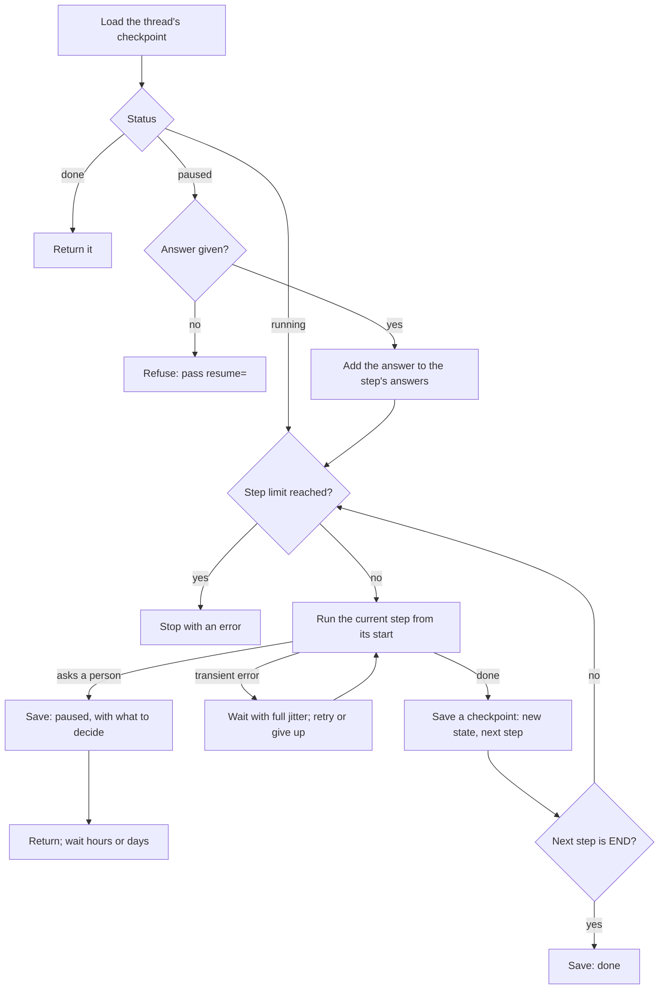

# The AI Engineering Stack, Part 09: Workflows and Several Agents

*October 15, 2026; reader tests added October 20, 2026. Part 09 of 13 (claude/engineering-stack-plan.md). Tags in this part: 173 [V], 69 [T], 9 [R], 0 [U] and 11 [I], counted in Sections 1 to 12 and the checks after them. Still open: no model and no Temporal server run on the test machine, so Temporal, CrewAI, Microsoft Agent Framework and the agent SDKs are described from their documentation and source code [R]; LangGraph 1.2.15 was run [T]. Most multi-agent evidence is preprints or vendor reports. The lab's reader tests ran on Windows by script on October 20, 2026 [T]; the typed Windows steps and macOS haven't been run [R]. The lab's orders, payments and agents are invented [I]; its engine is tested, including against LangGraph [T].*

**What this part gives you.** How to make AI work reliable when it runs for minutes or days, and when it is split across several agents. It starts with **workflows**: fixed steps written in code, which are often better than an agent. Then **durable execution**: saving progress after each step so a crash, a timeout or a two-day wait for a person doesn't lose the work, and making sure a retried step doesn't pay a customer twice. Then **several agents** working together: when splitting work helps, what it costs, and how context moves between agents. Last, **human approval**: pausing for a person in a way that survives restarts and actually gets read. The lab builds a small workflow engine in plain Python that pauses for approval, survives a process being killed, retries with jitter and refunds once even when a reply is lost. It then checks the same behaviours against LangGraph itself. No model, account or API key is needed.

## How to read this part

The tags are Part 01's. **[V: KEY]** points to Section 12, which gives each source's class and the place used. **[T]** ran on the test machine. **[R]** is a reader test. **[U]** names what would settle it. **[I]** is invented for teaching. Source classes: official documentation and source code (OD), specifications, standards and law (SB), peer-reviewed (PR), preprint (PP), vendor blog (VB), personal blog (PB). A vendor's docs are the authority on how its product works, not on how good it is. Numbers come with their model, version, date and who measured them. References like "ledger P8-04" point to rows of claude/engineering-stack-claim-ledger.md, this series' audit of the Gemini report.

**The test machine:** Ubuntu 24.04 in a cloud container, October 15, 2026, with Python 3.13.16, 3.12.3 and 3.11.17. It runs no AI model. LangGraph 1.2.15 was installed in a throwaway virtual environment for the cross-check [T]. No Temporal server ran here, so Temporal is described from its documentation and source code [R].

**This part covers three topics** (plan, Section 7), all in the **Control** layer: T16, workflows and durable execution; T17, multi-agent systems and frameworks; T18, human-in-the-loop. The agent loop and its approval rule are Part 08; tool protocols such as A2A are Part 07; prompt injection between agents is Part 10. The taxonomy covers multi-agent debate as a prompting technique (claude/taxonomy-of-prompt-engineering-3e.md); this part covers the software around it.

## 1. In plain words

**T16, workflows and durable execution.** Anthropic separates **workflows**, "systems where LLMs and tools are orchestrated through predefined code paths", from **agents**, where "LLMs dynamically direct their own processes and tool usage" [V: BEA]. Its advice is to find "the simplest solution possible, and only increasing complexity when needed" [V: BEA]. A workflow you can draw in advance is easier to test, cheaper and more predictable than an agent.

Long work fails partway: a server restarts, an API times out, a person takes two days to answer. **Durable execution** is Temporal's term for "the ability of a Workflow Execution to maintain its state and progress even in the face of failures, crashes, or server outages" [V: TDC]. In practice: save a checkpoint after each step, resume from the last one, and make sure any step that might run twice is safe to run twice.

*Analogy.* A recipe card with a pencil tick after each step. If the phone rings, you come back and carry on from the last tick. But if you can't remember whether you added the salt, you need a way to check before adding it again.

**T17, several agents.** One agent can hand work to others: an orchestrator splits a task, workers each handle a part in their own context, and the orchestrator combines what comes back. It can help with wide, separable work; Anthropic's research system beat a single agent by 90.2% on its own internal evaluation, while using "about 15× more tokens than chats" [V: MAR]. It also adds new ways to fail, and at equal budgets a single agent often does as well (Section 3.7).

*Analogy.* A newsroom: an editor sends three reporters to three towns and writes the story from their notes. Great for covering three towns at once. Useless for writing one paragraph, where passing notes back and forth only loses the thread.

**T18, human-in-the-loop.** The workflow stops before a risky action, shows a person what it is about to do, and waits for "approve" or "reject". OWASP advises using "human-in-the-loop control to require a human to approve high-impact actions before they are taken" [V: OWA]. The hard parts are waiting for days without losing state, and making sure people read what they approve: Anthropic reports that "Claude Code users approve 93% of permission prompts" [V: AAM].

**Where it sits in the stack** (plan, Section 5). All three are **Control**: they decide what happens next. They build on the agent loop (Part 08), tools (Parts 03 and 07) and evals (Part 02), and they meet security (Part 10) wherever text passes between agents.

## 2. Definitions

Every term is also in claude/engineering-stack-glossary.md.

| Plain words | Technical term | Notes |
|---|---|---|
| Fixed steps written in code, some of them model calls | Workflow | [V: BEA] |
| A chain of model calls, each using the last one's output | Prompt chaining | [V: BEA] |
| Sending each request to the step or model that suits it | Routing | [V: BEA] |
| Running parts at once, or the same task several times | Parallelization (sectioning; voting) | [V: BEA] |
| One model splits the work and hands parts to others | Orchestrator-workers | [V: BEA] |
| One model writes, another judges, in a loop | Evaluator-optimizer | [V: BEA] |
| A graph whose steps can loop back | State graph (not a DAG) | [V: LGD] |
| A graph with no loops | Directed acyclic graph (DAG) | Airflow's model [V: AFL] |
| A saved snapshot of a run's state | Checkpoint | Keyed by a thread id [V: LGD] |
| One conversation or job, with its own checkpoints | Thread | [V: LGD] |
| Progress that survives crashes and waits | Durable execution | [V: TDC] |
| A step that can run again with the same effect as once | Idempotent step | [V: LGD, TDC] |
| A unique label sent with a request so a repeat is recognized | Idempotency key | [V: STR] |
| Waits that grow each time, with a random part | Exponential backoff with jitter | [V: AWB] |
| A cap on steps before the run is stopped | Recursion limit; step limit | [V: LGS] |
| Pausing a run until a person answers | Interrupt | [V: LGD] |
| A run paused at a fixed step, for debugging | Static breakpoint | Not for approval [V: LGD] |
| Handing the whole conversation to another agent | Handoff | [V: OAS] |
| Calling another agent like a tool, with only the input the manager writes for it | Agent as tool | [V: OAS] |
| A worker agent with its own context window | Subagent | [V: CSA] |
| Trusting an automated suggestion without checking it | Automation bias | [V: GRW] |

The products named (LangGraph, Temporal, CrewAI and the rest) are introduced in Sections 3 and 6.

## 3. How it works

### 3.1 Five workflow patterns, and when each fits

Anthropic's "Building effective agents" names five workflow patterns before it gets to agents [V: BEA]. The post has been edited since December 2024: it now names Claude Haiku 4.5 and Sonnet 4.5 and says "Much of the tooling landscape described in this post has changed since December 2024" [V: BEA].

| Pattern | What it does | When it fits, in Anthropic's words |
|---|---|---|
| Prompt chaining | Each call works on the last one's output, with checks in between | "the task can be easily and cleanly decomposed into fixed subtasks" |
| Routing | A classifier sends each input to its own path | "distinct categories that are better handled separately", where "classification can be handled accurately" |
| Parallelization | **Sectioning**: "independent subtasks run in parallel"; **voting**: "the same task multiple times" | "subtasks can be parallelized for speed, or when multiple perspectives or attempts are needed" |
| Orchestrator-workers | "a central LLM dynamically breaks down tasks, delegates them to worker LLMs, and synthesizes their results" | "complex tasks where you can't predict the subtasks needed" |
| Evaluator-optimizer | "one LLM call generates a response while another provides evaluation and feedback in a loop" | "when we have clear evaluation criteria, and when iterative refinement provides measurable value" |

Two details correct the Gemini report. Routing's example sends "easy/common questions to smaller, cost-efficient models like Claude Haiku 4.5", not to "highly quantized" models; quantization is a separate technique (ledger P8-02; Part 11) [V: BEA]. And the evaluator-optimizer loop has no numeric quality threshold in the source; LangGraph's version loops "until an acceptable response is generated" [V: LGD]. Since a judge may never be satisfied, the loop also needs an iteration cap, which is how Anthropic's post describes agents in general: "stopping conditions (such as a maximum number of iterations)" (ledger P8-03) [V: BEA]. The lab's draft-and-review loop gives up after three drafts (check 4b) [T].

### 3.2 Three ways to describe a workflow

Gemini says orchestration "is modeled as a DAG or a cyclic state graph" (ledger P8-01). That's two of three common models [V: AFL, LGD, TDC, DBS]:

- **A DAG** (directed acyclic graph): steps and arrows, no loops. Airflow's model; its name comes from "the mathematical concept "directed acyclic graph"", and its code rejects a cycle with `AirflowDagCycleException` [V: AFL]. Good for scheduled batch jobs.
- **A state graph**: steps that read and write a shared state, with edges that may loop back. LangGraph's model, for "looping, stateful workflows" [V: LGD]. Good for agents, which loop by nature. So the curriculum row that calls a LangGraph graph with conditional edges a "DAG" is imprecise (ledger P8-06) [V: LGD].
- **Ordinary code with durable steps**: no graph at all. Temporal, DBOS and Restate run a normal function and record each step's result, so a restarted function skips what already happened [V: TDC, DBS, RST].

None of the four tools Gemini names is "the industry standard" in any source found (ledger P8-04): they do four different jobs, namely durable execution (Temporal), scheduled pipelines (Airflow), agent graphs (LangGraph) and a task queue (Celery) [V: TDC, AFL, LGD, CEL].

### 3.3 Checkpoints, threads and resuming

LangGraph runs a graph in **super-steps**: "a single iteration over the graph nodes", where nodes that run in parallel share one super-step [V: LGD]. It "creates a checkpoint at each super-step boundary", keyed by a thread: "When invoking a graph with a checkpointer, you **must** specify a `thread_id`" [V: LGD]. The cross-check confirms the refusal (check L5) [T].

**When the checkpoint is written** is a setting, `durability` [V: LGS, LGD]:

| Mode | Saves | Risk |
|---|---|---|
| `"exit"` | "only when graph execution exits" | A crash loses the whole run |
| `"async"` (the default in 1.2.15) | "asynchronously while the next step executes" | "a small risk that LangGraph does not write checkpoints if the process crashes" |
| `"sync"` | "synchronously before the next step starts" | Slowest; safest |

The lab's engine works like `"sync"`: it writes each checkpoint to a temporary file, flushes it to disk and renames it into place, so a killed process leaves either the old checkpoint or the new one, never half of one [I]. Check 3 kills a real process inside a step with `os._exit` and continues the thread from a second process: the finished steps don't run again, and the step that was killed does [T].

The lab's engine, step by step [T: its checks 1 to 8 exercise each arrow]:



**What resuming re-runs.** This is the rule that surprises people. LangGraph: "the affected **node** runs again from the start of its function. Code and side effects before the pause run again" [V: LGD]. So it advises: "Use idempotency keys, upserts, or read-before-write checks" (an upsert writes a record whether or not it exists, so doing it twice leaves one record) [V: LGD]. One help: if several nodes run in one super-step and one fails, "the successful nodes' writes are already durable and don't need to be re-run on resume" (pending writes) [V: LGD]. That isn't caching. Node caching is a separate, opt-in feature: you compile with a cache and give a node a `cache_policy`, whose key "defaults to a hash of the input with pickle" (ledger B1-03: overstated as a default) [V: LGD, LGS].

**The step limit.** A graph that loops needs a cap. LangGraph raises `GraphRecursionError`, "Recursion limit of {n} reached without hitting a stop condition" [V: LGS]. The default is widely quoted as 25, which it was until 1.0.5. It became 10,000 in 1.0.6 and is 10,007 in 1.2.x, read from the package source: `DEFAULT_RECURSION_LIMIT = int(getenv("LANGGRAPH_DEFAULT_RECURSION_LIMIT", "10007"))` [V: LGS, LGH]. LangGraph's own docs say "Starting in version 1.0.6, the default recursion limit is set to 1000 steps", which disagrees with the code [V: LGD]. The cross-check settles it for 1.2.15: the default reads 10,007, a 30-step loop finishes without error, and `recursion_limit=7` stops it (check L3) [T]. With a limit that high, a runaway graph can spend a lot before it stops, so set your own. The lab's engine defaults to 25 steps [I].

### 3.4 Temporal: workflows as replayed code

Temporal splits work in two. **Activities** are ordinary functions that do "a single, well-defined action ... such as calling another service", model calls included [V: TDC]. **Workflow code** decides what happens next, and it must be deterministic: "any time your Workflow code is executed it makes the same Workflow API calls in the same sequence, given the same input" [V: TDC]. The reason is replay. After a crash, Temporal runs the workflow function again from the top, and "the Commands that are emitted are compared with the existing Event History"; activities that already finished return their recorded results instead of running [V: TDC]. A mismatch gives "a _non-deterministic_ error", so workflow code can't branch on the clock or a random number except through the SDK's replay-safe versions [V: TDC].

| Default or limit | Value | Source |
|---|---|---|
| Activity retries | first wait 1 s, coefficient 2.0, longest wait 100 x the first (100 s), unlimited attempts | [V: TDC, TPS] |
| Workflow retries | none: "Workflow Executions do not retry by default" | [V: TDC] |
| Event history per run | 51,200 events or 50 MiB (warnings at 10,240 and 10 MiB) | docs and server code [V: TDC, TSV] |
| Waiting | "A Workflow can sleep for months" | [V: TDC] |
| Licence | MIT, server and Python SDK; Temporal Cloud is paid, "consumption-based" | [V: TSV, TPS, TDC] |

The history limit matters for agents: a long agent loop that records every model call as an event can hit it, which is why Temporal offers "continue-as-new", a fresh run that carries the state forward [V: TSV].

### 3.5 Retries, jitter and doing things once

**Retry only what might succeed next time.** A timeout, a rate limit (429) or a server error (5xx) may pass; a bad request won't. Both official Python SDKs retry for you: `DEFAULT_MAX_RETRIES = 2` (three attempts in all), starting at 0.5 seconds and doubling to at most 8 seconds, on 408, 409, 429 and 5xx responses (anthropic 1.14.0, openai 3.31.0) [V: ANS, OAI]. Their jitter is `1 - 0.25 * random()`, a delay cut by up to a quarter, though the code's comment says "plus-or-minus half a second" [V: ANS]. Anthropic adds that a spend-cap 429 "has no retry-after header and keeps failing" [V: ANE]. LangGraph's `RetryPolicy` defaults are 0.5 seconds, a factor of 2.0, a 128-second cap and 3 attempts "including the first", with jitter on (check L4) [V: LGS][T]. Its default skips errors that retrying won't fix, such as `ValueError` and `TypeError` [V: LGS]. The lab does the same: a `ValueError` runs once (check 5b) [T].

**Why jitter.** If a thousand clients fail together and all wait exactly 1, 2, 4 seconds, they all come back together. AWS's analysis compared ways to spread them; its companion code defines **full jitter** as `sleep = random.uniform(0, min(cap, base * 2 ** attempt))` [V: AWC], and the post concludes that of the jittered approaches "Equal Jitter" is "the loser", while "Full Jitter" uses "less work, but slightly more time" than the third kind, decorrelated jitter (a 2015 simulation of one contention model) [V: AWB]. The lab's `RetryPolicy.delay` is full jitter (check 5) [T].

**The lost reply.** A retry is only safe if the step is idempotent. The classic failure: you ask a payment service for a refund, it pays, and its reply is lost on the way back. Your code sees a timeout and retries. Without protection, the customer is refunded twice. The lab reproduces it: with no key, two refunds; with an idempotency key, one (check 6; `demo.py`, part 3) [T].

**Idempotency keys.** The caller sends a unique key with the request; the service stores the first result under that key and returns it for any repeat. Stripe's version (described for its API v1; v2 behaves differently) saves the "status code and body of the first request ... including 500 errors", takes keys "up to 255 characters", refuses a key reused with different parameters, and "you can remove keys from the system automatically after they're at least 24 hours old" [V: STR]. The key has to be checked by the side that performs the effect. A record your own code keeps after the call returns doesn't help when the reply is lost, and it can't cover a crash between the effect and the record (check 6d) [T]. One trap: the Anthropic and OpenAI SDKs generate an idempotency key for retries but don't send it (`_idempotency_header = None`), so model calls are not deduplicated [V: ANS, OAI].

**"Exactly once" is a promise about results, not runs.** Temporal guarantees "the Activity will be observed as completed exactly once. However, the Activity may be executed multiple times and may even partially complete more than once"; it calls the result an "effectively once" experience [V: TDC]. Celery makes the trade-off visible: by default a task is acknowledged "just before it's executed", so a task that crashed is never run again; with `acks_late`, it "may be executed multiple times should the worker crash in the middle of execution. Make sure your tasks are idempotent" [V: CEL]. The messages come back after a visibility timeout, by default one hour on Redis [V: CEL]. The general rule, as this part reads these sources: effectively once means running at least once plus making the effect idempotent [I].

### 3.6 Pausing for a person

**The mechanics.** A run reaches a risky step, saves its state, shows a person what it will do, and stops. Hours or days later, the answer arrives and the run continues from the saved state. Each framework spells it differently:

| Framework | How it pauses | How it resumes | Watch for |
|---|---|---|---|
| LangGraph 1.2.15 | `interrupt(value)` inside a node | `Command(resume=answer)` on the same thread | The node runs again from its start; answers match interrupts "strictly index-based"; don't wrap `interrupt` in try/except [V: LGD] |
| OpenAI Agents SDK 0.24.0 | A tool with `needs_approval=True`; calls appear in `result.interruptions` | `state = result.to_state()`, `state.approve(...)` or `state.reject(...)`, then `Runner.run(agent, state)` | `RunState` "is designed to be durable", but the docs say they "do not authenticate the snapshot or the person submitting it" [V: OAS] |
| Claude Agent SDK 0.2.167 | Hooks, deny and ask rules, the permission mode, allow rules, then the `canUseTool` callback | The callback's answer | "Auto-approved tools never reach `canUseTool`"; for checks on every call, "use a PreToolUse hook" [V: CAP] |
| Microsoft Agent Framework 1.22.0 | A function tool with `approval_mode="always_require"` | A function-approval response | The default is `"never_require"` [V: MAF] |
| CrewAI 1.15.28 | `@human_feedback` in a Flow (since 1.8.0) | `flow.resume(feedback)` | State is saved "automatically" when feedback is pending [V: CRW] |
| Temporal | The workflow waits on a condition (`workflow.wait_condition`) | A **signal** ("an asynchronous message ... to change its state") or an **update** ("a trackable synchronous request") | Built for waits of days [V: TDC, TPS] |

Static breakpoints are not approval. LangGraph's `interrupt_before` and `interrupt_after` exist "to step through the graph execution one node at a time", and its docs say "Static interrupts are **not** recommended for human-in-the-loop workflows. Use the interrupt function instead" (ledger B1-07: corrected) [V: LGD]. CrewAI's `@human_feedback` and its opt-in checkpointing make Gemini's "less structural durability" claim (ledger B1-06) unsupported: no source compares the two [V: CRW].

**Three rules the lab tests.**

1. *Code before the pause runs twice.* The lab's approval step increments a "notify" counter before asking; after one approval it reads 2 (check 2b). LangGraph does the same (check L1) [T]. Send the notification after the pause, or make it idempotent.
2. *Fail closed.* Only `{"decision": "approve"}` approves; `"yes"`, `{"decision": "Approve"}`, `True` and `{"approved": True}` don't (check 2d) [T]. A typo should stop the refund, not send it.
3. *A paused state is a security boundary.* Whoever can edit the saved state can change what gets approved. The lab signs checkpoints with HMAC-SHA256 (a code computed from the file and a secret, which changes if either changes) and refuses an edited one; with no secret, the same edit to the amount (250 to 25,000) loads quietly (check 7) [T]. OpenAI's docs make the same point about `RunState` [V: OAS].

**Will anyone read it?** An approval prompt is only a safeguard if the person reads it. Anthropic's post on Claude Code's auto mode reports that users "approve 93% of permission prompts" and names the risk, "approval fatigue, where people stop paying close attention to what they're approving"; the post doesn't say what data the 93% comes from [V: AAM]. Its fix is a classifier that decides instead, with its own errors: 0.4% false positives on 10,000 real actions and 17% false negatives on 52 real "overeager" actions, which the post calls "the honest number" [V: AAM]. A 2012 systematic review of clinical decision support (74 studies) found that over-reliance on automation grows with workload, task complexity and time pressure, and that accountability and training reduce it [V: GRW]. Design rules that follow, as this part reads them [I]:

- Ask only for actions that spend, send, delete or can't be undone; approve routine reads in code, or nobody reads the important prompts.
- Show the exact action and its arguments (the amount, the recipient), not the model's summary of them.
- Record who approved what, and when.

**The law, where it applies.** The EU AI Act requires that high-risk AI systems "shall be designed and developed" for effective human oversight, including staying aware of automation bias and being able to override or stop the system (Article 14) [V: EUA]. In the consolidated text as of July 27, 2026, which includes the "Digital Omnibus" amendments, those duties apply from December 2, 2027 for the Annex III high-risk uses and August 2, 2028 for Annex I products; the 2024 text's earlier dates are out of date [V: EUA]. This is information, not legal advice; most agent projects are not high-risk systems in the Act's sense.

### 3.7 Several agents: what the evidence says

| Study | What was compared | Result | Class |
|---|---|---|---|
| Anthropic's research system, June 2025 [V: MAR] | Claude Opus 4 leading Claude Sonnet 4 subagents, against a single Opus 4, on Anthropic's internal research evaluation | "outperformed single-agent Claude Opus 4 by 90.2%". Not equal compute: on BrowseComp, "token usage by itself explains 80% of the variance". Agents use "about 4× more tokens than chat interactions"; multi-agent systems "about 15×" | VB |
| Kim et al., "Towards a Science of Scaling Agent Systems" [V: SCAL] | 260 configurations, 6 benchmarks, 5 architectures, at "identical ... computational budgets" | From "+80.8% on decomposable financial reasoning" to "-70.0% on sequential planning"; adding agents had negative returns once a single agent scored above 45% | PP |
| Tran and Kiela, 2026 [V: TRAN] | Single against multi-agent on multi-hop questions at equal thinking-token budgets | The single agent matched or beat them; at 1,000 tokens, 0.418 against 0.379 (sequential) and 0.388 (debate) average accuracy, gaps of 3.9 and 3.0 percentage points | PP |
| MAST, Cemri et al., NeurIPS 2025 [V: MAST] | 1,642 traces from 7 multi-agent frameworks | 14 failure modes in 3 categories; the largest single modes were step repetition (15.7%) and a mismatch between reasoning and action (13.2%) | PR |
| Du et al., ICML 2024 [V: DU] | 3 agents, 2 rounds of debate, GPT-3.5 | Arithmetic 67.0 (single) and 75.0 (majority vote of 6, equal call count) against 81.8 (debate) | PR |
| Smit et al., ICML 2024 [V: SMIT] | Debate protocols against self-consistency and ensembles, GPT-3.5, medical and reasoning sets | Debate does "not reliably outperform" self-consistency; "more sensitive to different hyperparameter settings" | PR |

Three readings follow. First, multi-agent systems win partly by spending more: Anthropic's own analysis credits tokens with most of the variance, and the equal-budget studies find smaller or negative gains [V: MAR, SCAL, TRAN]. Second, the gain depends on the task: wide, separable work helped (Anthropic's breadth-first research; Kim et al.'s decomposable financial reasoning), while sequential planning got worse [V: MAR, SCAL]. Third, the failures are mostly coordination, not missing intelligence. MAST's authors "conjecture that improvements in the base model capabilities will be insufficient" to fix them [V: MAST].

The two vendor positions have moved closer. Cognition's 2025 post "Don't Build Multi-Agents" set two principles: "Share context, and share full agent traces, not just individual messages", and "Actions carry implicit decisions, and conflicting decisions carry bad results" [V: CG1]. Its April 2026 follow-up keeps them for "parallel-writer swarms" but reports multi-agent setups working when "writes stay single-threaded": a reviewer with a clean context, a stronger model consulted for advice, a manager delegating to children [V: CG2]. Anthropic's post says shared-context domains and "most coding tasks" are poor fits [V: MAR]. So Gemini's claim that splitting a fragile mega-prompt into specialists fixes it (ledger B1-01) is overstated: it helps for parallel, separable work and adds failures of its own [V: MAR, SCAL, MAST].

### 3.8 How context moves between agents

The design choice that matters most is what each agent gets to see.

| Mechanism | What the receiver sees | What comes back | Source |
|---|---|---|---|
| OpenAI handoff | "the entire previous conversation history", unless an `input_filter` trims it | Nothing: the receiver takes over the conversation | [V: OAS] |
| OpenAI `Agent.as_tool()` | Only the input the manager generated | The nested run's final output | [V: OAS] |
| Claude subagent | Its own system prompt and "the Agent tool's prompt string"; not the parent's history | "only its final message" | [V: CSA] |
| LangGraph supervisor (`langgraph-supervisor` 0.0.31) | What the supervisor passes | By default only the worker's last message (`output_mode="last_message"`) | [V: LGSU] |
| Microsoft Agent Framework handoff | "The entire conversation is maintained and reused on every hop" | Control moves to the next agent | [V: MAF] |

The lab measures the difference in words (a stand-in for tokens). Over five turns of conversation, the input a handoff passes grows from 75 to 363 words, while an agent-as-tool brief stays at 8 (check 9) [T]. And trimming history has limits: OpenAI's built-in filter "removes structured tool items" but "does not redact tool arguments or results already copied into ordinary messages"; the lab shows tool output surviving inside an assistant message (check 9b) [V: OAS][T]. Two more details from the OpenAI docs: the option that compacts earlier history on handoff, `nest_handoff_history`, is "an opt-in beta and is disabled by default"; and "Input guardrails still apply only to the first agent in the chain" [V: OAS].

Claude Code's subagents have changed since Cognition's 2025 post described subtasks that couldn't run in parallel or nest. By default, "a subagent can spawn subagents of its own, up to three layers below the main conversation", up to 20 run at once, and the SDK offers a spend cap (`max_budget_usd`, unlimited by default) [V: CCS, CSA]. Each subagent "spends tokens of its own while it runs" [V: CCS].

Other frameworks package the same patterns. Microsoft Agent Framework ships Sequential, Concurrent, Handoff, GroupChat and Magentic builders [V: MAF]. CrewAI's `Process` has two values, `sequential` and `hierarchical`, the second requiring a `manager_llm` or `manager_agent`; its Flows add event-driven steps (ledger B1-05: the processes are confirmed; "fastest way to prototype" is unmeasured) [V: CRW]. Google's ADK has `SequentialAgent`, `ParallelAgent` and `LoopAgent` [V: ADK]. LangGraph's swarm hands off with `Command(goto=agent_name, graph=Command.PARENT)`, and the `langgraph-supervisor` README now recommends "the supervisor pattern directly via tools rather than this library for most use cases" [V: LGSW, LGSU]. Gemini's claim that LangGraph is "vastly superior" for resumable, compliant work (ledger B1-04) is unsupported: it has those features, and so do the others; no comparison was found [V: LGS, MAF, OAS].

### 3.9 What several agents cost, and how errors spread

**The arithmetic of delegation** (toy numbers [I], computed [T]). Three workers each read 20,000 tokens, get a 300-token brief and return a 1,000-token summary. The workers process 63,900 tokens in all; the lead's context grows by only 3,900, where one agent reading everything would grow by 60,000 (check 10b). Delegation keeps the lead's context small, which is the point, while the total spent goes up. Anthropic's measured multipliers are the real-world version: about 4x a chat for one agent and about 15x for its multi-agent system [V: MAR].

**Errors compound.** If each of five steps succeeds 95% of the time, independently, all five succeed 0.95^5 = 77.4% of the time (check 11) [T]. A verifier that checks the final result catches some of this; Kim et al. report that independent agents amplified errors 17.2 times at the trace level, against 4.4 for a centralized design with a coordinator [V: SCAL]. That factor counts the extra work caused by coordination failures in their traces, not 17 times more wrong answers [V: SCAL].

**More voters help only if their mistakes are independent.** The lab simulates five voters, each right 60% of the time. With independent mistakes, the majority is right 68.7% of the time (the exact figure is 68.3%; the difference is simulation noise from 20,000 random trials); with mistakes always shared, 60.1%, no better than one voter (check 12; `demo.py`, part 4) [T]. Copies of one model with one prompt are likely to share mistakes, which this part reads as one reason debate and voting gains shrink at equal budgets [I]. The studies found debate often fails to beat self-consistency, and one 2025 audit proposed mixing different models as the fix [V: SMIT, ZHNG].

**Instructions spread too.** Text one agent writes is input to the next. A 2024 preprint showed a self-replicating injection passing through simulated agent societies, infecting all 10 agents of one simulated society by turn 4.7. Marking alone (a special symbol separating user prompts from agent prompts) still let 76% of attacks through; combined with a step that tags where each message came from, it blocked every attack in its tests [V: PINF]. The lab's `pass_along` shows the mechanics harmlessly: a marker survives three agents either way; tagging only labels it as data (check 13) [T]. Part 10 covers defences.

### 3.10 Which frameworks are current

Gemini's framework list (ledger P6-05) is outdated [V: OADP, AGN, MAF, PYPI]:

- **OpenAI Assistants API**: removed from the API on August 26, 2026; the replacement is the Responses API with the Conversations API [V: OADP]. The OpenAI Agents SDK (0.24.0, released October 15, 2026) is OpenAI's agent framework [V: PYPI].
- **AutoGen**: "now in maintenance mode. It will not receive new features or enhancements and is community managed going forward" (README, April 6, 2026); its last release, autogen-agentchat 0.7.5, dates from September 30, 2025 [V: AGN, PYPI].
- **Microsoft Agent Framework**: "the next generation of both Semantic Kernel and AutoGen" [V: MSL]; 1.0.0 on April 2, 2026, 1.22.0 on October 15, 2026, MIT [V: MAF, PYPI].
- **LangGraph** (1.2.15) and **CrewAI** (1.15.28) remain current [V: PYPI].

CrewAI sends anonymous telemetry unless `CREWAI_DISABLE_TELEMETRY`, `CREWAI_DISABLE_TRACKING` or `OTEL_SDK_DISABLED` is set to true [V: CRW]. Microsoft's own overview gives the simplest advice of all: "If you can write a function to handle the task, do that instead of using an AI agent" [V: MSL].

## 4. Gemini said, evidence says

| Gemini (ledger row) | Evidence | Section |
|---|---|---|
| Orchestration is a DAG or a cyclic state graph (P8-01) | Overstated: true of Airflow (a DAG) and LangGraph (a state graph); Temporal, DBOS and Restate run ordinary code with recorded steps [V: AFL, LGD, TDC, DBS] | 3.2 |
| Routers send simple queries to "highly quantized, rapid models" (P8-02) | Corrected: Anthropic's example routes to "smaller, cost-efficient models like Claude Haiku 4.5"; quantization is a different technique [V: BEA] | 3.1 |
| Evaluator-optimizer loops rewrite until a quality threshold is met (P8-03) | Overstated: the source has no numeric threshold; the loop runs until the judge accepts, and needs an iteration cap [V: BEA, LGD][T] | 3.1 |
| Temporal, Airflow, LangGraph and Celery are "the industry standard" (P8-04) | Unsupported: four tools for four different jobs; no adoption data found [V: TDC, AFL, LGD, CEL] | 3.2 |
| Examples: routing to a cache, a translation loop, map-reduce over 50 chunks with Celery (P8-05) | Illustrative [I]; the mechanisms exist (routing, Anthropic's literary-translation example, Celery chords and chunks, LangGraph's `Send`) [V: BEA, CEL, LGS] | 3.1 |
| Curriculum: asyncio, backoff with jitter, a LangGraph "DAG" with conditional edges (P8-06) | Corrected: a LangGraph graph may loop, so it is a state graph; backoff with jitter is sound [V: LGD, AWC] | 3.2, 3.5 |
| Frameworks: LangGraph, CrewAI, AutoGen, OpenAI Assistants API (P6-05) | Outdated: the Assistants API was removed on August 26, 2026; AutoGen is in maintenance mode, succeeded by Microsoft Agent Framework [V: OADP, AGN, MAF] | 3.10 |
| One mega-prompt is "highly fragile"; specialized agents fix this (B1-01) | Overstated: gains on wide, separable research at much higher token cost; losses on sequential planning; at equal budgets a single agent often matches [V: MAR, SCAL, TRAN] | 3.7 |
| LangGraph: a cyclic state graph, explicit routing, thread-scoped checkpoints (B1-02) | Confirmed [V: LGD][T] | 3.3 |
| LangGraph caches node results and skips unchanged nodes (B1-03) | Overstated: node caching is opt-in per node; what skips finished sibling nodes after a failure is "pending writes" [V: LGD, LGS] | 3.3 |
| LangGraph is "vastly superior" for compliant, resumable work (B1-04) | Unsupported: no comparison found; other frameworks have checkpoints and approvals too [V: LGS, MAF, OAS] | 3.8 |
| CrewAI: sequential or hierarchical delegation; "the fastest way to prototype" (B1-05) | First half confirmed; speed unmeasured; Flows add event-driven steps [V: CRW] | 3.8 |
| CrewAI has "less structural durability" for approval chains (B1-06) | Unsupported and partly outdated: `@human_feedback` since 1.8.0 saves state automatically while it waits [V: CRW] | 3.6 |
| Human-in-the-loop breakpoints let a person approve high-stakes actions (B1-07) | Corrected: LangGraph says static breakpoints are for debugging and "not recommended for human-in-the-loop"; use `interrupt()` [V: LGD] | 3.6 |

## 5. Examples

**Real examples.**

1. *An orchestrator that over-delegated* [V: MAR]. In Anthropic's research system, early versions made mistakes such as "spawning 50 subagents for simple queries"; the fix was rules in the prompt about how much effort each kind of query deserves. More agents is a cost, not a goal.
2. *Docs and code that disagree* [V: LGD, LGS]. LangGraph's documentation says its default step limit has been 1,000 since version 1.0.6; the package source says 10,000 in 1.0.6 and 10,007 in 1.2.x, and running it agrees with the source (check L3) [T]. When a limit matters, read it from the code you run.
3. *A framework shut down under its users* [V: OADP]. OpenAI announced the Assistants API's deprecation in August 2025 and removed it on August 26, 2026, pointing users to the Responses and Conversations APIs. Agent code tied to one vendor's orchestration API has to migrate when that API goes.

**A fully worked example: a refund that waits for a manager and survives a lost reply** [I: the order, services and approver are invented; every step ran, and the lines are the lab's `demo.py` output].

*Input.* Order A17, amount 250, the request "Refund please, item arrived broken"; a payment service that will lose its first reply; checkpoints signed with a demo-only secret.

*Step 1, start.* The thread runs five steps and stops: `status interrupted after 5 steps; model small-model; drafts 2`. Routing picked the small model (no hard words in the request); the draft-and-review loop took two drafts. The checkpoint holds what the manager must decide: `{'action': 'refund', 'order': 'A17', 'amount': 250}` [T].

*Step 2, approve.* Hours later, in a new process if need be, the manager answers `{"decision": "approve", "by": "manager"}`. The approval step runs again from its start, so its "notify" code runs a second time. The refund call goes through at the payment service, but the reply is lost: the retry log shows `{'step': 'refund', 'attempt': 1, 'error': 'timeout: the reply was lost'}`, the engine waits 0.07 seconds (full jitter) and tries again. The service recognizes the idempotency key `refund-A17` and returns the first refund, `rf_1` [T].

*Output.* `status done; refund rf_1`; `charges at the payment service: 1`. Step counts: `{'classify': 1, 'draft': 2, 'review': 2, 'notify': 2, 'refund': 2}`. The same run without the key ends with `charges: 2`: the customer refunded twice [T].

## 6. What you need

Checked October 15, 2026 [V: PYPI]. Licences from each project's licence file or registry entry; information, not legal advice.

| Tool | What it's for | Licence | Runs | Account or key? | Version |
|---|---|---|---|---|---|
| The lab's scripts | A durable workflow engine, a refund example, several-agent toys | This series | Python 3.11 to 3.13, standard library [T] | No | Lab zip |
| LangGraph (`langgraph`) | Agent graphs with checkpoints, interrupts, retries | MIT | Python 3.10 or later | No (LangSmith tracing is separate and off unless you turn it on) | 1.2.17, October 24, 2026 [T: PyPI, October 26]; the rest of this row was checked at 1.2.15 |
| `langgraph-checkpoint-sqlite` | Saves LangGraph checkpoints in a SQLite file, "for development" | MIT | Python 3.10 or later | No | 3.1.2 |
| Temporal (`temporalio`, server) | Durable execution: workflows as replayed code | MIT | A Temporal server you run, or Temporal Cloud (paid) | Cloud only | SDK 1.34.0, September 30, 2026 |
| DBOS (`dbos`) | Durable workflows "built on top of Postgres" | MIT | Python 3.10 or later, with Postgres | No | 3.2.0 |
| Restate, Inngest | Durable execution services | Restate: Business Source License 1.1; Inngest server: SSPL with a future Apache-2.0 licence. Neither is OSI open source today [V: RST, ING] | Self-hosted or their clouds | Cloud only | see their sites |
| Prefect, Airflow | Scheduled pipelines | Apache-2.0 | Python 3.10 or later | No | 3.8.8; 3.3.2 |
| Celery | A task queue | BSD-3-Clause | A broker such as Redis or RabbitMQ | No | 5.6.3 |
| OpenAI Agents SDK (`openai-agents`) | Handoffs, agents as tools, approvals | MIT | Python 3.10 or later | An OpenAI key for real models | 0.24.0, October 15, 2026 |
| Claude Agent SDK (`claude-agent-sdk`) | Claude Code's loop with subagents, hooks and permissions | MIT | Python 3.10 or later | An Anthropic key | 0.2.167, October 14, 2026 |
| Microsoft Agent Framework (`agent-framework`) | Workflows and multi-agent builders; AutoGen's successor | MIT | Python 3.10 or later | A model provider's key | 1.23.0, October 22, 2026 [T: PyPI, October 26]; the rest of this row was checked at 1.22.0 |
| CrewAI (`crewai`) | Role-based crews and event-driven Flows | MIT (repository) | Python 3.10 to 3.13 | A model provider's key; telemetry on by default (Section 3.10) | 1.15.30, October 24, 2026 [T: PyPI, October 26]; the rest of this row was checked at 1.15.28 |

Paths, and when to skip them:

- **Learn the ideas (this part):** the lab's engine, then the LangGraph cross-check. Free, offline after the install.
- **Build a small app:** LangGraph with the SQLite checkpointer while developing; its docs name `PostgresSaver` for production [V: LGD]. Or Temporal if your workflow outlives processes for days and calls many services.
- **Avoid lock-in:** keep each step a plain function with explicit inputs and outputs, so moving between engines means rewiring, not rewriting.
- **When not to use an agent at all:** when you can write the steps down. Anthropic's and Microsoft's advice agree: start with the simplest thing; "If you can write a function to handle the task, do that instead of using an AI agent" [V: BEA, MSL]. **When not to use several agents:** when the work is sequential or every step needs the whole context [V: MAR, SCAL].

## 7. Set it up

**Before you start.** Part 01's setup: Python 3.11 to 3.13, and the series folder `ai-stack` in your home folder (Part 01, Section 7). Unzip `engineering-stack-lab-part-09.zip` into `ai-stack`; you get a folder named `engineering-stack-lab-part-09`. On Windows, right-click the zip, choose Extract All and set the destination to your `ai-stack` folder; if you end up with the folder inside another folder of the same name, move the inner one up [R]. On macOS, double-click it, then move the folder into `ai-stack`. On Linux, go to the folder that holds the zip (for example `cd ~/Downloads`), then `python3 -m zipfile -e engineering-stack-lab-part-09.zip ~/ai-stack` [T on Linux]. The core lab needs nothing installed.

Blocks of commands below are typed one line at a time, as shown.

### 7.1 Windows 10 or 11 [R: the typed steps haven't been run on Windows; this lab ran there by script on October 20, 2026]

In PowerShell:

```
cd $HOME\ai-stack\engineering-stack-lab-part-09
py -V:3.13 -m venv .venv
.venv\Scripts\Activate.ps1
python run_lab.py
```

Expect `30 of 30 checks passed`. If PowerShell refuses to run `Activate.ps1`, see Part 01, Section 7.6. If `py -V:3.13` says the version isn't installed, use the 3.11 or 3.12 you installed in Part 01 (`py -V:3.12`). Check 3 starts a second Python process and kills it on purpose; that's expected.

### 7.2 macOS [R: no macOS test machine]

```
cd ~/ai-stack/engineering-stack-lab-part-09
python3.13 -m venv .venv
source .venv/bin/activate
python run_lab.py
```

Expect `30 of 30 checks passed`. If `python3.13` isn't found, use the 3.11 or 3.12 you installed in Part 01.

### 7.3 Linux (Ubuntu 24.04) [T]

The same commands as macOS, with `python3` in place of `python3.13` if your Python 3 is 3.11 to 3.13 (`python3 --version` tells you). Expect `30 of 30 checks passed`. If `python3 -m venv` says ensurepip is not available, install Ubuntu's venv package (`sudo apt install python3-venv`) and try again [R: the test machine already had it].

### 7.4 Optional: check against LangGraph [T]

With the virtual environment active:

```
python -m pip install -r requirements-crosscheck.txt
python crosscheck.py
```

This installs `langgraph` 1.2.15 and `langgraph-checkpoint-sqlite` 3.1.2 with their dependencies, 41 packages in a fresh environment on Python 3.11, 3.12 and 3.13 [T]. Only those two are pinned; their dependencies install at their current versions. No key or account is needed. The script turns LangSmith tracing off and blocks Python's usual way of opening a network connection for its own run, so a check that tried to reach the internet that way would fail rather than send anything; a separate trace of the test runs saw no connection attempts [T]. Expect six PASS lines and `6 of 6 cross-checks passed` [T on Python 3.13.16, 3.12.3, 3.11.17].

### 7.5 Optional: Temporal [R]

Temporal needs a server. Its documentation describes a local development server and the Python SDK's samples; follow Temporal's own install page (https://docs.temporal.io/) rather than a third-party script, and read any install command before running it. Nothing in this part depends on it, and no Temporal server ran on the test machine [R].

### 7.6 A tour

| Command | What it does |
|---|---|
| `python demo.py` | The refund run step by step, the double refund without a key, and the agent numbers |
| `python run_lab.py` | 30 checks; exit code 0 only if all pass |
| `python mutation_check.py` | Breaks the lab 33 ways in a temporary copy; each must make `run_lab.py` fail (under a minute) |
| `python crosscheck.py` | Optional LangGraph comparison (7.4) |

An **exit code** is the number a program hands back when it ends: 0 means success, anything else a failure. See it right after the command with `echo $?` on macOS and Linux, or `$LASTEXITCODE` in PowerShell.

**In your own code.** Build a `Workflow()`; the first step you add is where a run starts. Add steps with `add_node(name, fn, retry=RetryPolicy(...))`, where `fn(state, ctx)` returns a dictionary of updates, and connect them with `add_edge(a, b)` or `add_router(a, fn)` (return a step name or `END`). Inside a step, `ctx.interrupt(value)` pauses for a person. Run with `flow.run(thread_id, FileCheckpointer(folder, secret=...), state=...)`; answer a pause with `resume=...`; call it with neither to continue after a crash. Raise `TransientError` for failures worth retrying. Wrap a side effect you control in `IdempotencyStore(path).run(key, params, fn)`, where `params` is a dictionary of `fn`'s keyword arguments.

### 7.7 Common errors and fixes

| What you see | Why | Fix |
|---|---|---|
| `can't open file '.../run_lab.py': [Errno 2] No such file or directory` | The terminal isn't in the lab folder | `cd` into the lab folder [T] |
| `ModuleNotFoundError: No module named 'langgraph'` | Running `crosscheck.py` without installing its requirements, or in another environment | Section 7.4, with the virtual environment active [T] |
| `ValueError: no thread 'x'; pass state= to start one` | Continuing a thread that was never started (or a different checkpoint folder) | Start it with `state=`, or point at the right folder [T] |
| `ValueError: thread_id must be 1 to 64 letters, digits, _ or -` | A thread id with a space, a slash or a dot | Use letters, digits, `_` or `-`, such as `order-A17` [T] |
| `ValueError: thread 'A17' already exists` | Starting a thread whose checkpoint is still in the folder | Continue it instead, use a new id, or delete its file [T] |
| `ValueError: thread 't1' is paused; pass resume=` | A paused thread was called without an answer | Pass `resume={"decision": "approve"}` or a rejection [T] |
| `workflow.StepLimitError: step limit of 25 reached without reaching END` | A loop never reached its exit | Check the router; raise `step_limit` only if the loop is meant to be long [T] |
| `workflow.StateTamperedError: checkpoint for ... was changed` | A signed checkpoint was edited, or opened with a different secret | Use the same secret; treat an edit as an incident [T] |
| `IndexError` from `crash_run.py` | It was run by hand without its two arguments | It's a helper for check 3; run `run_lab.py` instead [T] |
| `[notice] A new release of pip is available` | An older pip | Not an error [T] |

### 7.8 How to uninstall

Before you `deactivate`, `python -m pip cache purge` empties pip's download cache, which every project on your computer shares, so skip it if you'd rather keep cached downloads [T]. Then `deactivate`, move up one folder with `cd ..`, and delete the lab folder, which also removes its virtual environment, LangGraph and any `my-checkpoints` folder inside it: `rm -rf engineering-stack-lab-part-09` on macOS and Linux [T], `Remove-Item -Recurse -Force engineering-stack-lab-part-09` in PowerShell [R]. The checks, the demo and the cross-check work in your system's temporary folder and delete what they made when they finish [T].

## 8. Hands-on lab: a workflow that survives

**Goal.** Run a refund workflow that pauses for a person, resume it from a different process, break its approval rule on purpose, watch a lost reply cause a double refund and an idempotency key prevent it, measure how context moves between agents, and prove each check can fail. Then confirm the key behaviours in LangGraph itself.

**Prerequisites.** Section 7 for your system. **Time:** about 40 minutes by hand, about a minute automated. **Cost:** none. **Pinned:** the standard library only; the optional cross-check pins `langgraph==1.2.15` and `langgraph-checkpoint-sqlite==3.1.2` (7.4). **Data:** an invented order, payment service and manager [I]. **Files:** all are in the zip; `workflow.py`, the engine, is also printed in the appendix. The others: `examples.py` (the refund workflow and the stand-in payment service), `multi_agent.py`, `crash_run.py`, `demo.py`, `run_lab.py`, `mutation_check.py`, `crosscheck.py`, `requirements-crosscheck.txt` and `README.md`.

**Why no model?** The steps that call a model here are scripted, so each check can force one situation (a lost reply, a rejected approval, a killed process) and see the same result every time [I]. What's under test is the machinery around the model, which is where durability and approval live.

**Steps.** Outputs are from the test machine, Python 3.13.16, October 15, 2026 [T].

1. **Read the engine.** Open `workflow.py`. `Workflow.run` is the heart: load the thread's checkpoint, run the current step through `_call` (which retries), save a new checkpoint, move on. `Context.interrupt` is how a step pauses. Note the comment `# saved before the next step starts`.
2. **Watch one run.** `python demo.py`; its first two parts print the worked example from Section 5: five steps, a pause, an approval, a lost reply, one retry and one refund [T].
3. **Pause in one process, approve in another.** Start a thread and let the process end:

   ```
   python -c "from examples import *; from workflow import *; f = build_refund_workflow(FakePaymentService(), {}); cp = f.run('A17', FileCheckpointer('my-checkpoints'), state={'order': 'A17', 'amount': 250, 'request': 'Refund please'}); print(cp['status'], cp['pending']['value'])"
   ```

   It prints `interrupted {'action': 'refund', 'order': 'A17', 'amount': 250}` and leaves `my-checkpoints/A17.json`. Open that file: the whole state is there, stored as one escaped text string (so expect backslashes) with its signature field when a secret is used. Now, as a new process:

   ```
   python -c "from examples import *; from workflow import *; f = build_refund_workflow(FakePaymentService(), {}); cp = f.run('A17', FileCheckpointer('my-checkpoints'), resume={'decision': 'approve'}); print(cp['status'], cp['state']['refund_id'])"
   ```

   It prints `done rf_1` [T on Linux, and on Windows by script on October 20, 2026; R on macOS]. The first process could have been a web request on Monday and the second a manager's click on Wednesday. Delete `my-checkpoints` when done (`rm -rf my-checkpoints` on macOS and Linux, `Remove-Item -Recurse -Force my-checkpoints` in PowerShell); running the first command again before that gives `ValueError: thread 'A17' already exists`.
4. **Break the approval rule.** In `examples.py`, find `flow.add_router("approve", lambda s: "refund" if s["approved"] else END)` and replace the line with `flow.add_edge("approve", "refund")`, keeping the four spaces at the start of the line (Python rejects the file with `IndentationError` otherwise). Run `python run_lab.py`: checks 2c and 2d fail, and it ends `28 of 30 checks passed` [T]. A rejection now still refunds: the person was asked, and the answer was ignored. An approval step is only as good as the code that reads the answer. Put the line back and confirm 30 of 30.
5. **See the double refund.** `python demo.py`, part 3: the same lost reply without an idempotency key ends with `charges: 2` [T]. Then look at `FakePaymentService.refund` in `examples.py`: the key is checked by the service, the side that pays. A record kept by the caller after the call returns can't help when the reply is lost (Section 3.5; check 6d shows the limit of the lab's own `IdempotencyStore`).
6. **Watch context grow.** `python -c "import multi_agent as m; h=[{'role':'user','text':'word '*50}]*10; print(m.words(m.handoff_input(h,'Billing.')), m.words(m.as_tool_input('Check A17.','Billing.')))"` prints `501 3`: a handoff carries all ten messages; the brief and its one-word instruction come to three words [T].
7. **Prove the checks can fail.** `python mutation_check.py` breaks the lab 33 ways in a temporary copy (answers matched to the wrong pause, no cap on retry waits, checkpoint signatures not checked, a handoff that drops history, and more). Each must make `run_lab.py` fail. Expect `33 of 33 mutations caught` [T]. While the lab was being built, two breaks went unnoticed (restarting a finished thread under its old id, and counting a tied vote as a win), so checks 2f and 12 gained cases that catch them.
8. **Compare with LangGraph (optional, 7.4).** `python crosscheck.py`: the same rules hold in LangGraph 1.2.15. A paused node runs again from its start while earlier nodes don't (L1), two interrupts in a node match their answers by position (L2), the step limit default is 10,007 and a set limit raises `GraphRecursionError` (L3), the retry defaults match the docs (L4), a missing `thread_id` is refused (L5), and a pause saved in SQLite resumes through a new connection (L6) [T].

**Expected output** (`python run_lab.py`, abridged):

```
PASS  1 a refund run pauses for approval, then finishes with one refund
PASS  2b resuming re-runs the paused step from its start, and only that step
PASS  3 a process killed mid-step is continued by a new process from its checkpoint
PASS  6 a lost reply plus a retry pays twice without a key, once with one
PASS  12 extra voters help only when their mistakes are independent
...
30 of 30 checks passed
```

**What the checks cover.** Workflow: approval and rejection (1, 2, 2c), routing (1b), resume rules (2b, 2e), failing closed (2d), misuse (2f), a killed process (3), step limits and loop caps (4, 4b), retries (5 to 5d), idempotency (6 to 6d), signed checkpoints (7), safe thread ids (7b), a save after every step (8) and the standard library only (8b). Agents: handoff against agent-as-tool (9), history filters (9b), subagent summaries (10), cost arithmetic (10b), compounding errors (11), voting (12) and passing text along (13).

**If it fails.** A FAIL line names the check and the failing comparison. Section 7.7 covers the common errors. A check that fails only on your machine is worth reporting: send the whole output.

## 9. Teach it

**Learning objectives.** After this part you can:

1. pick the simplest of Anthropic's five workflow patterns that fits a task, and say when an agent or several agents would earn their cost;
2. explain what a checkpoint, a thread and a durability mode are, and what runs again when a paused or crashed run resumes;
3. make a retried side effect happen once, using an idempotency key checked by the side that performs it;
4. add a human approval step that fails closed, survives a restart, and shows the person the exact action;
5. choose between a handoff and an agent-as-tool by what each one lets the next agent see;
6. read a multi-agent result for what was held equal (tokens, models, calls) before trusting the gain.

**Prerequisites.** Parts 01 and 08. Reading a little Python.

**Common misconceptions.**

- *"Resuming continues from the line where it paused."* It restarts the paused step from its beginning; code before the pause runs again [V: LGD][T].
- *"Retries are safe."* Only for idempotent steps; a lost reply plus a retry pays twice (check 6) [T].
- *"The SDK makes my model calls idempotent."* The Anthropic and OpenAI SDKs generate a key but don't send it [V: ANS, OAI].
- *"LangGraph stops a runaway graph at 25 steps."* Not since 1.0.6; in 1.2.15 the default is 10,007 [V: LGS][T].
- *"A breakpoint is an approval step."* LangGraph says static breakpoints are for debugging; use `interrupt()` [V: LGD].
- *"More agents, better answers."* At equal budgets the gains shrink or reverse on sequential work; much of the measured gain comes from spending more tokens [V: SCAL, TRAN, MAR].
- *"Voting fixes errors."* Only errors the voters don't share (check 12) [T].
- *"A person approved it, so it was checked."* People approve almost everything they're shown when prompts are frequent [V: AAM, GRW].

**Exercises, with checked answers.** Run the checks from the lab folder, with the virtual environment active.

1. *Backoff arithmetic.* With full jitter, a first wait of 0.5 s, a factor of 2 and a cap of 8 s, what is the longest possible wait for n = 3, and for n = 5? Here n counts from 0, so n = 3 is the wait before the fourth retry. Answer: min(8, 0.5 x 2^3) = 4 s and min(8, 0.5 x 2^5) = 8 s; the actual wait is random between 0 and that. Check: `python -c "from workflow import RetryPolicy as P; print(P(initial=0.5, cap=8.0).delay(3, type('H', (), {'uniform': lambda s, a, b: b})()))"` prints `4.0`; the small `H` object is a stand-in random source that always returns the top of the range, so `delay` shows the longest wait. Change the `3` to `5` and it prints `8.0` [T].
2. *Compounding.* A pipeline has 10 steps, each 98% reliable and independent. How often does the whole run succeed? Answer: 0.98^10 = 0.8171, about 82%. Check: `python -c "from multi_agent import chain_success; print(round(chain_success(0.98, 10), 4))"` [T].
3. *Temporal's defaults.* Ignoring any randomness, what are an activity's first eight waits between retries under Temporal's default policy? Answer: 1, 2, 4, 8, 16, 32, 64 and then 100 seconds, since the longest wait is 100 times the first; attempts never run out by default [V: TDC]. Check the arithmetic: `python -c "print([min(100, 2**n) for n in range(8)])"` [T].

**Five-question self-check.** Answers follow.

1. Which of Anthropic's workflow patterns fits a task whose subtasks you can't predict in advance?
2. A LangGraph node sends an email, then calls `interrupt()`. What happens to the email when the run resumes?
3. Why must an idempotency key be checked by the service that performs the effect?
4. What does an OpenAI handoff pass to the next agent by default, and what does `as_tool` pass?
5. Anthropic's multi-agent system beat a single agent by 90.2%. Name two things that were not held equal.

*Answers.* (1) Orchestrator-workers [V: BEA]. (2) It's sent again, because the node runs again from its start; move it after the interrupt or make it idempotent [V: LGD]. (3) If the reply is lost, the caller never learns the result, so only the service can recognize the repeat [V: STR][T]. (4) "the entire previous conversation history"; only the input the manager generated [V: OAS]. (5) Tokens (multi-agent systems used about 15 times a chat's tokens, and token usage explained 80% of the variance on BrowseComp) and models (an Opus 4 lead with Sonnet 4 workers against Opus 4 alone) [V: MAR].

**You've got it when** you can take a workflow someone else wrote and say, for each step, what happens if it runs twice, and change the ones where the answer is "something bad".

**Best next resources** (checked to exist on October 15, 2026):

- Anthropic, "Building effective agents" [V: BEA] and "How we built our multi-agent research system" [V: MAR].
- LangGraph's docs on interrupts and checkpointers [V: LGD].
- Temporal's documentation on workflows, activities and retry policies [V: TDC].
- Cemri et al., "Why Do Multi-Agent LLM Systems Fail?" [V: MAST].

**A tutor prompt to practice with.** Paste this into Claude (modelled on claude/github-tutor-prompt.md):

```
Help me practise building AI workflows that survive failures, and deciding
when several agents are worth it.

How to teach me: one idea at a time, a question I answer before you go on,
and a small worked example for each idea. When I'm wrong, show me the
reasoning rather than the answer, so I can find the mistake myself.

Topics, in order:
1. Workflows versus agents, and the five workflow patterns.
2. Checkpoints, threads, and what runs again when a run resumes.
3. Retries, backoff with jitter, and idempotency keys.
4. Pausing for a person: approval that fails closed and survives restarts.
5. Several agents: handoffs, agents as tools, subagents.
6. Reading multi-agent results: what was held equal?

For any product, version, default or benchmark score, tell me it may have
changed since your training and that I should check the official docs. If
you aren't sure of a fact, say so instead of guessing.

Start by asking what job I'd like to automate.
```

**What to learn next.** Part 10, security: prompt injection, including the kind that passes between agents, guardrails, privacy and licences.

## 10. Limits and debates

- **Most multi-agent evidence is young.** Kim et al. and Tran and Kiela are preprints; Anthropic's 90.2% comes from an internal evaluation nobody else can run; the debate studies used GPT-3.5 [V: SCAL, TRAN, MAR, DU, SMIT]. Whether the findings hold for 2026 models is untested.
- **"Equal budget" is hard to define.** Calls, tokens, thinking tokens and money give different answers, and Tran and Kiela report "significant artifacts in API-based budget control" [V: TRAN]. Du et al. matched the number of agents ("6 agents to match the cost of using 3 agents with 2 rounds of debate"); they don't report token counts [V: DU].
- **Vendor figures without methods.** The 93% approval rate has no stated dataset; the auto-mode classifier's 17% miss rate comes from 52 cases [V: AAM]. The automation-bias review covers clinical tools, not AI agents [V: GRW].
- **Documentation drifts from code.** LangGraph's step limit (docs 1,000, code 10,007), the SDKs' jitter comment, and Anthropic's edited "Building effective agents" post all show it [V: LGD, LGS, ANS, BEA]. This part cites the code where they differ, and checks it where it can [T].
- **Nothing here ran Temporal, CrewAI, the Agent Framework or a live model.** Their behaviour comes from docs and source code [R]. LangGraph is the only framework run [T].
- **The lab's engine is a teaching toy.** One process per thread, no locking, JSON files; its signed checkpoints prove only that an edit happened, not who may approve. Its voting and cost models are toy arithmetic, not measurements [I].
- **When this is the wrong tool.** A job with known steps and no model: a plain script or a scheduler. A short task that finishes in seconds: no checkpoints needed. Work every step of which needs the whole context: one agent, not several.

**Where this part touches project docs** (flagged, not applied; plan, Section 8):

1. *Claim ledger, row P8-01.* The row's note says Temporal and Celery "are neither" a DAG nor a state graph; the evidence supports that, and the row's verdict, "confirmed", should read "overstated", as Section 4 does [V: TDC, DBS]. *Row B1-03* is marked confirmed; the evidence shows the caching is opt-in, so "overstated" fits better [V: LGD]. The ledger itself was not edited, by the series' rule.
2. *Prompt guide 2e, §25, rule 7* says "Cap total calls in code. An orchestrator that can spawn workers that spawn workers is an unbounded bill." It agrees with this part, and matters more now that Claude Code's subagents can nest three layers by default [V: CCS]. No change needed.

## 11. Skill opportunity

claude/new-skills-appendix.md lists no workflow-reliability skill. One candidate fits the project's rules: a **retry-safety-review** skill that reads a workflow's code (LangGraph nodes, Temporal activities, Celery tasks or plain functions), lists every side effect, and reports for each whether it runs again on resume or retry and whether an idempotency key protects it. Its script could reuse the lab's engine to replay a step twice, and checks 2b, 3, 6 and 6d plus their mutations would start its eval pack. It would read code, never run the workflow. Like every skill here, it needs the owner's trigger and non-trigger lists first (project instructions, "Building a skill", step 1).

## 12. Sources

All opened October 15, 2026, by the lead session or one of two researcher agents. Packages were read from wheels downloaded from PyPI and repositories from git clones of the projects' own GitHub organizations, so quotes come with file and line; web pages through a fetch tool that summarizes, with quotes asked for verbatim. The lead session re-read in source LangGraph's step-limit default (and confirmed it by running 1.2.15), its retry defaults, Temporal's default retry policy and history limits in the SDK and server code, and the Anthropic SDK's retry constants and jitter; and re-read Anthropic's multi-agent post and Kim et al.'s abstract for the headline figures. Grade: confidence from 1 to 10 that the source supports the use made of it.

| Key | Source | Class | Used for | Grade |
|---|---|---|---|---|
| AAM | Anthropic Engineering, "Claude Code auto mode", March 25, 2026. https://www.anthropic.com/engineering/claude-code-auto-mode | VB | 93% of prompts approved; approval fatigue; classifier error rates (1, 3.6, 9, 10) | 6 |
| ADK | google-adk 2.12.0 wheel (PyPI), google/adk/agents | OD | Sequential, Parallel and Loop agents (3.8) | 8 |
| AFL | Apache Airflow 3.3.2: "Dags" page (https://airflow.apache.org/docs/apache-airflow/stable/core-concepts/dags.html) and apache-airflow-core 3.3.2 wheel (utils/dag_cycle_tester.py; default retries) | OD | DAGs reject cycles (2, 3.2, 4) | 8 |
| AGN | microsoft/autogen README and git history (commits 84f21a08, October 2, 2025; 027ecf0a, April 6, 2026) | OD | Maintenance mode; community managed (3.10, 4) | 9 |
| ANE | Claude API docs, "Errors". https://platform.claude.com/docs/en/api/errors | OD | 529; spend-cap 429 has no retry-after (3.5) | 8 |
| ANS | anthropic 1.14.0 wheel (PyPI): `_constants.py`, `_base_client.py`. Re-checked October 26, 2026 at v2.3.0 on GitHub: the facts used here are unchanged | OD | 2 retries, 0.5 to 8 s, jitter multiplier; idempotency header unset (3.5, 9) | 9 |
| AWB | Brooker, "Exponential Backoff And Jitter", AWS Architecture Blog, March 4, 2015 (updated May 2023). https://aws.amazon.com/blogs/architecture/exponential-backoff-and-jitter/ | VB | Full versus equal jitter (2, 3.5) | 7 |
| AWC | aws-samples/aws-arch-backoff-simulator, src/backoff_simulator.py (the post's companion code) | OD | The full-jitter formula (3.5, 4) | 8 |
| BEA | Anthropic Engineering, "Building effective agents", December 19, 2024, edited since (read October 15, 2026). https://www.anthropic.com/engineering/building-effective-agents | VB | Workflows and agents; five patterns; smaller models for routing; stopping conditions (1, 2, 3.1, 4, 6, 9, 10) | 9 |
| CAP | Claude Agent SDK docs, permissions. https://code.claude.com/docs/en/agent-sdk/permissions | OD | Evaluation order; auto-approved calls skip `canUseTool`; hooks for every call (3.6) | 8 |
| CCS | Claude Code docs, "Create custom subagents". https://code.claude.com/docs/en/sub-agents | OD | Own context; nesting three layers; own token spend (3.8, 10) | 7 |
| CEL | Celery 5.6.3 wheel and docs at tag v5.6.3 (configuration, tasks, Redis broker, canvas) | OD | Ack timing; `acks_late`; one-hour visibility timeout; chords (3.2, 3.5, 4) | 9 |
| CG1 | Yan, "Don't Build Multi-Agents", Cognition, June 12, 2025. https://cognition.com/blog/dont-build-multi-agents | VB | Two principles (3.7) | 7 |
| CG2 | Yan, "Multi-Agents: What's Actually Working", Cognition, April 22, 2026. https://cognition.com/blog/multi-agents-working | VB | Single-threaded writes; reviewers (3.7) | 6 |
| CRW | crewai 1.15.28 and crewai-core 1.15.28 wheels; crewAIInc/crewAI docs at v1.15.28 (human feedback in flows, checkpointing) | OD | `@human_feedback`; processes; Flows; telemetry switches (3.6, 3.8, 3.10, 4, 6) | 8 |
| CSA | Claude Agent SDK docs, "Subagents in the SDK". https://code.claude.com/docs/en/agent-sdk/subagents | OD | What a subagent receives and returns; concurrency and spend caps (2, 3.8) | 7 |
| DBS | dbos 3.2.0 wheel; dbos-inc/dbos-transact-py README | OD | Durable workflows on Postgres (3.2, 4, 6) | 8 |
| DU | Du et al., "Improving Factuality and Reasoning in Language Models through Multiagent Debate", ICML 2024, PMLR 235. https://proceedings.mlr.press/v235/du24e.html | PR | Debate results; a 6-agent majority-vote baseline (3.7, 10) | 8 |
| EUA | Regulation (EU) 2024/1689 (AI Act), Articles 14 and 113, consolidated as of July 27, 2026, read via the European Commission's AI Act Service Desk. https://ai-act-service-desk.ec.europa.eu/en/ai-act/article-14 | SB | Human oversight; application dates (3.6) | 6 |
| GRW | Goddard, Roudsari and Wyatt, "Automation bias: a systematic review of frequency, effect mediators, and mitigators", JAMIA 19(1):121-127, 2012 (abstract). doi:10.1136/amiajnl-2011-000089 | PR | Automation bias and what moderates it (2, 3.6, 9, 10) | 6 |
| ING | inngest/inngest LICENSE.md | OD | SSPL with a future Apache-2.0 licence (6) | 8 |
| LGD | LangChain docs repository (source of docs.langchain.com/oss/python/langgraph/), commit 5cd646e: graph-api, checkpointers, functional-api, interrupts, fault-tolerance, workflows-agents | OD | Super-steps; thread ids; durability; resume rules; static breakpoints; caching; the docs' step-limit statement (1 to 4, 6, 9, 10) | 9 |
| LGH | langgraph wheels 1.0.5, 1.0.6, 1.1.0, 1.2.0 (PyPI), `_internal/_config.py` | OD | Step-limit history: 25, 10,000, 10,007 (3.3) | 9 |
| LGS | langgraph 1.2.15 wheel (PyPI): `_internal/_config.py`, `types.py`, `errors.py`, `pregel/main.py`, `_internal/_retry.py` | OD | Default 10,007; `GraphRecursionError`; `RetryPolicy`; durability default; `Send` (2, 3.3, 3.5, 4, 9, 10) | 10 |
| LGSU | langgraph-supervisor 0.0.31 wheel and README | OD | `last_message` default; "directly via tools" (3.8) | 8 |
| LGSW | langgraph-swarm 0.1.0 wheel, `handoff.py` | OD | `Command(goto=..., graph=Command.PARENT)` (3.8) | 8 |
| MAF | microsoft/agent-framework repository (python/CHANGELOG.md, orchestrations, `_handoff.py`) and agent-framework-core 1.22.0 wheel (`_tools.py`) | OD | 1.0.0 date; builders; full history on handoff; `approval_mode` default (3.6, 3.8, 3.10, 4) | 9 |
| MAR | Hadfield et al., "How we built our multi-agent research system", Anthropic Engineering, June 13, 2025. https://www.anthropic.com/engineering/multi-agent-research-system | VB | 90.2%; 80% of variance; 4x and 15x tokens; poor fits; 50 subagents (1, 3.7, 3.9, 4, 5, 9, 10) | 7 |
| MAST | Cemri et al., "Why Do Multi-Agent LLM Systems Fail?", arXiv 2503.13657v3 (October 26, 2025); NeurIPS 2025 (spotlight poster) | PR | 14 modes, 3 categories, 1,642 traces, 7 frameworks; largest modes (3.7, 9) | 7 |
| MSL | Microsoft Learn, "Agent Framework overview". https://learn.microsoft.com/en-us/agent-framework/overview/ | OD | Successor to Semantic Kernel and AutoGen; "write a function" advice (3.10, 6) | 7 |
| OADP | OpenAI API deprecations page, entry "2025-08-20: Assistants API". https://developers.openai.com/api/docs/deprecations | OD | Removed August 26, 2026; replacement (3.10, 4, 5) | 8 |
| OAI | openai 3.31.0 wheel (PyPI): `_constants.py`, `_base_client.py`. Re-checked October 26, 2026 at v3.37.0 on GitHub: the facts used here are unchanged | OD | Same retry defaults; idempotency header unset (3.5, 9) | 9 |
| OAS | openai-agents 0.24.0 and 0.23.1 wheels; openai/openai-agents-python docs (human_in_the_loop.md, handoffs.md, multi_agent.md, tools.md) at commit 17d994b | OD | Approvals; RunState not authenticated; handoff versus `as_tool`; filters; guardrails on the first agent (2, 3.6, 3.8, 4, 9) | 9 |
| OWA | OWASP, "LLM06:2025 Excessive Agency". https://genai.owasp.org/llmrisk/llm062025-excessive-agency/ | SB | Human approval for high-impact actions (1) | 9 |
| PINF | Lee and Tiwari, "Prompt Infection: LLM-to-LLM Prompt Injection within Multi-Agent Systems", arXiv 2410.07283v1 (October 2024) | PP | Spread through simulated agents; tagging defences (3.9) | 5 |
| PYPI | PyPI JSON API, read October 15, 2026 | OD | Versions, dates, licences (3.10, 6) | 9 |
| RST | restatedev/restate LICENSE and README | OD | Business Source License 1.1 (3.2, 6) | 8 |
| SCAL | Kim et al., "Towards a Science of Scaling Agent Systems", arXiv 2512.08296v3 (April 8, 2026) | PP | 260 configurations; +80.8% to -70.0%; the 45% threshold; 17.2x and 4.4x (3.7, 3.9, 4, 6, 9, 10) | 6 |
| SMIT | Smit et al., "Should we be going MAD? A Look at Multi-Agent Debate Strategies for LLMs", ICML 2024, PMLR 235. https://proceedings.mlr.press/v235/smit24a.html | PR | Debate versus self-consistency (3.7, 3.9, 10) | 8 |
| STR | Stripe API reference, "Idempotent requests". https://docs.stripe.com/api/idempotent_requests | OD | How keys work; 255 characters; 24 hours (2, 3.5, 9) | 8 |
| TDC | temporalio/documentation repository (source of docs.temporal.io), commit cdc231e: glossary, workflow definition and execution, activities, retry policies, limits, message passing, timers, pricing | OD | Durable execution; determinism; replay; defaults; "effectively once"; signals and updates (1 to 4, 6, 9) | 9 |
| TPS | temporalio 1.34.0 wheel (PyPI), `common.py`, `workflow/_context.py` | OD | Default retry policy in code; `wait_condition` (3.4, 3.6) | 9 |
| TRAN | Tran and Kiela, "Single-Agent LLMs Outperform Multi-Agent Systems on Multi-Hop Reasoning Under Equal Thinking Token Budgets", arXiv 2604.02460v2 (April 11, 2026) | PP | Equal-budget comparison; budget-control artifacts (3.7, 6, 9, 10) | 6 |
| TSV | temporalio/temporal server repository: LICENSE; common/dynamicconfig/constants.go | OD | MIT; 51,200 events and 50 MiB; continue-as-new suggestion (3.4) | 10 |
| ZHNG | Zhang et al., "Stop Overvaluing Multi-Agent Debate", arXiv 2502.08788v3 (June 21, 2025) | PP | Debate often fails to beat self-consistency; mixing models (3.9) | 5 |

## Run on your computer

| Test | Command | Expected result |
|---|---|---|
| R1 | `python run_lab.py` | `30 of 30 checks passed` |
| R2 | `python mutation_check.py` | `33 of 33 mutations caught` |
| R3 | `python -m pip install -r requirements-crosscheck.txt`, then `python crosscheck.py` | `6 of 6 cross-checks passed` |
| R4 | Section 8, step 3: pause in one PowerShell or Terminal window, approve in another | `interrupted ...`, then `done rf_1` |

Send back the output; each [R] above then becomes [T] with the date.

**Results so far** (October 20, 2026, on the owner's test PC: Windows 11 Pro, Python 3.13.16, a fresh virtual environment made from the lab zip; run by script, not typed; record in claude/engineering-stack-windows-run-2026-10-20.md) [T]: R1 printed `30 of 30 checks passed`. R2 printed `33 of 33 mutations caught`, both with the script's UTF-8 output setting and without it. R3 installed LangGraph 1.2.15 and printed `6 of 6 cross-checks passed`. R4 ran the two commands of Section 8, step 3 as two separate Python processes: the first printed `interrupted {'action': 'refund', 'order': 'A17', 'amount': 250}` and left `my-checkpoints\A17.json` (428 bytes), the second printed `done rf_1`, and the script then deleted `my-checkpoints`.

## Checks run on this part

| Check | By | Result |
|---|---|---|
| Lab | `run_lab.py` on Python 3.13.16, 3.12.3 and 3.11.17 | 30 of 30 on each [T] |
| Mutation check | `mutation_check.py`, 33 deliberate breaks | 33 of 33 caught on each Python; two first-run misses were gaps in the checks, now covered [T] |
| LangGraph | `crosscheck.py` with `langgraph` 1.2.15 and `langgraph-checkpoint-sqlite` 3.1.2, network blocked | 6 of 6 on each Python; a separate trace of the beginner test saw no connections [T] |
| Blind source check A | A fresh agent on Claude Sonnet, given only the claims and their sources | 83 claims: 80 supported (3 of them in part about this part's own work, which is outside its scope), 3 partly, 0 contradicted |
| Blind source check B | Same rules | 87 claims: 83 supported (4 in part outside scope), 4 partly, 0 contradicted |
| Beginner test | A fresh agent following Sections 7 to 9 literally, in fresh environments on all three Pythons | 21 problems: 0 high, 5 medium, 16 low; every quoted output matched |
| Windows run | The owner's Windows 11 PC, Python 3.13.16, by script, October 20, 2026 | R1 30 of 30, R2 33 of 33, R3 6 of 6 with LangGraph 1.2.15, R4 `interrupted ...` then `done rf_1` [T]. Record: claude/engineering-stack-windows-run-2026-10-20.md |

Every finding was reproduced before it was fixed. The most useful one wasn't in the text: the checks left temporary folders behind (hundreds per mutation run), so the scripts now delete what they create. The record, in the finding format of claude/fabel-prompt-audit.md, is claude/engineering-stack-part-09-review.md.

## Cheat sheet

**Terms.** Workflow: fixed steps in code. Checkpoint: saved state after a step. Thread: one run's checkpoints. Durability mode: when the checkpoint is written. Idempotent: safe to run twice. Idempotency key: a label that lets the performer spot a repeat. Interrupt: a pause for a person. Handoff: the next agent gets the whole conversation. Agent as tool: the next agent gets a brief.

**Settings (read October 15, 2026; check before use).**

```
LangGraph 1.2.15   app.invoke(x, {"configurable": {"thread_id": "t1"}, "recursion_limit": 50})
                   default recursion_limit 10007 (docs say 1000); durability default "async"
                   RetryPolicy(): 0.5 s, x2.0, max 128 s, 3 attempts, jitter on
                   pause: interrupt(value)   resume: Command(resume=answer)
Temporal           activity retries: 1 s, x2.0, max 100 s, unlimited attempts
                   workflows: no retries by default; history 51,200 events or 50 MiB
OpenAI Agents SDK  @function_tool(needs_approval=True); state.approve(item) / state.reject(item)
Anthropic, OpenAI  max_retries=2 by default (0.5 s to 8 s); no idempotency key sent
Celery             task_acks_late=False by default; with True, make tasks idempotent
```

**Decision rules.**

1. Write the steps as a workflow when you can; use an agent when you can't, and several agents only for wide, separable work worth roughly 15 times a chat's tokens.
2. Assume every step can run twice: after a retry, a crash or a pause. Make side effects idempotent, with the key checked by whoever performs the effect.
3. Retry only transient failures, with backoff and jitter, and a limit.
4. Cap every loop: iterations for a judge, steps for a graph, depth and count for subagents.
5. Put approval in code before the action, show the exact action, fail closed, and save the paused state where it can't be edited unnoticed.
6. Ask for approval only where it matters, or people stop reading.
7. Give each agent only the context it needs; pass a brief, get back a summary.
8. Before trusting a multi-agent gain, ask what was held equal.

## Appendix: lab listings

The core file of the lab folder `engineering-stack-lab-part-09`, as tested: the workflow engine itself. `examples.py`, `multi_agent.py`, `crash_run.py`, `run_lab.py`, `mutation_check.py`, `demo.py`, `crosscheck.py`, `requirements-crosscheck.txt` and `README.md` are in the zip (Section 8).

### workflow.py

```python
"""A small durable workflow engine, for learning (Engineering Stack, Part 09).

Standard library only. It shows the ideas behind LangGraph, Temporal and
similar tools, at toy scale:

- a graph of steps (nodes) that may loop, with a step limit;
- a checkpoint saved after every step, keyed by a thread id, so a run that
  crashes or pauses can resume where it stopped (durability "sync");
- pausing for a person (interrupt) and resuming: the paused step runs again
  from its start, so code before the pause runs twice;
- retries with exponential backoff and full jitter;
- an idempotency store, so a retried side effect happens once.

Not a production engine: one process at a time per thread, no locking, and
checkpoints are plain JSON files. Section 3 of the part explains each idea.
"""
import hashlib
import hmac
import json
import os
import random
import re
import time

END = "__end__"
_THREAD_ID = re.compile(r"[A-Za-z0-9_-]{1,64}")


class Interrupt(Exception):
    """Raised inside a step to pause the run until a person answers."""

    def __init__(self, value, index):
        super().__init__(f"paused at interrupt {index}")
        self.value = value
        self.index = index


class TransientError(Exception):
    """A failure worth retrying (a timeout, a 429 or a 5xx, say)."""


class StepLimitError(RuntimeError):
    """The run took more steps than allowed without reaching END."""


class IdempotencyError(ValueError):
    """The same idempotency key was reused with different parameters."""


class StateTamperedError(ValueError):
    """A signed checkpoint failed its signature check."""


class RetryPolicy:
    """Exponential backoff with full jitter (AWS's "full jitter").

    The wait before retry n (n = 0, 1, ...) is a random number between 0
    and min(cap, initial * factor ** n). max_attempts counts the first try.
    """

    def __init__(self, max_attempts=3, initial=0.5, factor=2.0, cap=128.0,
                 retry_on=(TransientError,)):
        if max_attempts < 1:
            raise ValueError("max_attempts must be at least 1")
        self.max_attempts = max_attempts
        self.initial = initial
        self.factor = factor
        self.cap = cap
        self.retry_on = retry_on

    def delay(self, n, rng):
        return rng.uniform(0, min(self.cap, self.initial * self.factor ** n))


class Context:
    """Given to each step. Its interrupt() pauses the run for a person."""

    def __init__(self, resume_values):
        self._resume = list(resume_values)
        self._index = 0

    def interrupt(self, value):
        """Return the person's answer, or pause the run if there is none yet.

        Answers are matched to interrupts by position, so a step must call
        interrupt() in the same order every time it runs.
        """
        index = self._index
        self._index += 1
        if index < len(self._resume):
            return self._resume[index]
        raise Interrupt(value, index)


class FileCheckpointer:
    """Saves one JSON checkpoint per thread in a folder.

    With a secret, each file carries an HMAC-SHA256 signature, and a file
    changed by anyone without the secret is refused on load.
    """

    def __init__(self, folder, secret=None):
        self.folder = folder
        self.secret = secret.encode() if isinstance(secret, str) else secret
        os.makedirs(folder, exist_ok=True)

    def _path(self, thread_id):
        if not isinstance(thread_id, str) or not _THREAD_ID.fullmatch(thread_id):
            raise ValueError("thread_id must be 1 to 64 letters, digits, _ or -")
        return os.path.join(self.folder, thread_id + ".json")

    def _sign(self, body):
        return hmac.new(self.secret, body.encode(), hashlib.sha256).hexdigest()

    def save(self, thread_id, checkpoint):
        body = json.dumps(checkpoint, sort_keys=True)
        record = {"checkpoint": body}
        if self.secret:
            record["signature"] = self._sign(body)
        path = self._path(thread_id)
        temp = path + ".tmp"
        with open(temp, "w", encoding="utf-8") as handle:
            json.dump(record, handle)
            handle.flush()
            os.fsync(handle.fileno())
        os.replace(temp, path)  # all or nothing: never a half-written file

    def load(self, thread_id):
        path = self._path(thread_id)
        if not os.path.exists(path):
            return None
        with open(path, encoding="utf-8") as handle:
            record = json.load(handle)
        body = record["checkpoint"]
        if self.secret:
            expected = self._sign(body)
            if not hmac.compare_digest(expected, str(record.get("signature", ""))):
                raise StateTamperedError(f"checkpoint for {thread_id!r} was changed")
        return json.loads(body)


class Workflow:
    """A graph of steps. Each step takes (state, ctx) and returns updates."""

    def __init__(self):
        self.nodes = {}
        self.edges = {}
        self.retry = {}
        self.entry = None

    def add_node(self, name, fn, retry=None):
        if name == END or name in self.nodes:
            raise ValueError(f"bad or duplicate node name {name!r}")
        self.nodes[name] = fn
        self.retry[name] = retry or RetryPolicy(max_attempts=1)
        if self.entry is None:
            self.entry = name

    def add_edge(self, source, target):
        self.edges[source] = lambda state: target

    def add_router(self, source, router):
        """router(state) returns the next node's name, or END."""
        self.edges[source] = router

    def _next(self, name, state):
        if name not in self.edges:
            return END
        target = self.edges[name](state)
        if target != END and target not in self.nodes:
            raise ValueError(f"step {name!r} routed to unknown step {target!r}")
        return target

    def _call(self, name, state, ctx, sleep, rng, log):
        policy = self.retry[name]
        for attempt in range(policy.max_attempts):
            ctx._index = 0  # a retried step starts over, interrupts included
            try:
                return self.nodes[name](dict(state), ctx)
            except Interrupt:
                raise  # a pause is not a failure: never retried
            except policy.retry_on as error:
                log.append({"step": name, "attempt": attempt + 1, "error": str(error)})
                if attempt + 1 == policy.max_attempts:
                    raise
                sleep(policy.delay(attempt, rng))
        raise AssertionError("unreachable")

    def run(self, thread_id, checkpointer, state=None, resume=None,
            step_limit=25, sleep=time.sleep, rng=None):
        """Start or continue a thread. Returns its latest checkpoint.

        Pass `state` to start a new thread, `resume` to answer a pause, or
        neither to continue a thread that crashed. The checkpoint's
        "status" is "done", "interrupted" (see "pending") or "running".
        """
        rng = rng or random.Random()
        cp = checkpointer.load(thread_id)
        if cp is None:
            if state is None:
                raise ValueError(f"no thread {thread_id!r}; pass state= to start one")
            cp = {"node": self.entry, "state": dict(state), "step": 0,
                  "resume": [], "status": "running", "log": []}
            checkpointer.save(thread_id, cp)
        elif state is not None:
            raise ValueError(f"thread {thread_id!r} already exists")
        if cp["status"] == "done":
            return cp
        if cp["status"] == "interrupted":
            if resume is None:
                raise ValueError(f"thread {thread_id!r} is paused; pass resume=")
            cp["resume"].append(resume)
            cp["status"] = "running"
            cp.pop("pending", None)
        elif resume is not None:
            raise ValueError(f"thread {thread_id!r} is not paused")

        while True:
            name = cp["node"]
            if name == END:
                cp["status"] = "done"
                checkpointer.save(thread_id, cp)
                return cp
            if cp["step"] >= step_limit:
                raise StepLimitError(
                    f"step limit of {step_limit} reached without reaching END")
            ctx = Context(cp["resume"])
            try:
                update = self._call(name, cp["state"], ctx, sleep, rng, cp["log"])
            except Interrupt as pause:
                cp["status"] = "interrupted"
                cp["pending"] = {"step": name, "index": pause.index, "value": pause.value}
                checkpointer.save(thread_id, cp)
                return cp
            new_state = {**cp["state"], **(update or {})}
            cp = {"node": self._next(name, new_state), "state": new_state,
                  "step": cp["step"] + 1, "resume": [], "status": "running",
                  "log": cp["log"]}
            checkpointer.save(thread_id, cp)  # saved before the next step starts


class IdempotencyStore:
    """Remembers the result of each side effect by key, in a JSON file.

    Same key and same parameters: the stored result comes back and the
    effect does not run again. Same key with different parameters: an error.
    The effect and the record are not one transaction, so a crash between
    them still repeats the effect; real systems put the key in the same
    database transaction, or the receiving service checks it (as payment
    APIs do).
    """

    def __init__(self, path):
        self.path = path

    def _read(self):
        if not os.path.exists(self.path):
            return {}
        with open(self.path, encoding="utf-8") as handle:
            return json.load(handle)

    def run(self, key, params, effect):
        fingerprint = hashlib.sha256(
            json.dumps(params, sort_keys=True).encode()).hexdigest()
        records = self._read()
        if key in records:
            if records[key]["fingerprint"] != fingerprint:
                raise IdempotencyError(f"key {key!r} reused with different parameters")
            return records[key]["result"]
        result = effect(**params)
        records[key] = {"fingerprint": fingerprint, "result": result}
        temp = self.path + ".tmp"
        with open(temp, "w", encoding="utf-8") as handle:
            json.dump(records, handle)
        os.replace(temp, self.path)
        return result


def approved(answer):
    """Only an explicit approval approves; anything else is a no."""
    return isinstance(answer, dict) and answer.get("decision") == "approve"
```
