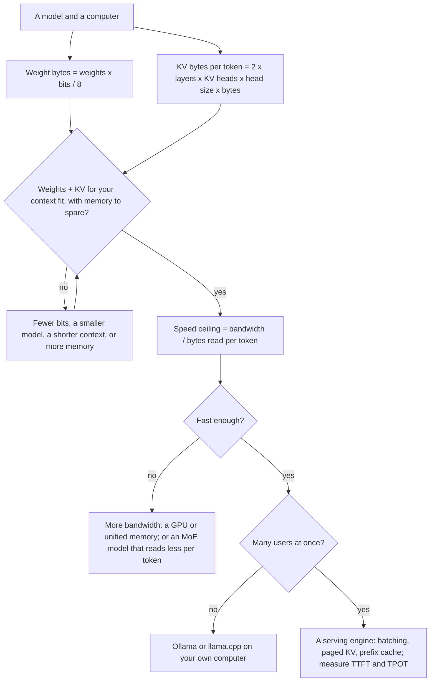

# The AI Engineering Stack, Part 11: Running Models

*October 16, 2026; post-part note in Section 3.6 added October 20, 2026. Part 11 of 13 (claude/engineering-stack-plan.md). Tags in this part: 192 [V], 85 [T], 16 [R], 17 [U], 12 [I], counted in Sections 1 to 12 and the checks after them. Still open: no AI model ran on the test machine, which has no GPU and can't reach Hugging Face or Ollama, so every serving engine and every local model is described from source code, documentation and published measurements; the arithmetic is tested [T], and a small-model speed test is written for your computer [R]. Speed claims for engines and speculative decoding come mostly from the vendors and method authors themselves. No independent GPU benchmark was read: MLPerf's results are submitted by vendors and reviewed by other submitters.*

**What this part gives you.** How to tell, before you download anything, whether a model will fit on a computer and how fast it can possibly run there, and what the software that serves it is doing. It starts with two pieces of arithmetic: **memory** (the weights plus the model's working memory for each token) and **speed** (a new token can't come out faster than the chip can read the weights). Then **quantization**, storing weights in fewer bits, and what that costs in quality. Then **serving engines** such as vLLM and SGLang, which share one model among many users, and the numbers they report. Last, **hardware**: how to read a GPU datasheet without being misled, and what an ordinary PC can do. The lab computes all of it in plain Python, reproduces llama.cpp's own file-size table to four decimal places, and includes a script that times a small model on your own computer.

## How to read this part

The tags are Part 01's. **[V: KEY]** points to Section 12, which gives each source's class and the place used. **[T]** ran on the test machine. **[R]** is a reader test. **[U]** names what would settle it. **[I]** is invented for teaching. Source classes: official documentation, specifications and source code (OD), standards bodies (SB), peer-reviewed (PR), preprint (PP), vendor blog (VB). A maker's own pages are the authority on what its product is; its speed claims are marketing until someone else measures them. References like "ledger P10-11" point to rows of claude/engineering-stack-claim-ledger.md, this series' audit of the Gemini report.

**Units.** GB is a billion bytes; GiB is 1,073,741,824 (2 to the 30th). Memory makers and Ollama use GB; llama.cpp prints GiB. A model "8B" has about 8 billion weights (parameters). Bandwidth is in GB/s or TB/s (a thousand GB/s).

**The test machine:** Ubuntu 24.04 in a cloud container, October 16, 2026, with Python 3.13.16, 3.12.3 and 3.11.17, 2 processors and 7.8 GB of memory. No GPU.

**This part covers three topics** (plan, Section 7), in two layers. **Runtime:** T23, serving engines, and T24, local models and quantization (placed here by the plan's tie-break rule, though quantization changes the model file). **Compute:** T25, hardware. Part 04 covers prompt caching and prefix reuse from the user's side; Part 10 covers model licences; Part 12 covers choosing and fine-tuning a model.

## 1. In plain words

**T23, serving engines.** A model on its own is a large file of numbers. A serving engine is the program that loads it onto a chip, accepts requests over a network, and keeps the chip busy by working on many requests at once. The hard part is memory: for every request, the model keeps working notes for each token it has read or written (the KV cache), and those notes can take more memory than the model itself. Engines such as vLLM manage that memory the way an operating system manages pages of RAM, and SGLang keeps it in a similar pool of small pages [V: VLL, VSR, SGS].

*Analogy.* A restaurant kitchen. The weights are the recipes, the same for every order; the KV cache is each order's tray of ingredients in progress. A good kitchen doesn't give every order a table-sized tray up front; it hands out small trays as needed, so more orders fit on the counter at once.

**T24, local models and quantization.** Running a model on your own computer means its weights must fit in your memory and be read quickly enough. Quantization stores each weight in fewer bits (4 instead of 16, say), so the file shrinks to about a third and writing the answer speeds up, at a small, measurable cost in quality that differs by model and task [V: LCP, KRT]. Tools such as Ollama and llama.cpp run quantized models on ordinary computers from a file format called GGUF [V: GGS, OLS].

*Analogy.* Saving a photo as a smaller JPEG. It looks almost the same, it loads faster, and a few details are gone; how much that matters depends on the photo.

**T25, hardware.** For generating text one token at a time, the speed limit is usually memory bandwidth, how many bytes per second the chip can read, not raw computing power: each new token needs every weight read once [V: POP, NVI]. That one fact explains why a gaming GPU, a Mac and a data-center GPU differ so much, and why a datasheet's headline TFLOPS figure says little about chat speed.

*Analogy.* A librarian who must walk the whole library for every word she writes. A faster walker (bandwidth) helps more than a faster writer (compute), until enough people ask at once that the writing becomes the bottleneck.

**Where it sits in the stack** (plan, Section 5). Runtime is the software that runs the model; Compute is the hardware under it. Everything above (context, agents, tools) waits on these two.

## 2. Definitions

Every term is also in claude/engineering-stack-glossary.md.

| Plain words | Technical term | Notes |
|---|---|---|
| The model's learned numbers | Weights; parameters | Llama 3 8B has 8,030,261,248 [T] |
| Reading the prompt | Prefill | Many tokens at once; limited by compute [V: VLL, NVI] |
| Writing the answer, one token at a time | Decode | Limited by memory bandwidth at small batch sizes [V: VLL, POP] |
| Stored keys and values for every token so far | KV cache | Grows by a fixed amount per token [V: VLL] |
| Several query heads sharing one key and value head | Grouped-query attention (GQA) | Llama 3 8B: 32 query heads, 8 KV heads [V: LLM] |
| Attention that looks back only a fixed number of tokens | Sliding window | gpt-oss: 128 tokens on alternate layers [V: GOS] |
| Bytes per second a chip can read from its memory | Memory bandwidth | H100 SXM: 3.35 TB/s [V: NVH] |
| Operations per byte at which compute and memory limit equally | Ridge point (roofline model) | [V: RFL] |
| Storing weights in fewer bits | Quantization | A format (GGUF) is not a method (AWQ, GPTQ) [V: GGS, AWQ, GPQ] |
| The file format llama.cpp and Ollama load | GGUF | Tensors plus metadata, chat template included; version 3 [V: GGS, OLS] |
| A group of weights sharing one scale | Block | Q4_K: 256 weights in 144 bytes [V: LCP] |
| Average storage per weight, scales included | Bits per weight (bpw) | Q4_K_M on Llama 3 8B: 4.8944 [T], as llama.cpp's table gives for Llama 3.1 8B [V: LCP] |
| A model where each token uses only some of its parts (experts) | Mixture of experts (MoE) | gpt-oss-20b: 4 of 32 experts per token [V: GOS] |
| Working on many requests in the same step | Continuous batching; iteration-level scheduling | Orca's idea (OSDI 2022) [V: ORC] |
| Storing the KV cache in small fixed blocks | PagedAttention | vLLM [V: VLL] |
| Pausing a request when memory runs out, to redo it later | Preemption | vLLM 0.31.0 recomputes; it no longer swaps [V: VSR] |
| A small model guessing tokens a big one checks | Speculative decoding | Same output distribution [V: LEV] |
| Share of draft guesses accepted | Acceptance rate (alpha) | [V: LEV] |
| Time to first token; time per output token; gap between streamed chunks | TTFT; TPOT; ITL | Tools disagree on names (Section 3.6) [V: VSR, APF] |
| Zeros in a fixed pattern the chip can skip | Structured sparsity | Doubles a datasheet's TFLOPS figure [V: NVB, HGX] |
| Usage data an engine sends its maker | Telemetry; usage statistics | On by default in vLLM [V: VSR] |

## 3. How it works

### 3.1 Two phases and one speed limit

A model answers in two phases. **Prefill** reads the whole prompt at once: every token goes through the same weights together, as matrix-times-matrix arithmetic that keeps a GPU's compute units busy. **Decode** writes the answer one token at a time, and each new token needs every weight read from memory again, as matrix-times-vector arithmetic that leaves most of the compute idle. The vLLM paper calls decoding "memory-bound, underutilizing the computation power of GPUs"; NVIDIA's inference guide says the same of decode and calls prefill "highly parallelized" [V: VLL, NVI].

**The ceiling.** If each token must read B bytes and memory delivers W bytes per second, one sequence can't go faster than W / B tokens per second [T]. It's an upper bound, never a prediction: real runs lose time to attention, overheads and imperfect memory use. With 16-bit Llama 3 8B (16.06 GB) on an H100 SXM (3.35 TB/s) the ceiling is 208.6 tokens per second; with the 4-bit file (4.91 GB) on a Core i5-9500T office PC (41.6 GB/s, Intel's figure), 8.5 [T][V: NVH, ARK].

**When compute takes over.** Williams, Waterman and Patterson's roofline model says attainable speed is the smaller of peak compute and bandwidth times operational intensity, the operations done per byte read [V: RFL]. A matrix-vector product does one multiply and one add per weight, so at 16 bits one sequence does 1 operation per byte. Serving B sequences at once reuses each weight B times, about B operations per byte. An H100's dense BF16 peak, 989.5 TFLOPS (half the 1,979 NVIDIA lists with sparsity, Section 3.9), over 3.35 TB/s gives a ridge point of 295 operations per byte: around 300 sequences before the weights stop being the bottleneck [T]. The KV cache doesn't batch that way. Each sequence has its own, so at large batches and long contexts reading it dominates: Pope et al. give 2,048 tokens at batch 512 as an example (preprint, Google, 2022) [V: POP].

**Prefill's floor** is the reverse: about 2 operations per weight per token at peak compute. A 1,000-token prompt through 8.03 billion weights takes at least 16.2 ms on an H100, before attention's own work [T]. That is the time to first token's lower bound on that chip.



[T: rendered with mermaid-cli 12.0.0]

### 3.2 Memory: the weights and the KV cache

**Weights.** Bytes = weights x bits / 8. The lab counts Llama 3 8B from Meta's own configuration (model width 4,096, 32 layers, 32 query heads, 8 key-value heads, vocabulary 128,256, feed-forward width 14,336) and gets 8,030,261,248 weights: 16.06 GB (14.96 GiB) at 16 bits [T][V: LLM].

**The KV cache.** Attention keeps a key and a value vector for every token in every layer, so each token adds 2 x layers x KV heads x head size x bytes per value [T]. For OPT-13B in 16-bit that is 2 x 5,120 x 40 x 2 = 819,200 bytes, the vLLM paper's "800 KB" per token (§3), so the cache grows in a straight line with length (ledger P2-15) [V: VLL][T]. Llama 3 8B needs 131,072 bytes per token, exactly 1 GiB per 8,192 tokens per sequence; without grouped-query attention it would need four times as much [T]. The vLLM paper's Figure 1, a 13-billion-parameter model on a 40 GB A100, gives 65% of memory to weights and over 30% to the KV cache: the cache is what limits how many requests fit [V: VLL].

**Two shapes that change the sums.** gpt-oss-20b gives every other layer a 128-token sliding window, so those layers keep at most 128 tokens [V: GOS]. At its 131,072-token maximum, the cache is 3.0 GiB instead of 6.0 GiB [T]; how an engine allocates it is its own choice [I]. It is also a **mixture of experts**: 20.91 billion weights, of which a token uses 3.61 billion (4 of 32 experts per layer), matching OpenAI's model card [T][V: GMC]. Its expert matrices are stored in MXFP4 at 4.25 bits and everything else in BF16, so the checkpoint is 12.8 GiB (13.76 GB), while one token reads only about 3.71 GB [T][V: GOS]. Stored size decides whether it fits; bytes read per token decide its speed. OpenAI says it runs within 16 GB of memory [V: OPN].

**Fit check.** Weights plus KV for your context and batch must fit, with room for the program itself; the lab keeps 10% spare, an arbitrary margin [I]. Llama 3 8B at 4-bit on a 16 GiB card leaves room for about 80,000 tokens of one conversation [T].

### 3.3 Quantization: fewer bits per weight

**How.** Weights are stored in blocks: a few bits per weight plus a shared scale, so the small numbers can be turned back into approximate real ones. llama.cpp's Q4_K packs 256 weights into 144 bytes, 4.5 bits each including scales (ggml-common.h) [V: LCP].

**A format is not a method** (ledger B4-10). GGUF is a file format: tensors plus metadata, including the chat template (`tokenizer.chat_template`), now at version 3 [V: GGS]. AWQ (MLSys 2024) and GPTQ (ICLR 2023, published as "OPTQ") are methods for choosing the quantized values [V: AWQ, GPQ]. A GGUF file can hold many types:

| Type | Weights per block | Bytes | Bits per weight |
|---|---|---|---|
| Q8_0 | 32 | 34 | 8.5 |
| Q6_K | 256 | 210 | 6.5625 |
| Q5_K | 256 | 176 | 5.5 |
| Q4_K, Q4_0 | 256, 32 | 144, 18 | 4.5 |
| NVFP4 | 64 | 36 | 4.5 |
| IQ4_XS, MXFP4 | 256, 32 | 136, 17 | 4.25 |
| Q3_K | 256 | 110 | 3.4375 |
| Q2_K | 256 | 84 | 2.625 |

[V: LCP][T: the lab checks each value]

MXFP4 is the Open Compute Project's microscaling format: 32 four-bit floating-point values share one 8-bit power-of-two scale [V: MXS].

**A "4-bit" file isn't all 4-bit.** In llama.cpp's Q4_K_M, the attention value matrix and the feed-forward down matrix get Q6_K on 16 of Llama 3 8B's 32 layers (the first eighth, the last eighth and every third layer between), the output matrix gets Q6_K, and norm tensors aren't quantized (src/llama-quant.cpp) [V: LCP]; the lab counts them at 32 bits. Applying those rules, the lab reproduces llama.cpp's published table for Llama 3.1 8B, which has the same shapes, to four decimal places [T][V: LCP]:

| File | Bits per weight | GiB | GB |
|---|---|---|---|
| F16 | 16.0005 | 14.96 | 16.06 |
| Q8_0 | 8.5008 | 7.95 | 8.53 |
| Q6_K | 6.5633 | 6.14 | 6.59 |
| Q5_K_M | 5.7036 | 5.33 | 5.73 |
| Q4_K_M | 4.8944 | 4.58 | 4.91 |

So ledger P10-09's "4.92 GB" Llama 3 8B Q4_K_M file fits: 4.91 GB of tensors [T], plus the metadata every GGUF file carries, tokenizer included, which the lab doesn't count [V: GGS].

**What it costs.** llama.cpp's own scoreboard (base Llama 3 8B, Wikitext-2, rows without an importance matrix, measured by its contributors) [V: LCP]:

| Type | Perplexity | Change from f16 |
|---|---|---|
| f16 | 6.233 | |
| Q8_0 | 6.234 | +0.02% |
| Q6_K | 6.253 | +0.32% |
| Q5_K_M | 6.289 | +0.89% |
| Q4_K_M | 6.407 | +2.79% |
| Q3_K_M | 6.888 | +10.51% |
| Q2_K | 9.752 | +56.45% |

With an importance matrix (statistics from sample text that tell the rounding which weights matter most), the same scoreboard gives +2.40% at Q4_K_M, +8.04% at Q3_K_M and +38.74% at Q2_K [V: LCP][T].

At Q4_K_M the most likely next token differs from f16's at about 8.1% of positions, and 1% of tokens lose at least 19.6 percentage points of probability on the right answer; Llama 3 8B loses more than Llama 2 7B at the same type [V: LCP]. Benchmarks move less: a single-author 2026 preprint found Llama 3.1 8B Instruct's average over five benchmarks went from 69.47 to 69.15 (-0.32 points) at Q4_K_M [V: KRT]. A peer-reviewed study of the Llama 3.1 family (ACL 2025, over 500,000 evaluations, vLLM on GPUs) found 8-bit floating point "lossless", 8-bit integers 1% to 3% worse and 4-bit weights competitive [V: KUR]. Dutta et al. (NeurIPS 2024) warn that averages hide answers that flip from right to wrong [V: DUT], and preprints find that low-resource languages lose most, especially at 2 bits, while 4 bits often holds for "high-resource languages and large models", with GGUF types the most consistent in that translation study; reasoning models lose accuracy below 4 bits [V: MAR, LQR]. So "minimal precision loss" (ledger B4-05) should read: small, measurable, and dependent on the model and task.

**The KV cache can shrink too.** Ollama's FAQ says a 4-bit KV cache takes about a quarter of the memory of 16-bit with "a small-medium loss in precision" [V: OLS]; vLLM offers 8-bit options [V: VSR].

**The tools changed.** AutoAWQ is deprecated (adopted by vLLM's llm-compressor), AutoGPTQ is unmaintained (its README points to GPTQModel), ExLlamaV2 is archived in favour of ExLlamaV3, and bitsandbytes 0.50.2 has a CPU backend needing AVX2 [V: QTL].

### 3.4 Serving many users: batching and paged memory

**Batching by step.** Orca (OSDI 2022) schedules work one model step at a time, so a new request joins the next step instead of waiting for the whole batch to finish; its authors measured 36.9 times FasterTransformer's throughput at the same latency on GPT-3 175B [V: ORC]. vLLM calls this continuous batching, TensorRT-LLM in-flight batching, LMDeploy persistent batching [V: VSR, TRL, LMD].

**Paged KV memory.** Earlier systems reserved each request's KV memory in advance, in one contiguous piece; the worst variant the vLLM paper tested reserved enough for the longest reply the model allows [V: VLL]. The vLLM paper measured only 20.4% to 38.2% of KV memory holding real token data in its own reimplementations of Orca (Figure 2) [V: VLL]. PagedAttention stores the cache in small blocks placed anywhere, like an operating system's memory pages, so waste is limited to the unfilled part of each request's last block (§4.3); the paper says "near-zero waste" with no percentage, and vLLM's launch blog says "under 4%", without a method (ledger P10-03) [V: VLL, VBL]. In the lab, four requests of 100, 200, 37 and 512 tokens leave 89.6% of slots empty when each reserves 2,048, and 3.5% in 16-token blocks [T].

**What that bought.** 2 to 4 times the throughput at similar latency against FasterTransformer and the authors' Orca reimplementations (OPT and LLaMA models on A100s, 2023), and 2.2 times as many requests at once as Orca (Oracle) on OPT-13B, from memory management, since both batch by step (ledger P10-04) [V: VLL].

**When memory runs out** (ledger P10-10). The paper preempted requests by swapping their blocks to CPU memory or by recomputing them later (§4.5) [V: VLL]. vLLM 0.31.0 only recomputes: the scheduler frees the blocks of the request scheduled last, resets its progress and puts it back in the queue, and its V1 guide lists CPU swapping as removed [V: VSR]. SGLang "retracts" requests in a similar way, choosing the one with the fewest generated tokens (or the lowest priority), and aborts beam-search groups instead [V: SGS]. An engine can't promise never to run out; it decides who waits.

**Defaults that set capacity**, read in source. vLLM 0.31.0 takes 92% of GPU memory (`gpu_memory_utilization`), uses 16-token blocks, turns prefix caching and chunked prefill on, and caps concurrent sequences at 256 or 1,024 depending on GPU memory [V: VSR]. SGLang 0.5.22 computes its memory share per GPU, and keeps its prefix cache (RadixAttention) on [V: SGS]. Part 04 covers prefix caching. One security default: vLLM's `--api-key` guards only the `/v1`, `/v2` and `/inference` paths (its security page adds `/cohere`), and its docs say "Do not rely on --api-key alone" [V: VSR].

### 3.5 Speculative decoding

A small draft model guesses gamma (γ) tokens; the big target model checks them all in one pass and keeps the longest accepted run, with a correction rule that leaves the output distribution exactly the target's (Leviathan, Kalman and Matias, ICML 2023) [V: LEV]. The symbols: alpha (α) is the expected acceptance rate (Definition 3.1), and c is the cost of one draft run as a share of one target run (Definition 3.7). Equation (1) gives the tokens produced per target pass, (1 - α^(γ+1)) / (1 - α); Theorem 3.8 gives the expected speed-up, that divided by (γc + 1); Corollary 3.9 says that if α beats c, some γ helps, by at least (1 + α) / (1 + c) [V: LEV]; when α is below c, no γ helps, which follows from Theorem 3.8 and which the lab checks [T]. With c = 0.05, the lab finds [T]:

| α | Best γ | Tokens per pass | Expected speed-up |
|---|---|---|---|
| 0.6 | 4 | 2.31 | 1.92x |
| 0.8 | 8 | 4.33 | 3.09x |
| 0.9 | 13 | 7.71 | 4.67x |

At α = 0.2 and c = 0.25 the best is 0.96x: slower than not speculating [T].

**Measured, with scope** (ledger P10-11, "effectively doubles"). Leviathan et al.: 2 to 3 times on T5-XXL, batch size 1, one TPU-v4 [V: LEV]. NVIDIA: 3.55 times for Llama 3.3 70B with a Llama 3.2 1B draft on one H200 (FP8, batch size 1, TensorRT-LLM 0.15.0, measured December 11, 2024), but 2.86 times with the same draft and Llama 3.1 70B in an earlier post and build [V: TRT, TR2]. The vLLM team: up to 1.5 times with a draft model at one request per second, and 1.4 to 1.8 times slower at high load (Llama 3 70B, four H100s, 2024) [V: VBL]. EAGLE-3's paper, from runs by the SGLang team (Llama 3.1 8B, MT-Bench, one H100): 1.81 times at batch 2, and 1.32 to 1.39 times from batch 24 to 64 (preprint) [V: EG3]. MagicDec found gains that survive large batches when contexts are long, because reading the KV cache then dominates, and slowdowns with short ones (preprint) [V: MGD]. vLLM's own docs pitch it "to reduce inter-token latency under medium-to-low QPS" [V: VSR]. All are measurements by vendors, engine teams or method authors; none is independent. "Doubles" fits low load; no single factor holds.

### 3.6 Measuring a server

**Three numbers.** Time to first token (TTFT): request sent to first output received. Time per output token (TPOT): (total time - TTFT) / (output tokens - 1). Inter-token latency (ITL): the gap between streamed chunks [V: VSR]. vLLM's benchmark docs warn that "metric terminology is not standardized"; NVIDIA's AIPerf calls vLLM's TPOT "ITL" and vLLM's ITL "inter chunk latency" [V: VSR, APF]. They split apart when a chunk carries several tokens, as with speculative decoding: in vLLM's example, a 5-token reply with TTFT 100 ms that ends at 180 ms in chunks of 1, 3 and 1 tokens has TPOT 20 ms but ITL 40 ms; the lab's `stream_metrics` reproduces it [V: VSR][T]. Define a metric by its formula, never by its name. OpenTelemetry's generative-AI conventions add names of their own: `gen_ai.client.inference.time_to_first_chunk` for a client and `gen_ai.server.time_to_first_token` for a server (as of October 18, 2026; the conventions are still marked Development) [V: Part 13, GAI]. *Post-part note, October 20, 2026.*

**Throughput** is tokens or requests per second of benchmark time; AIPerf notes its output throughput includes TTFT, so it isn't comparable to per-user throughput [V: APF]. **The main shared benchmark** is MLPerf Inference: round 6.1, released September 16, 2026 (its embargo date), has 492 results from 33 organizations, submitted by vendors and reviewed by other submitters rather than an independent lab [V: MLP]. Its closed data-center results are dominated by Blackwell (B300 and GB300) and AMD's MI355X; Vera Rubin appears as "preview", and no H100 result was submitted [V: MLP].

### 3.7 The engines, October 16, 2026

| Engine | Licence | Runs on | Status | Usage data sent by default |
|---|---|---|---|---|
| vLLM 0.31.0 | Apache-2.0 | Linux on NVIDIA, AMD, Intel GPUs; CPUs from a separate `+cpu` wheel (x86 AVX-512 recommended); Apple through a plugin | Active; its default install pulled 199 packages, a 3.93 GB download, here (Linux x86-64, Python 3.13) [T] | Yes, to stats.vllm.ai every 600 s; off with `VLLM_NO_USAGE_STATS=1` or `DO_NOT_TRACK=1` |
| SGLang 0.5.22 | Apache-2.0 | Python 3.11 or later, CUDA 13; NVIDIA, AMD, TPU, Intel, Ascend; Xeon CPUs with AMX | Active | None found in its code |
| TensorRT-LLM 1.2.1 | Apache-2.0 | Linux on NVIDIA only; PyPI holds a stub that fetches the wheel from NVIDIA's index | Stable from April 2026; release candidates since | Not in 1.2.1; on in 1.3.0rc29 and 1.4.0rc0 (`TRTLLM_NO_USAGE_STATS=1`) |
| Text Generation Inference | Apache-2.0 | Docker on NVIDIA, AMD, Gaudi, others | **Maintenance mode** since December 11, 2025; last tag v3.3.7 | Yes when run in a container; `--usage-stats=off` |
| LMDeploy 0.18.0 | Apache-2.0 | Linux and Windows on NVIDIA; Huawei Ascend and other builds | Active | None found |
| MLX-LM 0.32.2 | MIT | Apple silicon | Active; its server is "not recommended for production" | None found |
| llama.cpp (b11691) | MIT | CPUs, Apple, NVIDIA, AMD, Intel, Vulkan GPUs | Active; several builds a day | Not searched [U] |
| Ollama v0.40.5 | MIT | Windows, macOS, Linux; runs llama.cpp's server inside | Active | No analytics library, but calls to ollama.com (Section 3.8) |

[V: VSR, SGS, TRL, TGI, LMD, MLX, LCP, OLS] "None found" means a search of the code found no telemetry, not a network audit [U].

### 3.8 Running on your own computer

**Ollama is a manager around llama.cpp.** Version 0.40.5 runs llama.cpp's own server (pinned build b11669) as its engine [V: OLS]. This part's code reading is of v0.40.5; the owner's test PC ran v0.40.6 for the reader tests (October 19 and 20, 2026), which Part 04 also names. It installs per user on Windows without administrator rights (Windows 10 22H2 or newer, at least 4 GB of disk), as an app on macOS 14 or newer, or on Linux by a script that uses sudo, creates an `ollama` user, installs a system service and can install NVIDIA drivers; read it before running it (Part 01) [V: OLS].

**What it sends** (ledger B4-02), read in its source, not captured on a network [U]. Ollama says "We don't see your prompts or data when you run locally" [V: OLS]. But unless cloud features are off, every Ollama server contacts ollama.com at startup to list cloud models and fetches model recommendations every 4 hours; the Windows and macOS apps check ollama.com/api/update every hour, and the "Auto-download updates" setting (on by default) stops only the download, not the check; models come from registry.ollama.ai [V: OLS]. `OLLAMA_NO_CLOUD=1` (or `"disable_ollama_cloud": true` in `~/.ollama/server.json`) stops the cloud models, web search and recommendation calls, but not the apps' update check, and the server logs "Ollama cloud disabled: true" [V: OLS]. Cloud models need an account and send prompts to Ollama's servers [V: OLW]. No analytics library turned up in its code [V: OLS]. The app does store a `Survey` setting, on by default, which its code describes as whether the user "allows anonymous inference information to be shared with Ollama"; no other code in v0.40.5 uses it [V: OLS][T]. Running locally keeps prompts local; it isn't "zero telemetry" or air-gapped unless you configure it and block the network yourself.

**Defaults to know.** Ollama sets the context window from GPU memory: 4,096 tokens below 23 GiB (so on a CPU-only PC), 32,768 from 23 GiB, 262,144 from 47 GiB, while its FAQ still says a flat 4,096 [V: OLS]; Part 04 showed it drops old chat turns silently when the window fills. Models unload after 5 idle minutes, so the next request waits for a reload [V: OLS]. An Intel UHD 630 (8th to 10th generation Core chips) probably won't help: Ollama ignores integrated GPUs unless `OLLAMA_IGPU_ENABLE=1`, and llama.cpp's SYCL backend for Intel GPUs starts at 11th generation [V: OLS, LCP, INT]; whether its Vulkan backend helps on a UHD 630 wasn't measured [U]. On such a PC, plan for the CPU alone.

**llama.cpp directly.** Routes include `winget install llama.cpp`, `brew install llama.cpp`, conda-forge, Nix, Docker, release zips on GitHub (the Windows CPU x64 build carries several CPU variants and picks one at run time), and a `llama.app` script, now first in the README, that downloads from a Hugging Face bucket into `~/.local/bin` with no checksum step [V: LCP, LAP]. Its server speaks OpenAI's chat and Responses formats, listens on 127.0.0.1, and its default port is now 9931 (the same README's Docker examples still pass 8080); `-hf` downloads a model from Hugging Face, Q4_K_M by default; `llama-bench` measures prompt and generation speed [V: LCP]. **LM Studio** is proprietary, licensed "solely for Your personal and / or internal business purposes", and some features "may be offered for a fee" (terms of August 23, 2026); its privacy policy says it has no telemetry but checks for updates; it runs on Windows (AVX2 needed on x64; Arm too), macOS 14 on Apple silicon and Linux [V: LMS].

**Small models for an 8 GB computer**, from their publishers (sizes are Ollama's downloads unless noted):

| Model | Licence | Download |
|---|---|---|
| Qwen3 0.6B, 1.7B, 4B (April 2025) | Apache-2.0 | 0.52, 1.4, 2.5 GB; Qwen's own GGUF of 4B at Q4_K_M: 2.5 GB |
| Qwen3.5 0.8B, 2B, 4B (March 2026) | Apache-2.0 on the 0.8B card; check the others | 1.2, 2.7, 3.3 GB and up |
| Llama 3.2 1B, 3B | Llama 3.2 Community License (custom) | 1.3, 2.0 GB |
| Phi-4-mini 3.8B | MIT | 2.5 GB |
| Granite 4 micro (3B) | Apache-2.0 | 2.1 GB |
| Gemma 4 E2B, E4B | Apache 2.0 | 4.6 GB and up: tight in 8 GB |

[V: MCD, OLB, LLM] None of the six Ollama library pages read names the quantization, and only granite4's names a licence; take the licence from the publisher [V: OLB]. Meta's newest open-weight model, Muse Glimmer (30B, Apache-2.0, August 2026), needs about 18 GB at Q4_K_M, far beyond 8 GB [V: MUS][T].

### 3.9 Reading a datasheet

**Sparse or dense?** NVIDIA's H100 page lists 3,958 TFLOPS at FP8 and 1,979 at BF16, both footnoted "With sparsity": they assume "fine-grained structured sparsity", zeros in a fixed pattern that doubles the Tensor Cores' throughput [V: NVH, NVB]. NVIDIA's HGX page gives the rule on its Blackwell table, "Dense is ½ sparse spec shown"; applied to the H100, dense FP8 is 1,979 and dense BF16 989.5 (ledger P4-12), close to the 2,000 and 1,000 dense of the 2022 preliminary table [V: HGX, NVB][T]. Label every compute figure sparse or dense.

**Preliminary or shipping?** NVIDIA's 2022 Hopper architecture post still carries its "preliminary" table (3,000 GB/s, FP8 2,000 dense and 4,000 sparse); the shipping H100 SXM has 3.35 TB/s [V: NVB, NVH]. Use that post for design facts: the full GH100 chip has 144 streaming multiprocessors, the H100 SXM5 enables 132 and the PCIe card 114, so "132 SMs on the die" is wrong (ledger P4-04) [V: NVB].

**Do the pages agree?** Not always: NVIDIA's HGX page gives each Rubin GPU 22 TB/s and 3.6 TB/s of NVLink, its Vera Rubin NVL72 page 19.2 TB/s and 3 TB/s [V: HGX, VRP]. Cite the page and date.

**What is current** (ledger P4-01). Hopper is a generation back but still sold: the H200 has 141 GB of HBM3e at 4.8 TB/s [V: H2P]. NVIDIA says HGX B200 and B300 are "shipping now" (1.4 TB and 2.1 TB of GPU memory per eight GPUs) and the GB300 NVL72 rack (72 GPUs, 20 TB, up to 576 TB/s, so 8 TB/s each) is "Available Now" [V: HGX, G3P]. Vera Rubin is "ramping into full production" (results of August 26, 2026), and its page says "Available Now", yet its MLPerf results in September were in the "preview" category, for systems not yet available [V: NQ2, VRP, MLP]. AMD's MI355X has 288 GB of HBM3E at 8 TB/s and 1,400 W: the same bandwidth as each GB300 GPU [V: MI3, G3P][T].

**Hardware a person might own** (makers' figures):

| Hardware | Memory | Bandwidth |
|---|---|---|
| Core i5-9500T office PC (dual-channel DDR4-2666) | as fitted (the demo assumes 7.8 GB [I]) | 41.6 GB/s |
| Apple M5, M5 Pro, M5 Max (MacBook Pro page, October 2026) | up to 128 GB unified (M5 Max) | 153, 307, up to 614 GB/s |
| AMD Ryzen AI Max+ 395 | up to 128 GB LPDDR5x-8000, 256-bit | about 256 GB/s, derived [T] |
| NVIDIA DGX Spark (GB10) | 128 GB unified | 273 GB/s |
| RTX 5060 Ti 16 GB | 16 GB GDDR7 | 448 GB/s |
| RTX 5090 | 32 GB GDDR7 | 1,792 GB/s |

[V: ARK, APL, AMR, CON] The i5-9500T has AVX2 but no AVX-512, 6 cores and 6 threads, and Intel lists it as discontinued [V: ARK]. NVIDIA's newsroom celebrated the launch of "RTX Spark" on October 15, 2026, and its DGX Spark page advertises it for Windows PCs; its specifications weren't read [V: NWS, CON][U].

**Ceilings, tokens per second for one sequence** (`demo.py`, part 4; "too big" means the weights alone exceed memory) [T]:

| | qwen3:1.7b (1.4 GB) | Llama 3 8B Q4_K_M | gpt-oss-20b | Llama 3 8B F16 |
|---|---|---|---|---|
| Core i5-9500T | 29.7 | 8.5 | too big | too big |
| DGX Spark | 195.0 | 55.6 | 73.6 | 17.0 |
| RTX 5060 Ti 16 GB | 320.0 | 91.2 | 120.8 | too big |
| RTX 5090 | 1,280.0 | 364.8 | 483.3 | 111.6 |
| H100 SXM | 2,392.9 | 681.9 | 903.4 | 208.6 |

gpt-oss-20b is faster than Llama 3 8B at 16 bits despite having 2.6 times the weights, because each token reads only its 3.71 GB (Section 3.2) [T]. Real speeds land below these lines; the reader test in Section 7.5 measures how far below on your computer.

### 3.10 Inside a GPU server

**Eight GPUs aren't one memory** (ledger P4-06 to P4-08). NVIDIA's DGX H100 guide lists 8 x 80 GB = 640 GB of GPU memory, never as one pool [V: DGX]. NVLink's 900 GB/s counts both directions: 18 links at 25 GB/s each way, 450 GB/s per direction, about 7 times PCIe Gen5 [V: NVB][T]. Between servers, eight ConnectX-7 adapters at up to 400 Gb/s carry 50 GB/s each way per GPU, 9 times less again; a GPU's own memory, at 3.35 TB/s, is about 7.4 times faster than NVLink in one direction [V: DGX][T]. NVIDIA quantifies NVLink's bandwidth but only describes its latency, so "radically reduces latency" has no number behind it (ledger P4-17) [V: NVB].

**Power** (ledger P4-15). 8 x 700 W = 5.6 kW is the GPUs' ceiling; the whole DGX H100 is rated at up to 10.2 kW [V: NVH, DGX][T].

**Compute versus network** (ledger P4-05). NVIDIA's Megatron-LM reports model FLOP utilization (the share of peak compute doing useful work) of 41% to 48% across model sizes, in runs of up to 6,144 H100s, and 47% falling to 42% when one job spreads from 96 to 4,608 GPUs as communication "becomes more exposed" (its own figures) [V: MEG]. Communication costs something at scale, but these figures fit "rarely compute-bound" and its opposite alike; no source read measures it [U].

**FP8 training** (ledger P4-09 to P4-11). NVIDIA's Transformer Engine (commit 33f3b35) defines HYBRID as E4M3 numbers in the forward pass and E5M2 in the backward pass. Its default recipe depends on the GPU: on Hopper and Ada, "delayed scaling" from a history of past maximums; on Blackwell (compute capability 10.x), MXFP8, E4M3 everywhere with one scale per 32 values; on 12.x, scaling from the current tensor [V: TEN].

**The tools around it** (ledger P4-14, P4-16). CUDA 13.4 Update 2 is current; its cuBLAS adds Rubin (compute capability 10.7), and CUDA 13's libraries dropped Maxwell, Pascal and Volta [V: CUD]. Slurm 26.05.5 (GPL version 2 or later) schedules jobs on clusters [V: SLM]. Kubernetes reaches GPUs through vendor device plugins (stable since 1.26) and dynamic resource allocation (stable since 1.34) [V: K8S]. NVIDIA's DCGM reports NVLink bytes sent and received and "clocks event reasons", its new name for throttle reasons; the dcgm-exporter for Prometheus leaves the throttling counters off by default [V: DCG].

## 4. Gemini said, evidence says

| Gemini (ledger row) | Evidence | Section |
|---|---|---|
| The KV cache grows linearly with length (P2-15) | Confirmed: a fixed amount per token, 819,200 bytes for OPT-13B in 16-bit, the vLLM paper's "800 KB" [V: VLL][T] | 3.2 |
| AI infrastructure is centred on NVIDIA Hopper (P4-01) | Outdated: Blackwell is shipping, GB300 NVL72 is "Available Now", Vera Rubin is ramping; MLPerf Inference 6.1 had no H100 result [V: HGX, G3P, NQ2, MLP] | 3.9 |
| H100 SXM5: 80 GB of HBM3, 3.35 TB/s, 700 W (P4-02, P4-03, P4-13) | Confirmed for the SXM model; NVIDIA's 2022 table (3,000 GB/s) was preliminary; H100 NVL's 94 GB not re-checked [V: NVH, DGX, NVB][U] | 3.9 |
| 132 SMs "on the GH100 die" (P4-04) | Corrected: 144 on the full die, 132 enabled on SXM5, 114 on PCIe [V: NVB] | 3.9 |
| Multi-node training is "rarely" compute-bound (P4-05) | Unsupported: no source read measures how often; NVIDIA reports 41% to 48% model FLOP utilization across model sizes on up to 6,144 H100s, which fits either reading [V: MEG][U] | 3.10 |
| NVLink and NVSwitch "resolve" the bottleneck; 900 GB/s; eight GPUs as one "unified memory pool" (P4-06 to P4-08) | 900 GB/s confirmed, counting both directions; it helps inside a server, with 9 times less per GPU between servers; memory is 8 x 80 GB, not a pool: overstated [V: DGX, NVB][T] | 3.10 |
| The Transformer Engine runs FP8: E4M3 forward, E5M2 for gradients, with dynamic scaling (P4-09 to P4-11) | Partly supported: that is the HYBRID format, the default on Hopper and Ada with delayed scaling from past maximums; Blackwell's default, MXFP8, uses E4M3 throughout [V: TEN] | 3.10 |
| "Nearly 3,958 sparse TFLOPS" (P4-12) | Confirmed as FP8 with sparsity; dense is half, 1,979, by the rule NVIDIA states for Blackwell, close to the 2,000 dense of its preliminary Hopper table [V: NVH, HGX, NVB] | 3.9 |
| Tools: CUDA, Slurm, Kubernetes, vLLM (P4-14) | Confirmed, current: CUDA 13.4 Update 2, Slurm 26.05.5, Kubernetes device plugins, vLLM 0.31.0 [V: CUD, SLM, K8S, PYPI] | 3.10 |
| 8 x H100 draws "upwards of 5.6 kW" (P4-15) | Overstated: 5.6 kW is the GPUs' ceiling; the DGX H100 is rated up to 10.2 kW [V: NVH, DGX][T] | 3.10 |
| nvidia-smi and DCGM monitor NVLink throughput and thermal throttling (P4-16) | Partly supported: DCGM has the fields; its Prometheus exporter leaves throttling off by default; nvidia-smi's field names not checked [V: DCG][U] | 3.10 |
| NVLink "radically" reduces latency versus PCIe Gen5 (P4-17) | Unsupported: NVIDIA quantifies bandwidth (about 7 times), not latency [V: NVB] | 3.10 |
| HBM3 versus DDR; distributed data parallel (P4-18) | Illustrative [I]; Section 3.9's table compares the bandwidths | 3.9 |
| KV fragmentation limits batch size; PagedAttention stores it in blocks (P10-01, P10-02) | Confirmed; the 20.4% to 38.2% was measured against the authors' own Orca reimplementations [V: VLL] | 3.4 |
| PagedAttention cuts waste "to near-zero" (P10-03) | Confirmed as the paper's words, with no percentage; "under 4%" is the vLLM blog's, without a method [V: VLL, VBL] | 3.4 |
| "Massive" batch increases through continuous batching (P10-04) | Partly supported: step-level batching is Orca's (2022); vLLM's 2 to 4 times came from memory management [V: ORC, VLL] | 3.4 |
| Generation is memory-bandwidth bound (P10-05) | Confirmed at small batches; past the ridge point the weights become compute-bound, while each sequence's KV cache stays memory-bound [V: VLL, POP][T] | 3.1 |
| Speculative decoding's notation; output distribution unchanged (P10-06, P10-07) | Confirmed: Definition 3.1, Equation (1), Theorem 3.8 [V: LEV] | 3.5 |
| vLLM, TensorRT-LLM, Ollama, llama.cpp (P10-08) | Confirmed, all maintained; TGI, which Gemini didn't name, is in maintenance mode [V: PYPI, GHT, TGI] | 3.7 |
| Llama 3 8B Q4_K_M fits a consumer GPU (P10-09) | Confirmed: 4.91 GB of tensors, computed from llama.cpp's rules [V: LCP][T] | 3.3 |
| Llama 3 8B as the local example (P10-09b) | Outdated: Part 10 found Llama 4 labelled current; Meta has since published Muse Glimmer 30B (Apache-2.0, August 2026) and the much larger Muse Spark Open; Apache-2.0 and MIT small models exist [V: HFM, MUS, MCD] | 3.8 |
| vLLM serves hundreds of requests "without running out of KV cache memory" (P10-10) | Overstated: it preempts; 0.31.0 recomputes only [V: VLL, VSR] | 3.4 |
| A 1B draft with a 70B target "effectively doubles" speed (P10-11) | Overstated as a rule: 3.55 times at batch size 1 in NVIDIA's test, slowdowns at high load in vLLM's [V: TRT, VBL, EG3] | 3.5 |
| FP16, INT8 and INT4; linear KV growth; exact distribution (P10-12) | Illustrative [I]; the facts are in Sections 3.2, 3.3 and 3.5 | 3.2 |
| Local use "ensures complete data sovereignty, zero cloud telemetry and total air-gapped security" (B4-02) | Overstated: Ollama calls ollama.com at startup and every 4 hours unless cloud is off, and its apps check for updates hourly even with cloud off [V: OLS] | 3.8 |
| Local deployment uses containers (B4-03) | Overstated: native installers are the main route [V: OLS] | 3.8 |
| llama.cpp and Ollama run models on consumer hardware through GGUF (B4-04) | Confirmed; Ollama runs llama.cpp's server [V: OLS, GGS] | 3.8 |
| 16 to 4 bits with "minimal precision loss" (B4-05) | Overstated: +2.79% perplexity and a different top token at 8.1% of positions (Q4_K_M, Llama 3 8B, no importance matrix); larger losses at 3 and 2 bits and for low-resource languages [V: LCP, MAR] | 3.3 |
| Runs on Apple Silicon or NVIDIA GPUs (B4-06) | Partly supported: also AMD, Intel, Vulkan and plain CPUs; Ollama needs NVIDIA compute capability 5.0 or later [V: OLS, LCP] | 3.8 |
| A "zero-latency inference boundary" (B4-07) | Overstated: local removes the network hop, not the time per token [T] | 3.9 |
| GGUF versus AWQ versus GPTQ (B4-10) | Corrected: a file format against two methods [V: GGS, AWQ, GPQ] | 3.3 |
| "Rack and infrastructure engineering" as a field | Not found in use: a search showed vendor "AI infrastructure" pages and job titles only; no page was opened [U] | 1 |

## 5. Examples

**Real examples.**

1. *A paper's design isn't today's code* [V: VLL, VSR]. The vLLM paper (2023) recovers from full memory by swapping to CPU or recomputing; vLLM 0.31.0 removed swapping. Check the release you run, not the paper.
2. *One name, two numbers* [V: OLS]. Ollama's FAQ says the default context is 4,096 tokens; its code gives 4,096, 32,768 or 262,144 depending on GPU memory. The code decides.
3. *The old flagship left the benchmark* [V: MLP]. MLPerf Inference 6.1 (September 2026) had no H100 result at all. A benchmark shows what vendors chose to submit [I].

**A fully worked example: can an office PC run Llama 3 8B, and how fast?** [I: the PC's free memory is invented; every number below came from the lab]

*Input.* A Core i5-9500T PC (41.6 GB/s, Intel's figure) with 7.8 GB of memory, and Llama 3 8B at Q4_K_M in Ollama, whose default context there is 4,096 tokens.

*Step 1, weights.* 8,030,261,248 weights under llama.cpp's Q4_K_M rules: 4,912,898,048 bytes, 4.91 GB [T].

*Step 2, KV cache.* 131,072 bytes per token x 4,096 tokens = 0.54 GB [T].

*Step 3, fit.* 5.45 GB of 7.8 GB fits on paper, but Windows and other programs use part of the memory too. Check the memory in use first; if less than about 6 GB is free, pick a smaller model [I].

*Step 4, speed limit.* 41.6 / 4.91 = 8.5 tokens per second at most, before any overhead [T].

*Step 5, compare.* Qwen3 1.7B (Apache-2.0, 1.4 GB in Ollama) has a ceiling of 29.7 [T].

*Output.* Llama 3 8B fits, just, and can't beat 8.5 tokens per second; Qwen3 1.7B leaves room and allows three times the speed. Section 7.5's reader test measures what you actually get.

## 6. What you need

Checked October 16, 2026 [V: PYPI, GHT]. Licences from each project's licence file; information, not legal advice.

| Tool | What it's for | Licence | Runs on | Account or key? | Version |
|---|---|---|---|---|---|
| The lab's scripts | Memory, file-size, speed and serving arithmetic | This series | Python 3.11 to 3.13, standard library [T] | No | Lab zip |
| Ollama | Run local models with one command | MIT | Windows 10 22H2 or later, macOS 14 or later, Linux | Not for local models; cloud models need one | v0.40.5 |
| llama.cpp | Run and benchmark GGUF models from the command line | MIT | Windows, macOS, Linux; CPU or most GPUs | No; gated Hugging Face models need an account (Part 10) | b11691 |
| LM Studio | A desktop app for local models | Proprietary; personal and internal business use; some features paid | Windows (x64 with AVX2, or Arm), macOS 14 on Apple silicon, Linux | No | Terms of August 23, 2026 |
| vLLM | Serving many users on GPUs | Apache-2.0 | Linux; NVIDIA, AMD, Intel GPUs | No; usage statistics on by default | 0.32.0 (October 18, 2026; was 0.31.0) [T: PyPI, October 26]; preemption and usage statistics re-checked at 0.32.0: unchanged [V: VSR] |
| SGLang | The same, with a radix prefix cache | Apache-2.0 | Linux, Python 3.11 or later, CUDA 13 | No | 0.5.22 |
| TensorRT-LLM | NVIDIA's engine | Apache-2.0 | Linux on NVIDIA GPUs only | No | 1.2.1 (stable) |
| MLX-LM | Local models on Apple silicon | MIT | macOS on Apple silicon | No | 0.32.2 |
| llm-compressor, GPTQModel | Making AWQ and GPTQ models | Apache-2.0 | GPUs | No | 0.14.0; 7.6.0 |

Sources: Sections 3.3, 3.7 and 3.8 [V: OLS, LCP, LMS, VSR, SGS, TRL, MLX, QTL].

Picks, and when to skip them:

- **Best default for a solo builder on an ordinary computer:** Ollama for the easiest start, or llama.cpp when you'd rather start each program yourself, with a 1 to 4 billion parameter model under Apache-2.0 or MIT at Q4_K_M. With Ollama, set `OLLAMA_NO_CLOUD=1` unless you want its cloud models [V: OLS, LCP, MCD].
- **For production on GPUs:** vLLM or SGLang, both Apache-2.0 and active; turn off vLLM's usage statistics, and measure TTFT and TPOT on your own traffic. TensorRT-LLM if NVIDIA-only Linux suits you. Don't start new work on TGI, which is in maintenance mode [V: VSR, SGS, TRL, TGI].
- **On a Mac:** Ollama or llama.cpp (Metal), or MLX-LM; MLX-LM's own docs warn against its server in production [V: LCP, MLX].
- **Best free option:** every tool here but LM Studio is open source under MIT or Apache-2.0; the cost is the hardware, or the hours of a rented GPU [V: LMS].
- **No single best engine.** No independent comparison of engines on the same hardware was read; MLPerf compares whole systems their makers submit [V: MLP].
- **When not to run your own:** light or bursty traffic and no GPU. A hosted API bills per token, while your own GPU costs the same idle or busy [I].

## 7. Set it up

**Before you start.** Part 01's setup: Python 3.11 to 3.13 and the series folder `ai-stack` in your home folder. Unzip `engineering-stack-lab-part-11.zip` into `ai-stack`: on Windows, right-click, Extract All, destination `ai-stack` (if the folder ends up inside another of the same name, move the inner one up) [R]; on macOS, double-click and move the folder into `ai-stack`; on Linux, from the folder holding the zip, `python3 -m zipfile -e engineering-stack-lab-part-11.zip ~/ai-stack` [T on Linux]; it prints nothing, so check with `ls ~/ai-stack/engineering-stack-lab-part-11`, which should list six files [T]. The core lab needs nothing installed. Type each command on its own line.

### 7.1 to 7.3 Windows, macOS and Linux

**7.1 Windows,** in PowerShell [R: typed steps not run on Windows; Parts 01 and 02's labs ran there on October 12, 2026]:

```
cd $HOME\ai-stack\engineering-stack-lab-part-11
py -V:3.13 -m venv .venv
.venv\Scripts\Activate.ps1
python run_lab.py
```

If PowerShell refuses to run `Activate.ps1`, use Part 01's one-time fix (Part 01, Section 7.1, step 5), then activate again.

**7.2 macOS** [R: no macOS test machine] **and 7.3 Linux** [T]:

```
cd ~/ai-stack/engineering-stack-lab-part-11
python3.13 -m venv .venv
source .venv/bin/activate
python run_lab.py
```

Expect `14 of 14 checks passed`. If `py -V:3.13` or `python3.13` isn't found, use the 3.11 or 3.12 from Part 01. A virtual environment isn't strictly needed, since nothing gets installed, but it keeps the habit.

### 7.4 A tour

| Command | What it does |
|---|---|
| `python run_lab.py` | 14 checks; exit code 0 only if all pass |
| `python mutation_check.py` | Breaks the lab 31 ways in temporary copies; each must make `run_lab.py` fail (about 15 seconds) |
| `python demo.py` | Prints the eight worked tables behind Sections 3 and 5 |
| `python reader_local.py --self-test` | Runs the reader test against a stand-in for Ollama; its last line is `Self-test passed: these numbers come from the stand-in, not a model.` [T] |

In your own code, after `import runmath as rm` and `cfg = rm.LLAMA3_8B`: `rm.gguf_bytes(rm.llama_tensors(cfg), rm.k_quant_m("Q4_K", "Q6_K"), cfg["n_layers"])` returns 4912898048, the bytes of a Q4_K_M file's tensors [T]; `rm.kv_bytes(layers, kv_heads, head_size, tokens)` sizes the cache, and `rm.decode_ceiling(bandwidth, bytes_per_token)` gives the speed limit.

### 7.5 Reader test R3: a small model on your computer [R]

This downloads Ollama and a 1.4 GB model, and installs Ollama as an app with a background service; skip it if you'd rather not. On Windows:

1. Download `OllamaSetup.exe` from https://ollama.com/download and run it. It installs in your home folder without administrator rights and needs at least 4 GB of disk [V: OLS].
2. To keep it mostly local, follow Ollama's FAQ: quit Ollama by clicking its icon in the taskbar, open Settings (Windows 11) or Control Panel (Windows 10) and search for *environment variables*, click *Edit environment variables for your account*, create `OLLAMA_NO_CLOUD` with the value `1`, click OK, and start Ollama again from the Start menu [V: OLS]. That stops its cloud models, web search and model recommendations, not its hourly update check; turning off *Auto-download updates* in its settings stops only the download [V: OLS].
3. Open a new PowerShell window, since one opened before the install won't find `ollama` (Part 01, Section 7.6), and run `ollama pull qwen3:1.7b` (1.4 GB; Apache-2.0) [V: OLB, MCD].
4. In that window, go to the lab folder and activate its environment again (Section 7.1), then run `python reader_local.py --model qwen3:1.7b --bandwidth 41.6` with your own memory bandwidth in place of 41.6 [R]. Intel lists it on each processor's specification page; *Settings, System, About* names your processor [R]. Otherwise multiply the memory's transfer rate by 8 bytes and by the number of channels: DDR4-2666 in two channels gives 2,666 million x 8 x 2 = 42.7 GB/s, near Intel's 41.6 [T: the arithmetic]. A PC with a single memory module runs in one channel, at half that: the test PC turned out to have one 8 GB module, so about 21.3 GB/s (Windows run, October 19, 2026) [T]. If Ollama runs the model on a GPU or a Mac, use that memory's bandwidth (Section 3.9).

**Expected:** a measured speed below the printed ceiling. For qwen3:1.7b at 41.6 GB/s the ceiling is about 30 tokens per second (29.7 for exactly 1.4 GB; the script uses the exact size it prints) [T]. The script exits with an error if the measurement beats the ceiling, because then the bandwidth or the model name is wrong [T]. Note what it prints for reader test R3 (Section 12).

**On macOS,** Ollama installs as an app from the same page; set the variable with `launchctl setenv OLLAMA_NO_CLOUD 1`, restart Ollama, then do steps 3 and 4 in Terminal [V: OLS][R]. **On Linux,** read the install script first (Section 3.8); it sets up a system service, so add `Environment="OLLAMA_NO_CLOUD=1"` under `[Service]` with `sudo systemctl edit ollama.service`, then run `sudo systemctl daemon-reload` and `sudo systemctl restart ollama` [V: OLS][R].

**The llama.cpp route** (reader test R4): `winget install llama.cpp`, then open a new PowerShell window. In your browser, open https://huggingface.co/Qwen/Qwen3-4B-GGUF, go to *Files and versions*, and download `Qwen3-4B-Q4_K_M.gguf` (2.5 GB; Apache-2.0) [V: MCD]. Then run `llama-bench -m $HOME\Downloads\Qwen3-4B-Q4_K_M.gguf`. It prints prompt (`pp512`) and generation (`tg128`) speeds [V: LCP]; the generation speed should stay below your bandwidth divided by 2.5 GB, 16.6 tokens per second at 41.6 GB/s [T: the arithmetic][R].

**To uninstall Ollama:** *Add or remove programs* in Windows Settings; its uninstaller offers to remove models kept in the default place, with that box ticked at the start [V: OLS]. Delete the `OLLAMA_NO_CLOUD` variable the same way you added it.

### 7.6 Common errors and fixes

| What you see | Why | Fix |
|---|---|---|
| PowerShell refuses to run `Activate.ps1` | Its script policy | Part 01's one-time fix (Part 01, Section 7.1, step 5) [R] |
| `can't open file '.../run_lab.py': [Errno 2] No such file or directory` | The terminal isn't in the lab folder | `cd` into it [T] |
| `ollama` is "not recognized" just after installing | The window was opened before the install | Open a new PowerShell window (Part 01, Section 7.6) [R] |
| `qwen3:1.7b isn't pulled yet. Run: ollama pull qwen3:1.7b` | The model isn't downloaded | Run that command [T] |
| `Can't reach Ollama at http://127.0.0.1:11434: is it running?`, then a reason in brackets | Ollama isn't running | Start it: Start menu (Windows), Applications (macOS), `sudo systemctl start ollama` (Linux) [T: the message][V: OLS] |
| `Above the ceiling: check --bandwidth (on a GPU or a Mac, use that memory's figure) and the model name.` | The model ran on a GPU, or the bandwidth figure is wrong | Use the bandwidth of the memory the model ran on [T: the message] |

### 7.7 How to uninstall the lab

`deactivate`, move up one folder with `cd ..`, and delete `engineering-stack-lab-part-11`: `rm -rf engineering-stack-lab-part-11` on macOS and Linux [T], `Remove-Item -Recurse -Force engineering-stack-lab-part-11` in PowerShell [R]. After `deactivate`, type `python3` rather than `python` on macOS and Linux. The mutation check deletes its own temporary folders [T].

## 8. Hands-on lab: will it fit, and how fast can it go?

**Goal.** Size a model's file and its KV cache from its configuration, find the speed ceiling on any hardware, reproduce llama.cpp's published file sizes, see why speculative decoding can't always help, break the arithmetic on purpose, and prove the checks notice. Then, if you like, time a real model on your own computer.

**Prerequisites.** Section 7 for your system. **Time:** about 30 minutes by hand, under a minute automated. **Cost:** none. **Pinned:** the standard library only. **Data:** the published configurations of Llama 3 8B and gpt-oss-20b, and the published figures named in each check [V: LLM, GOS, LCP]; the PC's free memory and the lab's 10% margin are invented [I]. **Files:** all are in the zip; `runmath.py`, the arithmetic, is also printed in the appendix. The others: `run_lab.py`, `mutation_check.py`, `demo.py`, `reader_local.py` and `README.md`.

**Steps.** Outputs are from the test machine, Python 3.13.16, October 16, 2026 [T].

1. **Read the arithmetic.** Open `runmath.py`: most functions are a few lines, and the sources are named in the comments above the tables and in docstrings.
2. **Print the tables.** `python demo.py` prints eight worked tables, starting with the file sizes beside llama.cpp's own (abridged: the Q8_0, Q6_K and Q5_K_M rows sit where the dots are):

   ```
   1. Llama 3 8B file sizes (tensor data), against llama.cpp's published table
      8,030,261,248 weights
      F16     16.0005 bits/weight  14.96 GiB  16.06 GB   llama.cpp: 16.0005 and 14.96 GiB
      ...
      Q4_K_M   4.8944 bits/weight   4.58 GiB   4.91 GB   llama.cpp: 4.8944 and 4.58 GiB
   ```

3. **Size a longer context.** `python -c "import runmath as rm; print(rm.kv_bytes(32, 8, 128, 32768) / rm.GIB)"` prints `4.0`: Llama 3 8B's cache for one 32,768-token conversation is nearly as large as its 4-bit weights (4.58 GiB) [T].
4. **Find your own ceiling.** `python -c "import runmath as rm; print(rm.decode_ceiling(41.6e9, 1.4e9))"` prints `29.714285714285715`: the most a 1.4 GB model can do on a 41.6 GB/s PC [T]. Put in your own figures.
5. **Break it.** In `runmath.py` (line 83; any text editor, such as Notepad, TextEdit or nano), change `"Q6_K": (256, 210)` to `"Q6_K": (256, 208)`, two bytes short per block. `python run_lab.py` now ends `10 of 14 checks passed`: four checks fail (bits per weight, file sizes, the fit check and the speed ceiling), because Q4_K_M uses Q6_K for some tensors, and each FAIL line shows the value it got [T]. Put it back and confirm 14 of 14.
6. **Speculation.** `python -c "import runmath as rm; print(rm.best_gamma(0.8, 0.05), rm.speedup(0.8, 8, 0.05))"` prints `8 3.0920795428571433` [T]. Try an acceptance rate below the draft's cost, such as `rm.speedup(0.2, 4, 0.25)`: under 1, slower than not speculating.
7. **Prove the checks can fail.** `python mutation_check.py` breaks the lab 31 ways (a block without its scales, a wrong layer rule, keys without values, the sliding window ignored, the ceiling upside down, TPOT divided by every token, nanoseconds read as seconds, and more) and expects `run_lab.py` to fail each time. Expect `31 of 31 mutations caught` in about 15 seconds [T].
8. **Time a real model (optional).** Section 7.5 [R].

**Expected output** (`python run_lab.py`, abridged):

```
PASS c01_feed_forward_width
...
PASS c05_file_sizes_match_llama_cpp
PASS c06_gpt_oss_20b
...
PASS c11_speculative_decoding
...
PASS c14_reader_test_logic
14 of 14 checks passed
```

**If it fails.** A FAIL line names the check and, for checks that compare numbers, the value it got; Section 7.6 covers the common errors. If a check fails only on your machine, keep the whole output for reader test R1 (Section 12).

## 9. Teach it

**Learning objectives.** After this part you can:

1. work out a model's weight and KV-cache memory from its configuration, and whether it fits;
2. give a speed ceiling for decoding from bandwidth and bytes per token, and say when compute takes over;
3. explain what a quantization type stores, why "4-bit" files are nearer 5 bits, and what quantization costs;
4. say what a serving engine adds (batching by step, paged KV memory, preemption, prefix caching) and read TTFT, TPOT and ITL by their formulas;
5. read a GPU datasheet for what matters: memory, bandwidth, sparse versus dense, and whether a figure is preliminary.

**Prerequisites.** Part 01; Part 04 for the KV cache and prefix caching. Reading a little Python.

**Common misconceptions.**

- *"More TFLOPS means faster chat."* One conversation at a time is limited by bandwidth; compute matters for prompts and for big batches [V: VLL, NVI][T].
- *"A 4-bit model is a quarter of the 16-bit file."* Q4_K_M is 4.89 bits per weight, 30.6% of 16-bit [T].
- *"Quantization is free."* +2.79% perplexity on Llama 3 8B at Q4_K_M, and averages hide flipped answers [V: LCP, DUT].
- *"Running locally means nothing leaves my computer."* Ollama calls ollama.com; `OLLAMA_NO_CLOUD=1` stops most of those calls, but not its apps' hourly update check [V: OLS].
- *"A 21-billion-weight model needs 21 billion weights' worth of bandwidth."* Not a mixture of experts: gpt-oss-20b reads 3.71 GB per token [T].

**Exercises, with checked answers.** Run the checks from the lab folder.

1. *A long context on a window model.* How much KV cache does gpt-oss-20b need for 32,768 tokens? Answer: 0.75 GiB, since half its layers keep only 128 tokens. Check: `python -c "import runmath as rm; print(rm.kv_bytes(24, 8, 64, 32768, window=128, windowed_layers=12) / rm.GIB)"` prints `0.7529296875` [T].
2. *A Mac.* What is the ceiling for Llama 3 8B at Q4_K_M on an Apple M5 Pro (307 GB/s)? Answer: about 62.5 tokens per second. Check, with the Q4_K_M file's 4,912,898,048 bytes from Section 7.4: `python -c "import runmath as rm; print(rm.decode_ceiling(307e9, 4.912898048e9))"` prints `62.48857537863566` [T].
3. *Worth speculating?* A draft is accepted half the time (α = 0.5) and one draft run costs 0.4 of a target run (c = 0.4). Answer: yes, barely: α beats c, the best number of guesses per pass (γ) is 1, and the speed-up is (1 + 0.5) / (1 + 0.4) = 1.07 times. Check: `python -c "import runmath as rm; g = rm.best_gamma(0.5, 0.4); print(g, rm.speedup(0.5, g, 0.4))"` prints `1 1.0714285714285714` [T].

**Five-question self-check.** Answers follow.

1. Why is decoding one conversation limited by memory bandwidth rather than compute?
2. Which numbers do you need to size a KV cache, and what is Llama 3 8B's per token?
3. GGUF, AWQ and GPTQ: which is a file format?
4. What does vLLM 0.31.0 do when it runs out of KV blocks?
5. An NVIDIA table lists 3,958 TFLOPS. What two questions do you ask?

*Answers.* (1) Each new token reads every weight once while doing little arithmetic per byte, so bytes per second sets the pace [V: POP][T]. (2) Layers, KV heads, head size, bytes per value and tokens; 131,072 bytes [T]. (3) GGUF [V: GGS]. (4) It preempts the request scheduled last and recomputes it later; swapping to CPU was removed [V: VSR]. (5) Which precision, and with or without sparsity; also whether the table is preliminary [V: NVH, HGX, NVB].

**You've got it when** you can take any model card and any computer's specifications and say, within a minute, whether it fits, roughly how fast it can go at best, and which of the two you would change first.

**Best next resources** (checked to exist on October 16, 2026): the vLLM paper [V: VLL]; Leviathan et al. [V: LEV]; llama.cpp's quantize and perplexity READMEs [V: LCP]; Ollama's FAQ [V: OLS]; Williams, Waterman and Patterson's roofline report [V: RFL].

**A tutor prompt to practise with.** Paste this into Claude (modelled on claude/github-tutor-prompt.md):

```
Help me learn to run AI models on my own hardware and to size servers for them.

How to teach me: one idea at a time, a question I answer before you go on,
and a small worked example with real arithmetic for each idea. When I'm
wrong, show me the reasoning rather than the answer, so I can find the
mistake myself.

Topics, in order:
1. Prefill and decode, and why decoding is limited by memory bandwidth.
2. Weight memory and the KV cache: the formulas, with a model card I choose.
3. Quantization: what a block stores, bits per weight, what quality it costs.
4. Serving engines: batching, paged KV memory, prefix caching, and the
   metrics TTFT, TPOT and ITL.
5. Speculative decoding: acceptance rate, draft cost, when it pays.
6. Reading a GPU datasheet: memory, bandwidth, sparse versus dense.

For any product, version, price or benchmark figure, tell me it may have
changed since your training and that I should check the maker's page.

Start by asking what computer I have and which model I want to run.
```

**What to learn next.** Part 12, adapting models: choosing a model, and when fine-tuning beats prompting or retrieval.

## 10. Limits and debates

- **No model ran here.** The test machine has no GPU and can't reach Hugging Face or Ollama, so every engine and local tool is described from its source code, documentation and published measurements [R]. The arithmetic ran, and reproduces llama.cpp's and OpenAI's published sizes [T].
- **Speed claims come from interested parties.** NVIDIA's 3.55 times, the vLLM team's figures, EAGLE-3's and MagicDec's are measurements by vendors, engine teams or method authors (EAGLE-3's batch table was run by the SGLang team); LMDeploy's README claims "up to 1.8x higher request throughput than vLLM" with no scope beyond a 2024 note naming one model [V: TRT, VBL, EG3, MGD, LMD]. MLPerf has rules and peer review, but vendors submit the results and review each other's [V: MLP]. No independent comparison of engines on the same hardware was found [U].
- **Ceilings aren't speeds.** They leave out the KV cache's own reads, attention's arithmetic, scheduling and every inefficiency, so real runs land below them; how far below on a CPU wasn't measured here [U], which is what reader test R3 is for; on the test PC it ran at about half the single-channel ceiling (Windows run, October 19, 2026) [T].
- **Quality evidence is uneven.** llama.cpp's scoreboard is its contributors' own, its README warns that perplexity isn't comparable between models or projects, and most of the newer studies are preprints; the one large peer-reviewed study tested GPU formats in vLLM, not GGUF [V: LCP, KUR].
- **Network behaviour was read, not watched.** Ollama's calls to ollama.com come from reading v0.40.5's code; a capture of a fresh install with and without `OLLAMA_NO_CLOUD=1` would settle them, and would show whether a later release starts using the stored `Survey` setting (Section 3.8) [U]. "No telemetry found" for SGLang, LMDeploy and MLX-LM means a code search came up empty [U].
- **Makers' pages disagree and move.** NVIDIA's own pages give two different per-GPU bandwidths for Rubin, Vera Rubin is "Available Now" on one page and "preview" in MLPerf, and the RTX Spark platform's specifications weren't read [V: HGX, VRP, MLP][U].
- **The lab is a teaching tool.** Its Q4_K_M rule covers dense Llama-style models only (llama.cpp has extra rules for mixture-of-experts and Falcon models), its KV sizes are what the model needs rather than what an engine allocates, and its 10% memory margin is invented [V: LCP][I].
- **When this is the wrong tool.** Light or occasional use with no GPU: a hosted API bills per token, while your own hardware costs money idle [I]. A model that doesn't fit: below about 4 bits the scoreboard's losses grow fast (Q3_K_M +10.5%, Q2_K +56% perplexity) [V: LCP]; whether a smaller model at more bits would do better depends on the model and task, and wasn't measured here [U].
- **Open questions.** An independent, peer-reviewed measurement of speculative decoding on current GPUs; how fast small models run on 8 GB CPU-only PCs; which Rubin bandwidth is right [U].

**Where this part touches project docs** (flagged, not applied; plan, Section 8):

1. *Claim ledger P10-10* says vLLM preempts by "swapping to CPU or recomputing". That is the 2023 paper; vLLM 0.31.0 removed swapping [V: VSR]. The note should say so.
2. *Claim ledger P10-04's* 2 to 4 times should be scoped to FasterTransformer and the authors' own Orca reimplementations, and its verdict could read "partly supported", as Section 4 does [V: VLL].
3. *Claim ledger P4-09* calls the Transformer Engine's scaling "dynamic"; its Hopper default is delayed scaling, and Blackwell's default recipe uses E4M3 throughout [V: TEN].
4. *Claim ledger P10-11's* "draft length 10" appears only in NVIDIA's build commands, not in the measured table's settings [V: TRT].
5. *Freshness ledger, Section 1:* the NVIDIA row gains Blackwell's shipping status, Rubin's "ramping into full production" and MLPerf 6.1; the Ollama row gains its hourly update check, startup calls and default-context tiers. These go into its new Section 17.
6. *Part 10 and claim ledger P10-09b* call Llama 4 Meta's current line. Meta's verified Hugging Face organization has since published Muse Glimmer 30B (Apache-2.0, August 2026) and lists the much larger Muse Spark Open [V: MUS]. Part 10's text and the ledger note should say so.
7. No conflict found with the taxonomy or the guide: a search of the project for speculative decoding and quantization found them only in the Gemini report and the claim ledger.

## 11. Skill opportunity

claude/new-skills-appendix.md has no matching idea. A **model-fit-check** skill would take a model's configuration (a Hugging Face `config.json` or a GGUF file's metadata) and a computer's memory and bandwidth, and report the weight and KV-cache sizes at each quantization, whether it fits at a given context and batch, and the decode ceiling, always labelled as a ceiling. `runmath.py` would be its script, and checks c03 to c09 with their mutations would start its eval pack. It would read files and do arithmetic, never download or run a model. Like every skill here, it needs the owner's trigger and non-trigger lists first (project instructions, "Building a skill", step 1).

## 12. Sources

All opened October 16, 2026, by the lead session or one of three researcher agents, except MUS (October 19). Code and documentation were read from git clones at the commits named, or from wheels downloaded from PyPI, so quotes come with file and line; web pages through a fetch tool that summarizes, with quotes asked for verbatim. The lead re-read in source llama.cpp's Q4_K_M rules, gpt-oss's layer shapes and Ollama's documented API and Windows steps, and ran every number in the lab [T]; after the checks, the lead reopened the source behind every finding before fixing it (Checks section). Grade: confidence from 1 to 10 that the source supports the use made of it. Search the part for a key to find where it's used.

| Key | Source | Class | Used for | Grade |
|---|---|---|---|---|
| AMR | AMD, Ryzen AI Max+ 395 product page, Specifications | OD | 128 GB LPDDR5x-8000, 256-bit | 8 |
| APF | NVIDIA AIPerf (ai-dynamo/aiperf at c622220), docs/metrics-reference.md | OD | TTFT, ITL, ICL, throughput | 9 |
| APL | Apple, MacBook Pro technical specifications page | OD | M5 family bandwidth and memory | 8 |
| ARK | Intel, Core i5-9500T specifications page (intel.com, SKU 191052) | OD | Cores, DDR4-2666, 2 channels, 41.6 GB/s, AVX2, discontinued | 9 |
| AWQ | Lin et al., "AWQ", arXiv 2306.00978; MLSys 2024 per mit-han-lab/llm-awq's README (d6e797a) and a proceedings listing seen in search | PR | A quantization method; venue | 6 |
| CON | NVIDIA GeForce RTX 50 series comparison page; NVIDIA DGX Spark page (and its RTX Spark banner) | OD | RTX 5090 and 5060 Ti, DGX Spark | 8 |
| CUD | NVIDIA, CUDA Toolkit 13.4 Update 2 release notes | OD | Current CUDA; Rubin in cuBLAS; dropped architectures | 8 |
| DCG | NVIDIA DCGM v4.6.1 `dcgm_fields.h`; dcgm-exporter 4.8.4 `default-counters.csv`; nvidia-ml-py 13.615.71 | OD | NVLink and clock-event fields; exporter defaults | 9 |
| DGX | NVIDIA, DGX H100/H200 User Guide, "Introduction" (updated January 26, 2026) | OD | 640 GB; 900 GB/s; ConnectX-7 at 400 Gb/s; 10.2 kW | 9 |
| DUT | Dutta et al., "Accuracy is Not All You Need", NeurIPS 2024 (Advances in Neural Information Processing Systems 37, Main Conference Track), abstract page on proceedings.neurips.cc | PR | Flips hidden by averages | 7 |
| EG3 | Li et al., "EAGLE-3", arXiv 2503.01840v3, abstract and Table 3 (run by the SGLang team) | PP | Speed-up falling with batch size | 7 |
| G3P | NVIDIA GB300 NVL72 page | OD | 20 TB, up to 576 TB/s, "Available Now" | 8 |
| GGS | GGUF specification, ggml-org/ggml at a05c992, docs/gguf.md; llama.cpp `gguf.h` | OD | What a GGUF file holds; version 3; chat template key | 9 |
| GHT | Release tags read with `git ls-remote` (Ollama, llama.cpp, vLLM, SGLang, TensorRT-LLM, TGI, LMDeploy, MLX-LM) | OD | Versions | 9 |
| GMC | OpenAI, gpt-oss model card, arXiv 2508.10925v1, §2 and Table 1 | OD | 20.91B total, 3.61B active, 12.8 GiB | 8 |
| GOS | openai/gpt-oss at 5681a6b: README and `gpt_oss/torch/model.py`; the 20b `config.json` on Hugging Face | OD | Layer shapes, sliding window, MXFP4 for expert weights, 16 GB | 9 |
| GPQ | Frantar et al., GPTQ, arXiv 2210.17323; ICLR 2023 poster page, as "OPTQ" | PR | A quantization method; venue | 8 |
| H2P | NVIDIA H200 page | OD | 141 GB, 4.8 TB/s | 8 |
| HFM | Hugging Face, meta-llama organization page | OD | Llama 4 labelled "Current" | 7 |
| HGX | NVIDIA HGX page | OD | B200 and B300 "shipping now"; "Dense is ½ sparse"; Rubin per-GPU figures | 8 |
| INT | Intel, list of Core desktop processors' graphics (PDF) | OD | UHD 630 on 8th to 10th generation | 8 |
| K8S | kubernetes/website at 109572a (GPU scheduling; dynamic resource allocation); NVIDIA k8s-device-plugin and GPU Operator | OD | GPUs in Kubernetes | 9 |
| KRT | Kurt, arXiv 2601.14277v1 (January 2026), Table 2 | PP | -0.32 points at Q4_K_M | 6 |
| KUR | Kurtic et al., "Give Me BF16 or Give Me Death", ACL 2025, pp. 26872 to 26886, doi:10.18653/v1/2025.acl-long.1304 | PR | Large study of quantized Llama 3.1 | 7 |
| LAP | `llama.app/install.sh`, read as text | OD | Downloads from a Hugging Face bucket; no checksum | 7 |
| LCP | ggml-org/llama.cpp at f336359 and tag b11691: `ggml-common.h`, `src/llama-quant.cpp`, `tools/quantize/README.md`, `tools/perplexity/README.md`, server README, `common.h`, SYCL and install docs, release workflow, LICENSE | OD | Block sizes, mixture rules, published sizes, scoreboard, port, backends | 10 |
| LEV | Leviathan, Kalman and Matias, "Fast Inference from Transformers via Speculative Decoding", ICML 2023, PMLR 202: Definitions 3.1 and 3.7, Equation (1), Theorem 3.8, Corollary 3.9, §4.1 | PR | Speculative decoding | 9 |
| LLM | meta-llama/llama-models at 0e0b8c5: `models/sku_list.py`, `models/llama3/model.py`, Llama 3.2 model card and licence | OD | Llama 3 8B configuration; Llama 3.2 licence | 9 |
| LMD | InternLM/lmdeploy at 110965c (v0.18.0): LICENSE, README, installation docs | OD | Licence, platforms, its own speed claim | 8 |
| LMS | LM Studio app terms (August 23, 2026) and privacy policy; lmstudio-ai/docs at 4f8082f, system requirements | OD | Licence scope, paid features, telemetry, platforms | 7 |
| LQR | Liu et al., "Quantization Hurts Reasoning?", arXiv 2504.04823v2, abstract | PP | Reasoning under quantization | 6 |
| MAR | Marie and Fujita, arXiv 2508.20893v1, abstract | PP | Low-resource languages lose most; GGUF most consistent | 6 |
| MCD | Publishers' pages: QwenLM/Qwen3 README (7a2f61f) and Qwen/Qwen3-4B-GGUF files; QwenLM/Qwen3.5 README and the Qwen3.5-0.8B card; Phi-4-mini-instruct card; IBM Granite 4 README; Gemma 4 model card | OD | Sizes, dates, licences | 8 |
| MEG | NVIDIA/Megatron-LM at 3888b34, README, "Performance Benchmarking" | OD | 41% to 48% MFU (self-reported) | 7 |
| MGD | Sadhukhan et al., "MagicDec", arXiv 2408.11049v5, §1 and §3.2 | PP | Long contexts at large batch | 6 |
| MI3 | AMD Instinct MI355X and MI300X product pages | OD | 288 GB, 8 TB/s, 1,400 W | 8 |
| MLP | mlcommons/inference_results_v6.1 at 4bb63cd (`summary.csv`; the supplemental PDF, whose title reads "UNDER EMBARGO UNTIL 9/16/26 8:00 AM PT"); mlcommons/policies at 45b8b62 | OD | Round 6.1: date, counts, preview rule, review by submitters | 9 |
| MLX | ml-explore/mlx-lm at 93e6d4a (v0.32.2): LICENSE, README, SERVER.md | OD | Licence; server warning | 8 |
| MUS | Hugging Face: the meta-models organization page ("Meta Inc.", verified) and the Muse-Glimmer-30B model card, read October 19, 2026 | OD | Muse Glimmer 30B: Apache-2.0, August 2026; Muse Spark Open listed | 7 |
| MXS | Open Compute Project, Microscaling Formats (MX) Specification v1.0, §5, Table 1 | SB | MXFP4: 32 values, one E8M0 scale | 9 |
| NQ2 | NVIDIA, "NVIDIA Announces Financial Results for Second Quarter Fiscal 2027", August 26, 2026 | OD | Vera Rubin "ramping into full production" | 8 |
| NVB | NVIDIA Technical Blog, "NVIDIA Hopper Architecture In-Depth" (March 22, 2022; modified July 22, 2025) | VB | SM counts, NVLink links, preliminary table | 8 |
| NVH | NVIDIA H100 page, specifications table | OD | H100 SXM figures | 9 |
| NVI | NVIDIA Technical Blog, "Mastering LLM Techniques: Inference Optimization" (November 17, 2023) | VB | Prefill and decode | 7 |
| NWS | NVIDIA newsroom headlines, October 13 to 16, 2026 | OD | RTX Spark launch; no data-center news | 6 |
| OLB | Ollama library pages: qwen3, qwen3.5, llama3.2, phi4-mini, granite4, gemma4 | OD | Download sizes; granite4's licence line | 7 |
| OLS | ollama/ollama at v0.40.5 (d919272): `app/updater/updater.go`, `server/routes.go`, `server/model_recommendations.go`, `envconfig/config.go`, `discover/runner.go`, `scripts/install.sh`, `app/ollama.iss`, `app/store/store.go`, `app/store/database.go`, `docs/faq.mdx`, `docs/gpu.mdx`, `docs/windows.mdx`, `docs/linux.mdx`, `docs/api.md`, LICENSE | OD | Engine, installers, network calls, the `Survey` setting, defaults, API, setup steps | 9 |
| OLW | Ollama docs site, Cloud page | OD | Cloud models need an account | 8 |
| OPN | OpenAI, "Introducing gpt-oss", August 5, 2025 | VB | Runs within 16 GB | 8 |
| ORC | Yu et al., "Orca", OSDI 2022, USENIX page and abstract | PR | Iteration-level scheduling; 36.9 times | 8 |
| POP | Pope et al., "Efficiently Scaling Transformer Inference", arXiv 2211.05102v1, §2 and §4.4 | PP | Weights and KV cache read once per forward pass; which dominates | 7 |
| PYPI | PyPI JSON API, read October 16, 2026 | OD | Versions, dates, licences | 9 |
| QTL | AutoAWQ README and PyPI page; AutoGPTQ README; exllamav2 and exllamav3 READMEs; PyPI pages of gptqmodel and llmcompressor; bitsandbytes 0.50.2 wheel and README | OD | Tool status | 8 |
| RFL | Williams, Waterman and Patterson, "Roofline", technical report UCB/EECS-2008-134 (the 2009 CACM version not opened) | PP | Attainable speed = min(peak, bandwidth x intensity) | 8 |
| SGS | sgl-project/sglang at baa9bef and the 0.5.22 wheel: docs, memory and scheduling defaults, `schedule_batch.py` | OD | Retraction, defaults, platforms | 9 |
| SLM | SchedMD/slurm at ad46cad: META, COPYING | OD | 26.05.5; GPL version 2 or later | 9 |
| TEN | NVIDIA/TransformerEngine at 33f3b35: `common/recipe/__init__.py`, `pytorch/quantization.py`, FP8 primer | OD | FP8 formats and default recipes | 9 |
| TGI | huggingface/text-generation-inference at b4adbf2: README, launcher, `usage_stats.rs` | OD | Maintenance mode; telemetry | 9 |
| TR2 | NVIDIA Technical Blog, "TensorRT-LLM Speculative Decoding Boosts Inference Throughput by up to 3.6x" (December 2, 2024), Tables 1 and 2 | VB | 2.86 times on Llama 3.1 70B | 7 |
| TRL | NVIDIA/TensorRT-LLM tags v1.2.1, v1.3.0rc29, v1.4.0rc0: docs, `tensorrt_llm/usage/`; PyPI stubs; pypi.nvidia.com | OD | Distribution, hardware, telemetry | 8 |
| TRT | NVIDIA Technical Blog, "Boost Llama 3.3 70B Inference Throughput 3x with NVIDIA TensorRT-LLM Speculative Decoding" (December 17, 2024), Table 1 | VB | 3.55 times and its settings | 8 |
| VBL | vLLM blog (vllm-project.github.io at 005f295): June 20, 2023 launch post; October 17, 2024 speculative decoding post | VB | "Under 4%"; low- and high-load results | 7 |
| VLL | Kwon et al., "Efficient Memory Management for Large Language Model Serving with PagedAttention", SOSP 2023, doi:10.1145/3600006.3613165, read as arXiv 2309.06180v1: §1, §2.2, §3, §4.1, §4.3, §4.5, §6.1, §6.2, Figures 1 and 2 | PR | PagedAttention, KV size, measurements | 9 |
| VRP | NVIDIA Vera Rubin NVL72 page | OD | 19.2 TB/s per GPU; "Available Now" | 8 |
| VSR | vllm-project/vllm at v0.31.0 (db9527a): `v1/core/sched/scheduler.py`, `usage/usage_lib.py`, `config/cache.py`, `config/scheduler.py`, `engine/arg_utils.py`; docs on speculative decoding, metrics, optimization, the V1 guide, benchmarking, CPU install and the OpenAI-compatible server. Re-checked October 26, 2026 at v0.32.0 (`v1/core/sched/scheduler.py`, `usage/usage_lib.py`, `envs.py`): preemption and telemetry unchanged | OD | Preemption, telemetry, defaults, metrics, CPU support | 9 |

## Run on your computer

| Test | Command | Expected result |
|---|---|---|
| R1 | `python run_lab.py` | `14 of 14 checks passed` |
| R2 | `python mutation_check.py` | `31 of 31 mutations caught` |
| R3 | Section 7.5: install Ollama, `ollama pull qwen3:1.7b`, then `python reader_local.py --model qwen3:1.7b --bandwidth <yours>` | A measured speed below the printed ceiling; note what it prints |
| R4 | Section 7.5, the llama.cpp route: `llama-bench -m <file>` | A `tg128` speed below bandwidth / file size; send back its table |

Send back the output; each [R] above then becomes [T] with the date.

**Results so far** (October 19, 2026, on the owner's test PC: Windows 11, Core i5-9500T with one 8 GB DDR4-2666 module; run by script; claude/engineering-stack-windows-run-2026-10-19.md) [T]: R1 14 of 14; R2 31 of 31; R3 qwen3:1.7b at 8.4 and 8.0 tokens per second on the processor, under ceilings of 30.6 (at 41.6 GB/s) and 15.7 (at 21.3 GB/s, this PC's single channel); R4 `tg128` 3.93 on the processor and 2.19 on the UHD 630 through Vulkan, under ceilings of 16.7 and 8.5. The integrated GPU was slower than the processor, so Ollama's default of skipping it suits this PC. The typed PowerShell steps are still [R].

## Checks run on this part

| Check | By | Result |
|---|---|---|
| Lab | `run_lab.py` on Python 3.13.16, 3.12.3 and 3.11.17 | 14 of 14 on each, before and after the fixes [T] |
| Mutation check | `mutation_check.py`, 31 deliberate breaks | 31 of 31 caught on each Python, before and after the fixes [T] |
| Worked tables | `demo.py` on all three Pythons | Identical output; every number quoted in Sections 3, 5 and 8 came from it or from the commands shown [T] |
| Reader test logic | `reader_local.py --self-test` against a stand-in for Ollama, and against a closed port | The measurement, the ceiling, `Self-test passed` and the "can't reach Ollama" message as shown in Section 7 [T] |
| Blind source check A | A separate agent that saw only 108 claims from Sections 1 to 3.8 and their sources; 45 web lookups | 90 supported, 17 partly supported, none contradicted, 1 not checkable |
| Blind source check B | The same, for 99 claims from Section 3.9 onward; 43 web lookups | 82 supported, 14 partly supported, none contradicted, 3 not checkable |
| Beginner test | A separate agent following Sections 6 to 9 only, as a new Linux user, on all three Pythons, with its own stand-in for Ollama | Every printed number matched; 25 problems in the text (1 high, 10 medium, 14 low) |
| Fixes | The lead reopened the source or reran the command behind each finding before changing anything | Findings, fixes and what was left: claude/engineering-stack-part-11-review.md |
| Windows run | Claude, by script on the owner's Windows 11 PC, October 19, 2026 | R1 to R4 as in "Run on your computer" [T] |

## Cheat sheet

**Terms.** Prefill: reading the prompt, limited by compute. Decode: writing one token at a time, limited by bandwidth. KV cache: stored keys and values for every token. Quantization: fewer bits per weight. GGUF: the file format; AWQ and GPTQ: methods. Mixture of experts: each token uses only some weights. Continuous batching: requests join the next step. PagedAttention: the KV cache in small blocks. TTFT, TPOT, ITL: define them by formula.

**Formulas.**

```
weight bytes      = weights x bits per weight / 8
KV bytes / token  = 2 x layers x KV heads x head size x bytes per value
fits              when weights + KV x tokens x batch <= memory, with room to spare
decode ceiling    = bandwidth / bytes read per token          (one sequence; a bound)
ridge point       = peak operations per second / bandwidth      (H100 BF16 dense: 295 per byte)
prefill floor     = 2 x weights x prompt tokens / peak operations per second
speculation       = (1 - a^(g+1)) / ((1 - a)(g c + 1));   helps only if a > c
TPOT              = (end - first token) / (output tokens - 1)
```

**Facts (read October 16, 2026; check before use).**

```
Llama 3 8B       8,030,261,248 weights; 131,072 KV bytes per token (16-bit)
Q4_K_M           4.8944 bits per weight on Llama 3 8B: 4.58 GiB, 4.91 GB; +2.79% perplexity
                 (+2.40% with an importance matrix)
gpt-oss-20b      20.91B weights, 3.61B per token; 12.8 GiB; reads about 3.71 GB per token
H100 SXM         80 GB, 3.35 TB/s; 3,958 TFLOPS FP8 is with sparsity (dense 1,979)
Current NVIDIA   B200 and B300 shipping, GB300 NVL72 available, Vera Rubin ramping
vLLM 0.31.0      usage statistics on (VLLM_NO_USAGE_STATS=1); recompute-only preemption
TGI              maintenance mode since December 11, 2025
Ollama v0.40.5   runs llama.cpp's server; OLLAMA_NO_CLOUD=1; hourly update check in the apps
                 (not stopped by OLLAMA_NO_CLOUD)
llama.cpp        server port now 9931; `-hf` defaults to Q4_K_M
```

**Decision rules.**

1. Check the fit first: weights plus the KV cache for your real context and batch, with memory to spare.
2. For one user, speed is bandwidth over bytes per token; buy or rent bandwidth, not TFLOPS.
3. Start at Q4_K_M; go to 5 or 6 bits if quality matters and memory allows; below 4 bits, expect visible loss.
4. Pick models by licence as well as size (Part 10); Apache-2.0 and MIT small models exist.
5. For many users, use a maintained engine (vLLM or SGLang), turn off telemetry you didn't choose, and measure TTFT and TPOT on your own traffic.
6. Expect speculative decoding to help at low load and to shrink or reverse at high load; measure it.
7. Read every datasheet figure for precision, sparsity and whether it is preliminary.
8. Local isn't offline: set the switches (`OLLAMA_NO_CLOUD=1`) and block the network if that's the requirement.

## Appendix: lab listing

The core file of the lab folder `engineering-stack-lab-part-11`, as tested: the arithmetic itself. `run_lab.py`, `mutation_check.py`, `demo.py`, `reader_local.py` and `README.md` are in the zip (Section 8).

### runmath.py

```python
"""The arithmetic of running a model, for learning (Engineering Stack, Part 11).

Standard library only. Every function takes plain numbers, so each result can
be checked by hand: weights (1), quantized file sizes (2), the KV cache (3),
speed limits (4), speculative decoding (5), paged KV memory (6) and serving
metrics (7). The part's Section 3 explains each one. These are bounds and
estimates, not measurements: a real run is slower and uses more memory.
"""

GIB = 1024 ** 3

# ---------------------------------------------------------------- 1. weights

# Llama 3 8B: meta-llama/llama-models, models/sku_list.py (commit 0e0b8c5).
LLAMA3_8B = {"dim": 4096, "n_layers": 32, "n_heads": 32, "n_kv_heads": 8,
             "vocab": 128256, "ffn_multiplier": 1.3, "multiple_of": 1024}


def ffn_width(dim, multiple_of, multiplier=None):
    """Feed-forward width, as models/llama3/model.py computes it."""
    hidden = int(2 * (4 * dim) / 3)
    if multiplier is not None:
        hidden = int(multiplier * hidden)
    return multiple_of * ((hidden + multiple_of - 1) // multiple_of)


def llama_tensors(cfg):
    """(name, layer, number of weights) for every tensor of a Llama-style model.
    Norms are one-dimensional; everything else is a matrix."""
    d, n = cfg["dim"], cfg["n_layers"]
    kv = cfg["n_kv_heads"] * (d // cfg["n_heads"])
    f = ffn_width(d, cfg["multiple_of"], cfg.get("ffn_multiplier"))
    out = [("token_embd", None, cfg["vocab"] * d)]
    for i in range(n):
        out += [("attn_norm", i, d), ("attn_q", i, d * d), ("attn_k", i, d * kv),
                ("attn_v", i, d * kv), ("attn_output", i, d * d), ("ffn_norm", i, d),
                ("ffn_gate", i, d * f), ("ffn_up", i, d * f), ("ffn_down", i, f * d)]
    return out + [("output_norm", None, d), ("output", None, cfg["vocab"] * d)]


def count(tensors):
    return sum(n for _, _, n in tensors)


# gpt-oss-20b: openai/gpt-oss, gpt_oss/torch/model.py (commit 5681a6b), with
# the 20b values from its config.json: 24 layers and 32 experts.
GPT_OSS_20B = {"hidden": 2880, "n_layers": 24, "n_heads": 64, "n_kv_heads": 8,
               "head_dim": 64, "n_experts": 32, "per_token": 4, "ffn": 2880,
               "vocab": 201088, "window": 128}


def gpt_oss_params(c):
    """Total weights, and the weights one token uses (4 of the experts)."""
    h, hd, n = c["hidden"], c["head_dim"], c["n_layers"]
    qkv = hd * (c["n_heads"] + 2 * c["n_kv_heads"])
    attention = n * (h * qkv + qkv + hd * c["n_heads"] * h + h + c["n_heads"] + h)
    expert = 3 * c["ffn"] * h + 2 * c["ffn"] + h        # two matrices and their biases
    router = n * (h * c["n_experts"] + c["n_experts"] + h)  # gate, its bias, the MLP norm
    embed = c["vocab"] * h                              # the unembedding is the same size
    total = attention + router + n * c["n_experts"] * expert + 2 * embed + h
    active = attention + router + n * c["per_token"] * expert + embed + h
    return {"total": total, "active": active}


def gpt_oss_bytes(c, expert_bits=4.25, other_bits=16):
    """(checkpoint bytes, bytes one token reads): expert matrices in MXFP4,
    everything else in BF16 (openai/gpt-oss README)."""
    p = gpt_oss_params(c)
    per_expert = 3 * c["ffn"] * c["hidden"]
    mx_all = c["n_layers"] * c["n_experts"] * per_expert
    mx_one = c["n_layers"] * c["per_token"] * per_expert
    stored = (mx_all * expert_bits + (p["total"] - mx_all) * other_bits) / 8
    read = (mx_one * expert_bits + (p["active"] - mx_one) * other_bits) / 8
    return stored, read


# ------------------------------------------------------ 2. quantized sizes

# (weights per block, bytes per block), from ggml/src/ggml-common.h
# (llama.cpp commit f336359). F32, F16 and BF16 store each weight alone.
BLOCKS = {"F32": (1, 4), "F16": (1, 2), "BF16": (1, 2), "Q8_0": (32, 34),
          "Q4_0": (32, 18), "MXFP4": (32, 17), "Q2_K": (256, 84), "Q3_K": (256, 110),
          "Q4_K": (256, 144), "Q5_K": (256, 176), "Q6_K": (256, 210), "IQ4_XS": (256, 136)}


def bits_per_weight(kind):
    weights, size = BLOCKS[kind]
    return 8 * size / weights


def use_more_bits(i, n):
    """llama.cpp's rule for which layers get more bits (src/llama-quant.cpp)."""
    return i < n // 8 or i >= 7 * n // 8 or (i - n // 8) % 3 == 2


def k_quant_m(base, upgrade):
    """Q4_K_M (base Q4_K) or Q5_K_M (base Q5_K) for a dense model that isn't
    Falcon: attn_v and ffn_down go to `upgrade` on use-more-bits layers, the
    output matrix to Q6_K, norms stay F32."""
    def choose(name, layer, n_layers):
        if name.endswith("norm"):
            return "F32"
        if name == "output":
            return "Q6_K"
        if name in ("attn_v", "ffn_down") and use_more_bits(layer, n_layers):
            return upgrade
        return base
    return choose


def uniform(kind):
    return lambda name, layer, n_layers: "F32" if name.endswith("norm") else kind


def gguf_bytes(tensors, choose, n_layers):
    """Bytes of tensor data (the file adds a little metadata)."""
    total = 0
    for name, layer, n in tensors:
        weights, size = BLOCKS[choose(name, layer, n_layers)]
        if n % weights:
            raise ValueError(f"{name}: {n} weights don't fill whole blocks")
        total += n // weights * size
    return total


# ----------------------------------------------------------- 3. KV cache

def kv_bytes(n_layers, n_kv_heads, head_dim, tokens, batch=1, value_bytes=2,
             window=None, windowed_layers=0):
    """Keys and values kept for `tokens` tokens of each of `batch` sequences.
    Layers with a sliding window keep at most `window` tokens."""
    per_layer_token = 2 * n_kv_heads * head_dim * value_bytes
    kept = (n_layers - windowed_layers) * tokens
    kept += windowed_layers * (min(tokens, window) if window else tokens)
    return per_layer_token * kept * batch


def fits(memory, weights, kv, overhead=0.1):
    """True if weights plus KV cache fit, keeping `overhead` of memory spare."""
    return weights + kv <= memory * (1 - overhead)


def max_tokens(memory, weights, kv_per_token, batch=1, overhead=0.1):
    """Most tokens per sequence that fit next to the weights (0 if none)."""
    room = memory * (1 - overhead) - weights
    return max(0, int(room // (kv_per_token * batch)))


# ---------------------------------------------------------- 4. speed limits

def decode_ceiling(bandwidth, bytes_per_token):
    """Tokens per second if each new token must read `bytes_per_token` from
    memory once: an upper bound for one sequence, never a prediction."""
    return bandwidth / bytes_per_token


def ridge_point(flops, bandwidth):
    """Operations per byte where compute and memory limit equally (roofline)."""
    return flops / bandwidth


def prefill_seconds(n_weights, tokens, flops):
    """Lower bound for reading a prompt: one multiply and one add per weight
    per token, at the chip's peak (attention's own work not counted)."""
    return 2 * n_weights * tokens / flops


# --------------------------------------------------- 5. speculative decoding

def _check(alpha, gamma, c=0.0):
    if not 0 <= alpha <= 1 or gamma < 0 or c < 0:
        raise ValueError("alpha must be in [0, 1], gamma and c at least 0")


def expected_tokens(alpha, gamma):
    """Tokens per target pass with gamma draft tokens and acceptance rate
    alpha: (1 - alpha^(gamma+1)) / (1 - alpha), Leviathan et al. Eq. (1)."""
    _check(alpha, gamma)
    if alpha == 1:
        return gamma + 1
    return (1 - alpha ** (gamma + 1)) / (1 - alpha)


def speedup(alpha, gamma, c):
    """Expected walltime improvement when one draft run costs c target runs
    (Theorem 3.8). Below 1 means slower than not speculating."""
    _check(alpha, gamma, c)
    return expected_tokens(alpha, gamma) / (gamma * c + 1)


def best_gamma(alpha, c, largest=20):
    return max(range(1, largest + 1), key=lambda g: speedup(alpha, g, c))


# ------------------------------------------------------ 6. paged KV memory

def reserved_waste(lengths, reserve):
    """Share of KV slots holding no token when every request reserves
    `reserve` slots in one piece up front."""
    if max(lengths) > reserve:
        raise ValueError("a request is longer than its reservation")
    return 1 - sum(lengths) / (reserve * len(lengths))


def paged_waste(lengths, block):
    """Share of slots holding no token when memory comes in blocks of `block`
    tokens: only each request's last block can be partly empty."""
    allocated = sum(-(-n // block) * block for n in lengths)
    return 1 - sum(lengths) / allocated


# --------------------------------------------------------- 7. serving metrics

def stream_metrics(sent, chunks):
    """TTFT, TPOT and ITL for one streamed reply. `chunks` lists (arrival
    time, tokens in the chunk). TPOT follows vLLM's formula, which NVIDIA's
    AIPerf calls ITL; ITL here is vLLM's gap between chunks (AIPerf's ICL)."""
    times = [t for t, _ in chunks]
    n = sum(k for _, k in chunks)
    ttft, e2e = times[0] - sent, times[-1] - sent
    gaps = [b - a for a, b in zip(times, times[1:])]
    return {"ttft": ttft, "tpot": (e2e - ttft) / (n - 1) if n > 1 else 0.0,
            "itl": sum(gaps) / len(gaps) if gaps else 0.0, "tokens": n}
```
